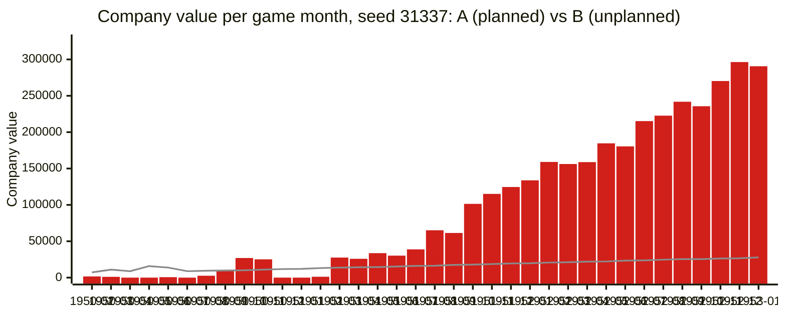
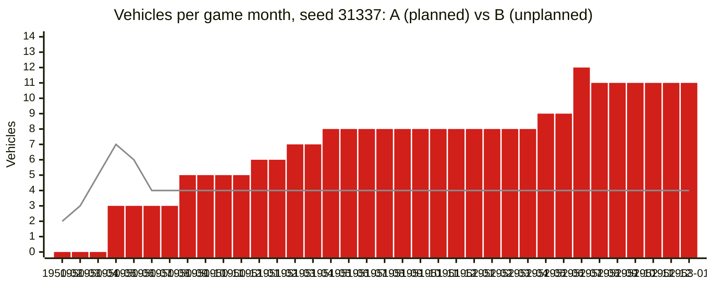

# Duel in one game: planned bot vs unplanned (seed 31337, 36 months)

Generated by `tools/research/mcp-duel` (transfer yards with a four-tile corridor and a fallback station (bridge 6f78532)). One game, one map: company 1 is PrismaticAI started from
the planner's portfolio (by the panel), company 2 the same AI started without a plan right after it.
Both compete for the same towns and industries. Values come from the console's `companies` command.

- planner: the passenger rail pair (score 113003) is built after 6 freight line(s) that score more
- planner: Coal by rail Coal Mine -> Power Station, 190.0 tiles, profit 9677.0/month, score 163280.0 (line 6, built when the money allows)
- planner: Wood by rail Forest -> Sawmill, 177.0 tiles, profit 10783.0/month, score 164447.0 (line 5, built when the money allows)
- planner: Coal by rail Coal Mine -> Power Station, 153.0 tiles, profit 10758.0/month, score 166533.0 (line 4, built when the money allows)
- planner: Wood by rail Forest -> Sawmill, 238.0 tiles, profit 14187.0/month, score 215012.0 (line 3, built when the money allows)
- planner: Coal by rail Coal Mine -> Power Station, 227.0 tiles, profit 14079.0/month, score 240547.0 (line 2, built when the money allows)
- planner: Coal by rail Coal Mine -> Power Station, 212.0 tiles, profit 14568.0/month, score 252708.0
- planner: passengers by rail New Prunpool - Little Bonnley Market, score 113003.0
- planner: 13 rail line(s) priced on the map by track-planning, 13 with a route: 207 pieces 16639, 189 pieces 14325, 224 pieces 17070, 231 pieces 18345, 150 pieces 11385, 170 pieces 13725, 187 pieces 15075, 131 pieces 11569, 196 pieces 15943, 234 pieces 17895, 157 pieces 12328, 175 pieces 14391, 173 pieces 13528
- planner portfolio by algoglyph knapsack-dp: 5 investment(s), total score 753612.0, 295k of 300k

**Winner: A (planned).** Final company value: A 290634 vs B 27853.

<!-- duel-charts:begin -->
<!-- generated by tools/research/mcp-duel from this record's JSON; `mcp-duel --render` rewrites it, `mcp-duel --render --check` fails while it is stale -->

<!-- duel-charts:end -->

| Month | Date | A (planned) value | B (unplanned) value |
|---|---|---|---|
| 1 | 1950-02-06 | 1610 | 7172 |
| 2 | 1950-03-08 | 1085 | 11015 |
| 3 | 1950-04-08 | 1 | 8797 |
| 4 | 1950-05-09 | 1 | 15872 |
| 5 | 1950-06-08 | 631 | 13845 |
| 6 | 1950-07-09 | 1 | 8840 |
| 7 | 1950-08-08 | 2586 | 9449 |
| 8 | 1950-09-08 | 9136 | 9862 |
| 9 | 1950-10-09 | 26960 | 10115 |
| 10 | 1950-11-08 | 25144 | 10994 |
| 11 | 1950-12-09 | 1 | 11793 |
| 12 | 1951-01-08 | 1 | 12017 |
| 13 | 1951-02-08 | 1196 | 13134 |
| 14 | 1951-03-10 | 27567 | 13807 |
| 15 | 1951-04-10 | 25900 | 14306 |
| 16 | 1951-05-11 | 33659 | 14484 |
| 17 | 1951-06-10 | 30226 | 15269 |
| 18 | 1951-07-11 | 38848 | 16144 |
| 19 | 1951-08-10 | 65120 | 16386 |
| 20 | 1951-09-10 | 61402 | 17538 |
| 21 | 1951-10-11 | 101406 | 17848 |
| 22 | 1951-11-10 | 115132 | 18647 |
| 23 | 1951-12-11 | 124587 | 19516 |
| 24 | 1952-01-10 | 133773 | 19759 |
| 25 | 1952-02-10 | 159063 | 20719 |
| 26 | 1952-03-02 | 156196 | 21145 |
| 27 | 1952-04-01 | 158796 | 21981 |
| 28 | 1952-05-02 | 184656 | 22255 |
| 29 | 1952-06-01 | 180446 | 23375 |
| 30 | 1952-07-02 | 215211 | 23774 |
| 31 | 1952-08-01 | 222689 | 24660 |
| 32 | 1952-09-01 | 241838 | 25524 |
| 33 | 1952-10-02 | 235667 | 25464 |
| 34 | 1952-11-01 | 270311 | 26319 |
| 35 | 1952-12-02 | 296380 | 26681 |
| 36 | 1953-01-01 | 290634 | 27853 |

## Reading this result

A won 290634 to 27853: **48% below** the best run on this map (duel-20261117T041705: 558331, the same plan
without transfer yards). This was the second try at transfer yards (bridge 6f78532: a four-tile
corridor kept for the second platform, and a fallback station).

- **Lentburg Sawmill worked again.** The second wood line took the kept platform (163 tiles).
- **Drinbourne Power Station still failed to reach the kept platform** (no route after 67445 nodes).
  This time the fallback built the line to a station of its own (185 tiles), so all seven lines were
  built.
- **But the Pintborough–Drinbourne line lost its train twice** around month 29. The bot replaced it
  twice ("had no train", replacement 1 and 2 of 2), so A ran nine trains for seven lines, and its money
  fell from 233892 to 20571 between months 29 and 30. No earlier duel in `research/results` has
  "had no train". It came with the new fallback at the same station, but the log does not show the
  mechanism, so this is not proven.

A bug found while reading: `RemoveRailStation` derives its step from `end - tile`. That is 0 for a
station that faces the other way (`end == tile`), so the cleanup after a failed line demolished one
tile of three. Fixed in the bridge.

**Decision:** in this form, transfer yards cost 16% and 48% on this seed. Bridge 3840fc6 and 6f78532 are
reverted, so the bot builds as in the best run; the next try needs the corridor proved offline first.

| Month | A (this run) | Trains | A (041705, no yards) | B (this run) |
|---|---|---|---|---|
| 12 | 1 | 3 | 1 | 12017 |
| 24 | 133773 | 5 | 207792 | 19759 |
| 30 | 215211 | 9 | 382428 | 23774 |
| 36 | **290634** | 9 | 558331 | 27853 |
