# Duel in one game: planned bot vs unplanned (seed 31337, 120 months)

Generated by `tools/research/mcp-duel` (own lines over ten years (own_lines=8 for the planned bot), budget 250000; pair with the same run without own lines). One game, one map: company 1 is PrismaticAI started from
the planner's portfolio (by the panel) with extra settings own_lines=8, company 2 the same AI started without a plan right after it.
Both compete for the same towns and industries. Values come from the console's `companies` command.

- planner: the passenger rail pair (score 113003) is built after 13 freight line(s) that score more
- planner: Wood by rail Forest -> Sawmill, 236.0 tiles, profit 8455.0/month, score 130726.0 (line 13, built when the money allows)
- planner: Grain by rail Farm -> Factory, 241.0 tiles, profit 9592.0/month, score 131308.0 (line 12, built when the money allows)
- planner: Wood by rail Forest -> Sawmill, 177.0 tiles, profit 8377.0/month, score 132720.0 (line 11, built when the money allows)
- planner: Wood by rail Forest -> Sawmill, 233.0 tiles, profit 10231.0/month, score 146588.0 (line 10, built when the money allows)
- planner: Coal by rail Coal Mine -> Power Station, 193.0 tiles, profit 9261.0/month, score 153671.0 (line 9, built when the money allows)
- planner: Coal by rail Coal Mine -> Power Station, 242.0 tiles, profit 9727.0/month, score 161312.0 (line 8, built when the money allows)
- planner: Coal by rail Coal Mine -> Power Station, 221.0 tiles, profit 9709.0/month, score 161537.0 (line 7, built when the money allows)
- planner: Coal by rail Coal Mine -> Power Station, 190.0 tiles, profit 9677.0/month, score 163280.0 (line 6, built when the money allows)
- planner: Wood by rail Forest -> Sawmill, 177.0 tiles, profit 10783.0/month, score 164447.0 (line 5, built when the money allows)
- planner: Coal by rail Coal Mine -> Power Station, 153.0 tiles, profit 10758.0/month, score 166533.0 (line 4, built when the money allows)
- planner: Wood by rail Forest -> Sawmill, 238.0 tiles, profit 14187.0/month, score 215012.0 (line 3, built when the money allows)
- planner: Coal by rail Coal Mine -> Power Station, 227.0 tiles, profit 14079.0/month, score 240547.0 (line 2, built when the money allows)
- planner: Coal by rail Coal Mine -> Power Station, 212.0 tiles, profit 14568.0/month, score 252708.0
- planner: passengers by rail New Prunpool - Little Bonnley Market, score 113003.0
- planner: 21 rail line(s) priced on the map by track-planning, 21 with a route: 207 pieces 16639, 189 pieces 14325, 224 pieces 17070, 231 pieces 18345, 150 pieces 11385, 170 pieces 13725, 187 pieces 15075, 131 pieces 11569, 210 pieces 17589, 237 pieces 18238, 194 pieces 14700, 157 pieces 12283, 238 pieces 18328, 182 pieces 14203, 238 pieces 18195, 229 pieces 18075, 196 pieces 15943, 234 pieces 17895, 157 pieces 12328, 175 pieces 14391, 173 pieces 13528
- planner portfolio by algoglyph knapsack-dp: 5 investment(s), total score 753612.0, 295k of 300k

**Winner: A (planned).** Final company value: A 4811581 vs B 39873.

```mermaid
---
config:
  xyChart:
    width: 900
    height: 360
  themeVariables:
    xyChart:
      plotColorPalette: "#d11f1a, #8a8a8a, #0b0b0b, #ece4d6"
---
xychart-beta
    title "Company value per game month, seed 31337: A (planned) vs B (unplanned)"
    x-axis ["1950-03", "1950-04", "1950-05", "1950-06", "1950-07", "1950-08", "1950-09", "1950-10", "1950-11", "1950-12", "1951-01", "1951-02", "1951-03", "1951-04", "1951-05", "1951-06", "1951-07", "1951-08", "1951-09", "1951-10", "1951-11", "1951-12", "1952-01", "1952-02", "1952-03", "1952-04", "1952-05", "1952-06", "1952-07", "1952-08", "1952-09", "1952-10", "1952-11", "1952-12", "1953-01", "1953-02", "1953-03", "1953-04", "1953-05", "1953-06", "1953-07", "1953-08", "1953-09", "1953-10", "1953-11", "1953-12", "1954-01", "1954-02", "1954-03", "1954-04", "1954-05", "1954-06", "1954-07", "1954-08", "1954-09", "1954-10", "1954-11", "1954-12", "1955-01", "1955-02", "1955-03", "1955-04", "1955-05", "1955-06", "1955-07", "1955-08", "1955-09", "1955-10", "1955-11", "1955-12", "1956-01", "1956-02", "1956-03", "1956-04", "1956-05", "1956-06", "1956-07", "1956-08", "1956-09", "1956-10", "1956-11", "1956-12", "1957-01", "1957-02", "1957-03", "1957-04", "1957-05", "1957-06", "1957-07", "1957-08", "1957-09", "1957-10", "1957-11", "1957-12", "1958-01", "1958-02", "1958-03", "1958-04", "1958-05", "1958-06", "1958-07", "1958-08", "1958-09", "1958-10", "1958-11", "1958-12", "1959-01", "1959-02", "1959-03", "1959-04", "1959-05", "1959-06", "1959-07", "1959-08", "1959-09", "1959-10", "1959-11", "1959-12", "1960-01", "1960-02"]
    %% series: A (planned) | B (unplanned)
    %% links: duel-20261117T155736-seed31337.md?col=Month&filter=1 | duel-20261117T155736-seed31337.md?col=Month&filter=2 | duel-20261117T155736-seed31337.md?col=Month&filter=3 | duel-20261117T155736-seed31337.md?col=Month&filter=4 | duel-20261117T155736-seed31337.md?col=Month&filter=5 | duel-20261117T155736-seed31337.md?col=Month&filter=6 | duel-20261117T155736-seed31337.md?col=Month&filter=7 | duel-20261117T155736-seed31337.md?col=Month&filter=8 | duel-20261117T155736-seed31337.md?col=Month&filter=9 | duel-20261117T155736-seed31337.md?col=Month&filter=10 | duel-20261117T155736-seed31337.md?col=Month&filter=11 | duel-20261117T155736-seed31337.md?col=Month&filter=12 | duel-20261117T155736-seed31337.md?col=Month&filter=13 | duel-20261117T155736-seed31337.md?col=Month&filter=14 | duel-20261117T155736-seed31337.md?col=Month&filter=15 | duel-20261117T155736-seed31337.md?col=Month&filter=16 | duel-20261117T155736-seed31337.md?col=Month&filter=17 | duel-20261117T155736-seed31337.md?col=Month&filter=18 | duel-20261117T155736-seed31337.md?col=Month&filter=19 | duel-20261117T155736-seed31337.md?col=Month&filter=20 | duel-20261117T155736-seed31337.md?col=Month&filter=21 | duel-20261117T155736-seed31337.md?col=Month&filter=22 | duel-20261117T155736-seed31337.md?col=Month&filter=23 | duel-20261117T155736-seed31337.md?col=Month&filter=24 | duel-20261117T155736-seed31337.md?col=Month&filter=25 | duel-20261117T155736-seed31337.md?col=Month&filter=26 | duel-20261117T155736-seed31337.md?col=Month&filter=27 | duel-20261117T155736-seed31337.md?col=Month&filter=28 | duel-20261117T155736-seed31337.md?col=Month&filter=29 | duel-20261117T155736-seed31337.md?col=Month&filter=30 | duel-20261117T155736-seed31337.md?col=Month&filter=31 | duel-20261117T155736-seed31337.md?col=Month&filter=32 | duel-20261117T155736-seed31337.md?col=Month&filter=33 | duel-20261117T155736-seed31337.md?col=Month&filter=34 | duel-20261117T155736-seed31337.md?col=Month&filter=35 | duel-20261117T155736-seed31337.md?col=Month&filter=36 | duel-20261117T155736-seed31337.md?col=Month&filter=37 | duel-20261117T155736-seed31337.md?col=Month&filter=38 | duel-20261117T155736-seed31337.md?col=Month&filter=39 | duel-20261117T155736-seed31337.md?col=Month&filter=40 | duel-20261117T155736-seed31337.md?col=Month&filter=41 | duel-20261117T155736-seed31337.md?col=Month&filter=42 | duel-20261117T155736-seed31337.md?col=Month&filter=43 | duel-20261117T155736-seed31337.md?col=Month&filter=44 | duel-20261117T155736-seed31337.md?col=Month&filter=45 | duel-20261117T155736-seed31337.md?col=Month&filter=46 | duel-20261117T155736-seed31337.md?col=Month&filter=47 | duel-20261117T155736-seed31337.md?col=Month&filter=48 | duel-20261117T155736-seed31337.md?col=Month&filter=49 | duel-20261117T155736-seed31337.md?col=Month&filter=50 | duel-20261117T155736-seed31337.md?col=Month&filter=51 | duel-20261117T155736-seed31337.md?col=Month&filter=52 | duel-20261117T155736-seed31337.md?col=Month&filter=53 | duel-20261117T155736-seed31337.md?col=Month&filter=54 | duel-20261117T155736-seed31337.md?col=Month&filter=55 | duel-20261117T155736-seed31337.md?col=Month&filter=56 | duel-20261117T155736-seed31337.md?col=Month&filter=57 | duel-20261117T155736-seed31337.md?col=Month&filter=58 | duel-20261117T155736-seed31337.md?col=Month&filter=59 | duel-20261117T155736-seed31337.md?col=Month&filter=60 | duel-20261117T155736-seed31337.md?col=Month&filter=61 | duel-20261117T155736-seed31337.md?col=Month&filter=62 | duel-20261117T155736-seed31337.md?col=Month&filter=63 | duel-20261117T155736-seed31337.md?col=Month&filter=64 | duel-20261117T155736-seed31337.md?col=Month&filter=65 | duel-20261117T155736-seed31337.md?col=Month&filter=66 | duel-20261117T155736-seed31337.md?col=Month&filter=67 | duel-20261117T155736-seed31337.md?col=Month&filter=68 | duel-20261117T155736-seed31337.md?col=Month&filter=69 | duel-20261117T155736-seed31337.md?col=Month&filter=70 | duel-20261117T155736-seed31337.md?col=Month&filter=71 | duel-20261117T155736-seed31337.md?col=Month&filter=72 | duel-20261117T155736-seed31337.md?col=Month&filter=73 | duel-20261117T155736-seed31337.md?col=Month&filter=74 | duel-20261117T155736-seed31337.md?col=Month&filter=75 | duel-20261117T155736-seed31337.md?col=Month&filter=76 | duel-20261117T155736-seed31337.md?col=Month&filter=77 | duel-20261117T155736-seed31337.md?col=Month&filter=78 | duel-20261117T155736-seed31337.md?col=Month&filter=79 | duel-20261117T155736-seed31337.md?col=Month&filter=80 | duel-20261117T155736-seed31337.md?col=Month&filter=81 | duel-20261117T155736-seed31337.md?col=Month&filter=82 | duel-20261117T155736-seed31337.md?col=Month&filter=83 | duel-20261117T155736-seed31337.md?col=Month&filter=84 | duel-20261117T155736-seed31337.md?col=Month&filter=85 | duel-20261117T155736-seed31337.md?col=Month&filter=86 | duel-20261117T155736-seed31337.md?col=Month&filter=87 | duel-20261117T155736-seed31337.md?col=Month&filter=88 | duel-20261117T155736-seed31337.md?col=Month&filter=89 | duel-20261117T155736-seed31337.md?col=Month&filter=90 | duel-20261117T155736-seed31337.md?col=Month&filter=91 | duel-20261117T155736-seed31337.md?col=Month&filter=92 | duel-20261117T155736-seed31337.md?col=Month&filter=93 | duel-20261117T155736-seed31337.md?col=Month&filter=94 | duel-20261117T155736-seed31337.md?col=Month&filter=95 | duel-20261117T155736-seed31337.md?col=Month&filter=96 | duel-20261117T155736-seed31337.md?col=Month&filter=97 | duel-20261117T155736-seed31337.md?col=Month&filter=98 | duel-20261117T155736-seed31337.md?col=Month&filter=99 | duel-20261117T155736-seed31337.md?col=Month&filter=100 | duel-20261117T155736-seed31337.md?col=Month&filter=101 | duel-20261117T155736-seed31337.md?col=Month&filter=102 | duel-20261117T155736-seed31337.md?col=Month&filter=103 | duel-20261117T155736-seed31337.md?col=Month&filter=104 | duel-20261117T155736-seed31337.md?col=Month&filter=105 | duel-20261117T155736-seed31337.md?col=Month&filter=106 | duel-20261117T155736-seed31337.md?col=Month&filter=107 | duel-20261117T155736-seed31337.md?col=Month&filter=108 | duel-20261117T155736-seed31337.md?col=Month&filter=109 | duel-20261117T155736-seed31337.md?col=Month&filter=110 | duel-20261117T155736-seed31337.md?col=Month&filter=111 | duel-20261117T155736-seed31337.md?col=Month&filter=112 | duel-20261117T155736-seed31337.md?col=Month&filter=113 | duel-20261117T155736-seed31337.md?col=Month&filter=114 | duel-20261117T155736-seed31337.md?col=Month&filter=115 | duel-20261117T155736-seed31337.md?col=Month&filter=116 | duel-20261117T155736-seed31337.md?col=Month&filter=117 | duel-20261117T155736-seed31337.md?col=Month&filter=118 | duel-20261117T155736-seed31337.md?col=Month&filter=119 | duel-20261117T155736-seed31337.md?col=Month&filter=120
    y-axis "Company value" 0 --> 5290000
    bar [1, 1, 1, 1, 1, 1, 6543, 15521, 19146, 50195, 48267, 71180, 102768, 100078, 111350, 136151, 143328, 158978, 214729, 216477, 271171, 313894, 314207, 329685, 396638, 398982, 415332, 519517, 543751, 537435, 652231, 710937, 736404, 793011, 859603, 959722, 1009552, 1046123, 1085898, 1158695, 1201510, 1278619, 1341251, 1372170, 1410062, 1455466, 1496181, 1544890, 1599628, 1626703, 1724443, 1753480, 1772636, 1844246, 1882567, 1920293, 1975665, 2031011, 2076432, 2124791, 2142738, 2189612, 2279158, 2308038, 2345597, 2360573, 2398124, 2486477, 2541627, 2601506, 2613167, 2648809, 2708570, 2743594, 2816909, 2853393, 2883438, 2935060, 3001712, 3046159, 3083295, 3113203, 3137561, 3180834, 3224682, 3286353, 3311946, 3409507, 3426564, 3467091, 3515728, 3569102, 3609412, 3646104, 3725705, 3751021, 3783638, 3821607, 3908086, 3907511, 3976017, 4015934, 4058123, 4124839, 4150244, 4170254, 4242902, 4305637, 4390759, 4397088, 4416290, 4459519, 4546587, 4589416, 4592502, 4704188, 4738489, 4767387, 4804788, 4811581]
    line [13770, 11156, 15784, 13528, 8406, 8680, 9424, 9637, 10446, 11010, 11836, 12611, 12984, 13794, 14053, 14859, 15072, 15897, 16125, 17272, 18134, 18370, 19123, 19437, 19914, 15411, 15372, 15905, 15901, 16448, 16433, 17020, 17568, 17845, 18421, 18412, 19016, 18994, 19579, 20163, 20324, 20634, 20720, 21312, 21659, 21697, 22137, 22194, 22840, 22701, 23052, 23514, 23634, 23772, 24168, 24212, 24387, 24658, 25300, 25362, 25417, 25941, 26019, 26032, 26837, 26956, 27152, 27246, 27832, 28393, 28502, 29035, 29142, 29750, 29932, 30648, 30919, 30979, 31675, 32211, 32389, 32931, 33010, 33372, 33510, 34111, 34308, 34365, 35227, 35373, 35778, 35889, 36568, 36972, 36848, 37757, 37905, 38149, 36445, 36525, 36740, 36872, 37030, 37230, 37292, 37485, 37571, 37849, 38077, 38152, 38364, 38432, 38703, 38942, 39054, 39172, 39282, 39654, 39838, 39873]
```

```mermaid
---
config:
  xyChart:
    width: 900
    height: 360
  themeVariables:
    xyChart:
      plotColorPalette: "#d11f1a, #8a8a8a, #0b0b0b, #ece4d6"
---
xychart-beta
    title "Vehicles per game month, seed 31337: A (planned) vs B (unplanned)"
    x-axis ["1950-03", "1950-04", "1950-05", "1950-06", "1950-07", "1950-08", "1950-09", "1950-10", "1950-11", "1950-12", "1951-01", "1951-02", "1951-03", "1951-04", "1951-05", "1951-06", "1951-07", "1951-08", "1951-09", "1951-10", "1951-11", "1951-12", "1952-01", "1952-02", "1952-03", "1952-04", "1952-05", "1952-06", "1952-07", "1952-08", "1952-09", "1952-10", "1952-11", "1952-12", "1953-01", "1953-02", "1953-03", "1953-04", "1953-05", "1953-06", "1953-07", "1953-08", "1953-09", "1953-10", "1953-11", "1953-12", "1954-01", "1954-02", "1954-03", "1954-04", "1954-05", "1954-06", "1954-07", "1954-08", "1954-09", "1954-10", "1954-11", "1954-12", "1955-01", "1955-02", "1955-03", "1955-04", "1955-05", "1955-06", "1955-07", "1955-08", "1955-09", "1955-10", "1955-11", "1955-12", "1956-01", "1956-02", "1956-03", "1956-04", "1956-05", "1956-06", "1956-07", "1956-08", "1956-09", "1956-10", "1956-11", "1956-12", "1957-01", "1957-02", "1957-03", "1957-04", "1957-05", "1957-06", "1957-07", "1957-08", "1957-09", "1957-10", "1957-11", "1957-12", "1958-01", "1958-02", "1958-03", "1958-04", "1958-05", "1958-06", "1958-07", "1958-08", "1958-09", "1958-10", "1958-11", "1958-12", "1959-01", "1959-02", "1959-03", "1959-04", "1959-05", "1959-06", "1959-07", "1959-08", "1959-09", "1959-10", "1959-11", "1959-12", "1960-01", "1960-02"]
    %% series: A (planned) | B (unplanned)
    %% links: duel-20261117T155736-seed31337.md?col=Month&filter=1 | duel-20261117T155736-seed31337.md?col=Month&filter=2 | duel-20261117T155736-seed31337.md?col=Month&filter=3 | duel-20261117T155736-seed31337.md?col=Month&filter=4 | duel-20261117T155736-seed31337.md?col=Month&filter=5 | duel-20261117T155736-seed31337.md?col=Month&filter=6 | duel-20261117T155736-seed31337.md?col=Month&filter=7 | duel-20261117T155736-seed31337.md?col=Month&filter=8 | duel-20261117T155736-seed31337.md?col=Month&filter=9 | duel-20261117T155736-seed31337.md?col=Month&filter=10 | duel-20261117T155736-seed31337.md?col=Month&filter=11 | duel-20261117T155736-seed31337.md?col=Month&filter=12 | duel-20261117T155736-seed31337.md?col=Month&filter=13 | duel-20261117T155736-seed31337.md?col=Month&filter=14 | duel-20261117T155736-seed31337.md?col=Month&filter=15 | duel-20261117T155736-seed31337.md?col=Month&filter=16 | duel-20261117T155736-seed31337.md?col=Month&filter=17 | duel-20261117T155736-seed31337.md?col=Month&filter=18 | duel-20261117T155736-seed31337.md?col=Month&filter=19 | duel-20261117T155736-seed31337.md?col=Month&filter=20 | duel-20261117T155736-seed31337.md?col=Month&filter=21 | duel-20261117T155736-seed31337.md?col=Month&filter=22 | duel-20261117T155736-seed31337.md?col=Month&filter=23 | duel-20261117T155736-seed31337.md?col=Month&filter=24 | duel-20261117T155736-seed31337.md?col=Month&filter=25 | duel-20261117T155736-seed31337.md?col=Month&filter=26 | duel-20261117T155736-seed31337.md?col=Month&filter=27 | duel-20261117T155736-seed31337.md?col=Month&filter=28 | duel-20261117T155736-seed31337.md?col=Month&filter=29 | duel-20261117T155736-seed31337.md?col=Month&filter=30 | duel-20261117T155736-seed31337.md?col=Month&filter=31 | duel-20261117T155736-seed31337.md?col=Month&filter=32 | duel-20261117T155736-seed31337.md?col=Month&filter=33 | duel-20261117T155736-seed31337.md?col=Month&filter=34 | duel-20261117T155736-seed31337.md?col=Month&filter=35 | duel-20261117T155736-seed31337.md?col=Month&filter=36 | duel-20261117T155736-seed31337.md?col=Month&filter=37 | duel-20261117T155736-seed31337.md?col=Month&filter=38 | duel-20261117T155736-seed31337.md?col=Month&filter=39 | duel-20261117T155736-seed31337.md?col=Month&filter=40 | duel-20261117T155736-seed31337.md?col=Month&filter=41 | duel-20261117T155736-seed31337.md?col=Month&filter=42 | duel-20261117T155736-seed31337.md?col=Month&filter=43 | duel-20261117T155736-seed31337.md?col=Month&filter=44 | duel-20261117T155736-seed31337.md?col=Month&filter=45 | duel-20261117T155736-seed31337.md?col=Month&filter=46 | duel-20261117T155736-seed31337.md?col=Month&filter=47 | duel-20261117T155736-seed31337.md?col=Month&filter=48 | duel-20261117T155736-seed31337.md?col=Month&filter=49 | duel-20261117T155736-seed31337.md?col=Month&filter=50 | duel-20261117T155736-seed31337.md?col=Month&filter=51 | duel-20261117T155736-seed31337.md?col=Month&filter=52 | duel-20261117T155736-seed31337.md?col=Month&filter=53 | duel-20261117T155736-seed31337.md?col=Month&filter=54 | duel-20261117T155736-seed31337.md?col=Month&filter=55 | duel-20261117T155736-seed31337.md?col=Month&filter=56 | duel-20261117T155736-seed31337.md?col=Month&filter=57 | duel-20261117T155736-seed31337.md?col=Month&filter=58 | duel-20261117T155736-seed31337.md?col=Month&filter=59 | duel-20261117T155736-seed31337.md?col=Month&filter=60 | duel-20261117T155736-seed31337.md?col=Month&filter=61 | duel-20261117T155736-seed31337.md?col=Month&filter=62 | duel-20261117T155736-seed31337.md?col=Month&filter=63 | duel-20261117T155736-seed31337.md?col=Month&filter=64 | duel-20261117T155736-seed31337.md?col=Month&filter=65 | duel-20261117T155736-seed31337.md?col=Month&filter=66 | duel-20261117T155736-seed31337.md?col=Month&filter=67 | duel-20261117T155736-seed31337.md?col=Month&filter=68 | duel-20261117T155736-seed31337.md?col=Month&filter=69 | duel-20261117T155736-seed31337.md?col=Month&filter=70 | duel-20261117T155736-seed31337.md?col=Month&filter=71 | duel-20261117T155736-seed31337.md?col=Month&filter=72 | duel-20261117T155736-seed31337.md?col=Month&filter=73 | duel-20261117T155736-seed31337.md?col=Month&filter=74 | duel-20261117T155736-seed31337.md?col=Month&filter=75 | duel-20261117T155736-seed31337.md?col=Month&filter=76 | duel-20261117T155736-seed31337.md?col=Month&filter=77 | duel-20261117T155736-seed31337.md?col=Month&filter=78 | duel-20261117T155736-seed31337.md?col=Month&filter=79 | duel-20261117T155736-seed31337.md?col=Month&filter=80 | duel-20261117T155736-seed31337.md?col=Month&filter=81 | duel-20261117T155736-seed31337.md?col=Month&filter=82 | duel-20261117T155736-seed31337.md?col=Month&filter=83 | duel-20261117T155736-seed31337.md?col=Month&filter=84 | duel-20261117T155736-seed31337.md?col=Month&filter=85 | duel-20261117T155736-seed31337.md?col=Month&filter=86 | duel-20261117T155736-seed31337.md?col=Month&filter=87 | duel-20261117T155736-seed31337.md?col=Month&filter=88 | duel-20261117T155736-seed31337.md?col=Month&filter=89 | duel-20261117T155736-seed31337.md?col=Month&filter=90 | duel-20261117T155736-seed31337.md?col=Month&filter=91 | duel-20261117T155736-seed31337.md?col=Month&filter=92 | duel-20261117T155736-seed31337.md?col=Month&filter=93 | duel-20261117T155736-seed31337.md?col=Month&filter=94 | duel-20261117T155736-seed31337.md?col=Month&filter=95 | duel-20261117T155736-seed31337.md?col=Month&filter=96 | duel-20261117T155736-seed31337.md?col=Month&filter=97 | duel-20261117T155736-seed31337.md?col=Month&filter=98 | duel-20261117T155736-seed31337.md?col=Month&filter=99 | duel-20261117T155736-seed31337.md?col=Month&filter=100 | duel-20261117T155736-seed31337.md?col=Month&filter=101 | duel-20261117T155736-seed31337.md?col=Month&filter=102 | duel-20261117T155736-seed31337.md?col=Month&filter=103 | duel-20261117T155736-seed31337.md?col=Month&filter=104 | duel-20261117T155736-seed31337.md?col=Month&filter=105 | duel-20261117T155736-seed31337.md?col=Month&filter=106 | duel-20261117T155736-seed31337.md?col=Month&filter=107 | duel-20261117T155736-seed31337.md?col=Month&filter=108 | duel-20261117T155736-seed31337.md?col=Month&filter=109 | duel-20261117T155736-seed31337.md?col=Month&filter=110 | duel-20261117T155736-seed31337.md?col=Month&filter=111 | duel-20261117T155736-seed31337.md?col=Month&filter=112 | duel-20261117T155736-seed31337.md?col=Month&filter=113 | duel-20261117T155736-seed31337.md?col=Month&filter=114 | duel-20261117T155736-seed31337.md?col=Month&filter=115 | duel-20261117T155736-seed31337.md?col=Month&filter=116 | duel-20261117T155736-seed31337.md?col=Month&filter=117 | duel-20261117T155736-seed31337.md?col=Month&filter=118 | duel-20261117T155736-seed31337.md?col=Month&filter=119 | duel-20261117T155736-seed31337.md?col=Month&filter=120
    y-axis "Vehicles" 0 --> 26
    bar [1, 3, 5, 6, 7, 8, 7, 7, 8, 8, 9, 9, 9, 10, 10, 10, 11, 12, 12, 13, 14, 15, 16, 16, 17, 18, 19, 20, 20, 21, 23, 23, 23, 23, 23, 23, 23, 23, 23, 23, 23, 23, 23, 23, 23, 23, 23, 23, 23, 23, 23, 23, 22, 22, 22, 22, 22, 22, 22, 22, 22, 22, 22, 22, 22, 22, 22, 22, 22, 22, 22, 22, 22, 22, 22, 22, 22, 22, 22, 22, 22, 22, 22, 21, 21, 21, 21, 21, 21, 21, 21, 21, 21, 21, 21, 21, 21, 21, 21, 20, 20, 20, 20, 20, 20, 20, 20, 20, 20, 20, 20, 20, 20, 20, 20, 20, 20, 19, 19, 19]
    line [3, 5, 7, 6, 4, 4, 4, 4, 4, 4, 4, 4, 4, 4, 4, 4, 4, 4, 4, 4, 4, 4, 4, 4, 4, 3, 3, 3, 3, 3, 3, 3, 3, 3, 3, 3, 3, 3, 3, 3, 3, 3, 3, 3, 3, 3, 3, 3, 3, 3, 3, 3, 3, 3, 3, 3, 3, 3, 3, 3, 3, 3, 3, 3, 3, 3, 3, 3, 3, 3, 3, 3, 3, 3, 3, 3, 3, 3, 3, 3, 3, 3, 3, 3, 3, 3, 3, 3, 3, 3, 3, 3, 3, 3, 3, 3, 3, 3, 2, 2, 2, 2, 2, 2, 2, 2, 2, 2, 2, 2, 2, 2, 2, 2, 2, 2, 2, 2, 2, 2]
```

<!-- duel-charts:begin -->
<!-- generated by tools/research/mcp-duel from this record's JSON; `mcp-duel --render` rewrites it, `mcp-duel --render --check` fails while it is stale -->

<!-- duel-charts:end -->

| Month | Date | A (planned) value | B (unplanned) value |
|---|---|---|---|
| 1 | 1950-03-10 | 1 | 13770 |
| 2 | 1950-04-09 | 1 | 11156 |
| 3 | 1950-05-10 | 1 | 15784 |
| 4 | 1950-06-10 | 1 | 13528 |
| 5 | 1950-07-10 | 1 | 8406 |
| 6 | 1950-08-10 | 1 | 8680 |
| 7 | 1950-09-09 | 6543 | 9424 |
| 8 | 1950-10-10 | 15521 | 9637 |
| 9 | 1950-11-10 | 19146 | 10446 |
| 10 | 1950-12-10 | 50195 | 11010 |
| 11 | 1951-01-10 | 48267 | 11836 |
| 12 | 1951-02-09 | 71180 | 12611 |
| 13 | 1951-03-02 | 102768 | 12984 |
| 14 | 1951-04-02 | 100078 | 13794 |
| 15 | 1951-05-02 | 111350 | 14053 |
| 16 | 1951-06-02 | 136151 | 14859 |
| 17 | 1951-07-02 | 143328 | 15072 |
| 18 | 1951-08-02 | 158978 | 15897 |
| 19 | 1951-09-01 | 214729 | 16125 |
| 20 | 1951-10-02 | 216477 | 17272 |
| 21 | 1951-11-02 | 271171 | 18134 |
| 22 | 1951-12-02 | 313894 | 18370 |
| 23 | 1952-01-02 | 314207 | 19123 |
| 24 | 1952-02-01 | 329685 | 19437 |
| 25 | 1952-03-03 | 396638 | 19914 |
| 26 | 1952-04-02 | 398982 | 15411 |
| 27 | 1952-05-03 | 415332 | 15372 |
| 28 | 1952-06-03 | 519517 | 15905 |
| 29 | 1952-07-03 | 543751 | 15901 |
| 30 | 1952-08-03 | 537435 | 16448 |
| 31 | 1952-09-02 | 652231 | 16433 |
| 32 | 1952-10-03 | 710937 | 17020 |
| 33 | 1952-11-03 | 736404 | 17568 |
| 34 | 1952-12-03 | 793011 | 17845 |
| 35 | 1953-01-03 | 859603 | 18421 |
| 36 | 1953-02-02 | 959722 | 18412 |
| 37 | 1953-03-05 | 1009552 | 19016 |
| 38 | 1953-04-04 | 1046123 | 18994 |
| 39 | 1953-05-05 | 1085898 | 19579 |
| 40 | 1953-06-05 | 1158695 | 20163 |
| 41 | 1953-07-05 | 1201510 | 20324 |
| 42 | 1953-08-05 | 1278619 | 20634 |
| 43 | 1953-09-04 | 1341251 | 20720 |
| 44 | 1953-10-05 | 1372170 | 21312 |
| 45 | 1953-11-05 | 1410062 | 21659 |
| 46 | 1953-12-05 | 1455466 | 21697 |
| 47 | 1954-01-05 | 1496181 | 22137 |
| 48 | 1954-02-04 | 1544890 | 22194 |
| 49 | 1954-03-07 | 1599628 | 22840 |
| 50 | 1954-04-06 | 1626703 | 22701 |
| 51 | 1954-05-07 | 1724443 | 23052 |
| 52 | 1954-06-07 | 1753480 | 23514 |
| 53 | 1954-07-07 | 1772636 | 23634 |
| 54 | 1954-08-07 | 1844246 | 23772 |
| 55 | 1954-09-07 | 1882567 | 24168 |
| 56 | 1954-10-07 | 1920293 | 24212 |
| 57 | 1954-11-07 | 1975665 | 24387 |
| 58 | 1954-12-07 | 2031011 | 24658 |
| 59 | 1955-01-07 | 2076432 | 25300 |
| 60 | 1955-02-07 | 2124791 | 25362 |
| 61 | 1955-03-09 | 2142738 | 25417 |
| 62 | 1955-04-09 | 2189612 | 25941 |
| 63 | 1955-05-09 | 2279158 | 26019 |
| 64 | 1955-06-09 | 2308038 | 26032 |
| 65 | 1955-07-09 | 2345597 | 26837 |
| 66 | 1955-08-09 | 2360573 | 26956 |
| 67 | 1955-09-09 | 2398124 | 27152 |
| 68 | 1955-10-09 | 2486477 | 27246 |
| 69 | 1955-11-09 | 2541627 | 27832 |
| 70 | 1955-12-09 | 2601506 | 28393 |
| 71 | 1956-01-09 | 2613167 | 28502 |
| 72 | 1956-02-08 | 2648809 | 29035 |
| 73 | 1956-03-10 | 2708570 | 29142 |
| 74 | 1956-04-10 | 2743594 | 29750 |
| 75 | 1956-05-10 | 2816909 | 29932 |
| 76 | 1956-06-10 | 2853393 | 30648 |
| 77 | 1956-07-10 | 2883438 | 30919 |
| 78 | 1956-08-10 | 2935060 | 30979 |
| 79 | 1956-09-09 | 3001712 | 31675 |
| 80 | 1956-10-10 | 3046159 | 32211 |
| 81 | 1956-11-10 | 3083295 | 32389 |
| 82 | 1956-12-10 | 3113203 | 32931 |
| 83 | 1957-01-10 | 3137561 | 33010 |
| 84 | 1957-02-09 | 3180834 | 33372 |
| 85 | 1957-03-02 | 3224682 | 33510 |
| 86 | 1957-04-01 | 3286353 | 34111 |
| 87 | 1957-05-02 | 3311946 | 34308 |
| 88 | 1957-06-02 | 3409507 | 34365 |
| 89 | 1957-07-02 | 3426564 | 35227 |
| 90 | 1957-08-02 | 3467091 | 35373 |
| 91 | 1957-09-01 | 3515728 | 35778 |
| 92 | 1957-10-02 | 3569102 | 35889 |
| 93 | 1957-11-02 | 3609412 | 36568 |
| 94 | 1957-12-02 | 3646104 | 36972 |
| 95 | 1958-01-02 | 3725705 | 36848 |
| 96 | 1958-02-01 | 3751021 | 37757 |
| 97 | 1958-03-04 | 3783638 | 37905 |
| 98 | 1958-04-04 | 3821607 | 38149 |
| 99 | 1958-05-04 | 3908086 | 36445 |
| 100 | 1958-06-04 | 3907511 | 36525 |
| 101 | 1958-07-04 | 3976017 | 36740 |
| 102 | 1958-08-04 | 4015934 | 36872 |
| 103 | 1958-09-04 | 4058123 | 37030 |
| 104 | 1958-10-04 | 4124839 | 37230 |
| 105 | 1958-11-04 | 4150244 | 37292 |
| 106 | 1958-12-04 | 4170254 | 37485 |
| 107 | 1959-01-04 | 4242902 | 37571 |
| 108 | 1959-02-04 | 4305637 | 37849 |
| 109 | 1959-03-06 | 4390759 | 38077 |
| 110 | 1959-04-06 | 4397088 | 38152 |
| 111 | 1959-05-06 | 4416290 | 38364 |
| 112 | 1959-06-06 | 4459519 | 38432 |
| 113 | 1959-07-06 | 4546587 | 38703 |
| 114 | 1959-08-06 | 4589416 | 38942 |
| 115 | 1959-09-06 | 4592502 | 39054 |
| 116 | 1959-10-06 | 4704188 | 39172 |
| 117 | 1959-11-06 | 4738489 | 39282 |
| 118 | 1959-12-06 | 4767387 | 39654 |
| 119 | 1960-01-06 | 4804788 | 39838 |
| 120 | 1960-02-06 | 4811581 | 39873 |

## Reading this result

Ten years on seed 31337 with the planned bot allowed eight own lines (`bot_settings` own_lines=8, the
duel's new parameter): A won **4811581 to 39873**. This is the first ten-year run with the script budget
the bots were meant to have (250000 opcodes, panel 1d8c45fa77).

Whether the own lines pay off over ten years needs its pair: the same ten-year run without own lines,
started right after this one through the panel. Until then, what this run shows:

- A had 21 trains at month 36 (the 36-month run without own lines had 14), then fewer: 20 at month 60,
  18 at month 120. The log records two lost trains. The early lines of a ten-year run are no longer in
  its bot log: the panel keeps only the latest events.
- A repaid its loan by month 36. From then on its money only grew: 4564726 at month 120. Nothing in the
  bot spends money once its lines are built.

| Month | A | Trains | Money | B |
|---|---|---|---|---|
| 12 | 71180 | 7 | 48783 | 12611 |
| 36 | 959722 | 21 | 225702 | 18412 |
| 60 | 2124791 | 20 | 1583936 | 25362 |
| 84 | 3180834 | 19 | 2785155 | 33372 |
| 120 | **4811581** | 18 | 4564726 | 39873 |
