# Duel in one game: planned bot vs unplanned (seed 31337, 120 months)

Generated by `tools/research/mcp-duel` (ten years without own lines (the pair of 155736, which had own_lines=8), budget 250000). One game, one map: company 1 is PrismaticAI started from
the planner's portfolio (by the panel), company 2 the same AI started without a plan right after it.
Both compete for the same towns and industries. Values come from the console's `companies` command.

- planner: the passenger rail pair (score 113003) is built after 13 freight line(s) that score more
- planner: Wood by rail Forest -> Sawmill, 236.0 tiles, profit 8455.0/month, score 130726.0 (line 13, built when the money allows)
- planner: Grain by rail Farm -> Factory, 241.0 tiles, profit 9592.0/month, score 131308.0 (line 12, built when the money allows)
- planner: Wood by rail Forest -> Sawmill, 177.0 tiles, profit 8377.0/month, score 132720.0 (line 11, built when the money allows)
- planner: Wood by rail Forest -> Sawmill, 233.0 tiles, profit 10231.0/month, score 146588.0 (line 10, built when the money allows)
- planner: Coal by rail Coal Mine -> Power Station, 193.0 tiles, profit 9261.0/month, score 153671.0 (line 9, built when the money allows)
- planner: Coal by rail Coal Mine -> Power Station, 242.0 tiles, profit 9727.0/month, score 161312.0 (line 8, built when the money allows)
- planner: Coal by rail Coal Mine -> Power Station, 221.0 tiles, profit 9709.0/month, score 161537.0 (line 7, built when the money allows)
- planner: Coal by rail Coal Mine -> Power Station, 190.0 tiles, profit 9677.0/month, score 163280.0 (line 6, built when the money allows)
- planner: Wood by rail Forest -> Sawmill, 177.0 tiles, profit 10783.0/month, score 164447.0 (line 5, built when the money allows)
- planner: Coal by rail Coal Mine -> Power Station, 153.0 tiles, profit 10758.0/month, score 166533.0 (line 4, built when the money allows)
- planner: Wood by rail Forest -> Sawmill, 238.0 tiles, profit 14187.0/month, score 215012.0 (line 3, built when the money allows)
- planner: Coal by rail Coal Mine -> Power Station, 227.0 tiles, profit 14079.0/month, score 240547.0 (line 2, built when the money allows)
- planner: Coal by rail Coal Mine -> Power Station, 212.0 tiles, profit 14568.0/month, score 252708.0
- planner: passengers by rail New Prunpool - Little Bonnley Market, score 113003.0
- planner: 21 rail line(s) priced on the map by track-planning, 21 with a route: 207 pieces 16639, 189 pieces 14325, 224 pieces 17070, 231 pieces 18345, 150 pieces 11385, 170 pieces 13725, 187 pieces 15075, 131 pieces 11569, 210 pieces 17589, 237 pieces 18238, 194 pieces 14700, 157 pieces 12283, 238 pieces 18328, 182 pieces 14203, 238 pieces 18195, 229 pieces 18075, 196 pieces 15943, 234 pieces 17895, 157 pieces 12328, 175 pieces 14391, 173 pieces 13528
- planner portfolio by algoglyph knapsack-dp: 5 investment(s), total score 753612.0, 295k of 300k

**Winner: A (planned).** Final company value: A 4356412 vs B 95210.

```mermaid
---
config:
  xyChart:
    width: 900
    height: 360
  themeVariables:
    xyChart:
      plotColorPalette: "#d11f1a, #8a8a8a, #0b0b0b, #ece4d6"
---
xychart-beta
    title "Company value per game month, seed 31337: A (planned) vs B (unplanned)"
    x-axis ["1950-03", "1950-04", "1950-05", "1950-06", "1950-07", "1950-08", "1950-09", "1950-10", "1950-11", "1950-12", "1951-01", "1951-02", "1951-03", "1951-04", "1951-05", "1951-06", "1951-07", "1951-08", "1951-09", "1951-10", "1951-11", "1951-12", "1952-01", "1952-02", "1952-03", "1952-04", "1952-05", "1952-06", "1952-07", "1952-08", "1952-09", "1952-10", "1952-11", "1952-12", "1953-01", "1953-02", "1953-03", "1953-04", "1953-05", "1953-06", "1953-07", "1953-08", "1953-09", "1953-10", "1953-11", "1953-12", "1954-01", "1954-02", "1954-03", "1954-04", "1954-05", "1954-06", "1954-07", "1954-08", "1954-09", "1954-10", "1954-11", "1954-12", "1955-01", "1955-02", "1955-03", "1955-04", "1955-05", "1955-06", "1955-07", "1955-08", "1955-09", "1955-10", "1955-11", "1955-12", "1956-01", "1956-02", "1956-03", "1956-04", "1956-05", "1956-06", "1956-07", "1956-08", "1956-09", "1956-10", "1956-11", "1956-12", "1957-01", "1957-02", "1957-03", "1957-04", "1957-05", "1957-06", "1957-07", "1957-08", "1957-09", "1957-10", "1957-11", "1957-12", "1958-01", "1958-02", "1958-03", "1958-04", "1958-05", "1958-06", "1958-07", "1958-08", "1958-09", "1958-10", "1958-11", "1958-12", "1959-01", "1959-02", "1959-03", "1959-04", "1959-05", "1959-06", "1959-07", "1959-08", "1959-09", "1959-10", "1959-11", "1959-12", "1960-01", "1960-02"]
    %% series: A (planned) | B (unplanned)
    %% links: duel-20261117T180225-seed31337.md?col=Month&filter=1 | duel-20261117T180225-seed31337.md?col=Month&filter=2 | duel-20261117T180225-seed31337.md?col=Month&filter=3 | duel-20261117T180225-seed31337.md?col=Month&filter=4 | duel-20261117T180225-seed31337.md?col=Month&filter=5 | duel-20261117T180225-seed31337.md?col=Month&filter=6 | duel-20261117T180225-seed31337.md?col=Month&filter=7 | duel-20261117T180225-seed31337.md?col=Month&filter=8 | duel-20261117T180225-seed31337.md?col=Month&filter=9 | duel-20261117T180225-seed31337.md?col=Month&filter=10 | duel-20261117T180225-seed31337.md?col=Month&filter=11 | duel-20261117T180225-seed31337.md?col=Month&filter=12 | duel-20261117T180225-seed31337.md?col=Month&filter=13 | duel-20261117T180225-seed31337.md?col=Month&filter=14 | duel-20261117T180225-seed31337.md?col=Month&filter=15 | duel-20261117T180225-seed31337.md?col=Month&filter=16 | duel-20261117T180225-seed31337.md?col=Month&filter=17 | duel-20261117T180225-seed31337.md?col=Month&filter=18 | duel-20261117T180225-seed31337.md?col=Month&filter=19 | duel-20261117T180225-seed31337.md?col=Month&filter=20 | duel-20261117T180225-seed31337.md?col=Month&filter=21 | duel-20261117T180225-seed31337.md?col=Month&filter=22 | duel-20261117T180225-seed31337.md?col=Month&filter=23 | duel-20261117T180225-seed31337.md?col=Month&filter=24 | duel-20261117T180225-seed31337.md?col=Month&filter=25 | duel-20261117T180225-seed31337.md?col=Month&filter=26 | duel-20261117T180225-seed31337.md?col=Month&filter=27 | duel-20261117T180225-seed31337.md?col=Month&filter=28 | duel-20261117T180225-seed31337.md?col=Month&filter=29 | duel-20261117T180225-seed31337.md?col=Month&filter=30 | duel-20261117T180225-seed31337.md?col=Month&filter=31 | duel-20261117T180225-seed31337.md?col=Month&filter=32 | duel-20261117T180225-seed31337.md?col=Month&filter=33 | duel-20261117T180225-seed31337.md?col=Month&filter=34 | duel-20261117T180225-seed31337.md?col=Month&filter=35 | duel-20261117T180225-seed31337.md?col=Month&filter=36 | duel-20261117T180225-seed31337.md?col=Month&filter=37 | duel-20261117T180225-seed31337.md?col=Month&filter=38 | duel-20261117T180225-seed31337.md?col=Month&filter=39 | duel-20261117T180225-seed31337.md?col=Month&filter=40 | duel-20261117T180225-seed31337.md?col=Month&filter=41 | duel-20261117T180225-seed31337.md?col=Month&filter=42 | duel-20261117T180225-seed31337.md?col=Month&filter=43 | duel-20261117T180225-seed31337.md?col=Month&filter=44 | duel-20261117T180225-seed31337.md?col=Month&filter=45 | duel-20261117T180225-seed31337.md?col=Month&filter=46 | duel-20261117T180225-seed31337.md?col=Month&filter=47 | duel-20261117T180225-seed31337.md?col=Month&filter=48 | duel-20261117T180225-seed31337.md?col=Month&filter=49 | duel-20261117T180225-seed31337.md?col=Month&filter=50 | duel-20261117T180225-seed31337.md?col=Month&filter=51 | duel-20261117T180225-seed31337.md?col=Month&filter=52 | duel-20261117T180225-seed31337.md?col=Month&filter=53 | duel-20261117T180225-seed31337.md?col=Month&filter=54 | duel-20261117T180225-seed31337.md?col=Month&filter=55 | duel-20261117T180225-seed31337.md?col=Month&filter=56 | duel-20261117T180225-seed31337.md?col=Month&filter=57 | duel-20261117T180225-seed31337.md?col=Month&filter=58 | duel-20261117T180225-seed31337.md?col=Month&filter=59 | duel-20261117T180225-seed31337.md?col=Month&filter=60 | duel-20261117T180225-seed31337.md?col=Month&filter=61 | duel-20261117T180225-seed31337.md?col=Month&filter=62 | duel-20261117T180225-seed31337.md?col=Month&filter=63 | duel-20261117T180225-seed31337.md?col=Month&filter=64 | duel-20261117T180225-seed31337.md?col=Month&filter=65 | duel-20261117T180225-seed31337.md?col=Month&filter=66 | duel-20261117T180225-seed31337.md?col=Month&filter=67 | duel-20261117T180225-seed31337.md?col=Month&filter=68 | duel-20261117T180225-seed31337.md?col=Month&filter=69 | duel-20261117T180225-seed31337.md?col=Month&filter=70 | duel-20261117T180225-seed31337.md?col=Month&filter=71 | duel-20261117T180225-seed31337.md?col=Month&filter=72 | duel-20261117T180225-seed31337.md?col=Month&filter=73 | duel-20261117T180225-seed31337.md?col=Month&filter=74 | duel-20261117T180225-seed31337.md?col=Month&filter=75 | duel-20261117T180225-seed31337.md?col=Month&filter=76 | duel-20261117T180225-seed31337.md?col=Month&filter=77 | duel-20261117T180225-seed31337.md?col=Month&filter=78 | duel-20261117T180225-seed31337.md?col=Month&filter=79 | duel-20261117T180225-seed31337.md?col=Month&filter=80 | duel-20261117T180225-seed31337.md?col=Month&filter=81 | duel-20261117T180225-seed31337.md?col=Month&filter=82 | duel-20261117T180225-seed31337.md?col=Month&filter=83 | duel-20261117T180225-seed31337.md?col=Month&filter=84 | duel-20261117T180225-seed31337.md?col=Month&filter=85 | duel-20261117T180225-seed31337.md?col=Month&filter=86 | duel-20261117T180225-seed31337.md?col=Month&filter=87 | duel-20261117T180225-seed31337.md?col=Month&filter=88 | duel-20261117T180225-seed31337.md?col=Month&filter=89 | duel-20261117T180225-seed31337.md?col=Month&filter=90 | duel-20261117T180225-seed31337.md?col=Month&filter=91 | duel-20261117T180225-seed31337.md?col=Month&filter=92 | duel-20261117T180225-seed31337.md?col=Month&filter=93 | duel-20261117T180225-seed31337.md?col=Month&filter=94 | duel-20261117T180225-seed31337.md?col=Month&filter=95 | duel-20261117T180225-seed31337.md?col=Month&filter=96 | duel-20261117T180225-seed31337.md?col=Month&filter=97 | duel-20261117T180225-seed31337.md?col=Month&filter=98 | duel-20261117T180225-seed31337.md?col=Month&filter=99 | duel-20261117T180225-seed31337.md?col=Month&filter=100 | duel-20261117T180225-seed31337.md?col=Month&filter=101 | duel-20261117T180225-seed31337.md?col=Month&filter=102 | duel-20261117T180225-seed31337.md?col=Month&filter=103 | duel-20261117T180225-seed31337.md?col=Month&filter=104 | duel-20261117T180225-seed31337.md?col=Month&filter=105 | duel-20261117T180225-seed31337.md?col=Month&filter=106 | duel-20261117T180225-seed31337.md?col=Month&filter=107 | duel-20261117T180225-seed31337.md?col=Month&filter=108 | duel-20261117T180225-seed31337.md?col=Month&filter=109 | duel-20261117T180225-seed31337.md?col=Month&filter=110 | duel-20261117T180225-seed31337.md?col=Month&filter=111 | duel-20261117T180225-seed31337.md?col=Month&filter=112 | duel-20261117T180225-seed31337.md?col=Month&filter=113 | duel-20261117T180225-seed31337.md?col=Month&filter=114 | duel-20261117T180225-seed31337.md?col=Month&filter=115 | duel-20261117T180225-seed31337.md?col=Month&filter=116 | duel-20261117T180225-seed31337.md?col=Month&filter=117 | duel-20261117T180225-seed31337.md?col=Month&filter=118 | duel-20261117T180225-seed31337.md?col=Month&filter=119 | duel-20261117T180225-seed31337.md?col=Month&filter=120
    y-axis "Company value" 0 --> 4790000
    bar [1, 1, 1, 1, 1, 1, 6881, 16298, 31316, 31000, 32405, 55177, 77876, 96251, 124714, 155547, 131008, 139870, 193344, 200373, 223574, 299427, 295096, 342710, 396793, 446674, 489191, 560968, 609502, 676100, 733260, 777476, 833851, 873603, 927104, 1014294, 1057080, 1081543, 1118308, 1175409, 1265760, 1287968, 1294324, 1385015, 1420378, 1428058, 1485202, 1557390, 1598867, 1637452, 1659796, 1712656, 1753442, 1775181, 1800756, 1869357, 1906685, 1962566, 1987409, 2029854, 2046621, 2068999, 2163439, 2230821, 2237469, 2260339, 2287828, 2354736, 2391870, 2401904, 2489677, 2530177, 2572589, 2595652, 2646393, 2656222, 2697699, 2723178, 2809271, 2847308, 2871238, 2894583, 2935311, 3012791, 3034580, 3054016, 3081601, 3126514, 3178414, 3184587, 3259528, 3280349, 3334928, 3363422, 3402199, 3454397, 3451315, 3513776, 3553052, 3577447, 3614199, 3655475, 3694349, 3705385, 3776607, 3802441, 3842661, 3911965, 3924563, 3948633, 3957966, 4031356, 4073353, 4142661, 4138325, 4195550, 4232431, 4277408, 4287732, 4356412]
    line [13768, 10974, 15959, 9027, 9160, 9913, 10531, 10687, 11382, 11555, 12269, 12352, 13660, 14446, 14566, 15261, 15507, 16192, 16965, 17711, 18523, 18698, 19405, 19620, 20518, 21553, 21871, 22595, 22831, 23694, 24985, 24746, 25246, 26057, 27264, 28014, 28366, 28615, 29406, 30571, 30876, 31989, 32372, 33201, 33440, 34345, 35639, 35738, 36608, 36707, 37918, 38322, 39076, 39961, 40176, 41214, 42421, 42561, 43449, 43667, 44701, 45106, 45873, 46219, 47323, 48453, 48610, 49510, 49781, 50919, 52281, 52664, 53641, 54042, 54981, 55692, 56958, 58019, 58393, 59440, 59855, 61198, 61616, 62986, 63445, 64401, 65436, 66316, 67588, 68097, 69166, 70309, 70769, 72235, 72963, 74075, 73884, 75647, 76233, 77147, 78313, 78767, 79943, 80767, 81821, 82428, 83167, 84584, 85069, 86140, 86619, 87710, 88976, 89555, 90762, 91353, 92266, 93356, 93794, 95210]
```

```mermaid
---
config:
  xyChart:
    width: 900
    height: 360
  themeVariables:
    xyChart:
      plotColorPalette: "#d11f1a, #8a8a8a, #0b0b0b, #ece4d6"
---
xychart-beta
    title "Vehicles per game month, seed 31337: A (planned) vs B (unplanned)"
    x-axis ["1950-03", "1950-04", "1950-05", "1950-06", "1950-07", "1950-08", "1950-09", "1950-10", "1950-11", "1950-12", "1951-01", "1951-02", "1951-03", "1951-04", "1951-05", "1951-06", "1951-07", "1951-08", "1951-09", "1951-10", "1951-11", "1951-12", "1952-01", "1952-02", "1952-03", "1952-04", "1952-05", "1952-06", "1952-07", "1952-08", "1952-09", "1952-10", "1952-11", "1952-12", "1953-01", "1953-02", "1953-03", "1953-04", "1953-05", "1953-06", "1953-07", "1953-08", "1953-09", "1953-10", "1953-11", "1953-12", "1954-01", "1954-02", "1954-03", "1954-04", "1954-05", "1954-06", "1954-07", "1954-08", "1954-09", "1954-10", "1954-11", "1954-12", "1955-01", "1955-02", "1955-03", "1955-04", "1955-05", "1955-06", "1955-07", "1955-08", "1955-09", "1955-10", "1955-11", "1955-12", "1956-01", "1956-02", "1956-03", "1956-04", "1956-05", "1956-06", "1956-07", "1956-08", "1956-09", "1956-10", "1956-11", "1956-12", "1957-01", "1957-02", "1957-03", "1957-04", "1957-05", "1957-06", "1957-07", "1957-08", "1957-09", "1957-10", "1957-11", "1957-12", "1958-01", "1958-02", "1958-03", "1958-04", "1958-05", "1958-06", "1958-07", "1958-08", "1958-09", "1958-10", "1958-11", "1958-12", "1959-01", "1959-02", "1959-03", "1959-04", "1959-05", "1959-06", "1959-07", "1959-08", "1959-09", "1959-10", "1959-11", "1959-12", "1960-01", "1960-02"]
    %% series: A (planned) | B (unplanned)
    %% links: duel-20261117T180225-seed31337.md?col=Month&filter=1 | duel-20261117T180225-seed31337.md?col=Month&filter=2 | duel-20261117T180225-seed31337.md?col=Month&filter=3 | duel-20261117T180225-seed31337.md?col=Month&filter=4 | duel-20261117T180225-seed31337.md?col=Month&filter=5 | duel-20261117T180225-seed31337.md?col=Month&filter=6 | duel-20261117T180225-seed31337.md?col=Month&filter=7 | duel-20261117T180225-seed31337.md?col=Month&filter=8 | duel-20261117T180225-seed31337.md?col=Month&filter=9 | duel-20261117T180225-seed31337.md?col=Month&filter=10 | duel-20261117T180225-seed31337.md?col=Month&filter=11 | duel-20261117T180225-seed31337.md?col=Month&filter=12 | duel-20261117T180225-seed31337.md?col=Month&filter=13 | duel-20261117T180225-seed31337.md?col=Month&filter=14 | duel-20261117T180225-seed31337.md?col=Month&filter=15 | duel-20261117T180225-seed31337.md?col=Month&filter=16 | duel-20261117T180225-seed31337.md?col=Month&filter=17 | duel-20261117T180225-seed31337.md?col=Month&filter=18 | duel-20261117T180225-seed31337.md?col=Month&filter=19 | duel-20261117T180225-seed31337.md?col=Month&filter=20 | duel-20261117T180225-seed31337.md?col=Month&filter=21 | duel-20261117T180225-seed31337.md?col=Month&filter=22 | duel-20261117T180225-seed31337.md?col=Month&filter=23 | duel-20261117T180225-seed31337.md?col=Month&filter=24 | duel-20261117T180225-seed31337.md?col=Month&filter=25 | duel-20261117T180225-seed31337.md?col=Month&filter=26 | duel-20261117T180225-seed31337.md?col=Month&filter=27 | duel-20261117T180225-seed31337.md?col=Month&filter=28 | duel-20261117T180225-seed31337.md?col=Month&filter=29 | duel-20261117T180225-seed31337.md?col=Month&filter=30 | duel-20261117T180225-seed31337.md?col=Month&filter=31 | duel-20261117T180225-seed31337.md?col=Month&filter=32 | duel-20261117T180225-seed31337.md?col=Month&filter=33 | duel-20261117T180225-seed31337.md?col=Month&filter=34 | duel-20261117T180225-seed31337.md?col=Month&filter=35 | duel-20261117T180225-seed31337.md?col=Month&filter=36 | duel-20261117T180225-seed31337.md?col=Month&filter=37 | duel-20261117T180225-seed31337.md?col=Month&filter=38 | duel-20261117T180225-seed31337.md?col=Month&filter=39 | duel-20261117T180225-seed31337.md?col=Month&filter=40 | duel-20261117T180225-seed31337.md?col=Month&filter=41 | duel-20261117T180225-seed31337.md?col=Month&filter=42 | duel-20261117T180225-seed31337.md?col=Month&filter=43 | duel-20261117T180225-seed31337.md?col=Month&filter=44 | duel-20261117T180225-seed31337.md?col=Month&filter=45 | duel-20261117T180225-seed31337.md?col=Month&filter=46 | duel-20261117T180225-seed31337.md?col=Month&filter=47 | duel-20261117T180225-seed31337.md?col=Month&filter=48 | duel-20261117T180225-seed31337.md?col=Month&filter=49 | duel-20261117T180225-seed31337.md?col=Month&filter=50 | duel-20261117T180225-seed31337.md?col=Month&filter=51 | duel-20261117T180225-seed31337.md?col=Month&filter=52 | duel-20261117T180225-seed31337.md?col=Month&filter=53 | duel-20261117T180225-seed31337.md?col=Month&filter=54 | duel-20261117T180225-seed31337.md?col=Month&filter=55 | duel-20261117T180225-seed31337.md?col=Month&filter=56 | duel-20261117T180225-seed31337.md?col=Month&filter=57 | duel-20261117T180225-seed31337.md?col=Month&filter=58 | duel-20261117T180225-seed31337.md?col=Month&filter=59 | duel-20261117T180225-seed31337.md?col=Month&filter=60 | duel-20261117T180225-seed31337.md?col=Month&filter=61 | duel-20261117T180225-seed31337.md?col=Month&filter=62 | duel-20261117T180225-seed31337.md?col=Month&filter=63 | duel-20261117T180225-seed31337.md?col=Month&filter=64 | duel-20261117T180225-seed31337.md?col=Month&filter=65 | duel-20261117T180225-seed31337.md?col=Month&filter=66 | duel-20261117T180225-seed31337.md?col=Month&filter=67 | duel-20261117T180225-seed31337.md?col=Month&filter=68 | duel-20261117T180225-seed31337.md?col=Month&filter=69 | duel-20261117T180225-seed31337.md?col=Month&filter=70 | duel-20261117T180225-seed31337.md?col=Month&filter=71 | duel-20261117T180225-seed31337.md?col=Month&filter=72 | duel-20261117T180225-seed31337.md?col=Month&filter=73 | duel-20261117T180225-seed31337.md?col=Month&filter=74 | duel-20261117T180225-seed31337.md?col=Month&filter=75 | duel-20261117T180225-seed31337.md?col=Month&filter=76 | duel-20261117T180225-seed31337.md?col=Month&filter=77 | duel-20261117T180225-seed31337.md?col=Month&filter=78 | duel-20261117T180225-seed31337.md?col=Month&filter=79 | duel-20261117T180225-seed31337.md?col=Month&filter=80 | duel-20261117T180225-seed31337.md?col=Month&filter=81 | duel-20261117T180225-seed31337.md?col=Month&filter=82 | duel-20261117T180225-seed31337.md?col=Month&filter=83 | duel-20261117T180225-seed31337.md?col=Month&filter=84 | duel-20261117T180225-seed31337.md?col=Month&filter=85 | duel-20261117T180225-seed31337.md?col=Month&filter=86 | duel-20261117T180225-seed31337.md?col=Month&filter=87 | duel-20261117T180225-seed31337.md?col=Month&filter=88 | duel-20261117T180225-seed31337.md?col=Month&filter=89 | duel-20261117T180225-seed31337.md?col=Month&filter=90 | duel-20261117T180225-seed31337.md?col=Month&filter=91 | duel-20261117T180225-seed31337.md?col=Month&filter=92 | duel-20261117T180225-seed31337.md?col=Month&filter=93 | duel-20261117T180225-seed31337.md?col=Month&filter=94 | duel-20261117T180225-seed31337.md?col=Month&filter=95 | duel-20261117T180225-seed31337.md?col=Month&filter=96 | duel-20261117T180225-seed31337.md?col=Month&filter=97 | duel-20261117T180225-seed31337.md?col=Month&filter=98 | duel-20261117T180225-seed31337.md?col=Month&filter=99 | duel-20261117T180225-seed31337.md?col=Month&filter=100 | duel-20261117T180225-seed31337.md?col=Month&filter=101 | duel-20261117T180225-seed31337.md?col=Month&filter=102 | duel-20261117T180225-seed31337.md?col=Month&filter=103 | duel-20261117T180225-seed31337.md?col=Month&filter=104 | duel-20261117T180225-seed31337.md?col=Month&filter=105 | duel-20261117T180225-seed31337.md?col=Month&filter=106 | duel-20261117T180225-seed31337.md?col=Month&filter=107 | duel-20261117T180225-seed31337.md?col=Month&filter=108 | duel-20261117T180225-seed31337.md?col=Month&filter=109 | duel-20261117T180225-seed31337.md?col=Month&filter=110 | duel-20261117T180225-seed31337.md?col=Month&filter=111 | duel-20261117T180225-seed31337.md?col=Month&filter=112 | duel-20261117T180225-seed31337.md?col=Month&filter=113 | duel-20261117T180225-seed31337.md?col=Month&filter=114 | duel-20261117T180225-seed31337.md?col=Month&filter=115 | duel-20261117T180225-seed31337.md?col=Month&filter=116 | duel-20261117T180225-seed31337.md?col=Month&filter=117 | duel-20261117T180225-seed31337.md?col=Month&filter=118 | duel-20261117T180225-seed31337.md?col=Month&filter=119 | duel-20261117T180225-seed31337.md?col=Month&filter=120
    y-axis "Vehicles" 0 --> 18
    bar [1, 3, 5, 6, 7, 8, 7, 7, 8, 8, 9, 9, 9, 10, 10, 11, 12, 12, 12, 13, 13, 14, 15, 16, 16, 16, 16, 16, 16, 16, 16, 16, 16, 16, 16, 16, 16, 16, 16, 16, 16, 16, 16, 16, 16, 16, 16, 16, 16, 16, 16, 16, 16, 16, 16, 16, 16, 16, 16, 16, 16, 16, 16, 16, 16, 16, 16, 16, 16, 16, 16, 16, 16, 16, 16, 16, 16, 16, 16, 16, 16, 16, 16, 16, 16, 16, 16, 16, 16, 16, 16, 16, 16, 16, 16, 16, 16, 16, 16, 16, 16, 16, 16, 16, 16, 16, 16, 16, 16, 16, 16, 16, 16, 16, 16, 16, 16, 16, 16, 16]
    line [3, 5, 7, 4, 4, 4, 4, 4, 4, 4, 4, 4, 4, 4, 4, 4, 4, 4, 4, 4, 4, 4, 4, 4, 4, 4, 4, 4, 4, 4, 4, 4, 4, 4, 4, 4, 4, 4, 4, 4, 4, 4, 4, 4, 4, 4, 4, 4, 4, 4, 4, 4, 4, 4, 4, 4, 4, 4, 4, 4, 4, 4, 4, 4, 4, 4, 4, 4, 4, 4, 4, 4, 4, 4, 4, 4, 4, 4, 4, 4, 4, 4, 4, 4, 4, 4, 4, 4, 4, 4, 4, 4, 4, 4, 4, 4, 4, 4, 4, 4, 4, 4, 4, 4, 4, 4, 4, 4, 4, 4, 4, 4, 4, 4, 4, 4, 4, 4, 4, 4]
```

<!-- duel-charts:begin -->
<!-- generated by tools/research/mcp-duel from this record's JSON; `mcp-duel --render` rewrites it, `mcp-duel --render --check` fails while it is stale -->

<!-- duel-charts:end -->

| Month | Date | A (planned) value | B (unplanned) value |
|---|---|---|---|
| 1 | 1950-03-08 | 1 | 13768 |
| 2 | 1950-04-08 | 1 | 10974 |
| 3 | 1950-05-09 | 1 | 15959 |
| 4 | 1950-06-08 | 1 | 9027 |
| 5 | 1950-07-09 | 1 | 9160 |
| 6 | 1950-08-08 | 1 | 9913 |
| 7 | 1950-09-08 | 6881 | 10531 |
| 8 | 1950-10-08 | 16298 | 10687 |
| 9 | 1950-11-08 | 31316 | 11382 |
| 10 | 1950-12-09 | 31000 | 11555 |
| 11 | 1951-01-08 | 32405 | 12269 |
| 12 | 1951-02-08 | 55177 | 12352 |
| 13 | 1951-03-10 | 77876 | 13660 |
| 14 | 1951-04-10 | 96251 | 14446 |
| 15 | 1951-05-11 | 124714 | 14566 |
| 16 | 1951-06-10 | 155547 | 15261 |
| 17 | 1951-07-11 | 131008 | 15507 |
| 18 | 1951-08-10 | 139870 | 16192 |
| 19 | 1951-09-10 | 193344 | 16965 |
| 20 | 1951-10-10 | 200373 | 17711 |
| 21 | 1951-11-10 | 223574 | 18523 |
| 22 | 1951-12-11 | 299427 | 18698 |
| 23 | 1952-01-10 | 295096 | 19405 |
| 24 | 1952-02-10 | 342710 | 19620 |
| 25 | 1952-03-01 | 396793 | 20518 |
| 26 | 1952-04-11 | 446674 | 21553 |
| 27 | 1952-05-02 | 489191 | 21871 |
| 28 | 1952-06-01 | 560968 | 22595 |
| 29 | 1952-07-02 | 609502 | 22831 |
| 30 | 1952-08-01 | 676100 | 23694 |
| 31 | 1952-09-11 | 733260 | 24985 |
| 32 | 1952-10-02 | 777476 | 24746 |
| 33 | 1952-11-01 | 833851 | 25246 |
| 34 | 1952-12-02 | 873603 | 26057 |
| 35 | 1953-01-01 | 927104 | 27264 |
| 36 | 1953-02-11 | 1014294 | 28014 |
| 37 | 1953-03-03 | 1057080 | 28366 |
| 38 | 1953-04-03 | 1081543 | 28615 |
| 39 | 1953-05-04 | 1118308 | 29406 |
| 40 | 1953-06-03 | 1175409 | 30571 |
| 41 | 1953-07-04 | 1265760 | 30876 |
| 42 | 1953-08-03 | 1287968 | 31989 |
| 43 | 1953-09-03 | 1294324 | 32372 |
| 44 | 1953-10-03 | 1385015 | 33201 |
| 45 | 1953-11-03 | 1420378 | 33440 |
| 46 | 1953-12-04 | 1428058 | 34345 |
| 47 | 1954-01-03 | 1485202 | 35639 |
| 48 | 1954-02-03 | 1557390 | 35738 |
| 49 | 1954-03-05 | 1598867 | 36608 |
| 50 | 1954-04-05 | 1637452 | 36707 |
| 51 | 1954-05-06 | 1659796 | 37918 |
| 52 | 1954-06-05 | 1712656 | 38322 |
| 53 | 1954-07-06 | 1753442 | 39076 |
| 54 | 1954-08-05 | 1775181 | 39961 |
| 55 | 1954-09-05 | 1800756 | 40176 |
| 56 | 1954-10-05 | 1869357 | 41214 |
| 57 | 1954-11-05 | 1906685 | 42421 |
| 58 | 1954-12-06 | 1962566 | 42561 |
| 59 | 1955-01-05 | 1987409 | 43449 |
| 60 | 1955-02-05 | 2029854 | 43667 |
| 61 | 1955-03-07 | 2046621 | 44701 |
| 62 | 1955-04-07 | 2068999 | 45106 |
| 63 | 1955-05-07 | 2163439 | 45873 |
| 64 | 1955-06-07 | 2230821 | 46219 |
| 65 | 1955-07-08 | 2237469 | 47323 |
| 66 | 1955-08-07 | 2260339 | 48453 |
| 67 | 1955-09-07 | 2287828 | 48610 |
| 68 | 1955-10-07 | 2354736 | 49510 |
| 69 | 1955-11-07 | 2391870 | 49781 |
| 70 | 1955-12-08 | 2401904 | 50919 |
| 71 | 1956-01-07 | 2489677 | 52281 |
| 72 | 1956-02-07 | 2530177 | 52664 |
| 73 | 1956-03-08 | 2572589 | 53641 |
| 74 | 1956-04-08 | 2595652 | 54042 |
| 75 | 1956-05-08 | 2646393 | 54981 |
| 76 | 1956-06-08 | 2656222 | 55692 |
| 77 | 1956-07-09 | 2697699 | 56958 |
| 78 | 1956-08-08 | 2723178 | 58019 |
| 79 | 1956-09-08 | 2809271 | 58393 |
| 80 | 1956-10-08 | 2847308 | 59440 |
| 81 | 1956-11-08 | 2871238 | 59855 |
| 82 | 1956-12-09 | 2894583 | 61198 |
| 83 | 1957-01-08 | 2935311 | 61616 |
| 84 | 1957-02-08 | 3012791 | 62986 |
| 85 | 1957-03-10 | 3034580 | 63445 |
| 86 | 1957-04-10 | 3054016 | 64401 |
| 87 | 1957-05-11 | 3081601 | 65436 |
| 88 | 1957-06-10 | 3126514 | 66316 |
| 89 | 1957-07-11 | 3178414 | 67588 |
| 90 | 1957-08-10 | 3184587 | 68097 |
| 91 | 1957-09-10 | 3259528 | 69166 |
| 92 | 1957-10-10 | 3280349 | 70309 |
| 93 | 1957-11-10 | 3334928 | 70769 |
| 94 | 1957-12-11 | 3363422 | 72235 |
| 95 | 1958-01-10 | 3402199 | 72963 |
| 96 | 1958-02-10 | 3454397 | 74075 |
| 97 | 1958-03-02 | 3451315 | 73884 |
| 98 | 1958-04-02 | 3513776 | 75647 |
| 99 | 1958-05-03 | 3553052 | 76233 |
| 100 | 1958-06-02 | 3577447 | 77147 |
| 101 | 1958-07-03 | 3614199 | 78313 |
| 102 | 1958-08-02 | 3655475 | 78767 |
| 103 | 1958-09-02 | 3694349 | 79943 |
| 104 | 1958-10-02 | 3705385 | 80767 |
| 105 | 1958-11-02 | 3776607 | 81821 |
| 106 | 1958-12-03 | 3802441 | 82428 |
| 107 | 1959-01-02 | 3842661 | 83167 |
| 108 | 1959-02-02 | 3911965 | 84584 |
| 109 | 1959-03-04 | 3924563 | 85069 |
| 110 | 1959-04-04 | 3948633 | 86140 |
| 111 | 1959-05-04 | 3957966 | 86619 |
| 112 | 1959-06-04 | 4031356 | 87710 |
| 113 | 1959-07-05 | 4073353 | 88976 |
| 114 | 1959-08-04 | 4142661 | 89555 |
| 115 | 1959-09-04 | 4138325 | 90762 |
| 116 | 1959-10-04 | 4195550 | 91353 |
| 117 | 1959-11-04 | 4232431 | 92266 |
| 118 | 1959-12-05 | 4277408 | 93356 |
| 119 | 1960-01-04 | 4287732 | 93794 |
| 120 | 1960-02-04 | 4356412 | 95210 |

## Reading this result

This is the pair of duel-20261117T155736: the same ten years on seed 31337, the same plan and script
budget, **without own lines**. A ended at **4356412**; with eight own lines it ended at **4811581**.
**Over ten years the own lines pay: +10.4%.**

| Month | A, no own lines | Trains | A, own lines (155736) | Trains |
|---|---|---|---|---|
| 12 | 55177 | 7 | 71180 | 7 |
| 24 | 342710 | 14 | 329685 | 14 |
| 36 | 1014294 | 14 | 959722 | 21 |
| 48 | 1557390 | 14 | 1544890 | 21 |
| 60 | 2029854 | 14 | 2124791 | 20 |
| 84 | 3012791 | 14 | 3180834 | 19 |
| 120 | 4356412 | 14 | **4811581** | 18 |

The own lines are built after month 24 and cost value until about month 50 (company value does not count
track). They lead from month 60 on and gain about 2% of value a year after that. At month 36 this pair
was −5%; the single 36-month run (duel-20261117T131347) was −20%. Both are early in the lines' payback.

**Decision:** own lines are back **on** for the planned bot (panel OWN_LINES 8). The owner's goal is to
win the game, and games run for years. The same rule holds for any investment the bot makes late: a
36-month duel sees its cost, not its return. Judge such changes on ten years.

B, the unplanned bot, grew more here (95210 against 39873) when A served fewer industries. That fits A's
own lines taking producers B would otherwise have reached.
