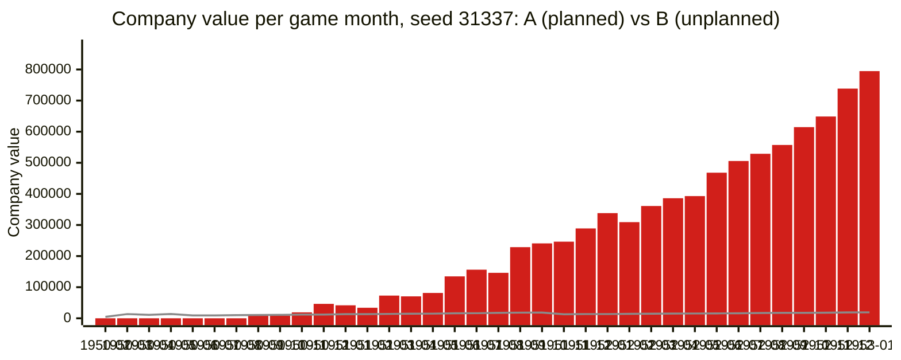
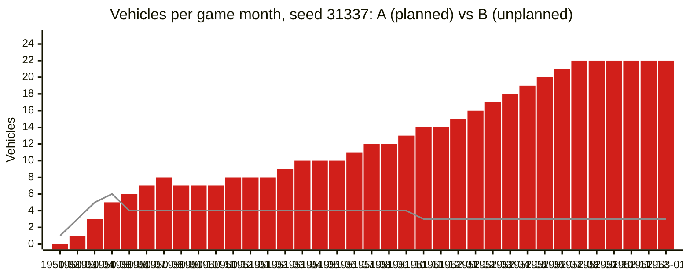

# Duel in one game: planned bot vs unplanned (seed 31337, 36 months)

Generated by `tools/research/mcp-duel` (paired A/B 31337: corrected calibration (net profit, 7211c47e11)). One game, one map: company 1 is PrismaticAI started from
the planner's portfolio (by the panel), company 2 the same AI started without a plan right after it.
Both compete for the same towns and industries. Values come from the console's `companies` command.

- planner: after these lines the bot may plan up to 8 more itself (own_lines)
- planner: Wood by rail Forest -> Sawmill, 233.0 tiles, profit 4988.0/month, score 47263.0 (line 12, built when the money allows)
- planner: Wood by rail Forest -> Sawmill, 236.0 tiles, profit 4988.0/month, score 47529.0 (line 11, built when the money allows)
- planner: Wood by rail Forest -> Sawmill, 177.0 tiles, profit 4942.0/month, score 50292.0 (line 10, built when the money allows)
- planner: Wood by rail Forest -> Sawmill, 177.0 tiles, profit 6362.0/month, score 58340.0 (line 9, built when the money allows)
- planner: Coal by rail Coal Mine -> Power Station, 193.0 tiles, profit 5464.0/month, score 62545.0 (line 8, built when the money allows)
- planner: Coal by rail Coal Mine -> Power Station, 242.0 tiles, profit 5739.0/month, score 65602.0 (line 7, built when the money allows)
- planner: Coal by rail Coal Mine -> Power Station, 221.0 tiles, profit 5728.0/month, score 66001.0 (line 6, built when the money allows)
- planner: Coal by rail Coal Mine -> Power Station, 190.0 tiles, profit 5709.0/month, score 68060.0 (line 5, built when the money allows)
- planner: Coal by rail Coal Mine -> Power Station, 153.0 tiles, profit 5634.0/month, score 69933.0 (line 4, built when the money allows)
- planner: Wood by rail Forest -> Sawmill, 238.0 tiles, profit 7483.0/month, score 80625.0 (line 3, built when the money allows)
- planner: Coal by rail Coal Mine -> Power Station, 227.0 tiles, profit 8307.0/month, score 102011.0 (line 2, built when the money allows)
- planner: Coal by rail Coal Mine -> Power Station, 212.0 tiles, profit 8595.0/month, score 109362.0
- planner: the freight_rail line Forest - Sawmill was not priced on the map, so it is not handed to the bot blind; the next line it can build goes instead
- planner: 21 rail line(s) priced on the map by track-planning, 21 with a route: 207 pieces 16639, 189 pieces 14325, 224 pieces 17070, 231 pieces 18345, 150 pieces 11385, 131 pieces 11569, 187 pieces 15075, 210 pieces 17589, 237 pieces 18238, 194 pieces 14700, 157 pieces 12283, 170 pieces 13725, 182 pieces 14203, 122 pieces 9945, 238 pieces 18328, 229 pieces 18075, 157 pieces 12328, 151 pieces 11835, 97 pieces 7813, 175 pieces 14391, 121 pieces 9135
- planner portfolio by algoglyph knapsack-dp: 4 investment(s), total score 300724.0, 296k of 300k
- planner: calibration from research/calibration.json (1 reading(s)): {"bus":0.16,"default":0.37,"freight_rail":0.59,"rail":0.15}

**Winner: A (planned).** Final company value: A 794737 vs B 19132.

<!-- duel-charts:begin -->
<!-- generated by tools/research/mcp-duel from this record's JSON; `mcp-duel --render` rewrites it, `mcp-duel --render --check` fails while it is stale -->

<!-- duel-charts:end -->

| Month | Date | A (planned) value | B (unplanned) value |
|---|---|---|---|
| 1 | 1950-02-09 | 1 | 4720 |
| 2 | 1950-03-02 | 1 | 13576 |
| 3 | 1950-04-02 | 1 | 11014 |
| 4 | 1950-05-02 | 1 | 13763 |
| 5 | 1950-06-02 | 1 | 9227 |
| 6 | 1950-07-02 | 1 | 9306 |
| 7 | 1950-08-02 | 1 | 10131 |
| 8 | 1950-09-01 | 12871 | 10695 |
| 9 | 1950-10-02 | 8736 | 10915 |
| 10 | 1950-11-02 | 19085 | 11906 |
| 11 | 1950-12-02 | 46390 | 12018 |
| 12 | 1951-01-02 | 41787 | 13189 |
| 13 | 1951-02-01 | 33851 | 13310 |
| 14 | 1951-03-04 | 72953 | 14020 |
| 15 | 1951-04-03 | 70512 | 14850 |
| 16 | 1951-05-04 | 81494 | 15016 |
| 17 | 1951-06-04 | 134754 | 16162 |
| 18 | 1951-07-04 | 156296 | 16364 |
| 19 | 1951-08-04 | 146197 | 17365 |
| 20 | 1951-09-03 | 228738 | 18227 |
| 21 | 1951-10-04 | 240855 | 18450 |
| 22 | 1951-11-03 | 246373 | 13061 |
| 23 | 1951-12-04 | 288960 | 13636 |
| 24 | 1952-01-04 | 338165 | 13625 |
| 25 | 1952-02-03 | 309151 | 14241 |
| 26 | 1952-03-05 | 361042 | 14811 |
| 27 | 1952-04-04 | 386025 | 15181 |
| 28 | 1952-05-05 | 392887 | 15490 |
| 29 | 1952-06-05 | 468114 | 15841 |
| 30 | 1952-07-05 | 505723 | 16260 |
| 31 | 1952-08-05 | 528973 | 16909 |
| 32 | 1952-09-04 | 557288 | 17352 |
| 33 | 1952-10-05 | 614649 | 17683 |
| 34 | 1952-11-04 | 648779 | 18014 |
| 35 | 1952-12-05 | 738501 | 18773 |
| 36 | 1953-01-05 | 794737 | 19132 |
