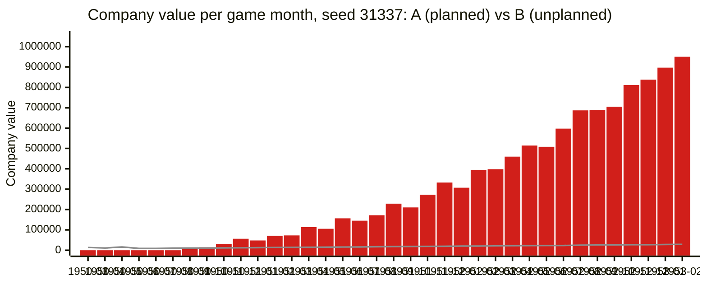
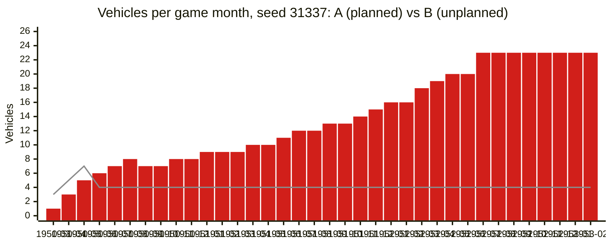

# Duel in one game: planned bot vs unplanned (seed 31337, 36 months)

Generated by `tools/research/mcp-duel` (paired A/B 31337: uncalibrated control (7211c47e11)). One game, one map: company 1 is PrismaticAI started from
the planner's portfolio (by the panel), company 2 the same AI started without a plan right after it.
Both compete for the same towns and industries. Values come from the console's `companies` command.

- planner: the passenger rail pair (score 113003) is built after 13 freight line(s) that score more
- planner: after these lines the bot may plan up to 8 more itself (own_lines)
- planner: Wood by rail Forest -> Sawmill, 236.0 tiles, profit 8455.0/month, score 130726.0 (line 13, built when the money allows)
- planner: Grain by rail Farm -> Factory, 241.0 tiles, profit 9592.0/month, score 131308.0 (line 12, built when the money allows)
- planner: Wood by rail Forest -> Sawmill, 177.0 tiles, profit 8377.0/month, score 132720.0 (line 11, built when the money allows)
- planner: Wood by rail Forest -> Sawmill, 233.0 tiles, profit 10231.0/month, score 146588.0 (line 10, built when the money allows)
- planner: Coal by rail Coal Mine -> Power Station, 193.0 tiles, profit 9261.0/month, score 153671.0 (line 9, built when the money allows)
- planner: Coal by rail Coal Mine -> Power Station, 242.0 tiles, profit 9727.0/month, score 161312.0 (line 8, built when the money allows)
- planner: Coal by rail Coal Mine -> Power Station, 221.0 tiles, profit 9709.0/month, score 161537.0 (line 7, built when the money allows)
- planner: Coal by rail Coal Mine -> Power Station, 190.0 tiles, profit 9677.0/month, score 163280.0 (line 6, built when the money allows)
- planner: Wood by rail Forest -> Sawmill, 177.0 tiles, profit 10783.0/month, score 164447.0 (line 5, built when the money allows)
- planner: Coal by rail Coal Mine -> Power Station, 153.0 tiles, profit 10758.0/month, score 166533.0 (line 4, built when the money allows)
- planner: Wood by rail Forest -> Sawmill, 238.0 tiles, profit 14187.0/month, score 215012.0 (line 3, built when the money allows)
- planner: Coal by rail Coal Mine -> Power Station, 227.0 tiles, profit 14079.0/month, score 240547.0 (line 2, built when the money allows)
- planner: Coal by rail Coal Mine -> Power Station, 212.0 tiles, profit 14568.0/month, score 252708.0
- planner: passengers by rail New Prunpool - Little Bonnley Market, score 113003.0
- planner: 21 rail line(s) priced on the map by track-planning, 21 with a route: 207 pieces 16639, 189 pieces 14325, 224 pieces 17070, 231 pieces 18345, 150 pieces 11385, 170 pieces 13725, 187 pieces 15075, 131 pieces 11569, 210 pieces 17589, 237 pieces 18238, 194 pieces 14700, 157 pieces 12283, 238 pieces 18328, 182 pieces 14203, 238 pieces 18195, 229 pieces 18075, 196 pieces 15943, 234 pieces 17895, 157 pieces 12328, 175 pieces 14391, 173 pieces 13528
- planner portfolio by algoglyph knapsack-dp: 5 investment(s), total score 753612.0, 295k of 300k

**Winner: A (planned).** Final company value: A 950946 vs B 29102.

<!-- duel-charts:begin -->
<!-- generated by tools/research/mcp-duel from this record's JSON; `mcp-duel --render` rewrites it, `mcp-duel --render --check` fails while it is stale -->

<!-- duel-charts:end -->

| Month | Date | A (planned) value | B (unplanned) value |
|---|---|---|---|
| 1 | 1950-03-03 | 1 | 13576 |
| 2 | 1950-04-03 | 1 | 10785 |
| 3 | 1950-05-04 | 1 | 15878 |
| 4 | 1950-06-03 | 1 | 8922 |
| 5 | 1950-07-04 | 1 | 9054 |
| 6 | 1950-08-03 | 1 | 9816 |
| 7 | 1950-09-03 | 5703 | 10495 |
| 8 | 1950-10-04 | 14593 | 10627 |
| 9 | 1950-11-03 | 30810 | 11661 |
| 10 | 1950-12-04 | 56497 | 11874 |
| 11 | 1951-01-03 | 48041 | 12893 |
| 12 | 1951-02-03 | 70834 | 13601 |
| 13 | 1951-03-05 | 72803 | 13727 |
| 14 | 1951-04-05 | 113528 | 14585 |
| 15 | 1951-05-06 | 105427 | 15050 |
| 16 | 1951-06-05 | 156684 | 15781 |
| 17 | 1951-07-06 | 145211 | 15981 |
| 18 | 1951-08-05 | 171648 | 16956 |
| 19 | 1951-09-05 | 228813 | 17819 |
| 20 | 1951-10-06 | 210254 | 18336 |
| 21 | 1951-11-05 | 272758 | 19097 |
| 22 | 1951-12-06 | 332637 | 19307 |
| 23 | 1952-01-05 | 307111 | 20341 |
| 24 | 1952-02-05 | 394924 | 20531 |
| 25 | 1952-03-06 | 398154 | 21330 |
| 26 | 1952-04-06 | 459679 | 22214 |
| 27 | 1952-05-07 | 514607 | 22723 |
| 28 | 1952-06-06 | 508049 | 23201 |
| 29 | 1952-07-07 | 597263 | 23399 |
| 30 | 1952-08-06 | 687255 | 24818 |
| 31 | 1952-09-06 | 688898 | 25752 |
| 32 | 1952-10-06 | 705000 | 25982 |
| 33 | 1952-11-06 | 811504 | 26825 |
| 34 | 1952-12-07 | 838119 | 26978 |
| 35 | 1953-01-06 | 897395 | 28184 |
| 36 | 1953-02-06 | 950946 | 29102 |
