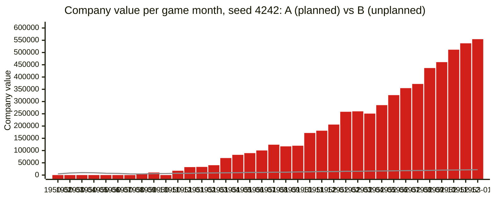
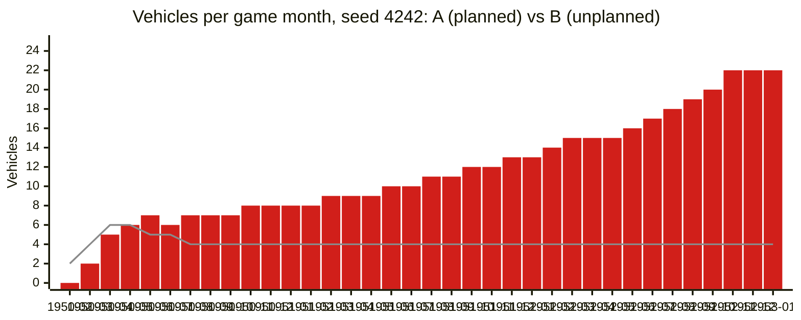

# Duel in one game: planned bot vs unplanned (seed 4242, 36 months)

Generated by `tools/research/mcp-duel` (held-start A/B 4242: corrected calibration). One game, one map: company 1 is PrismaticAI started from
the planner's portfolio (by the panel), company 2 the same AI started without a plan right after it.
Both compete for the same towns and industries. Values come from the console's `companies` command.

- planner: game unpaused at tick 1404 with 2 AI company(ies) after 102 s
- planner: after these lines the bot may plan up to 8 more itself (own_lines)
- planner: Grain by rail Farm -> Factory, 200.0 tiles, profit 4466.0/month, score 38034.0 (line 11, built when the money allows)
- planner: Grain by rail Farm -> Factory, 244.0 tiles, profit 5727.0/month, score 38108.0 (line 10, built when the money allows)
- planner: Grain by rail Farm -> Factory, 204.0 tiles, profit 4520.0/month, score 38114.0 (line 9, built when the money allows)
- planner: Grain by rail Farm -> Factory, 184.0 tiles, profit 4449.0/month, score 38899.0 (line 8, built when the money allows)
- planner: Iron Ore by rail Iron Ore Mine -> Steel Mill, 173.0 tiles, profit 4600.0/month, score 42197.0 (line 7, built when the money allows)
- planner: Wood by rail Forest -> Sawmill, 243.0 tiles, profit 4989.0/month, score 46693.0 (line 6, built when the money allows)
- planner: Wood by rail Forest -> Sawmill, 225.0 tiles, profit 4986.0/month, score 48349.0 (line 5, built when the money allows)
- planner: Iron Ore by rail Iron Ore Mine -> Steel Mill, 221.0 tiles, profit 4970.0/month, score 48501.0 (line 4, built when the money allows)
- planner: Iron Ore by rail Iron Ore Mine -> Steel Mill, 198.0 tiles, profit 4961.0/month, score 49906.0 (line 3, built when the money allows)
- planner: Wood by rail Forest -> Sawmill, 160.0 tiles, profit 4909.0/month, score 50328.0 (line 2, built when the money allows)
- planner: Coal by rail Coal Mine -> Power Station, 242.0 tiles, profit 5706.0/month, score 64807.0
- planner: 21 rail line(s) priced on the map by track-planning, 19 with a route: 239 pieces 18240, 152 pieces 12956, 158 pieces 13376, 197 pieces 15135, 209 pieces 15975, 216 pieces 16753, 226 pieces 17190, 229 pieces 17415, 238 pieces 18926, 186 pieces 14190, 191 pieces 15416, 197 pieces 15292, 211 pieces 16200, 181 pieces 13710, 245 pieces 18645, 197 pieces 14970, 182 pieces 13890, 141 pieces 10710, 171 pieces 13050; 2 without a route dropped their rail option
- planner portfolio by algoglyph knapsack-dp: 4 investment(s), total score 213542.0, 282k of 300k
- planner: calibration from research/calibration.json (1 reading(s)): {"bus":0.16,"default":0.37,"freight_rail":0.59,"rail":0.15}
- planner: game paused for a repeatable start; it runs once 2 AI company(ies) exist

**Winner: A (planned).** Final company value: A 554434 vs B 21926.

<!-- duel-charts:begin -->
<!-- generated by tools/research/mcp-duel from this record's JSON; `mcp-duel --render` rewrites it, `mcp-duel --render --check` fails while it is stale -->

<!-- duel-charts:end -->

| Month | Date | A (planned) value | B (unplanned) value |
|---|---|---|---|
| 1 | 1950-02-03 | 1 | 4750 |
| 2 | 1950-03-05 | 1 | 8403 |
| 3 | 1950-04-05 | 1 | 9900 |
| 4 | 1950-05-05 | 1 | 9315 |
| 5 | 1950-06-05 | 1 | 7330 |
| 6 | 1950-07-06 | 1 | 6866 |
| 7 | 1950-08-05 | 1 | 4805 |
| 8 | 1950-09-05 | 4296 | 4607 |
| 9 | 1950-10-05 | 10343 | 5867 |
| 10 | 1950-11-05 | 1 | 6284 |
| 11 | 1950-12-05 | 17593 | 7330 |
| 12 | 1951-01-05 | 32492 | 7068 |
| 13 | 1951-02-05 | 33322 | 8349 |
| 14 | 1951-03-07 | 40189 | 8808 |
| 15 | 1951-04-07 | 69433 | 9292 |
| 16 | 1951-05-07 | 82508 | 9778 |
| 17 | 1951-06-07 | 89547 | 10882 |
| 18 | 1951-07-07 | 100332 | 10538 |
| 19 | 1951-08-07 | 123910 | 11727 |
| 20 | 1951-09-07 | 117108 | 11644 |
| 21 | 1951-10-07 | 119697 | 12798 |
| 22 | 1951-11-07 | 171730 | 13263 |
| 23 | 1951-12-07 | 181020 | 14432 |
| 24 | 1952-01-07 | 206019 | 14228 |
| 25 | 1952-02-06 | 258272 | 15562 |
| 26 | 1952-03-08 | 259944 | 15307 |
| 27 | 1952-04-08 | 250839 | 16504 |
| 28 | 1952-05-08 | 285315 | 16816 |
| 29 | 1952-06-08 | 326169 | 17409 |
| 30 | 1952-07-08 | 354688 | 17940 |
| 31 | 1952-08-08 | 371743 | 18573 |
| 32 | 1952-09-07 | 436673 | 18988 |
| 33 | 1952-10-08 | 460732 | 20246 |
| 34 | 1952-11-07 | 511533 | 20666 |
| 35 | 1952-12-08 | 537546 | 21333 |
| 36 | 1953-01-08 | 554434 | 21926 |
