# Duel in one game: planned bot vs unplanned (seed 31337, 120 months)

Generated by `tools/research/mcp-duel` (held-game pair B: ten years WITH eight own lines (own_lines=8), run alongside pair A (own_lines=0) at the owner's choice). One game, one map: company 1 is PrismaticAI started from
the planner's portfolio (by the panel) with extra settings own_lines=8, company 2 the same AI started without a plan right after it.
Both compete for the same towns and industries. Values come from the console's `companies` command.

- planner: game unpaused at tick 1400 with 2 AI company(ies) after 106 s
- planner: the passenger rail pair (score 113003) is built after 13 freight line(s) that score more
- planner: after these lines the bot may plan up to 8 more itself (own_lines)
- planner: Wood by rail Forest -> Sawmill, 236.0 tiles, profit 8455.0/month, score 130726.0 (line 13, built when the money allows)
- planner: Grain by rail Farm -> Factory, 241.0 tiles, profit 9592.0/month, score 131398.0 (line 12, built when the money allows)
- planner: Wood by rail Forest -> Sawmill, 177.0 tiles, profit 8377.0/month, score 132720.0 (line 11, built when the money allows)
- planner: Wood by rail Forest -> Sawmill, 233.0 tiles, profit 10231.0/month, score 146588.0 (line 10, built when the money allows)
- planner: Coal by rail Coal Mine -> Power Station, 193.0 tiles, profit 9261.0/month, score 153671.0 (line 9, built when the money allows)
- planner: Coal by rail Coal Mine -> Power Station, 242.0 tiles, profit 9727.0/month, score 161312.0 (line 8, built when the money allows)
- planner: Coal by rail Coal Mine -> Power Station, 221.0 tiles, profit 9709.0/month, score 161537.0 (line 7, built when the money allows)
- planner: Coal by rail Coal Mine -> Power Station, 190.0 tiles, profit 9677.0/month, score 163295.0 (line 6, built when the money allows)
- planner: Wood by rail Forest -> Sawmill, 177.0 tiles, profit 10783.0/month, score 164447.0 (line 5, built when the money allows)
- planner: Coal by rail Coal Mine -> Power Station, 153.0 tiles, profit 10758.0/month, score 166533.0 (line 4, built when the money allows)
- planner: Wood by rail Forest -> Sawmill, 238.0 tiles, profit 14187.0/month, score 215012.0 (line 3, built when the money allows)
- planner: Coal by rail Coal Mine -> Power Station, 227.0 tiles, profit 14079.0/month, score 240547.0 (line 2, built when the money allows)
- planner: Coal by rail Coal Mine -> Power Station, 212.0 tiles, profit 14568.0/month, score 252708.0
- planner: passengers by rail New Prunpool - Little Bonnley Market, score 113003.0
- planner: 21 rail line(s) priced on the map by track-planning, 21 with a route: 207 pieces 16639, 189 pieces 14325, 224 pieces 17070, 231 pieces 18345, 150 pieces 11385, 170 pieces 13725, 187 pieces 15060, 131 pieces 11569, 210 pieces 17589, 237 pieces 18238, 194 pieces 14700, 157 pieces 12283, 238 pieces 18328, 182 pieces 14203, 238 pieces 18105, 229 pieces 18075, 196 pieces 15943, 234 pieces 17895, 157 pieces 12328, 175 pieces 14391, 173 pieces 13528
- planner portfolio by algoglyph knapsack-dp: 5 investment(s), total score 753627.0, 295k of 300k
- planner: game paused for a repeatable start; it runs once 2 AI company(ies) exist

**Winner: A (planned).** Final company value: A 4433637 vs B 61159.

```mermaid
---
config:
  xyChart:
    width: 900
    height: 360
  themeVariables:
    xyChart:
      plotColorPalette: "#d11f1a, #8a8a8a, #0b0b0b, #ece4d6"
---
xychart-beta
    title "Company value per game month, seed 31337: A (planned) vs B (unplanned)"
    x-axis ["1950-02", "1950-03", "1950-04", "1950-05", "1950-06", "1950-07", "1950-08", "1950-09", "1950-10", "1950-11", "1950-12", "1951-01", "1951-02", "1951-03", "1951-04", "1951-05", "1951-06", "1951-07", "1951-08", "1951-09", "1951-10", "1951-11", "1951-12", "1952-01", "1952-02", "1952-03", "1952-04", "1952-05", "1952-06", "1952-07", "1952-08", "1952-09", "1952-10", "1952-11", "1952-12", "1953-01", "1953-02", "1953-03", "1953-04", "1953-05", "1953-06", "1953-07", "1953-08", "1953-09", "1953-10", "1953-11", "1953-12", "1954-01", "1954-02", "1954-03", "1954-04", "1954-05", "1954-06", "1954-07", "1954-08", "1954-09", "1954-10", "1954-11", "1954-12", "1955-01", "1955-02", "1955-03", "1955-04", "1955-05", "1955-06", "1955-07", "1955-08", "1955-09", "1955-10", "1955-11", "1955-12", "1956-01", "1956-02", "1956-03", "1956-04", "1956-05", "1956-06", "1956-07", "1956-08", "1956-09", "1956-10", "1956-11", "1956-12", "1957-01", "1957-02", "1957-03", "1957-04", "1957-05", "1957-06", "1957-07", "1957-08", "1957-09", "1957-10", "1957-11", "1957-12", "1958-01", "1958-02", "1958-03", "1958-04", "1958-05", "1958-06", "1958-07", "1958-08", "1958-09", "1958-10", "1958-11", "1958-12", "1959-01", "1959-02", "1959-03", "1959-04", "1959-05", "1959-06", "1959-07", "1959-08", "1959-09", "1959-10", "1959-11", "1959-12", "1960-01"]
    %% series: A (planned) | B (unplanned)
    %% links: duel-20261117T234725-seed31337.md?col=Month&filter=1 | duel-20261117T234725-seed31337.md?col=Month&filter=2 | duel-20261117T234725-seed31337.md?col=Month&filter=3 | duel-20261117T234725-seed31337.md?col=Month&filter=4 | duel-20261117T234725-seed31337.md?col=Month&filter=5 | duel-20261117T234725-seed31337.md?col=Month&filter=6 | duel-20261117T234725-seed31337.md?col=Month&filter=7 | duel-20261117T234725-seed31337.md?col=Month&filter=8 | duel-20261117T234725-seed31337.md?col=Month&filter=9 | duel-20261117T234725-seed31337.md?col=Month&filter=10 | duel-20261117T234725-seed31337.md?col=Month&filter=11 | duel-20261117T234725-seed31337.md?col=Month&filter=12 | duel-20261117T234725-seed31337.md?col=Month&filter=13 | duel-20261117T234725-seed31337.md?col=Month&filter=14 | duel-20261117T234725-seed31337.md?col=Month&filter=15 | duel-20261117T234725-seed31337.md?col=Month&filter=16 | duel-20261117T234725-seed31337.md?col=Month&filter=17 | duel-20261117T234725-seed31337.md?col=Month&filter=18 | duel-20261117T234725-seed31337.md?col=Month&filter=19 | duel-20261117T234725-seed31337.md?col=Month&filter=20 | duel-20261117T234725-seed31337.md?col=Month&filter=21 | duel-20261117T234725-seed31337.md?col=Month&filter=22 | duel-20261117T234725-seed31337.md?col=Month&filter=23 | duel-20261117T234725-seed31337.md?col=Month&filter=24 | duel-20261117T234725-seed31337.md?col=Month&filter=25 | duel-20261117T234725-seed31337.md?col=Month&filter=26 | duel-20261117T234725-seed31337.md?col=Month&filter=27 | duel-20261117T234725-seed31337.md?col=Month&filter=28 | duel-20261117T234725-seed31337.md?col=Month&filter=29 | duel-20261117T234725-seed31337.md?col=Month&filter=30 | duel-20261117T234725-seed31337.md?col=Month&filter=31 | duel-20261117T234725-seed31337.md?col=Month&filter=32 | duel-20261117T234725-seed31337.md?col=Month&filter=33 | duel-20261117T234725-seed31337.md?col=Month&filter=34 | duel-20261117T234725-seed31337.md?col=Month&filter=35 | duel-20261117T234725-seed31337.md?col=Month&filter=36 | duel-20261117T234725-seed31337.md?col=Month&filter=37 | duel-20261117T234725-seed31337.md?col=Month&filter=38 | duel-20261117T234725-seed31337.md?col=Month&filter=39 | duel-20261117T234725-seed31337.md?col=Month&filter=40 | duel-20261117T234725-seed31337.md?col=Month&filter=41 | duel-20261117T234725-seed31337.md?col=Month&filter=42 | duel-20261117T234725-seed31337.md?col=Month&filter=43 | duel-20261117T234725-seed31337.md?col=Month&filter=44 | duel-20261117T234725-seed31337.md?col=Month&filter=45 | duel-20261117T234725-seed31337.md?col=Month&filter=46 | duel-20261117T234725-seed31337.md?col=Month&filter=47 | duel-20261117T234725-seed31337.md?col=Month&filter=48 | duel-20261117T234725-seed31337.md?col=Month&filter=49 | duel-20261117T234725-seed31337.md?col=Month&filter=50 | duel-20261117T234725-seed31337.md?col=Month&filter=51 | duel-20261117T234725-seed31337.md?col=Month&filter=52 | duel-20261117T234725-seed31337.md?col=Month&filter=53 | duel-20261117T234725-seed31337.md?col=Month&filter=54 | duel-20261117T234725-seed31337.md?col=Month&filter=55 | duel-20261117T234725-seed31337.md?col=Month&filter=56 | duel-20261117T234725-seed31337.md?col=Month&filter=57 | duel-20261117T234725-seed31337.md?col=Month&filter=58 | duel-20261117T234725-seed31337.md?col=Month&filter=59 | duel-20261117T234725-seed31337.md?col=Month&filter=60 | duel-20261117T234725-seed31337.md?col=Month&filter=61 | duel-20261117T234725-seed31337.md?col=Month&filter=62 | duel-20261117T234725-seed31337.md?col=Month&filter=63 | duel-20261117T234725-seed31337.md?col=Month&filter=64 | duel-20261117T234725-seed31337.md?col=Month&filter=65 | duel-20261117T234725-seed31337.md?col=Month&filter=66 | duel-20261117T234725-seed31337.md?col=Month&filter=67 | duel-20261117T234725-seed31337.md?col=Month&filter=68 | duel-20261117T234725-seed31337.md?col=Month&filter=69 | duel-20261117T234725-seed31337.md?col=Month&filter=70 | duel-20261117T234725-seed31337.md?col=Month&filter=71 | duel-20261117T234725-seed31337.md?col=Month&filter=72 | duel-20261117T234725-seed31337.md?col=Month&filter=73 | duel-20261117T234725-seed31337.md?col=Month&filter=74 | duel-20261117T234725-seed31337.md?col=Month&filter=75 | duel-20261117T234725-seed31337.md?col=Month&filter=76 | duel-20261117T234725-seed31337.md?col=Month&filter=77 | duel-20261117T234725-seed31337.md?col=Month&filter=78 | duel-20261117T234725-seed31337.md?col=Month&filter=79 | duel-20261117T234725-seed31337.md?col=Month&filter=80 | duel-20261117T234725-seed31337.md?col=Month&filter=81 | duel-20261117T234725-seed31337.md?col=Month&filter=82 | duel-20261117T234725-seed31337.md?col=Month&filter=83 | duel-20261117T234725-seed31337.md?col=Month&filter=84 | duel-20261117T234725-seed31337.md?col=Month&filter=85 | duel-20261117T234725-seed31337.md?col=Month&filter=86 | duel-20261117T234725-seed31337.md?col=Month&filter=87 | duel-20261117T234725-seed31337.md?col=Month&filter=88 | duel-20261117T234725-seed31337.md?col=Month&filter=89 | duel-20261117T234725-seed31337.md?col=Month&filter=90 | duel-20261117T234725-seed31337.md?col=Month&filter=91 | duel-20261117T234725-seed31337.md?col=Month&filter=92 | duel-20261117T234725-seed31337.md?col=Month&filter=93 | duel-20261117T234725-seed31337.md?col=Month&filter=94 | duel-20261117T234725-seed31337.md?col=Month&filter=95 | duel-20261117T234725-seed31337.md?col=Month&filter=96 | duel-20261117T234725-seed31337.md?col=Month&filter=97 | duel-20261117T234725-seed31337.md?col=Month&filter=98 | duel-20261117T234725-seed31337.md?col=Month&filter=99 | duel-20261117T234725-seed31337.md?col=Month&filter=100 | duel-20261117T234725-seed31337.md?col=Month&filter=101 | duel-20261117T234725-seed31337.md?col=Month&filter=102 | duel-20261117T234725-seed31337.md?col=Month&filter=103 | duel-20261117T234725-seed31337.md?col=Month&filter=104 | duel-20261117T234725-seed31337.md?col=Month&filter=105 | duel-20261117T234725-seed31337.md?col=Month&filter=106 | duel-20261117T234725-seed31337.md?col=Month&filter=107 | duel-20261117T234725-seed31337.md?col=Month&filter=108 | duel-20261117T234725-seed31337.md?col=Month&filter=109 | duel-20261117T234725-seed31337.md?col=Month&filter=110 | duel-20261117T234725-seed31337.md?col=Month&filter=111 | duel-20261117T234725-seed31337.md?col=Month&filter=112 | duel-20261117T234725-seed31337.md?col=Month&filter=113 | duel-20261117T234725-seed31337.md?col=Month&filter=114 | duel-20261117T234725-seed31337.md?col=Month&filter=115 | duel-20261117T234725-seed31337.md?col=Month&filter=116 | duel-20261117T234725-seed31337.md?col=Month&filter=117 | duel-20261117T234725-seed31337.md?col=Month&filter=118 | duel-20261117T234725-seed31337.md?col=Month&filter=119 | duel-20261117T234725-seed31337.md?col=Month&filter=120
    y-axis "Company value" 0 --> 4880000
    bar [1, 1, 1, 1, 1, 1, 6835, 2786, 31624, 51341, 48623, 71465, 79082, 116984, 120104, 173759, 138771, 181324, 227650, 211769, 273549, 316490, 325515, 367842, 427556, 453293, 491836, 559130, 613398, 642653, 667288, 747003, 783794, 842469, 906386, 941794, 989121, 1010427, 1083844, 1145120, 1159528, 1236874, 1267592, 1305726, 1357655, 1372223, 1426050, 1471952, 1501821, 1528751, 1570914, 1606566, 1640353, 1699888, 1726717, 1773980, 1820092, 1869911, 1899278, 1929622, 1989661, 2007390, 2038539, 2102933, 2132905, 2181354, 2206640, 2259962, 2322136, 2338630, 2377236, 2391633, 2482003, 2493138, 2570818, 2580090, 2619483, 2664578, 2659239, 2722443, 2765768, 2800266, 2865620, 2896857, 2963012, 2966876, 3000618, 3095889, 3106524, 3148491, 3192854, 3242779, 3281229, 3320475, 3388632, 3399588, 3439697, 3507584, 3545155, 3574651, 3599344, 3669611, 3728898, 3757839, 3788815, 3846105, 3877102, 3921722, 3972948, 4005169, 4066371, 4095363, 4147040, 4169604, 4221439, 4232488, 4289760, 4364176, 4370639, 4433637]
    line [13769, 11186, 14410, 15198, 12399, 9763, 10731, 10624, 11619, 11695, 12683, 13074, 13580, 14663, 14451, 15760, 16152, 16677, 17785, 17611, 18771, 18590, 19940, 20965, 20936, 22037, 21853, 22964, 24018, 24254, 25385, 20485, 21140, 21809, 21825, 22434, 22444, 23053, 24048, 24120, 24733, 24866, 25377, 25547, 26156, 27072, 27198, 27732, 27778, 28336, 28434, 28896, 29043, 29955, 30626, 30713, 31288, 31379, 31854, 32662, 32736, 33375, 33465, 34103, 34248, 34967, 35688, 35848, 36445, 36554, 37163, 37426, 38134, 38819, 38995, 39552, 39875, 40662, 41281, 41426, 41936, 42192, 43146, 43209, 44030, 44623, 44804, 44970, 45233, 46136, 46187, 46363, 47046, 47430, 47605, 48490, 48727, 48997, 49766, 50025, 50916, 51222, 52022, 52303, 52791, 53696, 53895, 54759, 55629, 55792, 56140, 56442, 57231, 57522, 57950, 58709, 59020, 59671, 60262, 61159]
```

```mermaid
---
config:
  xyChart:
    width: 900
    height: 360
  themeVariables:
    xyChart:
      plotColorPalette: "#d11f1a, #8a8a8a, #0b0b0b, #ece4d6"
---
xychart-beta
    title "Vehicles per game month, seed 31337: A (planned) vs B (unplanned)"
    x-axis ["1950-02", "1950-03", "1950-04", "1950-05", "1950-06", "1950-07", "1950-08", "1950-09", "1950-10", "1950-11", "1950-12", "1951-01", "1951-02", "1951-03", "1951-04", "1951-05", "1951-06", "1951-07", "1951-08", "1951-09", "1951-10", "1951-11", "1951-12", "1952-01", "1952-02", "1952-03", "1952-04", "1952-05", "1952-06", "1952-07", "1952-08", "1952-09", "1952-10", "1952-11", "1952-12", "1953-01", "1953-02", "1953-03", "1953-04", "1953-05", "1953-06", "1953-07", "1953-08", "1953-09", "1953-10", "1953-11", "1953-12", "1954-01", "1954-02", "1954-03", "1954-04", "1954-05", "1954-06", "1954-07", "1954-08", "1954-09", "1954-10", "1954-11", "1954-12", "1955-01", "1955-02", "1955-03", "1955-04", "1955-05", "1955-06", "1955-07", "1955-08", "1955-09", "1955-10", "1955-11", "1955-12", "1956-01", "1956-02", "1956-03", "1956-04", "1956-05", "1956-06", "1956-07", "1956-08", "1956-09", "1956-10", "1956-11", "1956-12", "1957-01", "1957-02", "1957-03", "1957-04", "1957-05", "1957-06", "1957-07", "1957-08", "1957-09", "1957-10", "1957-11", "1957-12", "1958-01", "1958-02", "1958-03", "1958-04", "1958-05", "1958-06", "1958-07", "1958-08", "1958-09", "1958-10", "1958-11", "1958-12", "1959-01", "1959-02", "1959-03", "1959-04", "1959-05", "1959-06", "1959-07", "1959-08", "1959-09", "1959-10", "1959-11", "1959-12", "1960-01"]
    %% series: A (planned) | B (unplanned)
    %% links: duel-20261117T234725-seed31337.md?col=Month&filter=1 | duel-20261117T234725-seed31337.md?col=Month&filter=2 | duel-20261117T234725-seed31337.md?col=Month&filter=3 | duel-20261117T234725-seed31337.md?col=Month&filter=4 | duel-20261117T234725-seed31337.md?col=Month&filter=5 | duel-20261117T234725-seed31337.md?col=Month&filter=6 | duel-20261117T234725-seed31337.md?col=Month&filter=7 | duel-20261117T234725-seed31337.md?col=Month&filter=8 | duel-20261117T234725-seed31337.md?col=Month&filter=9 | duel-20261117T234725-seed31337.md?col=Month&filter=10 | duel-20261117T234725-seed31337.md?col=Month&filter=11 | duel-20261117T234725-seed31337.md?col=Month&filter=12 | duel-20261117T234725-seed31337.md?col=Month&filter=13 | duel-20261117T234725-seed31337.md?col=Month&filter=14 | duel-20261117T234725-seed31337.md?col=Month&filter=15 | duel-20261117T234725-seed31337.md?col=Month&filter=16 | duel-20261117T234725-seed31337.md?col=Month&filter=17 | duel-20261117T234725-seed31337.md?col=Month&filter=18 | duel-20261117T234725-seed31337.md?col=Month&filter=19 | duel-20261117T234725-seed31337.md?col=Month&filter=20 | duel-20261117T234725-seed31337.md?col=Month&filter=21 | duel-20261117T234725-seed31337.md?col=Month&filter=22 | duel-20261117T234725-seed31337.md?col=Month&filter=23 | duel-20261117T234725-seed31337.md?col=Month&filter=24 | duel-20261117T234725-seed31337.md?col=Month&filter=25 | duel-20261117T234725-seed31337.md?col=Month&filter=26 | duel-20261117T234725-seed31337.md?col=Month&filter=27 | duel-20261117T234725-seed31337.md?col=Month&filter=28 | duel-20261117T234725-seed31337.md?col=Month&filter=29 | duel-20261117T234725-seed31337.md?col=Month&filter=30 | duel-20261117T234725-seed31337.md?col=Month&filter=31 | duel-20261117T234725-seed31337.md?col=Month&filter=32 | duel-20261117T234725-seed31337.md?col=Month&filter=33 | duel-20261117T234725-seed31337.md?col=Month&filter=34 | duel-20261117T234725-seed31337.md?col=Month&filter=35 | duel-20261117T234725-seed31337.md?col=Month&filter=36 | duel-20261117T234725-seed31337.md?col=Month&filter=37 | duel-20261117T234725-seed31337.md?col=Month&filter=38 | duel-20261117T234725-seed31337.md?col=Month&filter=39 | duel-20261117T234725-seed31337.md?col=Month&filter=40 | duel-20261117T234725-seed31337.md?col=Month&filter=41 | duel-20261117T234725-seed31337.md?col=Month&filter=42 | duel-20261117T234725-seed31337.md?col=Month&filter=43 | duel-20261117T234725-seed31337.md?col=Month&filter=44 | duel-20261117T234725-seed31337.md?col=Month&filter=45 | duel-20261117T234725-seed31337.md?col=Month&filter=46 | duel-20261117T234725-seed31337.md?col=Month&filter=47 | duel-20261117T234725-seed31337.md?col=Month&filter=48 | duel-20261117T234725-seed31337.md?col=Month&filter=49 | duel-20261117T234725-seed31337.md?col=Month&filter=50 | duel-20261117T234725-seed31337.md?col=Month&filter=51 | duel-20261117T234725-seed31337.md?col=Month&filter=52 | duel-20261117T234725-seed31337.md?col=Month&filter=53 | duel-20261117T234725-seed31337.md?col=Month&filter=54 | duel-20261117T234725-seed31337.md?col=Month&filter=55 | duel-20261117T234725-seed31337.md?col=Month&filter=56 | duel-20261117T234725-seed31337.md?col=Month&filter=57 | duel-20261117T234725-seed31337.md?col=Month&filter=58 | duel-20261117T234725-seed31337.md?col=Month&filter=59 | duel-20261117T234725-seed31337.md?col=Month&filter=60 | duel-20261117T234725-seed31337.md?col=Month&filter=61 | duel-20261117T234725-seed31337.md?col=Month&filter=62 | duel-20261117T234725-seed31337.md?col=Month&filter=63 | duel-20261117T234725-seed31337.md?col=Month&filter=64 | duel-20261117T234725-seed31337.md?col=Month&filter=65 | duel-20261117T234725-seed31337.md?col=Month&filter=66 | duel-20261117T234725-seed31337.md?col=Month&filter=67 | duel-20261117T234725-seed31337.md?col=Month&filter=68 | duel-20261117T234725-seed31337.md?col=Month&filter=69 | duel-20261117T234725-seed31337.md?col=Month&filter=70 | duel-20261117T234725-seed31337.md?col=Month&filter=71 | duel-20261117T234725-seed31337.md?col=Month&filter=72 | duel-20261117T234725-seed31337.md?col=Month&filter=73 | duel-20261117T234725-seed31337.md?col=Month&filter=74 | duel-20261117T234725-seed31337.md?col=Month&filter=75 | duel-20261117T234725-seed31337.md?col=Month&filter=76 | duel-20261117T234725-seed31337.md?col=Month&filter=77 | duel-20261117T234725-seed31337.md?col=Month&filter=78 | duel-20261117T234725-seed31337.md?col=Month&filter=79 | duel-20261117T234725-seed31337.md?col=Month&filter=80 | duel-20261117T234725-seed31337.md?col=Month&filter=81 | duel-20261117T234725-seed31337.md?col=Month&filter=82 | duel-20261117T234725-seed31337.md?col=Month&filter=83 | duel-20261117T234725-seed31337.md?col=Month&filter=84 | duel-20261117T234725-seed31337.md?col=Month&filter=85 | duel-20261117T234725-seed31337.md?col=Month&filter=86 | duel-20261117T234725-seed31337.md?col=Month&filter=87 | duel-20261117T234725-seed31337.md?col=Month&filter=88 | duel-20261117T234725-seed31337.md?col=Month&filter=89 | duel-20261117T234725-seed31337.md?col=Month&filter=90 | duel-20261117T234725-seed31337.md?col=Month&filter=91 | duel-20261117T234725-seed31337.md?col=Month&filter=92 | duel-20261117T234725-seed31337.md?col=Month&filter=93 | duel-20261117T234725-seed31337.md?col=Month&filter=94 | duel-20261117T234725-seed31337.md?col=Month&filter=95 | duel-20261117T234725-seed31337.md?col=Month&filter=96 | duel-20261117T234725-seed31337.md?col=Month&filter=97 | duel-20261117T234725-seed31337.md?col=Month&filter=98 | duel-20261117T234725-seed31337.md?col=Month&filter=99 | duel-20261117T234725-seed31337.md?col=Month&filter=100 | duel-20261117T234725-seed31337.md?col=Month&filter=101 | duel-20261117T234725-seed31337.md?col=Month&filter=102 | duel-20261117T234725-seed31337.md?col=Month&filter=103 | duel-20261117T234725-seed31337.md?col=Month&filter=104 | duel-20261117T234725-seed31337.md?col=Month&filter=105 | duel-20261117T234725-seed31337.md?col=Month&filter=106 | duel-20261117T234725-seed31337.md?col=Month&filter=107 | duel-20261117T234725-seed31337.md?col=Month&filter=108 | duel-20261117T234725-seed31337.md?col=Month&filter=109 | duel-20261117T234725-seed31337.md?col=Month&filter=110 | duel-20261117T234725-seed31337.md?col=Month&filter=111 | duel-20261117T234725-seed31337.md?col=Month&filter=112 | duel-20261117T234725-seed31337.md?col=Month&filter=113 | duel-20261117T234725-seed31337.md?col=Month&filter=114 | duel-20261117T234725-seed31337.md?col=Month&filter=115 | duel-20261117T234725-seed31337.md?col=Month&filter=116 | duel-20261117T234725-seed31337.md?col=Month&filter=117 | duel-20261117T234725-seed31337.md?col=Month&filter=118 | duel-20261117T234725-seed31337.md?col=Month&filter=119 | duel-20261117T234725-seed31337.md?col=Month&filter=120
    y-axis "Vehicles" 0 --> 24
    bar [1, 3, 5, 6, 7, 8, 7, 7, 8, 8, 9, 9, 9, 10, 11, 11, 12, 12, 13, 14, 14, 15, 16, 17, 18, 20, 20, 21, 21, 21, 21, 21, 21, 21, 21, 21, 21, 21, 21, 21, 21, 21, 21, 21, 21, 21, 21, 21, 21, 18, 18, 18, 19, 19, 19, 19, 19, 19, 19, 19, 19, 19, 19, 19, 19, 19, 19, 19, 19, 19, 19, 19, 19, 19, 19, 19, 17, 17, 17, 17, 17, 17, 17, 17, 17, 17, 17, 17, 17, 17, 17, 17, 17, 17, 17, 17, 17, 17, 17, 17, 17, 17, 17, 17, 17, 17, 17, 17, 17, 17, 17, 17, 17, 17, 17, 17, 17, 17, 17, 17]
    line [3, 5, 6, 6, 5, 4, 4, 4, 4, 4, 4, 4, 4, 4, 4, 4, 4, 4, 4, 4, 4, 4, 4, 4, 4, 4, 4, 4, 4, 4, 4, 3, 3, 3, 3, 3, 3, 3, 3, 3, 3, 3, 3, 3, 3, 3, 3, 3, 3, 3, 3, 3, 3, 3, 3, 3, 3, 3, 3, 3, 3, 3, 3, 3, 3, 3, 3, 3, 3, 3, 3, 3, 3, 3, 3, 3, 3, 3, 3, 3, 3, 3, 3, 3, 3, 3, 3, 3, 3, 3, 3, 3, 3, 3, 3, 3, 3, 3, 3, 3, 3, 3, 3, 3, 3, 3, 3, 3, 3, 3, 3, 3, 3, 3, 3, 3, 3, 3, 3, 3]
```

<!-- duel-charts:begin -->
<!-- generated by tools/research/mcp-duel from this record's JSON; `mcp-duel --render` rewrites it, `mcp-duel --render --check` fails while it is stale -->

<!-- duel-charts:end -->

| Month | Date | A (planned) value | B (unplanned) value |
|---|---|---|---|
| 1 | 1950-02-03 | 1 | 13769 |
| 2 | 1950-03-05 | 1 | 11186 |
| 3 | 1950-04-05 | 1 | 14410 |
| 4 | 1950-05-05 | 1 | 15198 |
| 5 | 1950-06-05 | 1 | 12399 |
| 6 | 1950-07-06 | 1 | 9763 |
| 7 | 1950-08-05 | 6835 | 10731 |
| 8 | 1950-09-05 | 2786 | 10624 |
| 9 | 1950-10-05 | 31624 | 11619 |
| 10 | 1950-11-05 | 51341 | 11695 |
| 11 | 1950-12-05 | 48623 | 12683 |
| 12 | 1951-01-05 | 71465 | 13074 |
| 13 | 1951-02-04 | 79082 | 13580 |
| 14 | 1951-03-07 | 116984 | 14663 |
| 15 | 1951-04-06 | 120104 | 14451 |
| 16 | 1951-05-07 | 173759 | 15760 |
| 17 | 1951-06-07 | 138771 | 16152 |
| 18 | 1951-07-07 | 181324 | 16677 |
| 19 | 1951-08-07 | 227650 | 17785 |
| 20 | 1951-09-06 | 211769 | 17611 |
| 21 | 1951-10-07 | 273549 | 18771 |
| 22 | 1951-11-07 | 316490 | 18590 |
| 23 | 1951-12-07 | 325515 | 19940 |
| 24 | 1952-01-07 | 367842 | 20965 |
| 25 | 1952-02-06 | 427556 | 20936 |
| 26 | 1952-03-08 | 453293 | 22037 |
| 27 | 1952-04-07 | 491836 | 21853 |
| 28 | 1952-05-08 | 559130 | 22964 |
| 29 | 1952-06-08 | 613398 | 24018 |
| 30 | 1952-07-08 | 642653 | 24254 |
| 31 | 1952-08-08 | 667288 | 25385 |
| 32 | 1952-09-08 | 747003 | 20485 |
| 33 | 1952-10-08 | 783794 | 21140 |
| 34 | 1952-11-08 | 842469 | 21809 |
| 35 | 1952-12-08 | 906386 | 21825 |
| 36 | 1953-01-08 | 941794 | 22434 |
| 37 | 1953-02-08 | 989121 | 22444 |
| 38 | 1953-03-10 | 1010427 | 23053 |
| 39 | 1953-04-10 | 1083844 | 24048 |
| 40 | 1953-05-10 | 1145120 | 24120 |
| 41 | 1953-06-10 | 1159528 | 24733 |
| 42 | 1953-07-11 | 1236874 | 24866 |
| 43 | 1953-08-10 | 1267592 | 25377 |
| 44 | 1953-09-10 | 1305726 | 25547 |
| 45 | 1953-10-10 | 1357655 | 26156 |
| 46 | 1953-11-10 | 1372223 | 27072 |
| 47 | 1953-12-10 | 1426050 | 27198 |
| 48 | 1954-01-10 | 1471952 | 27732 |
| 49 | 1954-02-10 | 1501821 | 27778 |
| 50 | 1954-03-02 | 1528751 | 28336 |
| 51 | 1954-04-02 | 1570914 | 28434 |
| 52 | 1954-05-02 | 1606566 | 28896 |
| 53 | 1954-06-02 | 1640353 | 29043 |
| 54 | 1954-07-03 | 1699888 | 29955 |
| 55 | 1954-08-02 | 1726717 | 30626 |
| 56 | 1954-09-02 | 1773980 | 30713 |
| 57 | 1954-10-02 | 1820092 | 31288 |
| 58 | 1954-11-02 | 1869911 | 31379 |
| 59 | 1954-12-02 | 1899278 | 31854 |
| 60 | 1955-01-02 | 1929622 | 32662 |
| 61 | 1955-02-02 | 1989661 | 32736 |
| 62 | 1955-03-04 | 2007390 | 33375 |
| 63 | 1955-04-04 | 2038539 | 33465 |
| 64 | 1955-05-04 | 2102933 | 34103 |
| 65 | 1955-06-04 | 2132905 | 34248 |
| 66 | 1955-07-04 | 2181354 | 34967 |
| 67 | 1955-08-04 | 2206640 | 35688 |
| 68 | 1955-09-04 | 2259962 | 35848 |
| 69 | 1955-10-04 | 2322136 | 36445 |
| 70 | 1955-11-04 | 2338630 | 36554 |
| 71 | 1955-12-04 | 2377236 | 37163 |
| 72 | 1956-01-04 | 2391633 | 37426 |
| 73 | 1956-02-04 | 2482003 | 38134 |
| 74 | 1956-03-05 | 2493138 | 38819 |
| 75 | 1956-04-05 | 2570818 | 38995 |
| 76 | 1956-05-05 | 2580090 | 39552 |
| 77 | 1956-06-05 | 2619483 | 39875 |
| 78 | 1956-07-06 | 2664578 | 40662 |
| 79 | 1956-08-05 | 2659239 | 41281 |
| 80 | 1956-09-05 | 2722443 | 41426 |
| 81 | 1956-10-06 | 2765768 | 41936 |
| 82 | 1956-11-05 | 2800266 | 42192 |
| 83 | 1956-12-06 | 2865620 | 43146 |
| 84 | 1957-01-05 | 2896857 | 43209 |
| 85 | 1957-02-05 | 2963012 | 44030 |
| 86 | 1957-03-08 | 2966876 | 44623 |
| 87 | 1957-04-07 | 3000618 | 44804 |
| 88 | 1957-05-08 | 3095889 | 44970 |
| 89 | 1957-06-07 | 3106524 | 45233 |
| 90 | 1957-07-08 | 3148491 | 46136 |
| 91 | 1957-08-08 | 3192854 | 46187 |
| 92 | 1957-09-07 | 3242779 | 46363 |
| 93 | 1957-10-08 | 3281229 | 47046 |
| 94 | 1957-11-07 | 3320475 | 47430 |
| 95 | 1957-12-08 | 3388632 | 47605 |
| 96 | 1958-01-08 | 3399588 | 48490 |
| 97 | 1958-02-07 | 3439697 | 48727 |
| 98 | 1958-03-10 | 3507584 | 48997 |
| 99 | 1958-04-10 | 3545155 | 49766 |
| 100 | 1958-05-10 | 3574651 | 50025 |
| 101 | 1958-06-10 | 3599344 | 50916 |
| 102 | 1958-07-11 | 3669611 | 51222 |
| 103 | 1958-08-10 | 3728898 | 52022 |
| 104 | 1958-09-10 | 3757839 | 52303 |
| 105 | 1958-10-10 | 3788815 | 52791 |
| 106 | 1958-11-10 | 3846105 | 53696 |
| 107 | 1958-12-11 | 3877102 | 53895 |
| 108 | 1959-01-10 | 3921722 | 54759 |
| 109 | 1959-02-10 | 3972948 | 55629 |
| 110 | 1959-03-02 | 4005169 | 55792 |
| 111 | 1959-04-02 | 4066371 | 56140 |
| 112 | 1959-05-03 | 4095363 | 56442 |
| 113 | 1959-06-02 | 4147040 | 57231 |
| 114 | 1959-07-03 | 4169604 | 57522 |
| 115 | 1959-08-03 | 4221439 | 57950 |
| 116 | 1959-09-02 | 4232488 | 58709 |
| 117 | 1959-10-03 | 4289760 | 59020 |
| 118 | 1959-11-02 | 4364176 | 59671 |
| 119 | 1959-12-03 | 4370639 | 60262 |
| 120 | 1960-01-03 | 4433637 | 61159 |

## Reading this result

Half B of the held-game re-measure of own lines on seed 31337: the planned bot **with eight own lines**
(`bot_settings` own_lines=8), started from a held game (unpaused at tick 1400 once both companies
existed). Half A is duel-20261117T225145 (own_lines=0, the same held start). The two ran side by side,
as the owner chose.

**Over ten years the own lines did not pay on this map: 4433637 against 4479471 without them (−1.0%).**
The held start works: at month 12 the two runs differ by 0.3% (71465 against 71228). The earlier +10.4%
for own lines (duel-20261117T155736 against duel-20261117T180225) came from runs before held starts,
when two runs of one bot differed by up to 52%. It was noise.

| Month | A, own_lines=0 | Trains | B, own_lines=8 | Trains | Rival in A | Rival in B |
|---|---|---|---|---|---|---|
| 12 | 71228 | 7 | 71465 | 7 | 13014 | 13074 |
| 36 | 1004930 | 14 | 941794 | 19 | 27479 | 22434 |
| 60 | 2018649 | 14 | 1929622 | 17 | 43115 | 32662 |
| 84 | 3003986 | 14 | 2896857 | 15 | 58393 | 43209 |
| 120 | **4479471** | 14 | **4433637** | 15 | 79076 | 61159 |

With own lines the bot was ahead only in months 7 to 23, before its own lines were built. It tried all
eight, ran up to 19 trains, and lost four trains ("had no train"). Its own lines also took industries
from the rival, who ended at 61159 instead of 79076. That does not help the planned bot's own value.

This is one seed of three. Seeds 20208 and 4242 run as their own held pairs, and the default of
`own_lines` is decided on all three.
