# Duel in one game: planned bot vs unplanned (seed 4242, 120 months)

Generated by `tools/research/mcp-duel` (held-game pair B seed 4242: ten years WITH eight own lines (own_lines=8)). One game, one map: company 1 is PrismaticAI started from
the planner's portfolio (by the panel) with extra settings own_lines=8, company 2 the same AI started without a plan right after it.
Both compete for the same towns and industries. Values come from the console's `companies` command.

- planner: game unpaused at tick 1379 with 2 AI company(ies) after 273 s
- planner: the passenger rail pair (score 205268) is built after 0 freight line(s) that score more
- planner: after these lines the bot may plan up to 8 more itself (own_lines)
- planner: Grain by rail Farm -> Factory, 208.0 tiles, profit 7665.0/month, score 114184.0 (line 10, built when the money allows)
- planner: Iron Ore by rail Iron Ore Mine -> Steel Mill, 173.0 tiles, profit 7797.0/month, score 118923.0 (line 9, built when the money allows)
- planner: Grain by rail Farm -> Factory, 237.0 tiles, profit 9438.0/month, score 127837.0 (line 8, built when the money allows)
- planner: Wood by rail Forest -> Sawmill, 243.0 tiles, profit 8456.0/month, score 129902.0 (line 7, built when the money allows)
- planner: Iron Ore by rail Iron Ore Mine -> Steel Mill, 221.0 tiles, profit 8424.0/month, score 131390.0 (line 6, built when the money allows)
- planner: Wood by rail Forest -> Sawmill, 160.0 tiles, profit 8321.0/month, score 132207.0 (line 5, built when the money allows)
- planner: Iron Ore by rail Iron Ore Mine -> Steel Mill, 198.0 tiles, profit 8409.0/month, score 132646.0 (line 4, built when the money allows)
- planner: Grain by rail Farm -> Factory, 244.0 tiles, profit 9707.0/month, score 133624.0 (line 3, built when the money allows)
- planner: Wood by rail Forest -> Sawmill, 232.0 tiles, profit 10188.0/month, score 146478.0 (line 2, built when the money allows)
- planner: Coal by rail Coal Mine -> Power Station, 242.0 tiles, profit 9671.0/month, score 159966.0
- planner: passengers by rail Wranville - Drundstone, score 205268.0
- planner: 21 rail line(s) priced on the map by track-planning, 21 with a route: 239 pieces 18240, 229 pieces 17415, 226 pieces 17190, 245 pieces 18645, 158 pieces 13376, 152 pieces 12956, 197 pieces 15135, 209 pieces 15975, 216 pieces 16753, 238 pieces 18926, 232 pieces 17968, 186 pieces 14190, 191 pieces 15416, 197 pieces 15292, 211 pieces 16200, 205 pieces 15615, 205 pieces 15555, 221 pieces 16890, 226 pieces 17205, 246 pieces 18675, 266 pieces 20443
- planner portfolio by algoglyph knapsack-dp: 4 investment(s), total score 715657.0, 296k of 300k
- planner: game paused for a repeatable start; it runs once 2 AI company(ies) exist

**Winner: A (planned).** Final company value: A 4022718 vs B 90622.

```mermaid
---
config:
  xyChart:
    width: 900
    height: 360
  themeVariables:
    xyChart:
      plotColorPalette: "#d11f1a, #8a8a8a, #0b0b0b, #ece4d6"
---
xychart-beta
    title "Company value per game month, seed 4242: A (planned) vs B (unplanned)"
    x-axis ["1950-02", "1950-03", "1950-04", "1950-05", "1950-06", "1950-07", "1950-08", "1950-09", "1950-10", "1950-11", "1950-12", "1951-01", "1951-02", "1951-03", "1951-04", "1951-05", "1951-06", "1951-07", "1951-08", "1951-09", "1951-10", "1951-11", "1951-12", "1952-01", "1952-02", "1952-03", "1952-04", "1952-05", "1952-06", "1952-07", "1952-08", "1952-09", "1952-10", "1952-11", "1952-12", "1953-01", "1953-02", "1953-03", "1953-04", "1953-05", "1953-06", "1953-07", "1953-08", "1953-09", "1953-10", "1953-11", "1953-12", "1954-01", "1954-02", "1954-03", "1954-04", "1954-05", "1954-06", "1954-07", "1954-08", "1954-09", "1954-10", "1954-11", "1954-12", "1955-01", "1955-02", "1955-03", "1955-04", "1955-05", "1955-06", "1955-07", "1955-08", "1955-09", "1955-10", "1955-11", "1955-12", "1956-01", "1956-02", "1956-03", "1956-04", "1956-05", "1956-06", "1956-07", "1956-08", "1956-09", "1956-10", "1956-11", "1956-12", "1957-01", "1957-02", "1957-03", "1957-04", "1957-05", "1957-06", "1957-07", "1957-08", "1957-09", "1957-10", "1957-11", "1957-12", "1958-01", "1958-02", "1958-03", "1958-04", "1958-05", "1958-06", "1958-07", "1958-08", "1958-09", "1958-10", "1958-11", "1958-12", "1959-01", "1959-02", "1959-03", "1959-04", "1959-05", "1959-06", "1959-07", "1959-08", "1959-09", "1959-10", "1959-11", "1959-12", "1960-01"]
    %% series: A (planned) | B (unplanned)
    %% links: duel-20261118T011802-seed4242.md?col=Month&filter=1 | duel-20261118T011802-seed4242.md?col=Month&filter=2 | duel-20261118T011802-seed4242.md?col=Month&filter=3 | duel-20261118T011802-seed4242.md?col=Month&filter=4 | duel-20261118T011802-seed4242.md?col=Month&filter=5 | duel-20261118T011802-seed4242.md?col=Month&filter=6 | duel-20261118T011802-seed4242.md?col=Month&filter=7 | duel-20261118T011802-seed4242.md?col=Month&filter=8 | duel-20261118T011802-seed4242.md?col=Month&filter=9 | duel-20261118T011802-seed4242.md?col=Month&filter=10 | duel-20261118T011802-seed4242.md?col=Month&filter=11 | duel-20261118T011802-seed4242.md?col=Month&filter=12 | duel-20261118T011802-seed4242.md?col=Month&filter=13 | duel-20261118T011802-seed4242.md?col=Month&filter=14 | duel-20261118T011802-seed4242.md?col=Month&filter=15 | duel-20261118T011802-seed4242.md?col=Month&filter=16 | duel-20261118T011802-seed4242.md?col=Month&filter=17 | duel-20261118T011802-seed4242.md?col=Month&filter=18 | duel-20261118T011802-seed4242.md?col=Month&filter=19 | duel-20261118T011802-seed4242.md?col=Month&filter=20 | duel-20261118T011802-seed4242.md?col=Month&filter=21 | duel-20261118T011802-seed4242.md?col=Month&filter=22 | duel-20261118T011802-seed4242.md?col=Month&filter=23 | duel-20261118T011802-seed4242.md?col=Month&filter=24 | duel-20261118T011802-seed4242.md?col=Month&filter=25 | duel-20261118T011802-seed4242.md?col=Month&filter=26 | duel-20261118T011802-seed4242.md?col=Month&filter=27 | duel-20261118T011802-seed4242.md?col=Month&filter=28 | duel-20261118T011802-seed4242.md?col=Month&filter=29 | duel-20261118T011802-seed4242.md?col=Month&filter=30 | duel-20261118T011802-seed4242.md?col=Month&filter=31 | duel-20261118T011802-seed4242.md?col=Month&filter=32 | duel-20261118T011802-seed4242.md?col=Month&filter=33 | duel-20261118T011802-seed4242.md?col=Month&filter=34 | duel-20261118T011802-seed4242.md?col=Month&filter=35 | duel-20261118T011802-seed4242.md?col=Month&filter=36 | duel-20261118T011802-seed4242.md?col=Month&filter=37 | duel-20261118T011802-seed4242.md?col=Month&filter=38 | duel-20261118T011802-seed4242.md?col=Month&filter=39 | duel-20261118T011802-seed4242.md?col=Month&filter=40 | duel-20261118T011802-seed4242.md?col=Month&filter=41 | duel-20261118T011802-seed4242.md?col=Month&filter=42 | duel-20261118T011802-seed4242.md?col=Month&filter=43 | duel-20261118T011802-seed4242.md?col=Month&filter=44 | duel-20261118T011802-seed4242.md?col=Month&filter=45 | duel-20261118T011802-seed4242.md?col=Month&filter=46 | duel-20261118T011802-seed4242.md?col=Month&filter=47 | duel-20261118T011802-seed4242.md?col=Month&filter=48 | duel-20261118T011802-seed4242.md?col=Month&filter=49 | duel-20261118T011802-seed4242.md?col=Month&filter=50 | duel-20261118T011802-seed4242.md?col=Month&filter=51 | duel-20261118T011802-seed4242.md?col=Month&filter=52 | duel-20261118T011802-seed4242.md?col=Month&filter=53 | duel-20261118T011802-seed4242.md?col=Month&filter=54 | duel-20261118T011802-seed4242.md?col=Month&filter=55 | duel-20261118T011802-seed4242.md?col=Month&filter=56 | duel-20261118T011802-seed4242.md?col=Month&filter=57 | duel-20261118T011802-seed4242.md?col=Month&filter=58 | duel-20261118T011802-seed4242.md?col=Month&filter=59 | duel-20261118T011802-seed4242.md?col=Month&filter=60 | duel-20261118T011802-seed4242.md?col=Month&filter=61 | duel-20261118T011802-seed4242.md?col=Month&filter=62 | duel-20261118T011802-seed4242.md?col=Month&filter=63 | duel-20261118T011802-seed4242.md?col=Month&filter=64 | duel-20261118T011802-seed4242.md?col=Month&filter=65 | duel-20261118T011802-seed4242.md?col=Month&filter=66 | duel-20261118T011802-seed4242.md?col=Month&filter=67 | duel-20261118T011802-seed4242.md?col=Month&filter=68 | duel-20261118T011802-seed4242.md?col=Month&filter=69 | duel-20261118T011802-seed4242.md?col=Month&filter=70 | duel-20261118T011802-seed4242.md?col=Month&filter=71 | duel-20261118T011802-seed4242.md?col=Month&filter=72 | duel-20261118T011802-seed4242.md?col=Month&filter=73 | duel-20261118T011802-seed4242.md?col=Month&filter=74 | duel-20261118T011802-seed4242.md?col=Month&filter=75 | duel-20261118T011802-seed4242.md?col=Month&filter=76 | duel-20261118T011802-seed4242.md?col=Month&filter=77 | duel-20261118T011802-seed4242.md?col=Month&filter=78 | duel-20261118T011802-seed4242.md?col=Month&filter=79 | duel-20261118T011802-seed4242.md?col=Month&filter=80 | duel-20261118T011802-seed4242.md?col=Month&filter=81 | duel-20261118T011802-seed4242.md?col=Month&filter=82 | duel-20261118T011802-seed4242.md?col=Month&filter=83 | duel-20261118T011802-seed4242.md?col=Month&filter=84 | duel-20261118T011802-seed4242.md?col=Month&filter=85 | duel-20261118T011802-seed4242.md?col=Month&filter=86 | duel-20261118T011802-seed4242.md?col=Month&filter=87 | duel-20261118T011802-seed4242.md?col=Month&filter=88 | duel-20261118T011802-seed4242.md?col=Month&filter=89 | duel-20261118T011802-seed4242.md?col=Month&filter=90 | duel-20261118T011802-seed4242.md?col=Month&filter=91 | duel-20261118T011802-seed4242.md?col=Month&filter=92 | duel-20261118T011802-seed4242.md?col=Month&filter=93 | duel-20261118T011802-seed4242.md?col=Month&filter=94 | duel-20261118T011802-seed4242.md?col=Month&filter=95 | duel-20261118T011802-seed4242.md?col=Month&filter=96 | duel-20261118T011802-seed4242.md?col=Month&filter=97 | duel-20261118T011802-seed4242.md?col=Month&filter=98 | duel-20261118T011802-seed4242.md?col=Month&filter=99 | duel-20261118T011802-seed4242.md?col=Month&filter=100 | duel-20261118T011802-seed4242.md?col=Month&filter=101 | duel-20261118T011802-seed4242.md?col=Month&filter=102 | duel-20261118T011802-seed4242.md?col=Month&filter=103 | duel-20261118T011802-seed4242.md?col=Month&filter=104 | duel-20261118T011802-seed4242.md?col=Month&filter=105 | duel-20261118T011802-seed4242.md?col=Month&filter=106 | duel-20261118T011802-seed4242.md?col=Month&filter=107 | duel-20261118T011802-seed4242.md?col=Month&filter=108 | duel-20261118T011802-seed4242.md?col=Month&filter=109 | duel-20261118T011802-seed4242.md?col=Month&filter=110 | duel-20261118T011802-seed4242.md?col=Month&filter=111 | duel-20261118T011802-seed4242.md?col=Month&filter=112 | duel-20261118T011802-seed4242.md?col=Month&filter=113 | duel-20261118T011802-seed4242.md?col=Month&filter=114 | duel-20261118T011802-seed4242.md?col=Month&filter=115 | duel-20261118T011802-seed4242.md?col=Month&filter=116 | duel-20261118T011802-seed4242.md?col=Month&filter=117 | duel-20261118T011802-seed4242.md?col=Month&filter=118 | duel-20261118T011802-seed4242.md?col=Month&filter=119 | duel-20261118T011802-seed4242.md?col=Month&filter=120
    y-axis "Company value" 0 --> 4420000
    bar [1, 1, 1, 1, 1, 1, 1, 1, 1, 1, 1, 40739, 20986, 59029, 90964, 91895, 101657, 120944, 136268, 151932, 144747, 169633, 229070, 204478, 239941, 256307, 259431, 298976, 315722, 369138, 368921, 394501, 439551, 438769, 484932, 502425, 599155, 644978, 665197, 682108, 766411, 808275, 837665, 921128, 951124, 1003311, 1053725, 1064153, 1100019, 1152696, 1216487, 1250159, 1291495, 1320205, 1377976, 1403957, 1445274, 1450664, 1538992, 1631814, 1634728, 1643061, 1664528, 1693499, 1770352, 1819403, 1860429, 1906054, 1937024, 1944431, 2007847, 2038636, 2062491, 2132964, 2171463, 2199921, 2234959, 2284594, 2310514, 2362199, 2406241, 2447039, 2467647, 2563123, 2596610, 2635141, 2658626, 2717747, 2739045, 2779982, 2816030, 2889204, 2909718, 2949766, 2995892, 3025515, 3061552, 3127453, 3170359, 3200631, 3241950, 3254922, 3310816, 3359444, 3384972, 3470372, 3477266, 3489741, 3532719, 3584945, 3624190, 3672689, 3715836, 3767621, 3816303, 3844596, 3879913, 3923814, 3969851, 4022718]
    line [4749, 8297, 9846, 7019, 7284, 7439, 5472, 5918, 6489, 6945, 8036, 7736, 9027, 9472, 10011, 10450, 11458, 11296, 12445, 12936, 13494, 13889, 15089, 14866, 16089, 16664, 17116, 17503, 18159, 18671, 19802, 19759, 20897, 21432, 22004, 22528, 23320, 23739, 24948, 24876, 26108, 26624, 26504, 27709, 29048, 28966, 29471, 30956, 31457, 32095, 32050, 33360, 34791, 35439, 35906, 36519, 37203, 37832, 38663, 38709, 40075, 40748, 41239, 41917, 43332, 43959, 44768, 45356, 46062, 46703, 47683, 47819, 49230, 49401, 50194, 51015, 52443, 52537, 53487, 53522, 54986, 55805, 56803, 56897, 58296, 58532, 60022, 60791, 61653, 62599, 63589, 63725, 65257, 66921, 67052, 68689, 69399, 69756, 70841, 72418, 72658, 73450, 75034, 75943, 76713, 77536, 78506, 79323, 80918, 81155, 81610, 83152, 84064, 84886, 85051, 86093, 86916, 88160, 89098, 90622]
```

```mermaid
---
config:
  xyChart:
    width: 900
    height: 360
  themeVariables:
    xyChart:
      plotColorPalette: "#d11f1a, #8a8a8a, #0b0b0b, #ece4d6"
---
xychart-beta
    title "Vehicles per game month, seed 4242: A (planned) vs B (unplanned)"
    x-axis ["1950-02", "1950-03", "1950-04", "1950-05", "1950-06", "1950-07", "1950-08", "1950-09", "1950-10", "1950-11", "1950-12", "1951-01", "1951-02", "1951-03", "1951-04", "1951-05", "1951-06", "1951-07", "1951-08", "1951-09", "1951-10", "1951-11", "1951-12", "1952-01", "1952-02", "1952-03", "1952-04", "1952-05", "1952-06", "1952-07", "1952-08", "1952-09", "1952-10", "1952-11", "1952-12", "1953-01", "1953-02", "1953-03", "1953-04", "1953-05", "1953-06", "1953-07", "1953-08", "1953-09", "1953-10", "1953-11", "1953-12", "1954-01", "1954-02", "1954-03", "1954-04", "1954-05", "1954-06", "1954-07", "1954-08", "1954-09", "1954-10", "1954-11", "1954-12", "1955-01", "1955-02", "1955-03", "1955-04", "1955-05", "1955-06", "1955-07", "1955-08", "1955-09", "1955-10", "1955-11", "1955-12", "1956-01", "1956-02", "1956-03", "1956-04", "1956-05", "1956-06", "1956-07", "1956-08", "1956-09", "1956-10", "1956-11", "1956-12", "1957-01", "1957-02", "1957-03", "1957-04", "1957-05", "1957-06", "1957-07", "1957-08", "1957-09", "1957-10", "1957-11", "1957-12", "1958-01", "1958-02", "1958-03", "1958-04", "1958-05", "1958-06", "1958-07", "1958-08", "1958-09", "1958-10", "1958-11", "1958-12", "1959-01", "1959-02", "1959-03", "1959-04", "1959-05", "1959-06", "1959-07", "1959-08", "1959-09", "1959-10", "1959-11", "1959-12", "1960-01"]
    %% series: A (planned) | B (unplanned)
    %% links: duel-20261118T011802-seed4242.md?col=Month&filter=1 | duel-20261118T011802-seed4242.md?col=Month&filter=2 | duel-20261118T011802-seed4242.md?col=Month&filter=3 | duel-20261118T011802-seed4242.md?col=Month&filter=4 | duel-20261118T011802-seed4242.md?col=Month&filter=5 | duel-20261118T011802-seed4242.md?col=Month&filter=6 | duel-20261118T011802-seed4242.md?col=Month&filter=7 | duel-20261118T011802-seed4242.md?col=Month&filter=8 | duel-20261118T011802-seed4242.md?col=Month&filter=9 | duel-20261118T011802-seed4242.md?col=Month&filter=10 | duel-20261118T011802-seed4242.md?col=Month&filter=11 | duel-20261118T011802-seed4242.md?col=Month&filter=12 | duel-20261118T011802-seed4242.md?col=Month&filter=13 | duel-20261118T011802-seed4242.md?col=Month&filter=14 | duel-20261118T011802-seed4242.md?col=Month&filter=15 | duel-20261118T011802-seed4242.md?col=Month&filter=16 | duel-20261118T011802-seed4242.md?col=Month&filter=17 | duel-20261118T011802-seed4242.md?col=Month&filter=18 | duel-20261118T011802-seed4242.md?col=Month&filter=19 | duel-20261118T011802-seed4242.md?col=Month&filter=20 | duel-20261118T011802-seed4242.md?col=Month&filter=21 | duel-20261118T011802-seed4242.md?col=Month&filter=22 | duel-20261118T011802-seed4242.md?col=Month&filter=23 | duel-20261118T011802-seed4242.md?col=Month&filter=24 | duel-20261118T011802-seed4242.md?col=Month&filter=25 | duel-20261118T011802-seed4242.md?col=Month&filter=26 | duel-20261118T011802-seed4242.md?col=Month&filter=27 | duel-20261118T011802-seed4242.md?col=Month&filter=28 | duel-20261118T011802-seed4242.md?col=Month&filter=29 | duel-20261118T011802-seed4242.md?col=Month&filter=30 | duel-20261118T011802-seed4242.md?col=Month&filter=31 | duel-20261118T011802-seed4242.md?col=Month&filter=32 | duel-20261118T011802-seed4242.md?col=Month&filter=33 | duel-20261118T011802-seed4242.md?col=Month&filter=34 | duel-20261118T011802-seed4242.md?col=Month&filter=35 | duel-20261118T011802-seed4242.md?col=Month&filter=36 | duel-20261118T011802-seed4242.md?col=Month&filter=37 | duel-20261118T011802-seed4242.md?col=Month&filter=38 | duel-20261118T011802-seed4242.md?col=Month&filter=39 | duel-20261118T011802-seed4242.md?col=Month&filter=40 | duel-20261118T011802-seed4242.md?col=Month&filter=41 | duel-20261118T011802-seed4242.md?col=Month&filter=42 | duel-20261118T011802-seed4242.md?col=Month&filter=43 | duel-20261118T011802-seed4242.md?col=Month&filter=44 | duel-20261118T011802-seed4242.md?col=Month&filter=45 | duel-20261118T011802-seed4242.md?col=Month&filter=46 | duel-20261118T011802-seed4242.md?col=Month&filter=47 | duel-20261118T011802-seed4242.md?col=Month&filter=48 | duel-20261118T011802-seed4242.md?col=Month&filter=49 | duel-20261118T011802-seed4242.md?col=Month&filter=50 | duel-20261118T011802-seed4242.md?col=Month&filter=51 | duel-20261118T011802-seed4242.md?col=Month&filter=52 | duel-20261118T011802-seed4242.md?col=Month&filter=53 | duel-20261118T011802-seed4242.md?col=Month&filter=54 | duel-20261118T011802-seed4242.md?col=Month&filter=55 | duel-20261118T011802-seed4242.md?col=Month&filter=56 | duel-20261118T011802-seed4242.md?col=Month&filter=57 | duel-20261118T011802-seed4242.md?col=Month&filter=58 | duel-20261118T011802-seed4242.md?col=Month&filter=59 | duel-20261118T011802-seed4242.md?col=Month&filter=60 | duel-20261118T011802-seed4242.md?col=Month&filter=61 | duel-20261118T011802-seed4242.md?col=Month&filter=62 | duel-20261118T011802-seed4242.md?col=Month&filter=63 | duel-20261118T011802-seed4242.md?col=Month&filter=64 | duel-20261118T011802-seed4242.md?col=Month&filter=65 | duel-20261118T011802-seed4242.md?col=Month&filter=66 | duel-20261118T011802-seed4242.md?col=Month&filter=67 | duel-20261118T011802-seed4242.md?col=Month&filter=68 | duel-20261118T011802-seed4242.md?col=Month&filter=69 | duel-20261118T011802-seed4242.md?col=Month&filter=70 | duel-20261118T011802-seed4242.md?col=Month&filter=71 | duel-20261118T011802-seed4242.md?col=Month&filter=72 | duel-20261118T011802-seed4242.md?col=Month&filter=73 | duel-20261118T011802-seed4242.md?col=Month&filter=74 | duel-20261118T011802-seed4242.md?col=Month&filter=75 | duel-20261118T011802-seed4242.md?col=Month&filter=76 | duel-20261118T011802-seed4242.md?col=Month&filter=77 | duel-20261118T011802-seed4242.md?col=Month&filter=78 | duel-20261118T011802-seed4242.md?col=Month&filter=79 | duel-20261118T011802-seed4242.md?col=Month&filter=80 | duel-20261118T011802-seed4242.md?col=Month&filter=81 | duel-20261118T011802-seed4242.md?col=Month&filter=82 | duel-20261118T011802-seed4242.md?col=Month&filter=83 | duel-20261118T011802-seed4242.md?col=Month&filter=84 | duel-20261118T011802-seed4242.md?col=Month&filter=85 | duel-20261118T011802-seed4242.md?col=Month&filter=86 | duel-20261118T011802-seed4242.md?col=Month&filter=87 | duel-20261118T011802-seed4242.md?col=Month&filter=88 | duel-20261118T011802-seed4242.md?col=Month&filter=89 | duel-20261118T011802-seed4242.md?col=Month&filter=90 | duel-20261118T011802-seed4242.md?col=Month&filter=91 | duel-20261118T011802-seed4242.md?col=Month&filter=92 | duel-20261118T011802-seed4242.md?col=Month&filter=93 | duel-20261118T011802-seed4242.md?col=Month&filter=94 | duel-20261118T011802-seed4242.md?col=Month&filter=95 | duel-20261118T011802-seed4242.md?col=Month&filter=96 | duel-20261118T011802-seed4242.md?col=Month&filter=97 | duel-20261118T011802-seed4242.md?col=Month&filter=98 | duel-20261118T011802-seed4242.md?col=Month&filter=99 | duel-20261118T011802-seed4242.md?col=Month&filter=100 | duel-20261118T011802-seed4242.md?col=Month&filter=101 | duel-20261118T011802-seed4242.md?col=Month&filter=102 | duel-20261118T011802-seed4242.md?col=Month&filter=103 | duel-20261118T011802-seed4242.md?col=Month&filter=104 | duel-20261118T011802-seed4242.md?col=Month&filter=105 | duel-20261118T011802-seed4242.md?col=Month&filter=106 | duel-20261118T011802-seed4242.md?col=Month&filter=107 | duel-20261118T011802-seed4242.md?col=Month&filter=108 | duel-20261118T011802-seed4242.md?col=Month&filter=109 | duel-20261118T011802-seed4242.md?col=Month&filter=110 | duel-20261118T011802-seed4242.md?col=Month&filter=111 | duel-20261118T011802-seed4242.md?col=Month&filter=112 | duel-20261118T011802-seed4242.md?col=Month&filter=113 | duel-20261118T011802-seed4242.md?col=Month&filter=114 | duel-20261118T011802-seed4242.md?col=Month&filter=115 | duel-20261118T011802-seed4242.md?col=Month&filter=116 | duel-20261118T011802-seed4242.md?col=Month&filter=117 | duel-20261118T011802-seed4242.md?col=Month&filter=118 | duel-20261118T011802-seed4242.md?col=Month&filter=119 | duel-20261118T011802-seed4242.md?col=Month&filter=120
    y-axis "Vehicles" 0 --> 22
    bar [0, 2, 3, 4, 5, 5, 5, 5, 6, 6, 7, 7, 8, 8, 8, 9, 9, 10, 10, 11, 11, 11, 11, 12, 13, 14, 14, 15, 15, 16, 17, 18, 19, 19, 20, 20, 20, 20, 20, 20, 20, 20, 20, 20, 20, 20, 20, 20, 20, 20, 20, 20, 20, 20, 20, 20, 20, 20, 20, 20, 20, 20, 20, 20, 20, 20, 20, 20, 20, 20, 20, 20, 20, 20, 20, 20, 20, 20, 20, 20, 20, 20, 20, 20, 20, 20, 20, 20, 20, 20, 20, 20, 20, 20, 20, 20, 20, 20, 20, 20, 20, 20, 20, 20, 20, 20, 19, 19, 19, 19, 19, 19, 19, 19, 19, 19, 19, 19, 19, 19]
    line [2, 4, 6, 5, 5, 5, 4, 4, 4, 4, 4, 4, 4, 4, 4, 4, 4, 4, 4, 4, 4, 4, 4, 4, 4, 4, 4, 4, 4, 4, 4, 4, 4, 4, 4, 4, 4, 4, 4, 4, 4, 4, 4, 4, 4, 4, 4, 4, 4, 4, 4, 4, 4, 4, 4, 4, 4, 4, 4, 4, 4, 4, 4, 4, 4, 4, 4, 4, 4, 4, 4, 4, 4, 4, 4, 4, 4, 4, 4, 4, 4, 4, 4, 4, 4, 4, 4, 4, 4, 4, 4, 4, 4, 4, 4, 4, 4, 4, 4, 4, 4, 4, 4, 4, 4, 4, 4, 4, 4, 4, 4, 4, 4, 4, 4, 4, 4, 4, 4, 4]
```

<!-- duel-charts:begin -->
<!-- generated by tools/research/mcp-duel from this record's JSON; `mcp-duel --render` rewrites it, `mcp-duel --render --check` fails while it is stale -->

<!-- duel-charts:end -->

| Month | Date | A (planned) value | B (unplanned) value |
|---|---|---|---|
| 1 | 1950-02-02 | 1 | 4749 |
| 2 | 1950-03-05 | 1 | 8297 |
| 3 | 1950-04-05 | 1 | 9846 |
| 4 | 1950-05-05 | 1 | 7019 |
| 5 | 1950-06-05 | 1 | 7284 |
| 6 | 1950-07-06 | 1 | 7439 |
| 7 | 1950-08-05 | 1 | 5472 |
| 8 | 1950-09-05 | 1 | 5918 |
| 9 | 1950-10-05 | 1 | 6489 |
| 10 | 1950-11-05 | 1 | 6945 |
| 11 | 1950-12-06 | 1 | 8036 |
| 12 | 1951-01-05 | 40739 | 7736 |
| 13 | 1951-02-05 | 20986 | 9027 |
| 14 | 1951-03-08 | 59029 | 9472 |
| 15 | 1951-04-07 | 90964 | 10011 |
| 16 | 1951-05-08 | 91895 | 10450 |
| 17 | 1951-06-07 | 101657 | 11458 |
| 18 | 1951-07-08 | 120944 | 11296 |
| 19 | 1951-08-08 | 136268 | 12445 |
| 20 | 1951-09-07 | 151932 | 12936 |
| 21 | 1951-10-08 | 144747 | 13494 |
| 22 | 1951-11-08 | 169633 | 13889 |
| 23 | 1951-12-08 | 229070 | 15089 |
| 24 | 1952-01-08 | 204478 | 14866 |
| 25 | 1952-02-07 | 239941 | 16089 |
| 26 | 1952-03-09 | 256307 | 16664 |
| 27 | 1952-04-09 | 259431 | 17116 |
| 28 | 1952-05-09 | 298976 | 17503 |
| 29 | 1952-06-09 | 315722 | 18159 |
| 30 | 1952-07-10 | 369138 | 18671 |
| 31 | 1952-08-09 | 368921 | 19802 |
| 32 | 1952-09-09 | 394501 | 19759 |
| 33 | 1952-10-09 | 439551 | 20897 |
| 34 | 1952-11-09 | 438769 | 21432 |
| 35 | 1952-12-10 | 484932 | 22004 |
| 36 | 1953-01-09 | 502425 | 22528 |
| 37 | 1953-02-09 | 599155 | 23320 |
| 38 | 1953-03-01 | 644978 | 23739 |
| 39 | 1953-04-11 | 665197 | 24948 |
| 40 | 1953-05-02 | 682108 | 24876 |
| 41 | 1953-06-01 | 766411 | 26108 |
| 42 | 1953-07-02 | 808275 | 26624 |
| 43 | 1953-08-01 | 837665 | 26504 |
| 44 | 1953-09-11 | 921128 | 27709 |
| 45 | 1953-10-02 | 951124 | 29048 |
| 46 | 1953-11-02 | 1003311 | 28966 |
| 47 | 1953-12-02 | 1053725 | 29471 |
| 48 | 1954-01-02 | 1064153 | 30956 |
| 49 | 1954-02-01 | 1100019 | 31457 |
| 50 | 1954-03-04 | 1152696 | 32095 |
| 51 | 1954-04-03 | 1216487 | 32050 |
| 52 | 1954-05-04 | 1250159 | 33360 |
| 53 | 1954-06-04 | 1291495 | 34791 |
| 54 | 1954-07-04 | 1320205 | 35439 |
| 55 | 1954-08-04 | 1377976 | 35906 |
| 56 | 1954-09-04 | 1403957 | 36519 |
| 57 | 1954-10-04 | 1445274 | 37203 |
| 58 | 1954-11-04 | 1450664 | 37832 |
| 59 | 1954-12-04 | 1538992 | 38663 |
| 60 | 1955-01-04 | 1631814 | 38709 |
| 61 | 1955-02-03 | 1634728 | 40075 |
| 62 | 1955-03-06 | 1643061 | 40748 |
| 63 | 1955-04-05 | 1664528 | 41239 |
| 64 | 1955-05-06 | 1693499 | 41917 |
| 65 | 1955-06-05 | 1770352 | 43332 |
| 66 | 1955-07-06 | 1819403 | 43959 |
| 67 | 1955-08-05 | 1860429 | 44768 |
| 68 | 1955-09-05 | 1906054 | 45356 |
| 69 | 1955-10-06 | 1937024 | 46062 |
| 70 | 1955-11-05 | 1944431 | 46703 |
| 71 | 1955-12-06 | 2007847 | 47683 |
| 72 | 1956-01-05 | 2038636 | 47819 |
| 73 | 1956-02-05 | 2062491 | 49230 |
| 74 | 1956-03-07 | 2132964 | 49401 |
| 75 | 1956-04-06 | 2171463 | 50194 |
| 76 | 1956-05-07 | 2199921 | 51015 |
| 77 | 1956-06-06 | 2234959 | 52443 |
| 78 | 1956-07-07 | 2284594 | 52537 |
| 79 | 1956-08-06 | 2310514 | 53487 |
| 80 | 1956-09-06 | 2362199 | 53522 |
| 81 | 1956-10-06 | 2406241 | 54986 |
| 82 | 1956-11-06 | 2447039 | 55805 |
| 83 | 1956-12-07 | 2467647 | 56803 |
| 84 | 1957-01-06 | 2563123 | 56897 |
| 85 | 1957-02-05 | 2596610 | 58296 |
| 86 | 1957-03-08 | 2635141 | 58532 |
| 87 | 1957-04-08 | 2658626 | 60022 |
| 88 | 1957-05-08 | 2717747 | 60791 |
| 89 | 1957-06-08 | 2739045 | 61653 |
| 90 | 1957-07-09 | 2779982 | 62599 |
| 91 | 1957-08-08 | 2816030 | 63589 |
| 92 | 1957-09-08 | 2889204 | 63725 |
| 93 | 1957-10-09 | 2909718 | 65257 |
| 94 | 1957-11-08 | 2949766 | 66921 |
| 95 | 1957-12-09 | 2995892 | 67052 |
| 96 | 1958-01-08 | 3025515 | 68689 |
| 97 | 1958-02-08 | 3061552 | 69399 |
| 98 | 1958-03-11 | 3127453 | 69756 |
| 99 | 1958-04-10 | 3170359 | 70841 |
| 100 | 1958-05-11 | 3200631 | 72418 |
| 101 | 1958-06-11 | 3241950 | 72658 |
| 102 | 1958-07-01 | 3254922 | 73450 |
| 103 | 1958-08-11 | 3310816 | 75034 |
| 104 | 1958-09-11 | 3359444 | 75943 |
| 105 | 1958-10-01 | 3384972 | 76713 |
| 106 | 1958-11-11 | 3470372 | 77536 |
| 107 | 1958-12-01 | 3477266 | 78506 |
| 108 | 1959-01-01 | 3489741 | 79323 |
| 109 | 1959-02-11 | 3532719 | 80918 |
| 110 | 1959-03-03 | 3584945 | 81155 |
| 111 | 1959-04-03 | 3624190 | 81610 |
| 112 | 1959-05-04 | 3672689 | 83152 |
| 113 | 1959-06-03 | 3715836 | 84064 |
| 114 | 1959-07-04 | 3767621 | 84886 |
| 115 | 1959-08-04 | 3816303 | 85051 |
| 116 | 1959-09-03 | 3844596 | 86093 |
| 117 | 1959-10-04 | 3879913 | 86916 |
| 118 | 1959-11-03 | 3923814 | 88160 |
| 119 | 1959-12-04 | 3969851 | 89098 |
| 120 | 1960-01-04 | 4022718 | 90622 |

## Reading this result

This file is one half of a paired A/B on seed 4242 over 120 game months; it is the own_lines=8 half,
and the other half is duel-20261118T011804-seed4242 (own_lines=0). Both halves started held (`PRISMATIC_START_PAUSED=2`): the game
stayed paused until both companies existed (the plan says "game unpaused at tick 1406 with 2 AI company(ies)" for own_lines=0,
tick 1379 for own_lines=8). The only setting that differs is the planned bot's (company A's)
`own_lines`: 0 (it builds only its handed lines) against 8 (it may plan up to eight extra freight
lines itself after its handed lines are built). Company B is the same bot without a plan in both.

Company value, with the train count in brackets, from the json "series":

| Month | Date (own_lines=0 game) | A, own_lines=0 | B, own_lines=0 game | A, own_lines=8 | B, own_lines=8 game |
|---|---|---|---|---|---|
| 36 | 1953-01-09 | 641087 (11) | 22408 (0) | 502425 (19) | 22528 (0) |
| 60 | 1955-01-04 | 1308314 (11) | 39184 (0) | 1631814 (19) | 38709 (0) |
| 84 | 1957-01-07 | 1900193 (11) | 58646 (0) | 2563123 (19) | 56897 (0) |
| 120 | 1960-01-04 | 2770405 (11) | 91031 (0) | 4022718 (18) | 90622 (0) |

At month 120, A with own_lines=8 is worth 4022718 against 2770405 with own_lines=0:
+45.2% for own_lines=8. The two A curves cross 8 times; they swap places
in months 13, 14, 17, 18, 19, 20, 21 and cross for the last time at month 44, after which
own_lines=8 stays ahead to month 120. At month 36 own_lines=0 was still ahead
(641087 vs 502425). Company B ends at 91031 and 90622 in the two games, 0.4% apart.

This is one seed of three: seed 31337 is measured by the parent session and seed 20208 by another
agent. One seed shows what happened on this map; it does not by itself show that own lines pay in
general.
