# Duel in one game: planned bot vs unplanned (seed 20208, 120 months)

Generated by `tools/research/mcp-duel` (held-game pair A seed 20208: ten years WITHOUT own lines (own_lines=0)). One game, one map: company 1 is PrismaticAI started from
the planner's portfolio (by the panel) with extra settings own_lines=0, company 2 the same AI started without a plan right after it.
Both compete for the same towns and industries. Values come from the console's `companies` command.

- planner: game unpaused at tick 1401 with 2 AI company(ies) after 208 s
- planner: the passenger rail pair (score 158996) is built after 3 freight line(s) that score more
- planner: after these lines the bot may plan up to 8 more itself (own_lines)
- planner: Livestock by rail Farm -> Factory, 235.0 tiles, profit 8400.0/month, score 102166.0 (line 9, built when the money allows)
- planner: Grain by rail Farm -> Factory, 225.0 tiles, profit 8972.0/month, score 117603.0 (line 8, built when the money allows)
- planner: Coal by rail Coal Mine -> Power Station, 217.0 tiles, profit 7887.0/month, score 118667.0 (line 7, built when the money allows)
- planner: Grain by rail Farm -> Factory, 234.0 tiles, profit 9322.0/month, score 124662.0 (line 6, built when the money allows)
- planner: Wood by rail Forest -> Sawmill, 164.0 tiles, profit 8336.0/month, score 132907.0 (line 5, built when the money allows)
- planner: Iron Ore by rail Iron Ore Mine -> Steel Mill, 239.0 tiles, profit 10466.0/month, score 152722.0 (line 4, built when the money allows)
- planner: Coal by rail Coal Mine -> Power Station, 246.0 tiles, profit 11486.0/month, score 176802.0 (line 3, built when the money allows)
- planner: Coal by rail Coal Mine -> Power Station, 172.0 tiles, profit 12747.0/month, score 212577.0 (line 2, built when the money allows)
- planner: Coal by rail Coal Mine -> Power Station, 180.0 tiles, profit 13327.0/month, score 225945.0
- planner: passengers by rail Mefingpool - Sontburg, score 158996.0
- planner: the freight_rail line Coal Mine - Power Station was not priced on the map, so it is not handed to the bot blind; the next line it can build goes instead
- planner: 21 rail line(s) priced on the map by track-planning, 18 with a route: 176 pieces 13620, 167 pieces 13063, 152 pieces 11790, 243 pieces 18585, 232 pieces 17865, 131 pieces 10050, 236 pieces 17970, 161 pieces 13035, 129 pieces 10813, 226 pieces 18362, 216 pieces 16725, 220 pieces 17038, 205 pieces 15765, 162 pieces 12733, 229 pieces 18021, 178 pieces 13903, 205 pieces 16271, 241 pieces 19369; 3 without a route dropped their rail option
- planner portfolio by algoglyph knapsack-dp: 4 investment(s), total score 645752.0, 298k of 300k
- planner: game paused for a repeatable start; it runs once 2 AI company(ies) exist

**Winner: A (planned).** Final company value: A 2824858 vs B 22348.

```mermaid
---
config:
  xyChart:
    width: 900
    height: 360
  themeVariables:
    xyChart:
      plotColorPalette: "#d11f1a, #8a8a8a, #0b0b0b, #ece4d6"
---
xychart-beta
    title "Company value per game month, seed 20208: A (planned) vs B (unplanned)"
    x-axis ["1950-02", "1950-03", "1950-04", "1950-05", "1950-06", "1950-07", "1950-08", "1950-09", "1950-10", "1950-11", "1950-12", "1951-01", "1951-02", "1951-03", "1951-04", "1951-05", "1951-06", "1951-07", "1951-08", "1951-09", "1951-10", "1951-11", "1951-12", "1952-01", "1952-02", "1952-03", "1952-04", "1952-05", "1952-06", "1952-07", "1952-08", "1952-09", "1952-10", "1952-11", "1952-12", "1953-01", "1953-02", "1953-03", "1953-04", "1953-05", "1953-06", "1953-07", "1953-08", "1953-09", "1953-10", "1953-11", "1953-12", "1954-01", "1954-02", "1954-03", "1954-04", "1954-05", "1954-06", "1954-07", "1954-08", "1954-09", "1954-10", "1954-11", "1954-12", "1955-01", "1955-02", "1955-03", "1955-04", "1955-05", "1955-06", "1955-07", "1955-08", "1955-09", "1955-10", "1955-11", "1955-12", "1956-01", "1956-02", "1956-03", "1956-04", "1956-05", "1956-06", "1956-07", "1956-08", "1956-09", "1956-10", "1956-11", "1956-12", "1957-01", "1957-02", "1957-03", "1957-04", "1957-05", "1957-06", "1957-07", "1957-08", "1957-09", "1957-10", "1957-11", "1957-12", "1958-01", "1958-02", "1958-03", "1958-04", "1958-05", "1958-06", "1958-07", "1958-08", "1958-09", "1958-10", "1958-11", "1958-12", "1959-01", "1959-02", "1959-03", "1959-04", "1959-05", "1959-06", "1959-07", "1959-08", "1959-09", "1959-10", "1959-11", "1959-12", "1960-01"]
    %% series: A (planned) | B (unplanned)
    %% links: duel-20261118T012204-seed20208.md?col=Month&filter=1 | duel-20261118T012204-seed20208.md?col=Month&filter=2 | duel-20261118T012204-seed20208.md?col=Month&filter=3 | duel-20261118T012204-seed20208.md?col=Month&filter=4 | duel-20261118T012204-seed20208.md?col=Month&filter=5 | duel-20261118T012204-seed20208.md?col=Month&filter=6 | duel-20261118T012204-seed20208.md?col=Month&filter=7 | duel-20261118T012204-seed20208.md?col=Month&filter=8 | duel-20261118T012204-seed20208.md?col=Month&filter=9 | duel-20261118T012204-seed20208.md?col=Month&filter=10 | duel-20261118T012204-seed20208.md?col=Month&filter=11 | duel-20261118T012204-seed20208.md?col=Month&filter=12 | duel-20261118T012204-seed20208.md?col=Month&filter=13 | duel-20261118T012204-seed20208.md?col=Month&filter=14 | duel-20261118T012204-seed20208.md?col=Month&filter=15 | duel-20261118T012204-seed20208.md?col=Month&filter=16 | duel-20261118T012204-seed20208.md?col=Month&filter=17 | duel-20261118T012204-seed20208.md?col=Month&filter=18 | duel-20261118T012204-seed20208.md?col=Month&filter=19 | duel-20261118T012204-seed20208.md?col=Month&filter=20 | duel-20261118T012204-seed20208.md?col=Month&filter=21 | duel-20261118T012204-seed20208.md?col=Month&filter=22 | duel-20261118T012204-seed20208.md?col=Month&filter=23 | duel-20261118T012204-seed20208.md?col=Month&filter=24 | duel-20261118T012204-seed20208.md?col=Month&filter=25 | duel-20261118T012204-seed20208.md?col=Month&filter=26 | duel-20261118T012204-seed20208.md?col=Month&filter=27 | duel-20261118T012204-seed20208.md?col=Month&filter=28 | duel-20261118T012204-seed20208.md?col=Month&filter=29 | duel-20261118T012204-seed20208.md?col=Month&filter=30 | duel-20261118T012204-seed20208.md?col=Month&filter=31 | duel-20261118T012204-seed20208.md?col=Month&filter=32 | duel-20261118T012204-seed20208.md?col=Month&filter=33 | duel-20261118T012204-seed20208.md?col=Month&filter=34 | duel-20261118T012204-seed20208.md?col=Month&filter=35 | duel-20261118T012204-seed20208.md?col=Month&filter=36 | duel-20261118T012204-seed20208.md?col=Month&filter=37 | duel-20261118T012204-seed20208.md?col=Month&filter=38 | duel-20261118T012204-seed20208.md?col=Month&filter=39 | duel-20261118T012204-seed20208.md?col=Month&filter=40 | duel-20261118T012204-seed20208.md?col=Month&filter=41 | duel-20261118T012204-seed20208.md?col=Month&filter=42 | duel-20261118T012204-seed20208.md?col=Month&filter=43 | duel-20261118T012204-seed20208.md?col=Month&filter=44 | duel-20261118T012204-seed20208.md?col=Month&filter=45 | duel-20261118T012204-seed20208.md?col=Month&filter=46 | duel-20261118T012204-seed20208.md?col=Month&filter=47 | duel-20261118T012204-seed20208.md?col=Month&filter=48 | duel-20261118T012204-seed20208.md?col=Month&filter=49 | duel-20261118T012204-seed20208.md?col=Month&filter=50 | duel-20261118T012204-seed20208.md?col=Month&filter=51 | duel-20261118T012204-seed20208.md?col=Month&filter=52 | duel-20261118T012204-seed20208.md?col=Month&filter=53 | duel-20261118T012204-seed20208.md?col=Month&filter=54 | duel-20261118T012204-seed20208.md?col=Month&filter=55 | duel-20261118T012204-seed20208.md?col=Month&filter=56 | duel-20261118T012204-seed20208.md?col=Month&filter=57 | duel-20261118T012204-seed20208.md?col=Month&filter=58 | duel-20261118T012204-seed20208.md?col=Month&filter=59 | duel-20261118T012204-seed20208.md?col=Month&filter=60 | duel-20261118T012204-seed20208.md?col=Month&filter=61 | duel-20261118T012204-seed20208.md?col=Month&filter=62 | duel-20261118T012204-seed20208.md?col=Month&filter=63 | duel-20261118T012204-seed20208.md?col=Month&filter=64 | duel-20261118T012204-seed20208.md?col=Month&filter=65 | duel-20261118T012204-seed20208.md?col=Month&filter=66 | duel-20261118T012204-seed20208.md?col=Month&filter=67 | duel-20261118T012204-seed20208.md?col=Month&filter=68 | duel-20261118T012204-seed20208.md?col=Month&filter=69 | duel-20261118T012204-seed20208.md?col=Month&filter=70 | duel-20261118T012204-seed20208.md?col=Month&filter=71 | duel-20261118T012204-seed20208.md?col=Month&filter=72 | duel-20261118T012204-seed20208.md?col=Month&filter=73 | duel-20261118T012204-seed20208.md?col=Month&filter=74 | duel-20261118T012204-seed20208.md?col=Month&filter=75 | duel-20261118T012204-seed20208.md?col=Month&filter=76 | duel-20261118T012204-seed20208.md?col=Month&filter=77 | duel-20261118T012204-seed20208.md?col=Month&filter=78 | duel-20261118T012204-seed20208.md?col=Month&filter=79 | duel-20261118T012204-seed20208.md?col=Month&filter=80 | duel-20261118T012204-seed20208.md?col=Month&filter=81 | duel-20261118T012204-seed20208.md?col=Month&filter=82 | duel-20261118T012204-seed20208.md?col=Month&filter=83 | duel-20261118T012204-seed20208.md?col=Month&filter=84 | duel-20261118T012204-seed20208.md?col=Month&filter=85 | duel-20261118T012204-seed20208.md?col=Month&filter=86 | duel-20261118T012204-seed20208.md?col=Month&filter=87 | duel-20261118T012204-seed20208.md?col=Month&filter=88 | duel-20261118T012204-seed20208.md?col=Month&filter=89 | duel-20261118T012204-seed20208.md?col=Month&filter=90 | duel-20261118T012204-seed20208.md?col=Month&filter=91 | duel-20261118T012204-seed20208.md?col=Month&filter=92 | duel-20261118T012204-seed20208.md?col=Month&filter=93 | duel-20261118T012204-seed20208.md?col=Month&filter=94 | duel-20261118T012204-seed20208.md?col=Month&filter=95 | duel-20261118T012204-seed20208.md?col=Month&filter=96 | duel-20261118T012204-seed20208.md?col=Month&filter=97 | duel-20261118T012204-seed20208.md?col=Month&filter=98 | duel-20261118T012204-seed20208.md?col=Month&filter=99 | duel-20261118T012204-seed20208.md?col=Month&filter=100 | duel-20261118T012204-seed20208.md?col=Month&filter=101 | duel-20261118T012204-seed20208.md?col=Month&filter=102 | duel-20261118T012204-seed20208.md?col=Month&filter=103 | duel-20261118T012204-seed20208.md?col=Month&filter=104 | duel-20261118T012204-seed20208.md?col=Month&filter=105 | duel-20261118T012204-seed20208.md?col=Month&filter=106 | duel-20261118T012204-seed20208.md?col=Month&filter=107 | duel-20261118T012204-seed20208.md?col=Month&filter=108 | duel-20261118T012204-seed20208.md?col=Month&filter=109 | duel-20261118T012204-seed20208.md?col=Month&filter=110 | duel-20261118T012204-seed20208.md?col=Month&filter=111 | duel-20261118T012204-seed20208.md?col=Month&filter=112 | duel-20261118T012204-seed20208.md?col=Month&filter=113 | duel-20261118T012204-seed20208.md?col=Month&filter=114 | duel-20261118T012204-seed20208.md?col=Month&filter=115 | duel-20261118T012204-seed20208.md?col=Month&filter=116 | duel-20261118T012204-seed20208.md?col=Month&filter=117 | duel-20261118T012204-seed20208.md?col=Month&filter=118 | duel-20261118T012204-seed20208.md?col=Month&filter=119 | duel-20261118T012204-seed20208.md?col=Month&filter=120
    y-axis "Company value" 0 --> 3110000
    bar [1, 1, 1, 1, 1, 1, 1, 1, 1, 1, 33730, 34078, 54507, 90293, 59370, 76694, 118212, 147803, 130191, 173058, 199003, 241607, 263631, 316670, 326743, 376125, 409325, 422498, 476340, 500030, 527290, 544841, 610370, 620615, 617468, 689995, 718718, 729323, 738123, 800976, 810818, 823956, 846342, 887872, 913186, 920674, 948544, 975742, 996070, 1023364, 1050595, 1064378, 1088056, 1125470, 1156182, 1154232, 1177430, 1206115, 1217847, 1257730, 1298633, 1312544, 1310231, 1336337, 1377977, 1390322, 1428565, 1440219, 1452870, 1499024, 1537243, 1551250, 1547735, 1545806, 1632430, 1646643, 1643186, 1670560, 1726185, 1722912, 1761030, 1787961, 1819314, 1826883, 1874364, 1891619, 1902806, 1946392, 1992570, 2013812, 2025474, 2054816, 2051694, 2110617, 2146656, 2178733, 2175829, 2192462, 2204148, 2268767, 2302809, 2306338, 2340339, 2376194, 2393022, 2408980, 2458374, 2471623, 2514458, 2552856, 2555344, 2564124, 2610647, 2642946, 2687564, 2695287, 2727623, 2749443, 2788873, 2824858]
    line [1, 1, 1, 1, 1, 1, 1, 1, 1, 1, 1, 1, 1, 1, 1, 1, 1, 1, 1, 1, 1, 1, 1, 1, 1, 1, 1, 1, 1, 1, 1, 1, 1, 1, 1, 1, 1, 1, 1, 1, 1, 1, 1, 1, 5020, 5059, 5013, 5362, 5453, 5658, 5976, 6040, 6025, 6183, 6275, 6538, 6889, 7120, 7155, 7154, 7387, 7740, 7980, 8026, 8179, 8212, 8504, 8676, 8829, 8982, 9147, 9290, 9603, 8938, 8981, 9360, 9464, 9751, 9994, 10228, 10500, 10529, 10901, 11200, 11491, 11873, 12191, 12332, 12597, 12895, 13092, 13477, 13669, 13977, 14297, 14704, 15065, 15090, 15437, 15717, 15919, 16338, 16581, 16883, 17204, 17664, 17992, 18255, 18474, 18900, 19278, 19589, 19884, 20270, 20477, 20837, 21279, 21627, 21962, 22348]
```

```mermaid
---
config:
  xyChart:
    width: 900
    height: 360
  themeVariables:
    xyChart:
      plotColorPalette: "#d11f1a, #8a8a8a, #0b0b0b, #ece4d6"
---
xychart-beta
    title "Vehicles per game month, seed 20208: A (planned) vs B (unplanned)"
    x-axis ["1950-02", "1950-03", "1950-04", "1950-05", "1950-06", "1950-07", "1950-08", "1950-09", "1950-10", "1950-11", "1950-12", "1951-01", "1951-02", "1951-03", "1951-04", "1951-05", "1951-06", "1951-07", "1951-08", "1951-09", "1951-10", "1951-11", "1951-12", "1952-01", "1952-02", "1952-03", "1952-04", "1952-05", "1952-06", "1952-07", "1952-08", "1952-09", "1952-10", "1952-11", "1952-12", "1953-01", "1953-02", "1953-03", "1953-04", "1953-05", "1953-06", "1953-07", "1953-08", "1953-09", "1953-10", "1953-11", "1953-12", "1954-01", "1954-02", "1954-03", "1954-04", "1954-05", "1954-06", "1954-07", "1954-08", "1954-09", "1954-10", "1954-11", "1954-12", "1955-01", "1955-02", "1955-03", "1955-04", "1955-05", "1955-06", "1955-07", "1955-08", "1955-09", "1955-10", "1955-11", "1955-12", "1956-01", "1956-02", "1956-03", "1956-04", "1956-05", "1956-06", "1956-07", "1956-08", "1956-09", "1956-10", "1956-11", "1956-12", "1957-01", "1957-02", "1957-03", "1957-04", "1957-05", "1957-06", "1957-07", "1957-08", "1957-09", "1957-10", "1957-11", "1957-12", "1958-01", "1958-02", "1958-03", "1958-04", "1958-05", "1958-06", "1958-07", "1958-08", "1958-09", "1958-10", "1958-11", "1958-12", "1959-01", "1959-02", "1959-03", "1959-04", "1959-05", "1959-06", "1959-07", "1959-08", "1959-09", "1959-10", "1959-11", "1959-12", "1960-01"]
    %% series: A (planned) | B (unplanned)
    %% links: duel-20261118T012204-seed20208.md?col=Month&filter=1 | duel-20261118T012204-seed20208.md?col=Month&filter=2 | duel-20261118T012204-seed20208.md?col=Month&filter=3 | duel-20261118T012204-seed20208.md?col=Month&filter=4 | duel-20261118T012204-seed20208.md?col=Month&filter=5 | duel-20261118T012204-seed20208.md?col=Month&filter=6 | duel-20261118T012204-seed20208.md?col=Month&filter=7 | duel-20261118T012204-seed20208.md?col=Month&filter=8 | duel-20261118T012204-seed20208.md?col=Month&filter=9 | duel-20261118T012204-seed20208.md?col=Month&filter=10 | duel-20261118T012204-seed20208.md?col=Month&filter=11 | duel-20261118T012204-seed20208.md?col=Month&filter=12 | duel-20261118T012204-seed20208.md?col=Month&filter=13 | duel-20261118T012204-seed20208.md?col=Month&filter=14 | duel-20261118T012204-seed20208.md?col=Month&filter=15 | duel-20261118T012204-seed20208.md?col=Month&filter=16 | duel-20261118T012204-seed20208.md?col=Month&filter=17 | duel-20261118T012204-seed20208.md?col=Month&filter=18 | duel-20261118T012204-seed20208.md?col=Month&filter=19 | duel-20261118T012204-seed20208.md?col=Month&filter=20 | duel-20261118T012204-seed20208.md?col=Month&filter=21 | duel-20261118T012204-seed20208.md?col=Month&filter=22 | duel-20261118T012204-seed20208.md?col=Month&filter=23 | duel-20261118T012204-seed20208.md?col=Month&filter=24 | duel-20261118T012204-seed20208.md?col=Month&filter=25 | duel-20261118T012204-seed20208.md?col=Month&filter=26 | duel-20261118T012204-seed20208.md?col=Month&filter=27 | duel-20261118T012204-seed20208.md?col=Month&filter=28 | duel-20261118T012204-seed20208.md?col=Month&filter=29 | duel-20261118T012204-seed20208.md?col=Month&filter=30 | duel-20261118T012204-seed20208.md?col=Month&filter=31 | duel-20261118T012204-seed20208.md?col=Month&filter=32 | duel-20261118T012204-seed20208.md?col=Month&filter=33 | duel-20261118T012204-seed20208.md?col=Month&filter=34 | duel-20261118T012204-seed20208.md?col=Month&filter=35 | duel-20261118T012204-seed20208.md?col=Month&filter=36 | duel-20261118T012204-seed20208.md?col=Month&filter=37 | duel-20261118T012204-seed20208.md?col=Month&filter=38 | duel-20261118T012204-seed20208.md?col=Month&filter=39 | duel-20261118T012204-seed20208.md?col=Month&filter=40 | duel-20261118T012204-seed20208.md?col=Month&filter=41 | duel-20261118T012204-seed20208.md?col=Month&filter=42 | duel-20261118T012204-seed20208.md?col=Month&filter=43 | duel-20261118T012204-seed20208.md?col=Month&filter=44 | duel-20261118T012204-seed20208.md?col=Month&filter=45 | duel-20261118T012204-seed20208.md?col=Month&filter=46 | duel-20261118T012204-seed20208.md?col=Month&filter=47 | duel-20261118T012204-seed20208.md?col=Month&filter=48 | duel-20261118T012204-seed20208.md?col=Month&filter=49 | duel-20261118T012204-seed20208.md?col=Month&filter=50 | duel-20261118T012204-seed20208.md?col=Month&filter=51 | duel-20261118T012204-seed20208.md?col=Month&filter=52 | duel-20261118T012204-seed20208.md?col=Month&filter=53 | duel-20261118T012204-seed20208.md?col=Month&filter=54 | duel-20261118T012204-seed20208.md?col=Month&filter=55 | duel-20261118T012204-seed20208.md?col=Month&filter=56 | duel-20261118T012204-seed20208.md?col=Month&filter=57 | duel-20261118T012204-seed20208.md?col=Month&filter=58 | duel-20261118T012204-seed20208.md?col=Month&filter=59 | duel-20261118T012204-seed20208.md?col=Month&filter=60 | duel-20261118T012204-seed20208.md?col=Month&filter=61 | duel-20261118T012204-seed20208.md?col=Month&filter=62 | duel-20261118T012204-seed20208.md?col=Month&filter=63 | duel-20261118T012204-seed20208.md?col=Month&filter=64 | duel-20261118T012204-seed20208.md?col=Month&filter=65 | duel-20261118T012204-seed20208.md?col=Month&filter=66 | duel-20261118T012204-seed20208.md?col=Month&filter=67 | duel-20261118T012204-seed20208.md?col=Month&filter=68 | duel-20261118T012204-seed20208.md?col=Month&filter=69 | duel-20261118T012204-seed20208.md?col=Month&filter=70 | duel-20261118T012204-seed20208.md?col=Month&filter=71 | duel-20261118T012204-seed20208.md?col=Month&filter=72 | duel-20261118T012204-seed20208.md?col=Month&filter=73 | duel-20261118T012204-seed20208.md?col=Month&filter=74 | duel-20261118T012204-seed20208.md?col=Month&filter=75 | duel-20261118T012204-seed20208.md?col=Month&filter=76 | duel-20261118T012204-seed20208.md?col=Month&filter=77 | duel-20261118T012204-seed20208.md?col=Month&filter=78 | duel-20261118T012204-seed20208.md?col=Month&filter=79 | duel-20261118T012204-seed20208.md?col=Month&filter=80 | duel-20261118T012204-seed20208.md?col=Month&filter=81 | duel-20261118T012204-seed20208.md?col=Month&filter=82 | duel-20261118T012204-seed20208.md?col=Month&filter=83 | duel-20261118T012204-seed20208.md?col=Month&filter=84 | duel-20261118T012204-seed20208.md?col=Month&filter=85 | duel-20261118T012204-seed20208.md?col=Month&filter=86 | duel-20261118T012204-seed20208.md?col=Month&filter=87 | duel-20261118T012204-seed20208.md?col=Month&filter=88 | duel-20261118T012204-seed20208.md?col=Month&filter=89 | duel-20261118T012204-seed20208.md?col=Month&filter=90 | duel-20261118T012204-seed20208.md?col=Month&filter=91 | duel-20261118T012204-seed20208.md?col=Month&filter=92 | duel-20261118T012204-seed20208.md?col=Month&filter=93 | duel-20261118T012204-seed20208.md?col=Month&filter=94 | duel-20261118T012204-seed20208.md?col=Month&filter=95 | duel-20261118T012204-seed20208.md?col=Month&filter=96 | duel-20261118T012204-seed20208.md?col=Month&filter=97 | duel-20261118T012204-seed20208.md?col=Month&filter=98 | duel-20261118T012204-seed20208.md?col=Month&filter=99 | duel-20261118T012204-seed20208.md?col=Month&filter=100 | duel-20261118T012204-seed20208.md?col=Month&filter=101 | duel-20261118T012204-seed20208.md?col=Month&filter=102 | duel-20261118T012204-seed20208.md?col=Month&filter=103 | duel-20261118T012204-seed20208.md?col=Month&filter=104 | duel-20261118T012204-seed20208.md?col=Month&filter=105 | duel-20261118T012204-seed20208.md?col=Month&filter=106 | duel-20261118T012204-seed20208.md?col=Month&filter=107 | duel-20261118T012204-seed20208.md?col=Month&filter=108 | duel-20261118T012204-seed20208.md?col=Month&filter=109 | duel-20261118T012204-seed20208.md?col=Month&filter=110 | duel-20261118T012204-seed20208.md?col=Month&filter=111 | duel-20261118T012204-seed20208.md?col=Month&filter=112 | duel-20261118T012204-seed20208.md?col=Month&filter=113 | duel-20261118T012204-seed20208.md?col=Month&filter=114 | duel-20261118T012204-seed20208.md?col=Month&filter=115 | duel-20261118T012204-seed20208.md?col=Month&filter=116 | duel-20261118T012204-seed20208.md?col=Month&filter=117 | duel-20261118T012204-seed20208.md?col=Month&filter=118 | duel-20261118T012204-seed20208.md?col=Month&filter=119 | duel-20261118T012204-seed20208.md?col=Month&filter=120
    y-axis "Vehicles" 0 --> 13
    bar [1, 3, 4, 5, 6, 6, 6, 7, 7, 7, 8, 8, 8, 9, 10, 10, 10, 10, 11, 11, 11, 11, 11, 11, 11, 11, 11, 11, 11, 11, 11, 11, 11, 11, 11, 11, 11, 11, 11, 11, 11, 11, 11, 11, 11, 11, 11, 11, 11, 11, 11, 11, 11, 11, 11, 11, 11, 11, 11, 11, 11, 11, 11, 11, 11, 11, 11, 11, 11, 11, 11, 11, 11, 11, 11, 11, 11, 11, 11, 11, 11, 11, 11, 11, 11, 11, 11, 11, 11, 11, 11, 11, 11, 11, 11, 11, 11, 11, 11, 11, 11, 11, 11, 11, 11, 11, 11, 11, 11, 11, 11, 11, 11, 11, 11, 11, 11, 11, 11, 11]
    line [1, 3, 3, 3, 3, 2, 2, 2, 2, 2, 2, 2, 2, 2, 2, 2, 2, 2, 2, 2, 2, 3, 3, 3, 3, 3, 3, 3, 3, 3, 3, 3, 3, 3, 3, 3, 3, 3, 3, 3, 3, 3, 3, 3, 4, 4, 4, 4, 4, 4, 4, 4, 4, 4, 4, 4, 4, 4, 4, 4, 4, 4, 4, 4, 4, 4, 4, 4, 4, 4, 4, 4, 4, 3, 3, 3, 3, 3, 3, 3, 3, 3, 3, 3, 3, 3, 3, 3, 3, 3, 3, 3, 3, 3, 3, 3, 3, 3, 3, 3, 3, 3, 3, 3, 3, 3, 3, 3, 3, 3, 3, 3, 3, 3, 3, 3, 3, 3, 3, 3]
```

<!-- duel-charts:begin -->
<!-- generated by tools/research/mcp-duel from this record's JSON; `mcp-duel --render` rewrites it, `mcp-duel --render --check` fails while it is stale -->

<!-- duel-charts:end -->

| Month | Date | A (planned) value | B (unplanned) value |
|---|---|---|---|
| 1 | 1950-02-03 | 1 | 1 |
| 2 | 1950-03-06 | 1 | 1 |
| 3 | 1950-04-05 | 1 | 1 |
| 4 | 1950-05-06 | 1 | 1 |
| 5 | 1950-06-06 | 1 | 1 |
| 6 | 1950-07-06 | 1 | 1 |
| 7 | 1950-08-06 | 1 | 1 |
| 8 | 1950-09-05 | 1 | 1 |
| 9 | 1950-10-06 | 1 | 1 |
| 10 | 1950-11-06 | 1 | 1 |
| 11 | 1950-12-06 | 33730 | 1 |
| 12 | 1951-01-06 | 34078 | 1 |
| 13 | 1951-02-06 | 54507 | 1 |
| 14 | 1951-03-08 | 90293 | 1 |
| 15 | 1951-04-08 | 59370 | 1 |
| 16 | 1951-05-08 | 76694 | 1 |
| 17 | 1951-06-08 | 118212 | 1 |
| 18 | 1951-07-09 | 147803 | 1 |
| 19 | 1951-08-08 | 130191 | 1 |
| 20 | 1951-09-08 | 173058 | 1 |
| 21 | 1951-10-08 | 199003 | 1 |
| 22 | 1951-11-08 | 241607 | 1 |
| 23 | 1951-12-09 | 263631 | 1 |
| 24 | 1952-01-08 | 316670 | 1 |
| 25 | 1952-02-08 | 326743 | 1 |
| 26 | 1952-03-10 | 376125 | 1 |
| 27 | 1952-04-09 | 409325 | 1 |
| 28 | 1952-05-10 | 422498 | 1 |
| 29 | 1952-06-10 | 476340 | 1 |
| 30 | 1952-07-10 | 500030 | 1 |
| 31 | 1952-08-10 | 527290 | 1 |
| 32 | 1952-09-09 | 544841 | 1 |
| 33 | 1952-10-10 | 610370 | 1 |
| 34 | 1952-11-10 | 620615 | 1 |
| 35 | 1952-12-10 | 617468 | 1 |
| 36 | 1953-01-10 | 689995 | 1 |
| 37 | 1953-02-10 | 718718 | 1 |
| 38 | 1953-03-02 | 729323 | 1 |
| 39 | 1953-04-02 | 738123 | 1 |
| 40 | 1953-05-02 | 800976 | 1 |
| 41 | 1953-06-02 | 810818 | 1 |
| 42 | 1953-07-03 | 823956 | 1 |
| 43 | 1953-08-02 | 846342 | 1 |
| 44 | 1953-09-02 | 887872 | 1 |
| 45 | 1953-10-02 | 913186 | 5020 |
| 46 | 1953-11-02 | 920674 | 5059 |
| 47 | 1953-12-02 | 948544 | 5013 |
| 48 | 1954-01-02 | 975742 | 5362 |
| 49 | 1954-02-02 | 996070 | 5453 |
| 50 | 1954-03-04 | 1023364 | 5658 |
| 51 | 1954-04-04 | 1050595 | 5976 |
| 52 | 1954-05-04 | 1064378 | 6040 |
| 53 | 1954-06-04 | 1088056 | 6025 |
| 54 | 1954-07-05 | 1125470 | 6183 |
| 55 | 1954-08-04 | 1156182 | 6275 |
| 56 | 1954-09-04 | 1154232 | 6538 |
| 57 | 1954-10-05 | 1177430 | 6889 |
| 58 | 1954-11-04 | 1206115 | 7120 |
| 59 | 1954-12-05 | 1217847 | 7155 |
| 60 | 1955-01-04 | 1257730 | 7154 |
| 61 | 1955-02-04 | 1298633 | 7387 |
| 62 | 1955-03-06 | 1312544 | 7740 |
| 63 | 1955-04-06 | 1310231 | 7980 |
| 64 | 1955-05-06 | 1336337 | 8026 |
| 65 | 1955-06-06 | 1377977 | 8179 |
| 66 | 1955-07-06 | 1390322 | 8212 |
| 67 | 1955-08-06 | 1428565 | 8504 |
| 68 | 1955-09-06 | 1440219 | 8676 |
| 69 | 1955-10-06 | 1452870 | 8829 |
| 70 | 1955-11-06 | 1499024 | 8982 |
| 71 | 1955-12-06 | 1537243 | 9147 |
| 72 | 1956-01-06 | 1551250 | 9290 |
| 73 | 1956-02-06 | 1547735 | 9603 |
| 74 | 1956-03-07 | 1545806 | 8938 |
| 75 | 1956-04-07 | 1632430 | 8981 |
| 76 | 1956-05-07 | 1646643 | 9360 |
| 77 | 1956-06-07 | 1643186 | 9464 |
| 78 | 1956-07-08 | 1670560 | 9751 |
| 79 | 1956-08-08 | 1726185 | 9994 |
| 80 | 1956-09-07 | 1722912 | 10228 |
| 81 | 1956-10-08 | 1761030 | 10500 |
| 82 | 1956-11-07 | 1787961 | 10529 |
| 83 | 1956-12-08 | 1819314 | 10901 |
| 84 | 1957-01-07 | 1826883 | 11200 |
| 85 | 1957-02-07 | 1874364 | 11491 |
| 86 | 1957-03-10 | 1891619 | 11873 |
| 87 | 1957-04-09 | 1902806 | 12191 |
| 88 | 1957-05-10 | 1946392 | 12332 |
| 89 | 1957-06-10 | 1992570 | 12597 |
| 90 | 1957-07-10 | 2013812 | 12895 |
| 91 | 1957-08-10 | 2025474 | 13092 |
| 92 | 1957-09-09 | 2054816 | 13477 |
| 93 | 1957-10-10 | 2051694 | 13669 |
| 94 | 1957-11-10 | 2110617 | 13977 |
| 95 | 1957-12-10 | 2146656 | 14297 |
| 96 | 1958-01-10 | 2178733 | 14704 |
| 97 | 1958-02-09 | 2175829 | 15065 |
| 98 | 1958-03-02 | 2192462 | 15090 |
| 99 | 1958-04-02 | 2204148 | 15437 |
| 100 | 1958-05-03 | 2268767 | 15717 |
| 101 | 1958-06-02 | 2302809 | 15919 |
| 102 | 1958-07-03 | 2306338 | 16338 |
| 103 | 1958-08-02 | 2340339 | 16581 |
| 104 | 1958-09-02 | 2376194 | 16883 |
| 105 | 1958-10-03 | 2393022 | 17204 |
| 106 | 1958-11-02 | 2408980 | 17664 |
| 107 | 1958-12-03 | 2458374 | 17992 |
| 108 | 1959-01-03 | 2471623 | 18255 |
| 109 | 1959-02-02 | 2514458 | 18474 |
| 110 | 1959-03-05 | 2552856 | 18900 |
| 111 | 1959-04-04 | 2555344 | 19278 |
| 112 | 1959-05-05 | 2564124 | 19589 |
| 113 | 1959-06-05 | 2610647 | 19884 |
| 114 | 1959-07-05 | 2642946 | 20270 |
| 115 | 1959-08-05 | 2687564 | 20477 |
| 116 | 1959-09-04 | 2695287 | 20837 |
| 117 | 1959-10-05 | 2727623 | 21279 |
| 118 | 1959-11-04 | 2749443 | 21627 |
| 119 | 1959-12-05 | 2788873 | 21962 |
| 120 | 1960-01-04 | 2824858 | 22348 |

## Reading this result

Half A of the held-game own-lines pair on seed 20208: this run is the planned bot **without own lines**
(`bot_settings` own_lines=0), unpaused at tick 1401 once both companies existed. Its partner half is
[duel-20261118T012206-seed20208](duel-20261118T012206-seed20208.md) (own_lines=8).

What was compared: the planned bot (company A) with `own_lines=0` against the same bot with
`own_lines=8`, each in its own game on seed 20208 for 120 months, both started from a held game
(`PRISMATIC_START_PAUSED=2`). The two halves ran side by side. Company B is the same bot without a
plan in both halves.

| Month | A, own_lines=0 | Trains | B (rival) | Trains | A, own_lines=8 | Trains | B (rival) | Trains | A8 vs A0 |
|---|---|---|---|---|---|---|---|---|---|
| 36 | 689995 | 9 | 1 | 0 | 589958 | 17 | 1 | 0 | -14.5% |
| 60 | 1257730 | 9 | 7154 | 0 | 1505827 | 17 | 2134 | 0 | +19.7% |
| 84 | 1826883 | 9 | 11200 | 0 | 2325006 | 15 | 5879 | 0 | +27.3% |
| 120 | **2824858** | 9 | 22348 | 0 | **3690922** | 15 | 14325 | 0 | **+30.7%** |

At month 120, A with eight own lines is 30.66% above A without them (3690922 against 2824858).
The two A curves cross several times in the first years (months 13 to 20, and 39 to 41). From
month 41 to month 120 the own_lines=8 curve stays above the own_lines=0 curve. The rival B ran
road vehicles only (no trains) in both halves and ended at 22348 and 14325.

This is one seed of three. Seed 31337 is measured by the parent session and seed 4242 by another
agent. A single seed does not show whether the difference holds on other maps.
