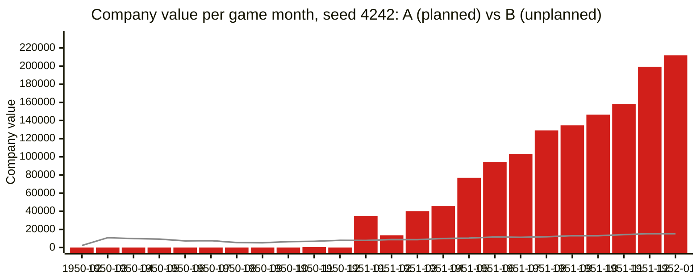
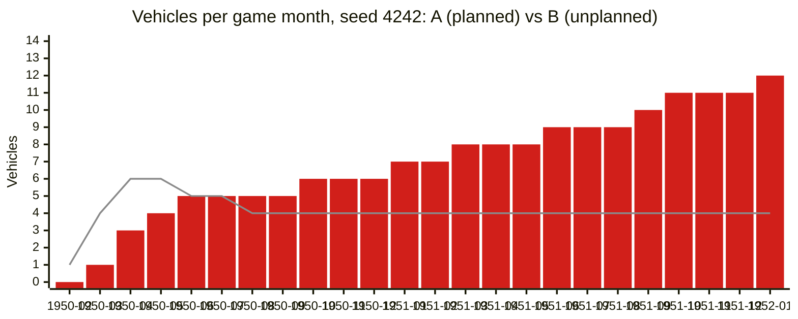

# Duel in one game: planned bot vs unplanned (seed 4242, 24 months)

Generated by `tools/research/mcp-duel` (A/B old rail geometry (bridge 19c2cbe)). One game, one map: company 1 is PrismaticAI started from
the planner's portfolio (by the panel), company 2 the same AI started without a plan right after it.
Both compete for the same towns and industries. Values come from the store's daily samples (the first sampled day of each game month), fleets from the console's `companies` command.

Read from the store `/private/tmp/claude-501/-Users-korczis-dev-OpenTTD/14bce8ae-1b38-41a1-9c99-d130ffe3c257/scratchpad/home-old/.local/state/prismatic-mcp/store/panel-55706.duckdb` (instance `panel-55706`, run started at 1794988751980 ms): 2 plan.* event(s), 3014 AI log line(s), 50 sample row(s) of the months. The verdict was not published: recovered offline: the run finished in the same second as its A/B partner, whose record took the same file name; rebuilt from this run's own store and console log by mcp-duel's own functions.

- planner: game unpaused at tick 1423 with 2 AI company(ies) after 3 s
- planner: the passenger rail pair (score 204098) is built after 0 freight line(s) that score more
- planner: after these lines the bot may plan up to 8 more itself (own_lines)
- planner: Iron Ore by rail Iron Ore Mine -> Steel Mill, 194.0 tiles, profit 6121.0/month, score 78337.0 (line 15, built when the money allows)
- planner: Wood by rail Forest -> Sawmill, 172.0 tiles, profit 7181.0/month, score 105335.0 (line 14, built when the money allows)
- planner: Oil by rail Oil Wells -> Oil Refinery, 205.0 tiles, profit 7579.0/month, score 111523.0 (line 13, built when the money allows)
- planner: Grain by rail Farm -> Factory, 200.0 tiles, profit 7569.0/month, score 112480.0 (line 12, built when the money allows)
- planner: Grain by rail Farm -> Factory, 222.0 tiles, profit 7675.0/month, score 113390.0 (line 11, built when the money allows)
- planner: Grain by rail Farm -> Factory, 196.0 tiles, profit 7651.0/month, score 114757.0 (line 10, built when the money allows)
- planner: Iron Ore by rail Iron Ore Mine -> Steel Mill, 173.0 tiles, profit 7797.0/month, score 120138.0 (line 9, built when the money allows)
- planner: Grain by rail Farm -> Factory, 237.0 tiles, profit 9438.0/month, score 128030.0 (line 8, built when the money allows)
- planner: Wood by rail Forest -> Sawmill, 243.0 tiles, profit 8456.0/month, score 130603.0 (line 7, built when the money allows)
- planner: Iron Ore by rail Iron Ore Mine -> Steel Mill, 221.0 tiles, profit 8424.0/month, score 131568.0 (line 6, built when the money allows)
- planner: Iron Ore by rail Iron Ore Mine -> Steel Mill, 198.0 tiles, profit 8409.0/month, score 132931.0 (line 5, built when the money allows)
- planner: Wood by rail Forest -> Sawmill, 160.0 tiles, profit 8321.0/month, score 133583.0 (line 4, built when the money allows)
- planner: Grain by rail Farm -> Factory, 244.0 tiles, profit 9707.0/month, score 133969.0 (line 3, built when the money allows)
- planner: Wood by rail Forest -> Sawmill, 232.0 tiles, profit 10188.0/month, score 146493.0 (line 2, built when the money allows)
- planner: Coal by rail Coal Mine -> Power Station, 242.0 tiles, profit 9671.0/month, score 160056.0
- planner: passengers by rail Wranville - Drundstone, score 204098.0
- planner portfolio by builtin knapsack (MCP_ALGOGLYPH_DIR not set or the runner refused): 4 investment(s), total score 714697.0, 297k of 300k
- planner: game paused for a repeatable start; it runs once 2 AI company(ies) exist

**Winner: A (planned).** Final company value: A 211797 vs B 15258. Rival spread 12.1% over 2 duels of this seed, length, opponent and start.

<!-- duel-charts:begin -->
<!-- generated by tools/research/mcp-duel from this record's JSON; `mcp-duel --render` rewrites it, `mcp-duel --render --check` fails while it is stale -->

<!-- duel-charts:end -->

| Month | Date | A (planned) value | B (unplanned) value |
|---|---|---|---|
| 1 | 1950-02-01 | 1 | 2291 |
| 2 | 1950-03-01 | 1 | 10879 |
| 3 | 1950-04-01 | 1 | 9897 |
| 4 | 1950-05-01 | 1 | 9371 |
| 5 | 1950-06-01 | 1 | 7398 |
| 6 | 1950-07-01 | 1 | 7612 |
| 7 | 1950-08-01 | 1 | 5548 |
| 8 | 1950-09-01 | 1 | 5296 |
| 9 | 1950-10-01 | 1 | 6541 |
| 10 | 1950-11-01 | 606 | 6938 |
| 11 | 1950-12-01 | 1 | 7961 |
| 12 | 1951-01-01 | 34741 | 7829 |
| 13 | 1951-02-01 | 13474 | 8890 |
| 14 | 1951-03-01 | 40012 | 8738 |
| 15 | 1951-04-01 | 45756 | 10021 |
| 16 | 1951-05-01 | 76881 | 10472 |
| 17 | 1951-06-01 | 94390 | 11627 |
| 18 | 1951-07-01 | 102916 | 11357 |
| 19 | 1951-08-01 | 129120 | 11898 |
| 20 | 1951-09-01 | 134655 | 13088 |
| 21 | 1951-10-01 | 146554 | 13000 |
| 22 | 1951-11-01 | 158284 | 14238 |
| 23 | 1951-12-01 | 199191 | 15372 |
| 24 | 1952-01-01 | 211797 | 15258 |
