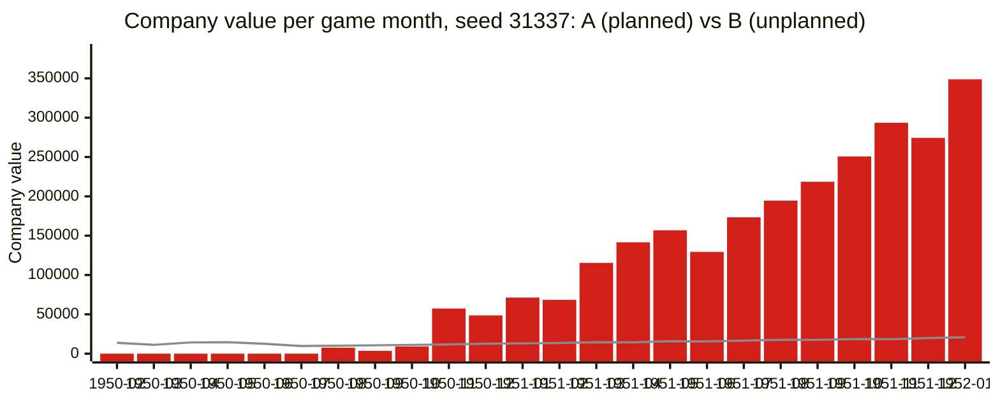
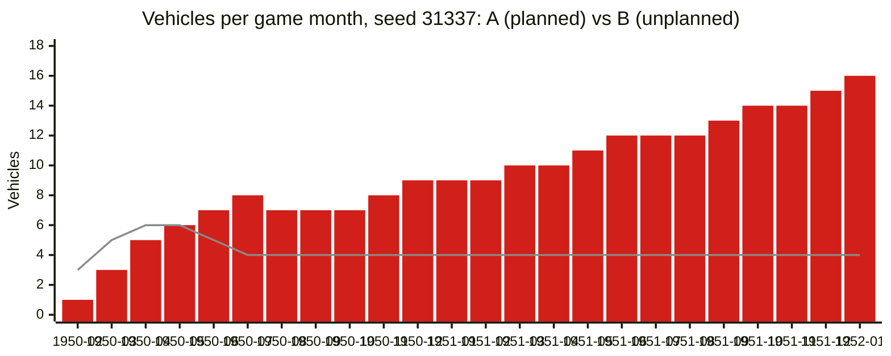

# Duel in one game: planned bot vs unplanned (seed 31337, 24 months)

Generated by `tools/research/mcp-duel` (A/B old rail geometry (bridge 19c2cbe)). One game, one map: company 1 is PrismaticAI started from
the planner's portfolio (by the panel), company 2 the same AI started without a plan right after it.
Both compete for the same towns and industries. Values come from the store's daily samples (the first sampled day of each game month), fleets from the console's `companies` command.

Read from the store `/private/tmp/claude-501/-Users-korczis-dev-OpenTTD/14bce8ae-1b38-41a1-9c99-d130ffe3c257/scratchpad/home-old/.local/state/prismatic-mcp/store/panel-63473.duckdb` (instance `panel-63473`, run started at 1794990744551 ms): 2 plan.* event(s), 3587 AI log line(s), 50 sample row(s) of the months. The verdict is plan.duel seq 4555, on the bus and in the store.

- planner: game unpaused at tick 1409 with 2 AI company(ies) after 3 s
- planner: the passenger rail pair (score 113106) is built after 14 freight line(s) that score more
- planner: after these lines the bot may plan up to 8 more itself (own_lines)
- planner: Grain by rail Farm -> Factory, 237.0 tiles, profit 6768.0/month, score 90500.0 (line 16, built when the money allows)
- planner: Oil by rail Oil Wells -> Oil Refinery, 242.0 tiles, profit 7660.0/month, score 110680.0 (line 15, built when the money allows)
- planner: Grain by rail Farm -> Factory, 211.0 tiles, profit 7668.0/month, score 114039.0 (line 14, built when the money allows)
- planner: Wood by rail Forest -> Sawmill, 236.0 tiles, profit 8455.0/month, score 131101.0 (line 13, built when the money allows)
- planner: Grain by rail Farm -> Factory, 241.0 tiles, profit 9592.0/month, score 131428.0 (line 12, built when the money allows)
- planner: Wood by rail Forest -> Sawmill, 177.0 tiles, profit 8377.0/month, score 133648.0 (line 11, built when the money allows)
- planner: Wood by rail Forest -> Sawmill, 233.0 tiles, profit 10231.0/month, score 147441.0 (line 10, built when the money allows)
- planner: Coal by rail Coal Mine -> Power Station, 193.0 tiles, profit 9261.0/month, score 153896.0 (line 9, built when the money allows)
- planner: Coal by rail Coal Mine -> Power Station, 242.0 tiles, profit 9727.0/month, score 161400.0 (line 8, built when the money allows)
- planner: Coal by rail Coal Mine -> Power Station, 221.0 tiles, profit 9709.0/month, score 162551.0 (line 7, built when the money allows)
- planner: Coal by rail Coal Mine -> Power Station, 190.0 tiles, profit 9677.0/month, score 164105.0 (line 6, built when the money allows)
- planner: Wood by rail Forest -> Sawmill, 177.0 tiles, profit 10783.0/month, score 164897.0 (line 5, built when the money allows)
- planner: Coal by rail Coal Mine -> Power Station, 153.0 tiles, profit 10758.0/month, score 166443.0 (line 4, built when the money allows)
- planner: Wood by rail Forest -> Sawmill, 238.0 tiles, profit 14187.0/month, score 215507.0 (line 3, built when the money allows)
- planner: Coal by rail Coal Mine -> Power Station, 227.0 tiles, profit 14079.0/month, score 240592.0 (line 2, built when the money allows)
- planner: Coal by rail Coal Mine -> Power Station, 212.0 tiles, profit 14568.0/month, score 253447.0
- planner: passengers by rail New Prunpool - Little Bonnley Market, score 113106.0
- planner portfolio by builtin knapsack (MCP_ALGOGLYPH_DIR not set or the runner refused): 5 investment(s), total score 756048.0, 294k of 300k
- planner: game paused for a repeatable start; it runs once 2 AI company(ies) exist

**Winner: A (planned).** Final company value: A 348825 vs B 20844. Rival spread 40.8% over 2 duels of this seed, length, opponent and start.

<!-- duel-charts:begin -->
<!-- generated by tools/research/mcp-duel from this record's JSON; `mcp-duel --render` rewrites it, `mcp-duel --render --check` fails while it is stale -->

<!-- duel-charts:end -->

| Month | Date | A (planned) value | B (unplanned) value |
|---|---|---|---|
| 1 | 1950-02-01 | 1 | 13773 |
| 2 | 1950-03-01 | 1 | 11251 |
| 3 | 1950-04-01 | 1 | 14262 |
| 4 | 1950-05-01 | 1 | 14617 |
| 5 | 1950-06-01 | 1 | 12497 |
| 6 | 1950-07-01 | 1 | 9795 |
| 7 | 1950-08-01 | 7606 | 10095 |
| 8 | 1950-09-01 | 3625 | 10612 |
| 9 | 1950-10-01 | 9221 | 11235 |
| 10 | 1950-11-01 | 57352 | 11668 |
| 11 | 1950-12-01 | 48594 | 12708 |
| 12 | 1951-01-01 | 71313 | 13042 |
| 13 | 1951-02-01 | 68439 | 13492 |
| 14 | 1951-03-01 | 115409 | 14568 |
| 15 | 1951-04-01 | 141561 | 14343 |
| 16 | 1951-05-01 | 156841 | 15743 |
| 17 | 1951-06-01 | 129387 | 15519 |
| 18 | 1951-07-01 | 173358 | 16633 |
| 19 | 1951-08-01 | 194544 | 17635 |
| 20 | 1951-09-01 | 218573 | 17530 |
| 21 | 1951-10-01 | 250716 | 18583 |
| 22 | 1951-11-01 | 293541 | 18441 |
| 23 | 1951-12-01 | 274360 | 19801 |
| 24 | 1952-01-01 | 348825 | 20844 |
