# Duel in one game: planned bot vs unplanned (seed 31337, 120 months)

Generated by `tools/research/mcp-duel` (I0087 held pair seed 31337: constant (own_lines 8, rail_after from scores; switch off)). One game, one map: company 1 is PrismaticAI started from
the planner's portfolio (by the panel), company 2 the same AI started without a plan right after it.
Both compete for the same towns and industries. Values come from the store's daily samples (the first sampled day of each game month), fleets from the console's `companies` command.

Read from the store `/Users/korczis/.local/state/prismatic-mcp/store/panel-51155.duckdb` (instance `panel-51155`, run started at 1794986205890 ms): 2 plan.* event(s), 6148 AI log line(s), 242 sample row(s) of the months. The verdict is plan.duel seq 10423, on the bus and in the store.

- planner: game unpaused at tick 1436 with 2 AI company(ies) after 119 s
- planner: the passenger rail pair (score 113003) is built after 13 freight line(s) that score more
- planner: after these lines the bot may plan up to 8 more itself (own_lines)
- planner: Wood by rail Forest -> Sawmill, 236.0 tiles, profit 8455.0/month, score 130726.0 (line 13, built when the money allows)
- planner: Grain by rail Farm -> Factory, 241.0 tiles, profit 9592.0/month, score 131308.0 (line 12, built when the money allows)
- planner: Wood by rail Forest -> Sawmill, 177.0 tiles, profit 8377.0/month, score 132720.0 (line 11, built when the money allows)
- planner: Wood by rail Forest -> Sawmill, 233.0 tiles, profit 10231.0/month, score 146588.0 (line 10, built when the money allows)
- planner: Coal by rail Coal Mine -> Power Station, 193.0 tiles, profit 9261.0/month, score 153671.0 (line 9, built when the money allows)
- planner: Coal by rail Coal Mine -> Power Station, 242.0 tiles, profit 9727.0/month, score 161312.0 (line 8, built when the money allows)
- planner: Coal by rail Coal Mine -> Power Station, 221.0 tiles, profit 9709.0/month, score 161537.0 (line 7, built when the money allows)
- planner: Coal by rail Coal Mine -> Power Station, 190.0 tiles, profit 9677.0/month, score 163280.0 (line 6, built when the money allows)
- planner: Wood by rail Forest -> Sawmill, 177.0 tiles, profit 10783.0/month, score 164447.0 (line 5, built when the money allows)
- planner: Coal by rail Coal Mine -> Power Station, 153.0 tiles, profit 10758.0/month, score 166533.0 (line 4, built when the money allows)
- planner: Wood by rail Forest -> Sawmill, 238.0 tiles, profit 14187.0/month, score 215012.0 (line 3, built when the money allows)
- planner: Coal by rail Coal Mine -> Power Station, 227.0 tiles, profit 14079.0/month, score 240547.0 (line 2, built when the money allows)
- planner: Coal by rail Coal Mine -> Power Station, 212.0 tiles, profit 14568.0/month, score 252708.0
- planner: passengers by rail New Prunpool - Little Bonnley Market, score 113003.0
- planner: 21 rail line(s) priced on the map by track-planning, 21 with a route: 207 pieces 16639, 189 pieces 14325, 224 pieces 17070, 231 pieces 18345, 150 pieces 11385, 170 pieces 13725, 187 pieces 15075, 131 pieces 11569, 210 pieces 17589, 237 pieces 18238, 194 pieces 14700, 157 pieces 12283, 238 pieces 18328, 182 pieces 14203, 238 pieces 18195, 229 pieces 18075, 196 pieces 15943, 234 pieces 17895, 157 pieces 12328, 175 pieces 14391, 173 pieces 13528
- planner portfolio by algoglyph knapsack-dp: 5 investment(s), total score 753612.0, 295k of 300k
- planner: game paused for a repeatable start; it runs once 2 AI company(ies) exist

**Winner: A (planned).** Final company value: A 4940838 vs B 67948. Rival spread 29.3% over 4 duels of this seed, length, opponent and start.

```mermaid
---
config:
  xyChart:
    width: 900
    height: 360
  themeVariables:
    xyChart:
      plotColorPalette: "#d11f1a, #8a8a8a, #0b0b0b, #ece4d6"
---
xychart-beta
    title "Company value per game month, seed 31337: A (planned) vs B (unplanned)"
    x-axis ["1950-02", "1950-03", "1950-04", "1950-05", "1950-06", "1950-07", "1950-08", "1950-09", "1950-10", "1950-11", "1950-12", "1951-01", "1951-02", "1951-03", "1951-04", "1951-05", "1951-06", "1951-07", "1951-08", "1951-09", "1951-10", "1951-11", "1951-12", "1952-01", "1952-02", "1952-03", "1952-04", "1952-05", "1952-06", "1952-07", "1952-08", "1952-09", "1952-10", "1952-11", "1952-12", "1953-01", "1953-02", "1953-03", "1953-04", "1953-05", "1953-06", "1953-07", "1953-08", "1953-09", "1953-10", "1953-11", "1953-12", "1954-01", "1954-02", "1954-03", "1954-04", "1954-05", "1954-06", "1954-07", "1954-08", "1954-09", "1954-10", "1954-11", "1954-12", "1955-01", "1955-02", "1955-03", "1955-04", "1955-05", "1955-06", "1955-07", "1955-08", "1955-09", "1955-10", "1955-11", "1955-12", "1956-01", "1956-02", "1956-03", "1956-04", "1956-05", "1956-06", "1956-07", "1956-08", "1956-09", "1956-10", "1956-11", "1956-12", "1957-01", "1957-02", "1957-03", "1957-04", "1957-05", "1957-06", "1957-07", "1957-08", "1957-09", "1957-10", "1957-11", "1957-12", "1958-01", "1958-02", "1958-03", "1958-04", "1958-05", "1958-06", "1958-07", "1958-08", "1958-09", "1958-10", "1958-11", "1958-12", "1959-01", "1959-02", "1959-03", "1959-04", "1959-05", "1959-06", "1959-07", "1959-08", "1959-09", "1959-10", "1959-11", "1959-12", "1960-01"]
    %% series: A (planned) | B (unplanned)
    %% links: duel-20261118T102031-seed31337.md?col=Month&filter=1 | duel-20261118T102031-seed31337.md?col=Month&filter=2 | duel-20261118T102031-seed31337.md?col=Month&filter=3 | duel-20261118T102031-seed31337.md?col=Month&filter=4 | duel-20261118T102031-seed31337.md?col=Month&filter=5 | duel-20261118T102031-seed31337.md?col=Month&filter=6 | duel-20261118T102031-seed31337.md?col=Month&filter=7 | duel-20261118T102031-seed31337.md?col=Month&filter=8 | duel-20261118T102031-seed31337.md?col=Month&filter=9 | duel-20261118T102031-seed31337.md?col=Month&filter=10 | duel-20261118T102031-seed31337.md?col=Month&filter=11 | duel-20261118T102031-seed31337.md?col=Month&filter=12 | duel-20261118T102031-seed31337.md?col=Month&filter=13 | duel-20261118T102031-seed31337.md?col=Month&filter=14 | duel-20261118T102031-seed31337.md?col=Month&filter=15 | duel-20261118T102031-seed31337.md?col=Month&filter=16 | duel-20261118T102031-seed31337.md?col=Month&filter=17 | duel-20261118T102031-seed31337.md?col=Month&filter=18 | duel-20261118T102031-seed31337.md?col=Month&filter=19 | duel-20261118T102031-seed31337.md?col=Month&filter=20 | duel-20261118T102031-seed31337.md?col=Month&filter=21 | duel-20261118T102031-seed31337.md?col=Month&filter=22 | duel-20261118T102031-seed31337.md?col=Month&filter=23 | duel-20261118T102031-seed31337.md?col=Month&filter=24 | duel-20261118T102031-seed31337.md?col=Month&filter=25 | duel-20261118T102031-seed31337.md?col=Month&filter=26 | duel-20261118T102031-seed31337.md?col=Month&filter=27 | duel-20261118T102031-seed31337.md?col=Month&filter=28 | duel-20261118T102031-seed31337.md?col=Month&filter=29 | duel-20261118T102031-seed31337.md?col=Month&filter=30 | duel-20261118T102031-seed31337.md?col=Month&filter=31 | duel-20261118T102031-seed31337.md?col=Month&filter=32 | duel-20261118T102031-seed31337.md?col=Month&filter=33 | duel-20261118T102031-seed31337.md?col=Month&filter=34 | duel-20261118T102031-seed31337.md?col=Month&filter=35 | duel-20261118T102031-seed31337.md?col=Month&filter=36 | duel-20261118T102031-seed31337.md?col=Month&filter=37 | duel-20261118T102031-seed31337.md?col=Month&filter=38 | duel-20261118T102031-seed31337.md?col=Month&filter=39 | duel-20261118T102031-seed31337.md?col=Month&filter=40 | duel-20261118T102031-seed31337.md?col=Month&filter=41 | duel-20261118T102031-seed31337.md?col=Month&filter=42 | duel-20261118T102031-seed31337.md?col=Month&filter=43 | duel-20261118T102031-seed31337.md?col=Month&filter=44 | duel-20261118T102031-seed31337.md?col=Month&filter=45 | duel-20261118T102031-seed31337.md?col=Month&filter=46 | duel-20261118T102031-seed31337.md?col=Month&filter=47 | duel-20261118T102031-seed31337.md?col=Month&filter=48 | duel-20261118T102031-seed31337.md?col=Month&filter=49 | duel-20261118T102031-seed31337.md?col=Month&filter=50 | duel-20261118T102031-seed31337.md?col=Month&filter=51 | duel-20261118T102031-seed31337.md?col=Month&filter=52 | duel-20261118T102031-seed31337.md?col=Month&filter=53 | duel-20261118T102031-seed31337.md?col=Month&filter=54 | duel-20261118T102031-seed31337.md?col=Month&filter=55 | duel-20261118T102031-seed31337.md?col=Month&filter=56 | duel-20261118T102031-seed31337.md?col=Month&filter=57 | duel-20261118T102031-seed31337.md?col=Month&filter=58 | duel-20261118T102031-seed31337.md?col=Month&filter=59 | duel-20261118T102031-seed31337.md?col=Month&filter=60 | duel-20261118T102031-seed31337.md?col=Month&filter=61 | duel-20261118T102031-seed31337.md?col=Month&filter=62 | duel-20261118T102031-seed31337.md?col=Month&filter=63 | duel-20261118T102031-seed31337.md?col=Month&filter=64 | duel-20261118T102031-seed31337.md?col=Month&filter=65 | duel-20261118T102031-seed31337.md?col=Month&filter=66 | duel-20261118T102031-seed31337.md?col=Month&filter=67 | duel-20261118T102031-seed31337.md?col=Month&filter=68 | duel-20261118T102031-seed31337.md?col=Month&filter=69 | duel-20261118T102031-seed31337.md?col=Month&filter=70 | duel-20261118T102031-seed31337.md?col=Month&filter=71 | duel-20261118T102031-seed31337.md?col=Month&filter=72 | duel-20261118T102031-seed31337.md?col=Month&filter=73 | duel-20261118T102031-seed31337.md?col=Month&filter=74 | duel-20261118T102031-seed31337.md?col=Month&filter=75 | duel-20261118T102031-seed31337.md?col=Month&filter=76 | duel-20261118T102031-seed31337.md?col=Month&filter=77 | duel-20261118T102031-seed31337.md?col=Month&filter=78 | duel-20261118T102031-seed31337.md?col=Month&filter=79 | duel-20261118T102031-seed31337.md?col=Month&filter=80 | duel-20261118T102031-seed31337.md?col=Month&filter=81 | duel-20261118T102031-seed31337.md?col=Month&filter=82 | duel-20261118T102031-seed31337.md?col=Month&filter=83 | duel-20261118T102031-seed31337.md?col=Month&filter=84 | duel-20261118T102031-seed31337.md?col=Month&filter=85 | duel-20261118T102031-seed31337.md?col=Month&filter=86 | duel-20261118T102031-seed31337.md?col=Month&filter=87 | duel-20261118T102031-seed31337.md?col=Month&filter=88 | duel-20261118T102031-seed31337.md?col=Month&filter=89 | duel-20261118T102031-seed31337.md?col=Month&filter=90 | duel-20261118T102031-seed31337.md?col=Month&filter=91 | duel-20261118T102031-seed31337.md?col=Month&filter=92 | duel-20261118T102031-seed31337.md?col=Month&filter=93 | duel-20261118T102031-seed31337.md?col=Month&filter=94 | duel-20261118T102031-seed31337.md?col=Month&filter=95 | duel-20261118T102031-seed31337.md?col=Month&filter=96 | duel-20261118T102031-seed31337.md?col=Month&filter=97 | duel-20261118T102031-seed31337.md?col=Month&filter=98 | duel-20261118T102031-seed31337.md?col=Month&filter=99 | duel-20261118T102031-seed31337.md?col=Month&filter=100 | duel-20261118T102031-seed31337.md?col=Month&filter=101 | duel-20261118T102031-seed31337.md?col=Month&filter=102 | duel-20261118T102031-seed31337.md?col=Month&filter=103 | duel-20261118T102031-seed31337.md?col=Month&filter=104 | duel-20261118T102031-seed31337.md?col=Month&filter=105 | duel-20261118T102031-seed31337.md?col=Month&filter=106 | duel-20261118T102031-seed31337.md?col=Month&filter=107 | duel-20261118T102031-seed31337.md?col=Month&filter=108 | duel-20261118T102031-seed31337.md?col=Month&filter=109 | duel-20261118T102031-seed31337.md?col=Month&filter=110 | duel-20261118T102031-seed31337.md?col=Month&filter=111 | duel-20261118T102031-seed31337.md?col=Month&filter=112 | duel-20261118T102031-seed31337.md?col=Month&filter=113 | duel-20261118T102031-seed31337.md?col=Month&filter=114 | duel-20261118T102031-seed31337.md?col=Month&filter=115 | duel-20261118T102031-seed31337.md?col=Month&filter=116 | duel-20261118T102031-seed31337.md?col=Month&filter=117 | duel-20261118T102031-seed31337.md?col=Month&filter=118 | duel-20261118T102031-seed31337.md?col=Month&filter=119 | duel-20261118T102031-seed31337.md?col=Month&filter=120
    y-axis "Company value" 0 --> 5430000
    bar [1, 1, 1, 1, 1, 1, 1, 3790, 9705, 52429, 49632, 72735, 95194, 115447, 144359, 161423, 141659, 160581, 200241, 190354, 270915, 320221, 305595, 361588, 417053, 405332, 446904, 508925, 537875, 532623, 545111, 661521, 720504, 733181, 834663, 892256, 919589, 1011327, 1040347, 1109710, 1193199, 1245861, 1258729, 1308846, 1399919, 1461754, 1480740, 1525908, 1615390, 1651910, 1686897, 1741783, 1780709, 1814578, 1885089, 1939910, 1945735, 2029754, 2052504, 2091082, 2126972, 2180218, 2243316, 2299811, 2320610, 2373049, 2422766, 2476155, 2512687, 2536120, 2620526, 2662873, 2719535, 2736191, 2796369, 2831466, 2907015, 2956783, 2991664, 3023536, 3081905, 3140341, 3164940, 3217627, 3258429, 3308678, 3390756, 3395777, 3471171, 3515715, 3557199, 3590920, 3639914, 3699113, 3736977, 3803467, 3867776, 3889354, 3923425, 3947214, 4030613, 4069685, 4103469, 4140114, 4229832, 4263043, 4302476, 4350973, 4415574, 4423064, 4492291, 4552283, 4615080, 4625439, 4687297, 4787533, 4794785, 4817442, 4886076, 4940838]
    line [13774, 11077, 16390, 14374, 12212, 9567, 9909, 10349, 10760, 11233, 12527, 12607, 13372, 14435, 14274, 15291, 15187, 16249, 17606, 17527, 18588, 18464, 19514, 20080, 20770, 21934, 21768, 22941, 22784, 23891, 24421, 25269, 26146, 26971, 27441, 28070, 28613, 29428, 29653, 30778, 31338, 31468, 31969, 32484, 33125, 33424, 34000, 35056, 35105, 35662, 36146, 36523, 37444, 37759, 38119, 38140, 39293, 39338, 39844, 40230, 40844, 41093, 41225, 42014, 42945, 42994, 43638, 44236, 44367, 45185, 45209, 45696, 46856, 47404, 48035, 48079, 48960, 49522, 50108, 51195, 51110, 52126, 52649, 53706, 54419, 54510, 55152, 55761, 56242, 54330, 54657, 55399, 55512, 55677, 56399, 56640, 56825, 56981, 57618, 58207, 58308, 59298, 59531, 59856, 60782, 60925, 61198, 61902, 62306, 62394, 62845, 63660, 63803, 64670, 65287, 65581, 66140, 66392, 67230, 67948]
```

```mermaid
---
config:
  xyChart:
    width: 900
    height: 360
  themeVariables:
    xyChart:
      plotColorPalette: "#d11f1a, #8a8a8a, #0b0b0b, #ece4d6"
---
xychart-beta
    title "Vehicles per game month, seed 31337: A (planned) vs B (unplanned)"
    x-axis ["1950-02", "1950-03", "1950-04", "1950-05", "1950-06", "1950-07", "1950-08", "1950-09", "1950-10", "1950-11", "1950-12", "1951-01", "1951-02", "1951-03", "1951-04", "1951-05", "1951-06", "1951-07", "1951-08", "1951-09", "1951-10", "1951-11", "1951-12", "1952-01", "1952-02", "1952-03", "1952-04", "1952-05", "1952-06", "1952-07", "1952-08", "1952-09", "1952-10", "1952-11", "1952-12", "1953-01", "1953-02", "1953-03", "1953-04", "1953-05", "1953-06", "1953-07", "1953-08", "1953-09", "1953-10", "1953-11", "1953-12", "1954-01", "1954-02", "1954-03", "1954-04", "1954-05", "1954-06", "1954-07", "1954-08", "1954-09", "1954-10", "1954-11", "1954-12", "1955-01", "1955-02", "1955-03", "1955-04", "1955-05", "1955-06", "1955-07", "1955-08", "1955-09", "1955-10", "1955-11", "1955-12", "1956-01", "1956-02", "1956-03", "1956-04", "1956-05", "1956-06", "1956-07", "1956-08", "1956-09", "1956-10", "1956-11", "1956-12", "1957-01", "1957-02", "1957-03", "1957-04", "1957-05", "1957-06", "1957-07", "1957-08", "1957-09", "1957-10", "1957-11", "1957-12", "1958-01", "1958-02", "1958-03", "1958-04", "1958-05", "1958-06", "1958-07", "1958-08", "1958-09", "1958-10", "1958-11", "1958-12", "1959-01", "1959-02", "1959-03", "1959-04", "1959-05", "1959-06", "1959-07", "1959-08", "1959-09", "1959-10", "1959-11", "1959-12", "1960-01"]
    %% series: A (planned) | B (unplanned)
    %% links: duel-20261118T102031-seed31337.md?col=Month&filter=1 | duel-20261118T102031-seed31337.md?col=Month&filter=2 | duel-20261118T102031-seed31337.md?col=Month&filter=3 | duel-20261118T102031-seed31337.md?col=Month&filter=4 | duel-20261118T102031-seed31337.md?col=Month&filter=5 | duel-20261118T102031-seed31337.md?col=Month&filter=6 | duel-20261118T102031-seed31337.md?col=Month&filter=7 | duel-20261118T102031-seed31337.md?col=Month&filter=8 | duel-20261118T102031-seed31337.md?col=Month&filter=9 | duel-20261118T102031-seed31337.md?col=Month&filter=10 | duel-20261118T102031-seed31337.md?col=Month&filter=11 | duel-20261118T102031-seed31337.md?col=Month&filter=12 | duel-20261118T102031-seed31337.md?col=Month&filter=13 | duel-20261118T102031-seed31337.md?col=Month&filter=14 | duel-20261118T102031-seed31337.md?col=Month&filter=15 | duel-20261118T102031-seed31337.md?col=Month&filter=16 | duel-20261118T102031-seed31337.md?col=Month&filter=17 | duel-20261118T102031-seed31337.md?col=Month&filter=18 | duel-20261118T102031-seed31337.md?col=Month&filter=19 | duel-20261118T102031-seed31337.md?col=Month&filter=20 | duel-20261118T102031-seed31337.md?col=Month&filter=21 | duel-20261118T102031-seed31337.md?col=Month&filter=22 | duel-20261118T102031-seed31337.md?col=Month&filter=23 | duel-20261118T102031-seed31337.md?col=Month&filter=24 | duel-20261118T102031-seed31337.md?col=Month&filter=25 | duel-20261118T102031-seed31337.md?col=Month&filter=26 | duel-20261118T102031-seed31337.md?col=Month&filter=27 | duel-20261118T102031-seed31337.md?col=Month&filter=28 | duel-20261118T102031-seed31337.md?col=Month&filter=29 | duel-20261118T102031-seed31337.md?col=Month&filter=30 | duel-20261118T102031-seed31337.md?col=Month&filter=31 | duel-20261118T102031-seed31337.md?col=Month&filter=32 | duel-20261118T102031-seed31337.md?col=Month&filter=33 | duel-20261118T102031-seed31337.md?col=Month&filter=34 | duel-20261118T102031-seed31337.md?col=Month&filter=35 | duel-20261118T102031-seed31337.md?col=Month&filter=36 | duel-20261118T102031-seed31337.md?col=Month&filter=37 | duel-20261118T102031-seed31337.md?col=Month&filter=38 | duel-20261118T102031-seed31337.md?col=Month&filter=39 | duel-20261118T102031-seed31337.md?col=Month&filter=40 | duel-20261118T102031-seed31337.md?col=Month&filter=41 | duel-20261118T102031-seed31337.md?col=Month&filter=42 | duel-20261118T102031-seed31337.md?col=Month&filter=43 | duel-20261118T102031-seed31337.md?col=Month&filter=44 | duel-20261118T102031-seed31337.md?col=Month&filter=45 | duel-20261118T102031-seed31337.md?col=Month&filter=46 | duel-20261118T102031-seed31337.md?col=Month&filter=47 | duel-20261118T102031-seed31337.md?col=Month&filter=48 | duel-20261118T102031-seed31337.md?col=Month&filter=49 | duel-20261118T102031-seed31337.md?col=Month&filter=50 | duel-20261118T102031-seed31337.md?col=Month&filter=51 | duel-20261118T102031-seed31337.md?col=Month&filter=52 | duel-20261118T102031-seed31337.md?col=Month&filter=53 | duel-20261118T102031-seed31337.md?col=Month&filter=54 | duel-20261118T102031-seed31337.md?col=Month&filter=55 | duel-20261118T102031-seed31337.md?col=Month&filter=56 | duel-20261118T102031-seed31337.md?col=Month&filter=57 | duel-20261118T102031-seed31337.md?col=Month&filter=58 | duel-20261118T102031-seed31337.md?col=Month&filter=59 | duel-20261118T102031-seed31337.md?col=Month&filter=60 | duel-20261118T102031-seed31337.md?col=Month&filter=61 | duel-20261118T102031-seed31337.md?col=Month&filter=62 | duel-20261118T102031-seed31337.md?col=Month&filter=63 | duel-20261118T102031-seed31337.md?col=Month&filter=64 | duel-20261118T102031-seed31337.md?col=Month&filter=65 | duel-20261118T102031-seed31337.md?col=Month&filter=66 | duel-20261118T102031-seed31337.md?col=Month&filter=67 | duel-20261118T102031-seed31337.md?col=Month&filter=68 | duel-20261118T102031-seed31337.md?col=Month&filter=69 | duel-20261118T102031-seed31337.md?col=Month&filter=70 | duel-20261118T102031-seed31337.md?col=Month&filter=71 | duel-20261118T102031-seed31337.md?col=Month&filter=72 | duel-20261118T102031-seed31337.md?col=Month&filter=73 | duel-20261118T102031-seed31337.md?col=Month&filter=74 | duel-20261118T102031-seed31337.md?col=Month&filter=75 | duel-20261118T102031-seed31337.md?col=Month&filter=76 | duel-20261118T102031-seed31337.md?col=Month&filter=77 | duel-20261118T102031-seed31337.md?col=Month&filter=78 | duel-20261118T102031-seed31337.md?col=Month&filter=79 | duel-20261118T102031-seed31337.md?col=Month&filter=80 | duel-20261118T102031-seed31337.md?col=Month&filter=81 | duel-20261118T102031-seed31337.md?col=Month&filter=82 | duel-20261118T102031-seed31337.md?col=Month&filter=83 | duel-20261118T102031-seed31337.md?col=Month&filter=84 | duel-20261118T102031-seed31337.md?col=Month&filter=85 | duel-20261118T102031-seed31337.md?col=Month&filter=86 | duel-20261118T102031-seed31337.md?col=Month&filter=87 | duel-20261118T102031-seed31337.md?col=Month&filter=88 | duel-20261118T102031-seed31337.md?col=Month&filter=89 | duel-20261118T102031-seed31337.md?col=Month&filter=90 | duel-20261118T102031-seed31337.md?col=Month&filter=91 | duel-20261118T102031-seed31337.md?col=Month&filter=92 | duel-20261118T102031-seed31337.md?col=Month&filter=93 | duel-20261118T102031-seed31337.md?col=Month&filter=94 | duel-20261118T102031-seed31337.md?col=Month&filter=95 | duel-20261118T102031-seed31337.md?col=Month&filter=96 | duel-20261118T102031-seed31337.md?col=Month&filter=97 | duel-20261118T102031-seed31337.md?col=Month&filter=98 | duel-20261118T102031-seed31337.md?col=Month&filter=99 | duel-20261118T102031-seed31337.md?col=Month&filter=100 | duel-20261118T102031-seed31337.md?col=Month&filter=101 | duel-20261118T102031-seed31337.md?col=Month&filter=102 | duel-20261118T102031-seed31337.md?col=Month&filter=103 | duel-20261118T102031-seed31337.md?col=Month&filter=104 | duel-20261118T102031-seed31337.md?col=Month&filter=105 | duel-20261118T102031-seed31337.md?col=Month&filter=106 | duel-20261118T102031-seed31337.md?col=Month&filter=107 | duel-20261118T102031-seed31337.md?col=Month&filter=108 | duel-20261118T102031-seed31337.md?col=Month&filter=109 | duel-20261118T102031-seed31337.md?col=Month&filter=110 | duel-20261118T102031-seed31337.md?col=Month&filter=111 | duel-20261118T102031-seed31337.md?col=Month&filter=112 | duel-20261118T102031-seed31337.md?col=Month&filter=113 | duel-20261118T102031-seed31337.md?col=Month&filter=114 | duel-20261118T102031-seed31337.md?col=Month&filter=115 | duel-20261118T102031-seed31337.md?col=Month&filter=116 | duel-20261118T102031-seed31337.md?col=Month&filter=117 | duel-20261118T102031-seed31337.md?col=Month&filter=118 | duel-20261118T102031-seed31337.md?col=Month&filter=119 | duel-20261118T102031-seed31337.md?col=Month&filter=120
    y-axis "Vehicles" 0 --> 26
    bar [0, 3, 5, 6, 7, 8, 7, 7, 7, 8, 9, 9, 9, 10, 10, 11, 11, 12, 12, 13, 14, 15, 16, 16, 17, 18, 19, 19, 20, 22, 22, 23, 23, 23, 23, 23, 23, 23, 23, 23, 23, 23, 23, 23, 23, 23, 23, 23, 23, 23, 23, 23, 23, 23, 23, 22, 22, 22, 22, 22, 22, 22, 22, 22, 22, 22, 22, 22, 22, 22, 22, 22, 22, 22, 22, 22, 22, 22, 22, 22, 22, 22, 22, 22, 22, 22, 22, 22, 22, 22, 22, 22, 22, 22, 22, 22, 22, 22, 22, 22, 22, 21, 21, 21, 21, 21, 21, 21, 21, 21, 21, 21, 21, 21, 21, 21, 21, 21, 21, 21]
    line [3, 5, 7, 6, 5, 4, 4, 4, 4, 4, 4, 4, 4, 4, 4, 4, 4, 4, 4, 4, 4, 4, 4, 4, 4, 4, 4, 4, 4, 4, 4, 4, 4, 4, 4, 4, 4, 4, 4, 4, 4, 4, 4, 4, 4, 4, 4, 4, 4, 4, 4, 4, 4, 4, 4, 4, 4, 4, 4, 4, 4, 4, 4, 4, 4, 4, 4, 4, 4, 4, 4, 4, 4, 4, 4, 4, 4, 4, 4, 4, 4, 4, 4, 4, 4, 4, 4, 4, 4, 3, 3, 3, 3, 3, 3, 3, 3, 3, 3, 3, 3, 3, 3, 3, 3, 3, 3, 3, 3, 3, 3, 3, 3, 3, 3, 3, 3, 3, 3, 3]
```

<!-- duel-charts:begin -->
<!-- generated by tools/research/mcp-duel from this record's JSON; `mcp-duel --render` rewrites it, `mcp-duel --render --check` fails while it is stale -->

<!-- duel-charts:end -->

| Month | Date | A (planned) value | B (unplanned) value |
|---|---|---|---|
| 1 | 1950-02-01 | 1 | 13774 |
| 2 | 1950-03-01 | 1 | 11077 |
| 3 | 1950-04-01 | 1 | 16390 |
| 4 | 1950-05-01 | 1 | 14374 |
| 5 | 1950-06-01 | 1 | 12212 |
| 6 | 1950-07-01 | 1 | 9567 |
| 7 | 1950-08-01 | 1 | 9909 |
| 8 | 1950-09-01 | 3790 | 10349 |
| 9 | 1950-10-01 | 9705 | 10760 |
| 10 | 1950-11-01 | 52429 | 11233 |
| 11 | 1950-12-01 | 49632 | 12527 |
| 12 | 1951-01-01 | 72735 | 12607 |
| 13 | 1951-02-01 | 95194 | 13372 |
| 14 | 1951-03-01 | 115447 | 14435 |
| 15 | 1951-04-01 | 144359 | 14274 |
| 16 | 1951-05-01 | 161423 | 15291 |
| 17 | 1951-06-01 | 141659 | 15187 |
| 18 | 1951-07-01 | 160581 | 16249 |
| 19 | 1951-08-01 | 200241 | 17606 |
| 20 | 1951-09-01 | 190354 | 17527 |
| 21 | 1951-10-01 | 270915 | 18588 |
| 22 | 1951-11-01 | 320221 | 18464 |
| 23 | 1951-12-01 | 305595 | 19514 |
| 24 | 1952-01-01 | 361588 | 20080 |
| 25 | 1952-02-01 | 417053 | 20770 |
| 26 | 1952-03-01 | 405332 | 21934 |
| 27 | 1952-04-01 | 446904 | 21768 |
| 28 | 1952-05-01 | 508925 | 22941 |
| 29 | 1952-06-01 | 537875 | 22784 |
| 30 | 1952-07-01 | 532623 | 23891 |
| 31 | 1952-08-01 | 545111 | 24421 |
| 32 | 1952-09-01 | 661521 | 25269 |
| 33 | 1952-10-01 | 720504 | 26146 |
| 34 | 1952-11-01 | 733181 | 26971 |
| 35 | 1952-12-01 | 834663 | 27441 |
| 36 | 1953-01-01 | 892256 | 28070 |
| 37 | 1953-02-01 | 919589 | 28613 |
| 38 | 1953-03-01 | 1011327 | 29428 |
| 39 | 1953-04-01 | 1040347 | 29653 |
| 40 | 1953-05-01 | 1109710 | 30778 |
| 41 | 1953-06-01 | 1193199 | 31338 |
| 42 | 1953-07-01 | 1245861 | 31468 |
| 43 | 1953-08-01 | 1258729 | 31969 |
| 44 | 1953-09-01 | 1308846 | 32484 |
| 45 | 1953-10-01 | 1399919 | 33125 |
| 46 | 1953-11-01 | 1461754 | 33424 |
| 47 | 1953-12-01 | 1480740 | 34000 |
| 48 | 1954-01-01 | 1525908 | 35056 |
| 49 | 1954-02-01 | 1615390 | 35105 |
| 50 | 1954-03-01 | 1651910 | 35662 |
| 51 | 1954-04-01 | 1686897 | 36146 |
| 52 | 1954-05-01 | 1741783 | 36523 |
| 53 | 1954-06-01 | 1780709 | 37444 |
| 54 | 1954-07-01 | 1814578 | 37759 |
| 55 | 1954-08-01 | 1885089 | 38119 |
| 56 | 1954-09-01 | 1939910 | 38140 |
| 57 | 1954-10-01 | 1945735 | 39293 |
| 58 | 1954-11-01 | 2029754 | 39338 |
| 59 | 1954-12-01 | 2052504 | 39844 |
| 60 | 1955-01-01 | 2091082 | 40230 |
| 61 | 1955-02-01 | 2126972 | 40844 |
| 62 | 1955-03-01 | 2180218 | 41093 |
| 63 | 1955-04-01 | 2243316 | 41225 |
| 64 | 1955-05-01 | 2299811 | 42014 |
| 65 | 1955-06-01 | 2320610 | 42945 |
| 66 | 1955-07-01 | 2373049 | 42994 |
| 67 | 1955-08-01 | 2422766 | 43638 |
| 68 | 1955-09-01 | 2476155 | 44236 |
| 69 | 1955-10-01 | 2512687 | 44367 |
| 70 | 1955-11-01 | 2536120 | 45185 |
| 71 | 1955-12-01 | 2620526 | 45209 |
| 72 | 1956-01-01 | 2662873 | 45696 |
| 73 | 1956-02-01 | 2719535 | 46856 |
| 74 | 1956-03-01 | 2736191 | 47404 |
| 75 | 1956-04-01 | 2796369 | 48035 |
| 76 | 1956-05-01 | 2831466 | 48079 |
| 77 | 1956-06-01 | 2907015 | 48960 |
| 78 | 1956-07-01 | 2956783 | 49522 |
| 79 | 1956-08-01 | 2991664 | 50108 |
| 80 | 1956-09-01 | 3023536 | 51195 |
| 81 | 1956-10-01 | 3081905 | 51110 |
| 82 | 1956-11-01 | 3140341 | 52126 |
| 83 | 1956-12-01 | 3164940 | 52649 |
| 84 | 1957-01-01 | 3217627 | 53706 |
| 85 | 1957-02-01 | 3258429 | 54419 |
| 86 | 1957-03-01 | 3308678 | 54510 |
| 87 | 1957-04-01 | 3390756 | 55152 |
| 88 | 1957-05-01 | 3395777 | 55761 |
| 89 | 1957-06-01 | 3471171 | 56242 |
| 90 | 1957-07-01 | 3515715 | 54330 |
| 91 | 1957-08-01 | 3557199 | 54657 |
| 92 | 1957-09-01 | 3590920 | 55399 |
| 93 | 1957-10-01 | 3639914 | 55512 |
| 94 | 1957-11-01 | 3699113 | 55677 |
| 95 | 1957-12-01 | 3736977 | 56399 |
| 96 | 1958-01-01 | 3803467 | 56640 |
| 97 | 1958-02-01 | 3867776 | 56825 |
| 98 | 1958-03-01 | 3889354 | 56981 |
| 99 | 1958-04-01 | 3923425 | 57618 |
| 100 | 1958-05-01 | 3947214 | 58207 |
| 101 | 1958-06-01 | 4030613 | 58308 |
| 102 | 1958-07-01 | 4069685 | 59298 |
| 103 | 1958-08-01 | 4103469 | 59531 |
| 104 | 1958-09-01 | 4140114 | 59856 |
| 105 | 1958-10-01 | 4229832 | 60782 |
| 106 | 1958-11-01 | 4263043 | 60925 |
| 107 | 1958-12-01 | 4302476 | 61198 |
| 108 | 1959-01-01 | 4350973 | 61902 |
| 109 | 1959-02-01 | 4415574 | 62306 |
| 110 | 1959-03-01 | 4423064 | 62394 |
| 111 | 1959-04-01 | 4492291 | 62845 |
| 112 | 1959-05-01 | 4552283 | 63660 |
| 113 | 1959-06-01 | 4615080 | 63803 |
| 114 | 1959-07-01 | 4625439 | 64670 |
| 115 | 1959-08-01 | 4687297 | 65287 |
| 116 | 1959-09-01 | 4787533 | 65581 |
| 117 | 1959-10-01 | 4794785 | 66140 |
| 118 | 1959-11-01 | 4817442 | 66392 |
| 119 | 1959-12-01 | 4886076 | 67230 |
| 120 | 1960-01-01 | 4940838 | 67948 |

## Reading this result

This is the constant half of the I0087 held-start pair on seed 31337 over 120 game months: own_lines 8,
`rail_after` from the plan's scores, switch off. Its `plan.bot_settings` says why: "constants:
PRISMATIC_BOT_FROM_DUELS is off". The derived half is duel-20261118T102030-seed31337, which chose own_lines
0 from the stored outcomes. Both had the same 13 freight lines and passenger pair and ran side by side
from a held game. The table and the reading are in the derived half's file.

**Constant 4940838 against derived 4213684.** The constant is ahead by 17.3%, inside the rival's 29.3%
spread. This half planned all eight own lines and ran up to 21 trains.

This record was **rebuilt**. Both halves ended in the same second and got one name, and the derived
half's record overwrote this one's file. The record was rebuilt from this run's store
(`/Users/korczis/.local/state/prismatic-mcp/store/panel-51155.duckdb`) with mcp-duel's own reads
(`read_store`, `series_from_samples`, `rival_spread`), with the fleet split taken from the duel's month
lines. All 120 months came from the store's samples. The run's own `plan.duel` (seq in `verdict_event`)
names `duel-20261118T102030-seed31337.json`, the file it was meant to write.
