# Duel in one game: planned bot vs unplanned (seed 4242, 120 months)

Generated by `tools/research/mcp-duel` (I0087 held pair seed 4242: derived (PRISMATIC_BOT_FROM_DUELS=1)). One game, one map: company 1 is PrismaticAI started from
the planner's portfolio (by the panel), company 2 the same AI started without a plan right after it.
Both compete for the same towns and industries. Values come from the store's daily samples (the first sampled day of each game month), fleets from the console's `companies` command.

Read from the store `/Users/korczis/.local/state/prismatic-mcp/store/panel-52805.duckdb` (instance `panel-52805`, run started at 1794993972870 ms): 2 plan.* event(s), 6640 AI log line(s), 242 sample row(s) of the months. The verdict is plan.duel seq 10918, on the bus and in the store.

- planner: game unpaused at tick 1403 with 2 AI company(ies) after 223 s
- planner: own_lines 16 from stored duel outcomes (constant 8): 2 pair(s) with h within 1 of 10: 1 pay beyond the spread, none costs; twice the largest that paid (8), at most 16
- planner: the passenger rail pair (score 205268) is built after 0 freight line(s) that score more
- planner: after these lines the bot may plan up to 8 more itself (own_lines)
- planner: Grain by rail Farm -> Factory, 208.0 tiles, profit 7665.0/month, score 114184.0 (line 10, built when the money allows)
- planner: Iron Ore by rail Iron Ore Mine -> Steel Mill, 173.0 tiles, profit 7797.0/month, score 118923.0 (line 9, built when the money allows)
- planner: Grain by rail Farm -> Factory, 237.0 tiles, profit 9438.0/month, score 127837.0 (line 8, built when the money allows)
- planner: Wood by rail Forest -> Sawmill, 243.0 tiles, profit 8456.0/month, score 129902.0 (line 7, built when the money allows)
- planner: Iron Ore by rail Iron Ore Mine -> Steel Mill, 221.0 tiles, profit 8424.0/month, score 131390.0 (line 6, built when the money allows)
- planner: Wood by rail Forest -> Sawmill, 160.0 tiles, profit 8321.0/month, score 132207.0 (line 5, built when the money allows)
- planner: Iron Ore by rail Iron Ore Mine -> Steel Mill, 198.0 tiles, profit 8409.0/month, score 132646.0 (line 4, built when the money allows)
- planner: Grain by rail Farm -> Factory, 244.0 tiles, profit 9707.0/month, score 133624.0 (line 3, built when the money allows)
- planner: Wood by rail Forest -> Sawmill, 232.0 tiles, profit 10188.0/month, score 146478.0 (line 2, built when the money allows)
- planner: Coal by rail Coal Mine -> Power Station, 242.0 tiles, profit 9671.0/month, score 159966.0
- planner: passengers by rail Wranville - Drundstone, score 205268.0
- planner: 21 rail line(s) priced on the map by track-planning, 21 with a route: 239 pieces 18240, 229 pieces 17415, 226 pieces 17190, 245 pieces 18645, 158 pieces 13376, 152 pieces 12956, 197 pieces 15135, 209 pieces 15975, 216 pieces 16753, 238 pieces 18926, 232 pieces 17968, 186 pieces 14190, 191 pieces 15416, 197 pieces 15292, 211 pieces 16200, 205 pieces 15615, 205 pieces 15555, 221 pieces 16890, 226 pieces 17205, 246 pieces 18675, 266 pieces 20443
- planner portfolio by algoglyph knapsack-dp: 4 investment(s), total score 715657.0, 296k of 300k
- planner: game paused for a repeatable start; it runs once 2 AI company(ies) exist

**Winner: A (planned).** Final company value: A 3717995 vs B 70675. Rival spread 30.5% over 4 duels of this seed, length, opponent and start.

```mermaid
---
config:
  xyChart:
    width: 900
    height: 360
  themeVariables:
    xyChart:
      plotColorPalette: "#d11f1a, #8a8a8a, #0b0b0b, #ece4d6"
---
xychart-beta
    title "Company value per game month, seed 4242: A (planned) vs B (unplanned)"
    x-axis ["1950-02", "1950-03", "1950-04", "1950-05", "1950-06", "1950-07", "1950-08", "1950-09", "1950-10", "1950-11", "1950-12", "1951-01", "1951-02", "1951-03", "1951-04", "1951-05", "1951-06", "1951-07", "1951-08", "1951-09", "1951-10", "1951-11", "1951-12", "1952-01", "1952-02", "1952-03", "1952-04", "1952-05", "1952-06", "1952-07", "1952-08", "1952-09", "1952-10", "1952-11", "1952-12", "1953-01", "1953-02", "1953-03", "1953-04", "1953-05", "1953-06", "1953-07", "1953-08", "1953-09", "1953-10", "1953-11", "1953-12", "1954-01", "1954-02", "1954-03", "1954-04", "1954-05", "1954-06", "1954-07", "1954-08", "1954-09", "1954-10", "1954-11", "1954-12", "1955-01", "1955-02", "1955-03", "1955-04", "1955-05", "1955-06", "1955-07", "1955-08", "1955-09", "1955-10", "1955-11", "1955-12", "1956-01", "1956-02", "1956-03", "1956-04", "1956-05", "1956-06", "1956-07", "1956-08", "1956-09", "1956-10", "1956-11", "1956-12", "1957-01", "1957-02", "1957-03", "1957-04", "1957-05", "1957-06", "1957-07", "1957-08", "1957-09", "1957-10", "1957-11", "1957-12", "1958-01", "1958-02", "1958-03", "1958-04", "1958-05", "1958-06", "1958-07", "1958-08", "1958-09", "1958-10", "1958-11", "1958-12", "1959-01", "1959-02", "1959-03", "1959-04", "1959-05", "1959-06", "1959-07", "1959-08", "1959-09", "1959-10", "1959-11", "1959-12", "1960-01"]
    %% series: A (planned) | B (unplanned)
    %% links: duel-20261118T123138-seed4242.md?col=Month&filter=1 | duel-20261118T123138-seed4242.md?col=Month&filter=2 | duel-20261118T123138-seed4242.md?col=Month&filter=3 | duel-20261118T123138-seed4242.md?col=Month&filter=4 | duel-20261118T123138-seed4242.md?col=Month&filter=5 | duel-20261118T123138-seed4242.md?col=Month&filter=6 | duel-20261118T123138-seed4242.md?col=Month&filter=7 | duel-20261118T123138-seed4242.md?col=Month&filter=8 | duel-20261118T123138-seed4242.md?col=Month&filter=9 | duel-20261118T123138-seed4242.md?col=Month&filter=10 | duel-20261118T123138-seed4242.md?col=Month&filter=11 | duel-20261118T123138-seed4242.md?col=Month&filter=12 | duel-20261118T123138-seed4242.md?col=Month&filter=13 | duel-20261118T123138-seed4242.md?col=Month&filter=14 | duel-20261118T123138-seed4242.md?col=Month&filter=15 | duel-20261118T123138-seed4242.md?col=Month&filter=16 | duel-20261118T123138-seed4242.md?col=Month&filter=17 | duel-20261118T123138-seed4242.md?col=Month&filter=18 | duel-20261118T123138-seed4242.md?col=Month&filter=19 | duel-20261118T123138-seed4242.md?col=Month&filter=20 | duel-20261118T123138-seed4242.md?col=Month&filter=21 | duel-20261118T123138-seed4242.md?col=Month&filter=22 | duel-20261118T123138-seed4242.md?col=Month&filter=23 | duel-20261118T123138-seed4242.md?col=Month&filter=24 | duel-20261118T123138-seed4242.md?col=Month&filter=25 | duel-20261118T123138-seed4242.md?col=Month&filter=26 | duel-20261118T123138-seed4242.md?col=Month&filter=27 | duel-20261118T123138-seed4242.md?col=Month&filter=28 | duel-20261118T123138-seed4242.md?col=Month&filter=29 | duel-20261118T123138-seed4242.md?col=Month&filter=30 | duel-20261118T123138-seed4242.md?col=Month&filter=31 | duel-20261118T123138-seed4242.md?col=Month&filter=32 | duel-20261118T123138-seed4242.md?col=Month&filter=33 | duel-20261118T123138-seed4242.md?col=Month&filter=34 | duel-20261118T123138-seed4242.md?col=Month&filter=35 | duel-20261118T123138-seed4242.md?col=Month&filter=36 | duel-20261118T123138-seed4242.md?col=Month&filter=37 | duel-20261118T123138-seed4242.md?col=Month&filter=38 | duel-20261118T123138-seed4242.md?col=Month&filter=39 | duel-20261118T123138-seed4242.md?col=Month&filter=40 | duel-20261118T123138-seed4242.md?col=Month&filter=41 | duel-20261118T123138-seed4242.md?col=Month&filter=42 | duel-20261118T123138-seed4242.md?col=Month&filter=43 | duel-20261118T123138-seed4242.md?col=Month&filter=44 | duel-20261118T123138-seed4242.md?col=Month&filter=45 | duel-20261118T123138-seed4242.md?col=Month&filter=46 | duel-20261118T123138-seed4242.md?col=Month&filter=47 | duel-20261118T123138-seed4242.md?col=Month&filter=48 | duel-20261118T123138-seed4242.md?col=Month&filter=49 | duel-20261118T123138-seed4242.md?col=Month&filter=50 | duel-20261118T123138-seed4242.md?col=Month&filter=51 | duel-20261118T123138-seed4242.md?col=Month&filter=52 | duel-20261118T123138-seed4242.md?col=Month&filter=53 | duel-20261118T123138-seed4242.md?col=Month&filter=54 | duel-20261118T123138-seed4242.md?col=Month&filter=55 | duel-20261118T123138-seed4242.md?col=Month&filter=56 | duel-20261118T123138-seed4242.md?col=Month&filter=57 | duel-20261118T123138-seed4242.md?col=Month&filter=58 | duel-20261118T123138-seed4242.md?col=Month&filter=59 | duel-20261118T123138-seed4242.md?col=Month&filter=60 | duel-20261118T123138-seed4242.md?col=Month&filter=61 | duel-20261118T123138-seed4242.md?col=Month&filter=62 | duel-20261118T123138-seed4242.md?col=Month&filter=63 | duel-20261118T123138-seed4242.md?col=Month&filter=64 | duel-20261118T123138-seed4242.md?col=Month&filter=65 | duel-20261118T123138-seed4242.md?col=Month&filter=66 | duel-20261118T123138-seed4242.md?col=Month&filter=67 | duel-20261118T123138-seed4242.md?col=Month&filter=68 | duel-20261118T123138-seed4242.md?col=Month&filter=69 | duel-20261118T123138-seed4242.md?col=Month&filter=70 | duel-20261118T123138-seed4242.md?col=Month&filter=71 | duel-20261118T123138-seed4242.md?col=Month&filter=72 | duel-20261118T123138-seed4242.md?col=Month&filter=73 | duel-20261118T123138-seed4242.md?col=Month&filter=74 | duel-20261118T123138-seed4242.md?col=Month&filter=75 | duel-20261118T123138-seed4242.md?col=Month&filter=76 | duel-20261118T123138-seed4242.md?col=Month&filter=77 | duel-20261118T123138-seed4242.md?col=Month&filter=78 | duel-20261118T123138-seed4242.md?col=Month&filter=79 | duel-20261118T123138-seed4242.md?col=Month&filter=80 | duel-20261118T123138-seed4242.md?col=Month&filter=81 | duel-20261118T123138-seed4242.md?col=Month&filter=82 | duel-20261118T123138-seed4242.md?col=Month&filter=83 | duel-20261118T123138-seed4242.md?col=Month&filter=84 | duel-20261118T123138-seed4242.md?col=Month&filter=85 | duel-20261118T123138-seed4242.md?col=Month&filter=86 | duel-20261118T123138-seed4242.md?col=Month&filter=87 | duel-20261118T123138-seed4242.md?col=Month&filter=88 | duel-20261118T123138-seed4242.md?col=Month&filter=89 | duel-20261118T123138-seed4242.md?col=Month&filter=90 | duel-20261118T123138-seed4242.md?col=Month&filter=91 | duel-20261118T123138-seed4242.md?col=Month&filter=92 | duel-20261118T123138-seed4242.md?col=Month&filter=93 | duel-20261118T123138-seed4242.md?col=Month&filter=94 | duel-20261118T123138-seed4242.md?col=Month&filter=95 | duel-20261118T123138-seed4242.md?col=Month&filter=96 | duel-20261118T123138-seed4242.md?col=Month&filter=97 | duel-20261118T123138-seed4242.md?col=Month&filter=98 | duel-20261118T123138-seed4242.md?col=Month&filter=99 | duel-20261118T123138-seed4242.md?col=Month&filter=100 | duel-20261118T123138-seed4242.md?col=Month&filter=101 | duel-20261118T123138-seed4242.md?col=Month&filter=102 | duel-20261118T123138-seed4242.md?col=Month&filter=103 | duel-20261118T123138-seed4242.md?col=Month&filter=104 | duel-20261118T123138-seed4242.md?col=Month&filter=105 | duel-20261118T123138-seed4242.md?col=Month&filter=106 | duel-20261118T123138-seed4242.md?col=Month&filter=107 | duel-20261118T123138-seed4242.md?col=Month&filter=108 | duel-20261118T123138-seed4242.md?col=Month&filter=109 | duel-20261118T123138-seed4242.md?col=Month&filter=110 | duel-20261118T123138-seed4242.md?col=Month&filter=111 | duel-20261118T123138-seed4242.md?col=Month&filter=112 | duel-20261118T123138-seed4242.md?col=Month&filter=113 | duel-20261118T123138-seed4242.md?col=Month&filter=114 | duel-20261118T123138-seed4242.md?col=Month&filter=115 | duel-20261118T123138-seed4242.md?col=Month&filter=116 | duel-20261118T123138-seed4242.md?col=Month&filter=117 | duel-20261118T123138-seed4242.md?col=Month&filter=118 | duel-20261118T123138-seed4242.md?col=Month&filter=119 | duel-20261118T123138-seed4242.md?col=Month&filter=120
    y-axis "Company value" 0 --> 4090000
    bar [1, 1, 1, 1, 1, 1, 1, 1, 1, 1, 1, 22105, 26983, 33615, 44011, 59747, 76346, 109154, 120704, 116630, 119767, 147238, 179157, 203213, 197654, 217315, 260178, 259211, 276017, 331767, 361542, 367510, 374980, 407226, 445746, 476572, 526629, 538581, 557839, 558915, 570889, 628870, 658402, 663952, 709461, 774544, 810698, 830915, 895675, 930755, 1014558, 1050299, 1096136, 1157046, 1174390, 1236660, 1286622, 1291941, 1319837, 1372709, 1414843, 1469226, 1504398, 1548351, 1581759, 1603156, 1657230, 1699677, 1710206, 1745276, 1826838, 1831056, 1861216, 1887315, 1943149, 1949154, 1980743, 1997758, 2041004, 2075623, 2130449, 2157319, 2196291, 2243250, 2229719, 2255951, 2313636, 2350816, 2410487, 2439492, 2466618, 2533595, 2570176, 2607416, 2651279, 2674349, 2731652, 2781743, 2821595, 2859840, 2915075, 2962273, 3015162, 3031320, 3087498, 3115024, 3158103, 3207686, 3248359, 3282316, 3354890, 3396397, 3409144, 3453844, 3501691, 3545615, 3581065, 3609270, 3677616, 3717995]
    line [2291, 10705, 9941, 9678, 7941, 7773, 8217, 8094, 8748, 9247, 9902, 9745, 10307, 10799, 10901, 11374, 12008, 11876, 12502, 12468, 13147, 13767, 14467, 14386, 15034, 14998, 15728, 16301, 16175, 16879, 16960, 17600, 18055, 18832, 18885, 19594, 19793, 20435, 20366, 21120, 21913, 22073, 22860, 23245, 23332, 24187, 24890, 25172, 25779, 25781, 26573, 27451, 27564, 28319, 29033, 29089, 29985, 30130, 30917, 31593, 31660, 32545, 32835, 33571, 34479, 35176, 35469, 36260, 36399, 37186, 37981, 38099, 39028, 39868, 40160, 40925, 41726, 41992, 42775, 43713, 43889, 44504, 44779, 45793, 46617, 46870, 47705, 47859, 48778, 49637, 50466, 50826, 51734, 52002, 52909, 53827, 54092, 54987, 55844, 56229, 57185, 57974, 58323, 59221, 60261, 60508, 61382, 61588, 62582, 63400, 64569, 64836, 65656, 66076, 67035, 67973, 68410, 69393, 69686, 70675]
```

```mermaid
---
config:
  xyChart:
    width: 900
    height: 360
  themeVariables:
    xyChart:
      plotColorPalette: "#d11f1a, #8a8a8a, #0b0b0b, #ece4d6"
---
xychart-beta
    title "Vehicles per game month, seed 4242: A (planned) vs B (unplanned)"
    x-axis ["1950-02", "1950-03", "1950-04", "1950-05", "1950-06", "1950-07", "1950-08", "1950-09", "1950-10", "1950-11", "1950-12", "1951-01", "1951-02", "1951-03", "1951-04", "1951-05", "1951-06", "1951-07", "1951-08", "1951-09", "1951-10", "1951-11", "1951-12", "1952-01", "1952-02", "1952-03", "1952-04", "1952-05", "1952-06", "1952-07", "1952-08", "1952-09", "1952-10", "1952-11", "1952-12", "1953-01", "1953-02", "1953-03", "1953-04", "1953-05", "1953-06", "1953-07", "1953-08", "1953-09", "1953-10", "1953-11", "1953-12", "1954-01", "1954-02", "1954-03", "1954-04", "1954-05", "1954-06", "1954-07", "1954-08", "1954-09", "1954-10", "1954-11", "1954-12", "1955-01", "1955-02", "1955-03", "1955-04", "1955-05", "1955-06", "1955-07", "1955-08", "1955-09", "1955-10", "1955-11", "1955-12", "1956-01", "1956-02", "1956-03", "1956-04", "1956-05", "1956-06", "1956-07", "1956-08", "1956-09", "1956-10", "1956-11", "1956-12", "1957-01", "1957-02", "1957-03", "1957-04", "1957-05", "1957-06", "1957-07", "1957-08", "1957-09", "1957-10", "1957-11", "1957-12", "1958-01", "1958-02", "1958-03", "1958-04", "1958-05", "1958-06", "1958-07", "1958-08", "1958-09", "1958-10", "1958-11", "1958-12", "1959-01", "1959-02", "1959-03", "1959-04", "1959-05", "1959-06", "1959-07", "1959-08", "1959-09", "1959-10", "1959-11", "1959-12", "1960-01"]
    %% series: A (planned) | B (unplanned)
    %% links: duel-20261118T123138-seed4242.md?col=Month&filter=1 | duel-20261118T123138-seed4242.md?col=Month&filter=2 | duel-20261118T123138-seed4242.md?col=Month&filter=3 | duel-20261118T123138-seed4242.md?col=Month&filter=4 | duel-20261118T123138-seed4242.md?col=Month&filter=5 | duel-20261118T123138-seed4242.md?col=Month&filter=6 | duel-20261118T123138-seed4242.md?col=Month&filter=7 | duel-20261118T123138-seed4242.md?col=Month&filter=8 | duel-20261118T123138-seed4242.md?col=Month&filter=9 | duel-20261118T123138-seed4242.md?col=Month&filter=10 | duel-20261118T123138-seed4242.md?col=Month&filter=11 | duel-20261118T123138-seed4242.md?col=Month&filter=12 | duel-20261118T123138-seed4242.md?col=Month&filter=13 | duel-20261118T123138-seed4242.md?col=Month&filter=14 | duel-20261118T123138-seed4242.md?col=Month&filter=15 | duel-20261118T123138-seed4242.md?col=Month&filter=16 | duel-20261118T123138-seed4242.md?col=Month&filter=17 | duel-20261118T123138-seed4242.md?col=Month&filter=18 | duel-20261118T123138-seed4242.md?col=Month&filter=19 | duel-20261118T123138-seed4242.md?col=Month&filter=20 | duel-20261118T123138-seed4242.md?col=Month&filter=21 | duel-20261118T123138-seed4242.md?col=Month&filter=22 | duel-20261118T123138-seed4242.md?col=Month&filter=23 | duel-20261118T123138-seed4242.md?col=Month&filter=24 | duel-20261118T123138-seed4242.md?col=Month&filter=25 | duel-20261118T123138-seed4242.md?col=Month&filter=26 | duel-20261118T123138-seed4242.md?col=Month&filter=27 | duel-20261118T123138-seed4242.md?col=Month&filter=28 | duel-20261118T123138-seed4242.md?col=Month&filter=29 | duel-20261118T123138-seed4242.md?col=Month&filter=30 | duel-20261118T123138-seed4242.md?col=Month&filter=31 | duel-20261118T123138-seed4242.md?col=Month&filter=32 | duel-20261118T123138-seed4242.md?col=Month&filter=33 | duel-20261118T123138-seed4242.md?col=Month&filter=34 | duel-20261118T123138-seed4242.md?col=Month&filter=35 | duel-20261118T123138-seed4242.md?col=Month&filter=36 | duel-20261118T123138-seed4242.md?col=Month&filter=37 | duel-20261118T123138-seed4242.md?col=Month&filter=38 | duel-20261118T123138-seed4242.md?col=Month&filter=39 | duel-20261118T123138-seed4242.md?col=Month&filter=40 | duel-20261118T123138-seed4242.md?col=Month&filter=41 | duel-20261118T123138-seed4242.md?col=Month&filter=42 | duel-20261118T123138-seed4242.md?col=Month&filter=43 | duel-20261118T123138-seed4242.md?col=Month&filter=44 | duel-20261118T123138-seed4242.md?col=Month&filter=45 | duel-20261118T123138-seed4242.md?col=Month&filter=46 | duel-20261118T123138-seed4242.md?col=Month&filter=47 | duel-20261118T123138-seed4242.md?col=Month&filter=48 | duel-20261118T123138-seed4242.md?col=Month&filter=49 | duel-20261118T123138-seed4242.md?col=Month&filter=50 | duel-20261118T123138-seed4242.md?col=Month&filter=51 | duel-20261118T123138-seed4242.md?col=Month&filter=52 | duel-20261118T123138-seed4242.md?col=Month&filter=53 | duel-20261118T123138-seed4242.md?col=Month&filter=54 | duel-20261118T123138-seed4242.md?col=Month&filter=55 | duel-20261118T123138-seed4242.md?col=Month&filter=56 | duel-20261118T123138-seed4242.md?col=Month&filter=57 | duel-20261118T123138-seed4242.md?col=Month&filter=58 | duel-20261118T123138-seed4242.md?col=Month&filter=59 | duel-20261118T123138-seed4242.md?col=Month&filter=60 | duel-20261118T123138-seed4242.md?col=Month&filter=61 | duel-20261118T123138-seed4242.md?col=Month&filter=62 | duel-20261118T123138-seed4242.md?col=Month&filter=63 | duel-20261118T123138-seed4242.md?col=Month&filter=64 | duel-20261118T123138-seed4242.md?col=Month&filter=65 | duel-20261118T123138-seed4242.md?col=Month&filter=66 | duel-20261118T123138-seed4242.md?col=Month&filter=67 | duel-20261118T123138-seed4242.md?col=Month&filter=68 | duel-20261118T123138-seed4242.md?col=Month&filter=69 | duel-20261118T123138-seed4242.md?col=Month&filter=70 | duel-20261118T123138-seed4242.md?col=Month&filter=71 | duel-20261118T123138-seed4242.md?col=Month&filter=72 | duel-20261118T123138-seed4242.md?col=Month&filter=73 | duel-20261118T123138-seed4242.md?col=Month&filter=74 | duel-20261118T123138-seed4242.md?col=Month&filter=75 | duel-20261118T123138-seed4242.md?col=Month&filter=76 | duel-20261118T123138-seed4242.md?col=Month&filter=77 | duel-20261118T123138-seed4242.md?col=Month&filter=78 | duel-20261118T123138-seed4242.md?col=Month&filter=79 | duel-20261118T123138-seed4242.md?col=Month&filter=80 | duel-20261118T123138-seed4242.md?col=Month&filter=81 | duel-20261118T123138-seed4242.md?col=Month&filter=82 | duel-20261118T123138-seed4242.md?col=Month&filter=83 | duel-20261118T123138-seed4242.md?col=Month&filter=84 | duel-20261118T123138-seed4242.md?col=Month&filter=85 | duel-20261118T123138-seed4242.md?col=Month&filter=86 | duel-20261118T123138-seed4242.md?col=Month&filter=87 | duel-20261118T123138-seed4242.md?col=Month&filter=88 | duel-20261118T123138-seed4242.md?col=Month&filter=89 | duel-20261118T123138-seed4242.md?col=Month&filter=90 | duel-20261118T123138-seed4242.md?col=Month&filter=91 | duel-20261118T123138-seed4242.md?col=Month&filter=92 | duel-20261118T123138-seed4242.md?col=Month&filter=93 | duel-20261118T123138-seed4242.md?col=Month&filter=94 | duel-20261118T123138-seed4242.md?col=Month&filter=95 | duel-20261118T123138-seed4242.md?col=Month&filter=96 | duel-20261118T123138-seed4242.md?col=Month&filter=97 | duel-20261118T123138-seed4242.md?col=Month&filter=98 | duel-20261118T123138-seed4242.md?col=Month&filter=99 | duel-20261118T123138-seed4242.md?col=Month&filter=100 | duel-20261118T123138-seed4242.md?col=Month&filter=101 | duel-20261118T123138-seed4242.md?col=Month&filter=102 | duel-20261118T123138-seed4242.md?col=Month&filter=103 | duel-20261118T123138-seed4242.md?col=Month&filter=104 | duel-20261118T123138-seed4242.md?col=Month&filter=105 | duel-20261118T123138-seed4242.md?col=Month&filter=106 | duel-20261118T123138-seed4242.md?col=Month&filter=107 | duel-20261118T123138-seed4242.md?col=Month&filter=108 | duel-20261118T123138-seed4242.md?col=Month&filter=109 | duel-20261118T123138-seed4242.md?col=Month&filter=110 | duel-20261118T123138-seed4242.md?col=Month&filter=111 | duel-20261118T123138-seed4242.md?col=Month&filter=112 | duel-20261118T123138-seed4242.md?col=Month&filter=113 | duel-20261118T123138-seed4242.md?col=Month&filter=114 | duel-20261118T123138-seed4242.md?col=Month&filter=115 | duel-20261118T123138-seed4242.md?col=Month&filter=116 | duel-20261118T123138-seed4242.md?col=Month&filter=117 | duel-20261118T123138-seed4242.md?col=Month&filter=118 | duel-20261118T123138-seed4242.md?col=Month&filter=119 | duel-20261118T123138-seed4242.md?col=Month&filter=120
    y-axis "Vehicles" 0 --> 33
    bar [0, 1, 3, 4, 5, 5, 5, 5, 6, 6, 6, 6, 7, 7, 8, 8, 9, 9, 10, 10, 10, 11, 11, 12, 13, 13, 13, 15, 15, 15, 16, 17, 18, 18, 19, 20, 21, 22, 23, 24, 24, 25, 26, 26, 26, 26, 26, 26, 26, 26, 27, 27, 27, 27, 28, 28, 28, 28, 28, 28, 30, 30, 30, 30, 30, 30, 30, 30, 30, 30, 30, 30, 30, 30, 30, 28, 28, 28, 26, 26, 26, 26, 26, 26, 22, 22, 22, 22, 22, 22, 22, 22, 22, 22, 22, 22, 22, 22, 22, 22, 22, 22, 22, 22, 22, 22, 22, 22, 22, 22, 22, 22, 22, 22, 22, 22, 22, 22, 22, 22]
    line [1, 4, 5, 5, 4, 4, 4, 4, 4, 4, 4, 4, 4, 4, 4, 4, 4, 4, 4, 4, 4, 4, 4, 4, 4, 4, 4, 4, 4, 4, 4, 4, 4, 4, 4, 4, 4, 4, 4, 4, 4, 4, 4, 4, 4, 4, 4, 4, 4, 4, 4, 4, 4, 4, 4, 4, 4, 4, 4, 4, 4, 4, 4, 4, 4, 4, 4, 4, 4, 4, 4, 4, 4, 4, 4, 4, 4, 4, 4, 4, 4, 4, 4, 4, 4, 4, 4, 4, 4, 4, 4, 4, 4, 4, 4, 4, 4, 4, 4, 4, 4, 4, 4, 4, 4, 4, 4, 4, 4, 4, 4, 4, 4, 4, 4, 4, 4, 4, 4, 4]
```

<!-- duel-charts:begin -->
<!-- generated by tools/research/mcp-duel from this record's JSON; `mcp-duel --render` rewrites it, `mcp-duel --render --check` fails while it is stale -->

<!-- duel-charts:end -->

| Month | Date | A (planned) value | B (unplanned) value |
|---|---|---|---|
| 1 | 1950-02-01 | 1 | 2291 |
| 2 | 1950-03-01 | 1 | 10705 |
| 3 | 1950-04-01 | 1 | 9941 |
| 4 | 1950-05-01 | 1 | 9678 |
| 5 | 1950-06-01 | 1 | 7941 |
| 6 | 1950-07-01 | 1 | 7773 |
| 7 | 1950-08-01 | 1 | 8217 |
| 8 | 1950-09-01 | 1 | 8094 |
| 9 | 1950-10-01 | 1 | 8748 |
| 10 | 1950-11-01 | 1 | 9247 |
| 11 | 1950-12-01 | 1 | 9902 |
| 12 | 1951-01-01 | 22105 | 9745 |
| 13 | 1951-02-01 | 26983 | 10307 |
| 14 | 1951-03-01 | 33615 | 10799 |
| 15 | 1951-04-01 | 44011 | 10901 |
| 16 | 1951-05-01 | 59747 | 11374 |
| 17 | 1951-06-01 | 76346 | 12008 |
| 18 | 1951-07-01 | 109154 | 11876 |
| 19 | 1951-08-01 | 120704 | 12502 |
| 20 | 1951-09-01 | 116630 | 12468 |
| 21 | 1951-10-01 | 119767 | 13147 |
| 22 | 1951-11-01 | 147238 | 13767 |
| 23 | 1951-12-01 | 179157 | 14467 |
| 24 | 1952-01-01 | 203213 | 14386 |
| 25 | 1952-02-01 | 197654 | 15034 |
| 26 | 1952-03-01 | 217315 | 14998 |
| 27 | 1952-04-01 | 260178 | 15728 |
| 28 | 1952-05-01 | 259211 | 16301 |
| 29 | 1952-06-01 | 276017 | 16175 |
| 30 | 1952-07-01 | 331767 | 16879 |
| 31 | 1952-08-01 | 361542 | 16960 |
| 32 | 1952-09-01 | 367510 | 17600 |
| 33 | 1952-10-01 | 374980 | 18055 |
| 34 | 1952-11-01 | 407226 | 18832 |
| 35 | 1952-12-01 | 445746 | 18885 |
| 36 | 1953-01-01 | 476572 | 19594 |
| 37 | 1953-02-01 | 526629 | 19793 |
| 38 | 1953-03-01 | 538581 | 20435 |
| 39 | 1953-04-01 | 557839 | 20366 |
| 40 | 1953-05-01 | 558915 | 21120 |
| 41 | 1953-06-01 | 570889 | 21913 |
| 42 | 1953-07-01 | 628870 | 22073 |
| 43 | 1953-08-01 | 658402 | 22860 |
| 44 | 1953-09-01 | 663952 | 23245 |
| 45 | 1953-10-01 | 709461 | 23332 |
| 46 | 1953-11-01 | 774544 | 24187 |
| 47 | 1953-12-01 | 810698 | 24890 |
| 48 | 1954-01-01 | 830915 | 25172 |
| 49 | 1954-02-01 | 895675 | 25779 |
| 50 | 1954-03-01 | 930755 | 25781 |
| 51 | 1954-04-01 | 1014558 | 26573 |
| 52 | 1954-05-01 | 1050299 | 27451 |
| 53 | 1954-06-01 | 1096136 | 27564 |
| 54 | 1954-07-01 | 1157046 | 28319 |
| 55 | 1954-08-01 | 1174390 | 29033 |
| 56 | 1954-09-01 | 1236660 | 29089 |
| 57 | 1954-10-01 | 1286622 | 29985 |
| 58 | 1954-11-01 | 1291941 | 30130 |
| 59 | 1954-12-01 | 1319837 | 30917 |
| 60 | 1955-01-01 | 1372709 | 31593 |
| 61 | 1955-02-01 | 1414843 | 31660 |
| 62 | 1955-03-01 | 1469226 | 32545 |
| 63 | 1955-04-01 | 1504398 | 32835 |
| 64 | 1955-05-01 | 1548351 | 33571 |
| 65 | 1955-06-01 | 1581759 | 34479 |
| 66 | 1955-07-01 | 1603156 | 35176 |
| 67 | 1955-08-01 | 1657230 | 35469 |
| 68 | 1955-09-01 | 1699677 | 36260 |
| 69 | 1955-10-01 | 1710206 | 36399 |
| 70 | 1955-11-01 | 1745276 | 37186 |
| 71 | 1955-12-01 | 1826838 | 37981 |
| 72 | 1956-01-01 | 1831056 | 38099 |
| 73 | 1956-02-01 | 1861216 | 39028 |
| 74 | 1956-03-01 | 1887315 | 39868 |
| 75 | 1956-04-01 | 1943149 | 40160 |
| 76 | 1956-05-01 | 1949154 | 40925 |
| 77 | 1956-06-01 | 1980743 | 41726 |
| 78 | 1956-07-01 | 1997758 | 41992 |
| 79 | 1956-08-01 | 2041004 | 42775 |
| 80 | 1956-09-01 | 2075623 | 43713 |
| 81 | 1956-10-01 | 2130449 | 43889 |
| 82 | 1956-11-01 | 2157319 | 44504 |
| 83 | 1956-12-01 | 2196291 | 44779 |
| 84 | 1957-01-01 | 2243250 | 45793 |
| 85 | 1957-02-01 | 2229719 | 46617 |
| 86 | 1957-03-01 | 2255951 | 46870 |
| 87 | 1957-04-01 | 2313636 | 47705 |
| 88 | 1957-05-01 | 2350816 | 47859 |
| 89 | 1957-06-01 | 2410487 | 48778 |
| 90 | 1957-07-01 | 2439492 | 49637 |
| 91 | 1957-08-01 | 2466618 | 50466 |
| 92 | 1957-09-01 | 2533595 | 50826 |
| 93 | 1957-10-01 | 2570176 | 51734 |
| 94 | 1957-11-01 | 2607416 | 52002 |
| 95 | 1957-12-01 | 2651279 | 52909 |
| 96 | 1958-01-01 | 2674349 | 53827 |
| 97 | 1958-02-01 | 2731652 | 54092 |
| 98 | 1958-03-01 | 2781743 | 54987 |
| 99 | 1958-04-01 | 2821595 | 55844 |
| 100 | 1958-05-01 | 2859840 | 56229 |
| 101 | 1958-06-01 | 2915075 | 57185 |
| 102 | 1958-07-01 | 2962273 | 57974 |
| 103 | 1958-08-01 | 3015162 | 58323 |
| 104 | 1958-09-01 | 3031320 | 59221 |
| 105 | 1958-10-01 | 3087498 | 60261 |
| 106 | 1958-11-01 | 3115024 | 60508 |
| 107 | 1958-12-01 | 3158103 | 61382 |
| 108 | 1959-01-01 | 3207686 | 61588 |
| 109 | 1959-02-01 | 3248359 | 62582 |
| 110 | 1959-03-01 | 3282316 | 63400 |
| 111 | 1959-04-01 | 3354890 | 64569 |
| 112 | 1959-05-01 | 3396397 | 64836 |
| 113 | 1959-06-01 | 3409144 | 65656 |
| 114 | 1959-07-01 | 3453844 | 66076 |
| 115 | 1959-08-01 | 3501691 | 67035 |
| 116 | 1959-09-01 | 3545615 | 67973 |
| 117 | 1959-10-01 | 3581065 | 68410 |
| 118 | 1959-11-01 | 3609270 | 69393 |
| 119 | 1959-12-01 | 3677616 | 69686 |
| 120 | 1960-01-01 | 3717995 | 70675 |

## Reading this result

This is the derived half of the I0087 held-start pair on seed 4242 over 120 game months. The other half
is duel-20261118T123135-seed4242, the constant. Both ran side by side from a held game, and both were
handed the same 10 freight lines and passenger pair (`rail_after` 0). This half ran with
`PRISMATIC_BOT_FROM_DUELS=1` and read 8 qualifying outcomes from the stores: the six imported held ten-year
duels and the two halves of the seed 31337 pair. It chose **own_lines 16**: "2 pair(s) with h within 1 of
10: 1 pay beyond the spread, none costs; twice the largest that paid (8), at most 16". The pair that paid
is seed 4242's own earlier pair (own_lines 8 against 0: +45.2% against a 0.45% spread). The constant half
kept own_lines 8.

| Month | A, constant (own 8) | Trains | A, derived (own 16) | Trains | Rival, constant game | Rival, derived game |
|---|---|---|---|---|---|---|
| 12 | 29306 | 6 | 22105 | 6 | 7821 | 9745 |
| 24 | 219078 | 12 | 203213 | 11 | 14921 | 14386 |
| 36 | 526558 | 19 | 476572 | 19 | 23030 | 19594 |
| 48 | 1096702 | 19 | 830915 | 25 | 30961 | 25172 |
| 60 | 1575620 | 19 | 1372709 | 27 | 39991 | 31593 |
| 84 | 2525339 | 19 | 2243250 | 25 | 59977 | 45793 |
| 120 | **4072265** | 19 | **3717995** | 21 | 92215 | 70675 |

**The derived value lost: 3717995 against 4072265, -8.7%.** That is inside the rival's spread over the held
ten-year duels of this seed, 30.5% (70675 to 92215, four records), so the pair favours neither value. The
derived half was behind from month 21 to the end. It planned all sixteen own lines and ran up to 27 trains,
but logged "had no train" ten times (once with eight lines) and four lines without a rail path. It ended
with 21 trains against 19. The extra lines also took industries from the rival, who ended at 70675 instead of
92215. Doubling the own lines past the eight that paid did not pay here. The constant half repeats
yesterday's own_lines 8 run on this seed within 1.2% (4072265 against 4022718, duel-20261118T011802).
