# Duel in one game: planned bot vs unplanned (seed 20208, 120 months)

Generated by `tools/research/mcp-duel` (I0087 held pair seed 20208: derived (PRISMATIC_BOT_FROM_DUELS=1)). One game, one map: company 1 is PrismaticAI started from
the planner's portfolio (by the panel), company 2 the same AI started without a plan right after it.
Both compete for the same towns and industries. Values come from the store's daily samples (the first sampled day of each game month), fleets from the console's `companies` command.

Read from the store `/Users/korczis/.local/state/prismatic-mcp/store/panel-65523.duckdb` (instance `panel-65523`, run started at 1795001665355 ms): 2 plan.* event(s), 6302 AI log line(s), 242 sample row(s) of the months. The verdict is plan.duel seq 10576, on the bus and in the store.

- planner: game unpaused at tick 1411 with 2 AI company(ies) after 82 s
- planner: own_lines 16 from stored duel outcomes (constant 8): 3 pair(s) with h within 1 of 9: 2 pay beyond the spread, none costs; twice the largest that paid (16), at most 16
- planner: the passenger rail pair (score 158996) is built after 3 freight line(s) that score more
- planner: after these lines the bot may plan up to 8 more itself (own_lines)
- planner: Livestock by rail Farm -> Factory, 235.0 tiles, profit 8400.0/month, score 102166.0 (line 9, built when the money allows)
- planner: Grain by rail Farm -> Factory, 225.0 tiles, profit 8972.0/month, score 117603.0 (line 8, built when the money allows)
- planner: Coal by rail Coal Mine -> Power Station, 217.0 tiles, profit 7887.0/month, score 118667.0 (line 7, built when the money allows)
- planner: Grain by rail Farm -> Factory, 234.0 tiles, profit 9322.0/month, score 124662.0 (line 6, built when the money allows)
- planner: Wood by rail Forest -> Sawmill, 164.0 tiles, profit 8336.0/month, score 132907.0 (line 5, built when the money allows)
- planner: Iron Ore by rail Iron Ore Mine -> Steel Mill, 239.0 tiles, profit 10466.0/month, score 152722.0 (line 4, built when the money allows)
- planner: Coal by rail Coal Mine -> Power Station, 246.0 tiles, profit 11486.0/month, score 176802.0 (line 3, built when the money allows)
- planner: Coal by rail Coal Mine -> Power Station, 172.0 tiles, profit 12747.0/month, score 212577.0 (line 2, built when the money allows)
- planner: Coal by rail Coal Mine -> Power Station, 180.0 tiles, profit 13327.0/month, score 225945.0
- planner: passengers by rail Mefingpool - Sontburg, score 158996.0
- planner: the freight_rail line Coal Mine - Power Station was not priced on the map, so it is not handed to the bot blind; the next line it can build goes instead
- planner: 21 rail line(s) priced on the map by track-planning, 18 with a route: 176 pieces 13620, 167 pieces 13063, 152 pieces 11790, 243 pieces 18585, 232 pieces 17865, 131 pieces 10050, 236 pieces 17970, 161 pieces 13035, 129 pieces 10813, 226 pieces 18362, 216 pieces 16725, 220 pieces 17038, 205 pieces 15765, 162 pieces 12733, 229 pieces 18021, 178 pieces 13903, 205 pieces 16271, 241 pieces 19369; 3 without a route dropped their rail option
- planner portfolio by algoglyph knapsack-dp: 4 investment(s), total score 645752.0, 298k of 300k
- planner: game paused for a repeatable start; it runs once 2 AI company(ies) exist

**Winner: A (planned).** Final company value: A 4011279 vs B 17442. Rival spread 56.0% over 4 duels of this seed, length, opponent and start.

```mermaid
---
config:
  xyChart:
    width: 900
    height: 360
  themeVariables:
    xyChart:
      plotColorPalette: "#d11f1a, #8a8a8a, #0b0b0b, #ece4d6"
---
xychart-beta
    title "Company value per game month, seed 20208: A (planned) vs B (unplanned)"
    x-axis ["1950-02", "1950-03", "1950-04", "1950-05", "1950-06", "1950-07", "1950-08", "1950-09", "1950-10", "1950-11", "1950-12", "1951-01", "1951-02", "1951-03", "1951-04", "1951-05", "1951-06", "1951-07", "1951-08", "1951-09", "1951-10", "1951-11", "1951-12", "1952-01", "1952-02", "1952-03", "1952-04", "1952-05", "1952-06", "1952-07", "1952-08", "1952-09", "1952-10", "1952-11", "1952-12", "1953-01", "1953-02", "1953-03", "1953-04", "1953-05", "1953-06", "1953-07", "1953-08", "1953-09", "1953-10", "1953-11", "1953-12", "1954-01", "1954-02", "1954-03", "1954-04", "1954-05", "1954-06", "1954-07", "1954-08", "1954-09", "1954-10", "1954-11", "1954-12", "1955-01", "1955-02", "1955-03", "1955-04", "1955-05", "1955-06", "1955-07", "1955-08", "1955-09", "1955-10", "1955-11", "1955-12", "1956-01", "1956-02", "1956-03", "1956-04", "1956-05", "1956-06", "1956-07", "1956-08", "1956-09", "1956-10", "1956-11", "1956-12", "1957-01", "1957-02", "1957-03", "1957-04", "1957-05", "1957-06", "1957-07", "1957-08", "1957-09", "1957-10", "1957-11", "1957-12", "1958-01", "1958-02", "1958-03", "1958-04", "1958-05", "1958-06", "1958-07", "1958-08", "1958-09", "1958-10", "1958-11", "1958-12", "1959-01", "1959-02", "1959-03", "1959-04", "1959-05", "1959-06", "1959-07", "1959-08", "1959-09", "1959-10", "1959-11", "1959-12", "1960-01"]
    %% series: A (planned) | B (unplanned)
    %% links: duel-20261118T143728-seed20208.md?col=Month&filter=1 | duel-20261118T143728-seed20208.md?col=Month&filter=2 | duel-20261118T143728-seed20208.md?col=Month&filter=3 | duel-20261118T143728-seed20208.md?col=Month&filter=4 | duel-20261118T143728-seed20208.md?col=Month&filter=5 | duel-20261118T143728-seed20208.md?col=Month&filter=6 | duel-20261118T143728-seed20208.md?col=Month&filter=7 | duel-20261118T143728-seed20208.md?col=Month&filter=8 | duel-20261118T143728-seed20208.md?col=Month&filter=9 | duel-20261118T143728-seed20208.md?col=Month&filter=10 | duel-20261118T143728-seed20208.md?col=Month&filter=11 | duel-20261118T143728-seed20208.md?col=Month&filter=12 | duel-20261118T143728-seed20208.md?col=Month&filter=13 | duel-20261118T143728-seed20208.md?col=Month&filter=14 | duel-20261118T143728-seed20208.md?col=Month&filter=15 | duel-20261118T143728-seed20208.md?col=Month&filter=16 | duel-20261118T143728-seed20208.md?col=Month&filter=17 | duel-20261118T143728-seed20208.md?col=Month&filter=18 | duel-20261118T143728-seed20208.md?col=Month&filter=19 | duel-20261118T143728-seed20208.md?col=Month&filter=20 | duel-20261118T143728-seed20208.md?col=Month&filter=21 | duel-20261118T143728-seed20208.md?col=Month&filter=22 | duel-20261118T143728-seed20208.md?col=Month&filter=23 | duel-20261118T143728-seed20208.md?col=Month&filter=24 | duel-20261118T143728-seed20208.md?col=Month&filter=25 | duel-20261118T143728-seed20208.md?col=Month&filter=26 | duel-20261118T143728-seed20208.md?col=Month&filter=27 | duel-20261118T143728-seed20208.md?col=Month&filter=28 | duel-20261118T143728-seed20208.md?col=Month&filter=29 | duel-20261118T143728-seed20208.md?col=Month&filter=30 | duel-20261118T143728-seed20208.md?col=Month&filter=31 | duel-20261118T143728-seed20208.md?col=Month&filter=32 | duel-20261118T143728-seed20208.md?col=Month&filter=33 | duel-20261118T143728-seed20208.md?col=Month&filter=34 | duel-20261118T143728-seed20208.md?col=Month&filter=35 | duel-20261118T143728-seed20208.md?col=Month&filter=36 | duel-20261118T143728-seed20208.md?col=Month&filter=37 | duel-20261118T143728-seed20208.md?col=Month&filter=38 | duel-20261118T143728-seed20208.md?col=Month&filter=39 | duel-20261118T143728-seed20208.md?col=Month&filter=40 | duel-20261118T143728-seed20208.md?col=Month&filter=41 | duel-20261118T143728-seed20208.md?col=Month&filter=42 | duel-20261118T143728-seed20208.md?col=Month&filter=43 | duel-20261118T143728-seed20208.md?col=Month&filter=44 | duel-20261118T143728-seed20208.md?col=Month&filter=45 | duel-20261118T143728-seed20208.md?col=Month&filter=46 | duel-20261118T143728-seed20208.md?col=Month&filter=47 | duel-20261118T143728-seed20208.md?col=Month&filter=48 | duel-20261118T143728-seed20208.md?col=Month&filter=49 | duel-20261118T143728-seed20208.md?col=Month&filter=50 | duel-20261118T143728-seed20208.md?col=Month&filter=51 | duel-20261118T143728-seed20208.md?col=Month&filter=52 | duel-20261118T143728-seed20208.md?col=Month&filter=53 | duel-20261118T143728-seed20208.md?col=Month&filter=54 | duel-20261118T143728-seed20208.md?col=Month&filter=55 | duel-20261118T143728-seed20208.md?col=Month&filter=56 | duel-20261118T143728-seed20208.md?col=Month&filter=57 | duel-20261118T143728-seed20208.md?col=Month&filter=58 | duel-20261118T143728-seed20208.md?col=Month&filter=59 | duel-20261118T143728-seed20208.md?col=Month&filter=60 | duel-20261118T143728-seed20208.md?col=Month&filter=61 | duel-20261118T143728-seed20208.md?col=Month&filter=62 | duel-20261118T143728-seed20208.md?col=Month&filter=63 | duel-20261118T143728-seed20208.md?col=Month&filter=64 | duel-20261118T143728-seed20208.md?col=Month&filter=65 | duel-20261118T143728-seed20208.md?col=Month&filter=66 | duel-20261118T143728-seed20208.md?col=Month&filter=67 | duel-20261118T143728-seed20208.md?col=Month&filter=68 | duel-20261118T143728-seed20208.md?col=Month&filter=69 | duel-20261118T143728-seed20208.md?col=Month&filter=70 | duel-20261118T143728-seed20208.md?col=Month&filter=71 | duel-20261118T143728-seed20208.md?col=Month&filter=72 | duel-20261118T143728-seed20208.md?col=Month&filter=73 | duel-20261118T143728-seed20208.md?col=Month&filter=74 | duel-20261118T143728-seed20208.md?col=Month&filter=75 | duel-20261118T143728-seed20208.md?col=Month&filter=76 | duel-20261118T143728-seed20208.md?col=Month&filter=77 | duel-20261118T143728-seed20208.md?col=Month&filter=78 | duel-20261118T143728-seed20208.md?col=Month&filter=79 | duel-20261118T143728-seed20208.md?col=Month&filter=80 | duel-20261118T143728-seed20208.md?col=Month&filter=81 | duel-20261118T143728-seed20208.md?col=Month&filter=82 | duel-20261118T143728-seed20208.md?col=Month&filter=83 | duel-20261118T143728-seed20208.md?col=Month&filter=84 | duel-20261118T143728-seed20208.md?col=Month&filter=85 | duel-20261118T143728-seed20208.md?col=Month&filter=86 | duel-20261118T143728-seed20208.md?col=Month&filter=87 | duel-20261118T143728-seed20208.md?col=Month&filter=88 | duel-20261118T143728-seed20208.md?col=Month&filter=89 | duel-20261118T143728-seed20208.md?col=Month&filter=90 | duel-20261118T143728-seed20208.md?col=Month&filter=91 | duel-20261118T143728-seed20208.md?col=Month&filter=92 | duel-20261118T143728-seed20208.md?col=Month&filter=93 | duel-20261118T143728-seed20208.md?col=Month&filter=94 | duel-20261118T143728-seed20208.md?col=Month&filter=95 | duel-20261118T143728-seed20208.md?col=Month&filter=96 | duel-20261118T143728-seed20208.md?col=Month&filter=97 | duel-20261118T143728-seed20208.md?col=Month&filter=98 | duel-20261118T143728-seed20208.md?col=Month&filter=99 | duel-20261118T143728-seed20208.md?col=Month&filter=100 | duel-20261118T143728-seed20208.md?col=Month&filter=101 | duel-20261118T143728-seed20208.md?col=Month&filter=102 | duel-20261118T143728-seed20208.md?col=Month&filter=103 | duel-20261118T143728-seed20208.md?col=Month&filter=104 | duel-20261118T143728-seed20208.md?col=Month&filter=105 | duel-20261118T143728-seed20208.md?col=Month&filter=106 | duel-20261118T143728-seed20208.md?col=Month&filter=107 | duel-20261118T143728-seed20208.md?col=Month&filter=108 | duel-20261118T143728-seed20208.md?col=Month&filter=109 | duel-20261118T143728-seed20208.md?col=Month&filter=110 | duel-20261118T143728-seed20208.md?col=Month&filter=111 | duel-20261118T143728-seed20208.md?col=Month&filter=112 | duel-20261118T143728-seed20208.md?col=Month&filter=113 | duel-20261118T143728-seed20208.md?col=Month&filter=114 | duel-20261118T143728-seed20208.md?col=Month&filter=115 | duel-20261118T143728-seed20208.md?col=Month&filter=116 | duel-20261118T143728-seed20208.md?col=Month&filter=117 | duel-20261118T143728-seed20208.md?col=Month&filter=118 | duel-20261118T143728-seed20208.md?col=Month&filter=119 | duel-20261118T143728-seed20208.md?col=Month&filter=120
    y-axis "Company value" 0 --> 4410000
    bar [1, 1, 1, 1, 1, 1, 1, 1, 1, 1, 31419, 32571, 51943, 67763, 82601, 84687, 112614, 135163, 102308, 123751, 143312, 179887, 200218, 241656, 246999, 271613, 277526, 314853, 354099, 354539, 416472, 436622, 427725, 473675, 490686, 531918, 579569, 576089, 635036, 691509, 733833, 775262, 845889, 875005, 917325, 941058, 1014714, 1031558, 1115531, 1158040, 1190216, 1213898, 1260768, 1329859, 1380870, 1383250, 1423599, 1484533, 1513895, 1521642, 1588088, 1621663, 1624040, 1665440, 1720770, 1769088, 1800878, 1839398, 1864492, 1901774, 1912897, 2017816, 2022956, 2055929, 2060618, 2125360, 2198651, 2228171, 2259822, 2290724, 2334251, 2380797, 2448991, 2479209, 2513362, 2564679, 2568500, 2645688, 2699221, 2724768, 2748988, 2787421, 2849446, 2906665, 2945344, 2965375, 3030672, 3039615, 3105834, 3185846, 3197444, 3227127, 3272108, 3330420, 3366545, 3413713, 3468261, 3496712, 3519393, 3564942, 3605143, 3653667, 3697171, 3750349, 3792723, 3830759, 3878608, 3935069, 3952946, 4011279]
    line [1, 1, 1, 1, 1, 1, 1, 1, 1, 1, 1, 1, 1, 1, 1, 1, 1, 1, 1, 1, 1, 1, 1, 1, 1, 1, 1, 1, 1, 1, 1, 1, 1, 1, 1, 1, 1, 1, 1, 1, 1, 1, 1, 1, 4906, 4838, 5077, 5101, 5123, 5328, 5300, 5349, 5301, 5262, 5237, 5542, 5621, 5689, 5688, 5643, 5725, 6038, 6151, 6207, 6259, 6413, 6518, 6835, 7008, 7147, 7090, 7179, 7287, 7650, 7816, 7820, 8076, 8219, 8378, 8489, 8561, 8608, 8911, 8891, 9154, 8528, 8649, 8955, 9080, 9241, 9606, 9769, 10014, 10282, 10527, 10744, 11012, 11083, 11423, 11645, 11935, 12267, 12498, 12873, 13060, 13327, 13591, 13878, 14062, 14288, 14588, 14915, 15191, 15480, 15835, 16093, 16555, 16878, 17153, 17442]
```

```mermaid
---
config:
  xyChart:
    width: 900
    height: 360
  themeVariables:
    xyChart:
      plotColorPalette: "#d11f1a, #8a8a8a, #0b0b0b, #ece4d6"
---
xychart-beta
    title "Vehicles per game month, seed 20208: A (planned) vs B (unplanned)"
    x-axis ["1950-02", "1950-03", "1950-04", "1950-05", "1950-06", "1950-07", "1950-08", "1950-09", "1950-10", "1950-11", "1950-12", "1951-01", "1951-02", "1951-03", "1951-04", "1951-05", "1951-06", "1951-07", "1951-08", "1951-09", "1951-10", "1951-11", "1951-12", "1952-01", "1952-02", "1952-03", "1952-04", "1952-05", "1952-06", "1952-07", "1952-08", "1952-09", "1952-10", "1952-11", "1952-12", "1953-01", "1953-02", "1953-03", "1953-04", "1953-05", "1953-06", "1953-07", "1953-08", "1953-09", "1953-10", "1953-11", "1953-12", "1954-01", "1954-02", "1954-03", "1954-04", "1954-05", "1954-06", "1954-07", "1954-08", "1954-09", "1954-10", "1954-11", "1954-12", "1955-01", "1955-02", "1955-03", "1955-04", "1955-05", "1955-06", "1955-07", "1955-08", "1955-09", "1955-10", "1955-11", "1955-12", "1956-01", "1956-02", "1956-03", "1956-04", "1956-05", "1956-06", "1956-07", "1956-08", "1956-09", "1956-10", "1956-11", "1956-12", "1957-01", "1957-02", "1957-03", "1957-04", "1957-05", "1957-06", "1957-07", "1957-08", "1957-09", "1957-10", "1957-11", "1957-12", "1958-01", "1958-02", "1958-03", "1958-04", "1958-05", "1958-06", "1958-07", "1958-08", "1958-09", "1958-10", "1958-11", "1958-12", "1959-01", "1959-02", "1959-03", "1959-04", "1959-05", "1959-06", "1959-07", "1959-08", "1959-09", "1959-10", "1959-11", "1959-12", "1960-01"]
    %% series: A (planned) | B (unplanned)
    %% links: duel-20261118T143728-seed20208.md?col=Month&filter=1 | duel-20261118T143728-seed20208.md?col=Month&filter=2 | duel-20261118T143728-seed20208.md?col=Month&filter=3 | duel-20261118T143728-seed20208.md?col=Month&filter=4 | duel-20261118T143728-seed20208.md?col=Month&filter=5 | duel-20261118T143728-seed20208.md?col=Month&filter=6 | duel-20261118T143728-seed20208.md?col=Month&filter=7 | duel-20261118T143728-seed20208.md?col=Month&filter=8 | duel-20261118T143728-seed20208.md?col=Month&filter=9 | duel-20261118T143728-seed20208.md?col=Month&filter=10 | duel-20261118T143728-seed20208.md?col=Month&filter=11 | duel-20261118T143728-seed20208.md?col=Month&filter=12 | duel-20261118T143728-seed20208.md?col=Month&filter=13 | duel-20261118T143728-seed20208.md?col=Month&filter=14 | duel-20261118T143728-seed20208.md?col=Month&filter=15 | duel-20261118T143728-seed20208.md?col=Month&filter=16 | duel-20261118T143728-seed20208.md?col=Month&filter=17 | duel-20261118T143728-seed20208.md?col=Month&filter=18 | duel-20261118T143728-seed20208.md?col=Month&filter=19 | duel-20261118T143728-seed20208.md?col=Month&filter=20 | duel-20261118T143728-seed20208.md?col=Month&filter=21 | duel-20261118T143728-seed20208.md?col=Month&filter=22 | duel-20261118T143728-seed20208.md?col=Month&filter=23 | duel-20261118T143728-seed20208.md?col=Month&filter=24 | duel-20261118T143728-seed20208.md?col=Month&filter=25 | duel-20261118T143728-seed20208.md?col=Month&filter=26 | duel-20261118T143728-seed20208.md?col=Month&filter=27 | duel-20261118T143728-seed20208.md?col=Month&filter=28 | duel-20261118T143728-seed20208.md?col=Month&filter=29 | duel-20261118T143728-seed20208.md?col=Month&filter=30 | duel-20261118T143728-seed20208.md?col=Month&filter=31 | duel-20261118T143728-seed20208.md?col=Month&filter=32 | duel-20261118T143728-seed20208.md?col=Month&filter=33 | duel-20261118T143728-seed20208.md?col=Month&filter=34 | duel-20261118T143728-seed20208.md?col=Month&filter=35 | duel-20261118T143728-seed20208.md?col=Month&filter=36 | duel-20261118T143728-seed20208.md?col=Month&filter=37 | duel-20261118T143728-seed20208.md?col=Month&filter=38 | duel-20261118T143728-seed20208.md?col=Month&filter=39 | duel-20261118T143728-seed20208.md?col=Month&filter=40 | duel-20261118T143728-seed20208.md?col=Month&filter=41 | duel-20261118T143728-seed20208.md?col=Month&filter=42 | duel-20261118T143728-seed20208.md?col=Month&filter=43 | duel-20261118T143728-seed20208.md?col=Month&filter=44 | duel-20261118T143728-seed20208.md?col=Month&filter=45 | duel-20261118T143728-seed20208.md?col=Month&filter=46 | duel-20261118T143728-seed20208.md?col=Month&filter=47 | duel-20261118T143728-seed20208.md?col=Month&filter=48 | duel-20261118T143728-seed20208.md?col=Month&filter=49 | duel-20261118T143728-seed20208.md?col=Month&filter=50 | duel-20261118T143728-seed20208.md?col=Month&filter=51 | duel-20261118T143728-seed20208.md?col=Month&filter=52 | duel-20261118T143728-seed20208.md?col=Month&filter=53 | duel-20261118T143728-seed20208.md?col=Month&filter=54 | duel-20261118T143728-seed20208.md?col=Month&filter=55 | duel-20261118T143728-seed20208.md?col=Month&filter=56 | duel-20261118T143728-seed20208.md?col=Month&filter=57 | duel-20261118T143728-seed20208.md?col=Month&filter=58 | duel-20261118T143728-seed20208.md?col=Month&filter=59 | duel-20261118T143728-seed20208.md?col=Month&filter=60 | duel-20261118T143728-seed20208.md?col=Month&filter=61 | duel-20261118T143728-seed20208.md?col=Month&filter=62 | duel-20261118T143728-seed20208.md?col=Month&filter=63 | duel-20261118T143728-seed20208.md?col=Month&filter=64 | duel-20261118T143728-seed20208.md?col=Month&filter=65 | duel-20261118T143728-seed20208.md?col=Month&filter=66 | duel-20261118T143728-seed20208.md?col=Month&filter=67 | duel-20261118T143728-seed20208.md?col=Month&filter=68 | duel-20261118T143728-seed20208.md?col=Month&filter=69 | duel-20261118T143728-seed20208.md?col=Month&filter=70 | duel-20261118T143728-seed20208.md?col=Month&filter=71 | duel-20261118T143728-seed20208.md?col=Month&filter=72 | duel-20261118T143728-seed20208.md?col=Month&filter=73 | duel-20261118T143728-seed20208.md?col=Month&filter=74 | duel-20261118T143728-seed20208.md?col=Month&filter=75 | duel-20261118T143728-seed20208.md?col=Month&filter=76 | duel-20261118T143728-seed20208.md?col=Month&filter=77 | duel-20261118T143728-seed20208.md?col=Month&filter=78 | duel-20261118T143728-seed20208.md?col=Month&filter=79 | duel-20261118T143728-seed20208.md?col=Month&filter=80 | duel-20261118T143728-seed20208.md?col=Month&filter=81 | duel-20261118T143728-seed20208.md?col=Month&filter=82 | duel-20261118T143728-seed20208.md?col=Month&filter=83 | duel-20261118T143728-seed20208.md?col=Month&filter=84 | duel-20261118T143728-seed20208.md?col=Month&filter=85 | duel-20261118T143728-seed20208.md?col=Month&filter=86 | duel-20261118T143728-seed20208.md?col=Month&filter=87 | duel-20261118T143728-seed20208.md?col=Month&filter=88 | duel-20261118T143728-seed20208.md?col=Month&filter=89 | duel-20261118T143728-seed20208.md?col=Month&filter=90 | duel-20261118T143728-seed20208.md?col=Month&filter=91 | duel-20261118T143728-seed20208.md?col=Month&filter=92 | duel-20261118T143728-seed20208.md?col=Month&filter=93 | duel-20261118T143728-seed20208.md?col=Month&filter=94 | duel-20261118T143728-seed20208.md?col=Month&filter=95 | duel-20261118T143728-seed20208.md?col=Month&filter=96 | duel-20261118T143728-seed20208.md?col=Month&filter=97 | duel-20261118T143728-seed20208.md?col=Month&filter=98 | duel-20261118T143728-seed20208.md?col=Month&filter=99 | duel-20261118T143728-seed20208.md?col=Month&filter=100 | duel-20261118T143728-seed20208.md?col=Month&filter=101 | duel-20261118T143728-seed20208.md?col=Month&filter=102 | duel-20261118T143728-seed20208.md?col=Month&filter=103 | duel-20261118T143728-seed20208.md?col=Month&filter=104 | duel-20261118T143728-seed20208.md?col=Month&filter=105 | duel-20261118T143728-seed20208.md?col=Month&filter=106 | duel-20261118T143728-seed20208.md?col=Month&filter=107 | duel-20261118T143728-seed20208.md?col=Month&filter=108 | duel-20261118T143728-seed20208.md?col=Month&filter=109 | duel-20261118T143728-seed20208.md?col=Month&filter=110 | duel-20261118T143728-seed20208.md?col=Month&filter=111 | duel-20261118T143728-seed20208.md?col=Month&filter=112 | duel-20261118T143728-seed20208.md?col=Month&filter=113 | duel-20261118T143728-seed20208.md?col=Month&filter=114 | duel-20261118T143728-seed20208.md?col=Month&filter=115 | duel-20261118T143728-seed20208.md?col=Month&filter=116 | duel-20261118T143728-seed20208.md?col=Month&filter=117 | duel-20261118T143728-seed20208.md?col=Month&filter=118 | duel-20261118T143728-seed20208.md?col=Month&filter=119 | duel-20261118T143728-seed20208.md?col=Month&filter=120
    y-axis "Vehicles" 0 --> 29
    bar [1, 2, 4, 5, 6, 6, 6, 7, 7, 7, 8, 8, 8, 9, 9, 9, 10, 10, 11, 11, 11, 13, 13, 13, 14, 14, 15, 15, 17, 17, 18, 18, 19, 20, 21, 22, 23, 24, 25, 25, 25, 25, 25, 25, 25, 25, 25, 25, 26, 26, 26, 26, 26, 26, 26, 26, 26, 26, 26, 26, 26, 26, 24, 24, 24, 24, 24, 24, 24, 24, 24, 24, 22, 22, 22, 22, 22, 22, 22, 22, 22, 22, 22, 22, 22, 22, 22, 22, 22, 22, 22, 22, 22, 22, 22, 22, 22, 22, 22, 22, 22, 22, 22, 22, 22, 22, 22, 21, 21, 21, 21, 21, 21, 21, 21, 21, 21, 21, 21, 21]
    line [1, 3, 3, 3, 3, 2, 2, 2, 2, 2, 2, 2, 2, 2, 2, 2, 2, 2, 2, 2, 2, 2, 3, 3, 3, 3, 3, 3, 3, 3, 3, 3, 3, 3, 3, 3, 3, 3, 3, 3, 3, 3, 3, 3, 4, 4, 4, 4, 4, 4, 4, 4, 4, 4, 4, 4, 4, 4, 4, 4, 4, 4, 4, 4, 4, 4, 4, 4, 4, 4, 4, 4, 4, 4, 4, 4, 4, 4, 4, 4, 4, 4, 4, 4, 4, 3, 3, 3, 3, 3, 3, 3, 3, 3, 3, 3, 3, 3, 3, 3, 3, 3, 3, 3, 3, 3, 3, 3, 3, 3, 3, 3, 3, 3, 3, 3, 3, 3, 3, 3]
```

<!-- duel-charts:begin -->
<!-- generated by tools/research/mcp-duel from this record's JSON; `mcp-duel --render` rewrites it, `mcp-duel --render --check` fails while it is stale -->

<!-- duel-charts:end -->

| Month | Date | A (planned) value | B (unplanned) value |
|---|---|---|---|
| 1 | 1950-02-01 | 1 | 1 |
| 2 | 1950-03-01 | 1 | 1 |
| 3 | 1950-04-01 | 1 | 1 |
| 4 | 1950-05-01 | 1 | 1 |
| 5 | 1950-06-01 | 1 | 1 |
| 6 | 1950-07-01 | 1 | 1 |
| 7 | 1950-08-01 | 1 | 1 |
| 8 | 1950-09-01 | 1 | 1 |
| 9 | 1950-10-01 | 1 | 1 |
| 10 | 1950-11-01 | 1 | 1 |
| 11 | 1950-12-01 | 31419 | 1 |
| 12 | 1951-01-01 | 32571 | 1 |
| 13 | 1951-02-01 | 51943 | 1 |
| 14 | 1951-03-01 | 67763 | 1 |
| 15 | 1951-04-01 | 82601 | 1 |
| 16 | 1951-05-01 | 84687 | 1 |
| 17 | 1951-06-01 | 112614 | 1 |
| 18 | 1951-07-01 | 135163 | 1 |
| 19 | 1951-08-01 | 102308 | 1 |
| 20 | 1951-09-01 | 123751 | 1 |
| 21 | 1951-10-01 | 143312 | 1 |
| 22 | 1951-11-01 | 179887 | 1 |
| 23 | 1951-12-01 | 200218 | 1 |
| 24 | 1952-01-01 | 241656 | 1 |
| 25 | 1952-02-01 | 246999 | 1 |
| 26 | 1952-03-01 | 271613 | 1 |
| 27 | 1952-04-01 | 277526 | 1 |
| 28 | 1952-05-01 | 314853 | 1 |
| 29 | 1952-06-01 | 354099 | 1 |
| 30 | 1952-07-01 | 354539 | 1 |
| 31 | 1952-08-01 | 416472 | 1 |
| 32 | 1952-09-01 | 436622 | 1 |
| 33 | 1952-10-01 | 427725 | 1 |
| 34 | 1952-11-01 | 473675 | 1 |
| 35 | 1952-12-01 | 490686 | 1 |
| 36 | 1953-01-01 | 531918 | 1 |
| 37 | 1953-02-01 | 579569 | 1 |
| 38 | 1953-03-01 | 576089 | 1 |
| 39 | 1953-04-01 | 635036 | 1 |
| 40 | 1953-05-01 | 691509 | 1 |
| 41 | 1953-06-01 | 733833 | 1 |
| 42 | 1953-07-01 | 775262 | 1 |
| 43 | 1953-08-01 | 845889 | 1 |
| 44 | 1953-09-01 | 875005 | 1 |
| 45 | 1953-10-01 | 917325 | 4906 |
| 46 | 1953-11-01 | 941058 | 4838 |
| 47 | 1953-12-01 | 1014714 | 5077 |
| 48 | 1954-01-01 | 1031558 | 5101 |
| 49 | 1954-02-01 | 1115531 | 5123 |
| 50 | 1954-03-01 | 1158040 | 5328 |
| 51 | 1954-04-01 | 1190216 | 5300 |
| 52 | 1954-05-01 | 1213898 | 5349 |
| 53 | 1954-06-01 | 1260768 | 5301 |
| 54 | 1954-07-01 | 1329859 | 5262 |
| 55 | 1954-08-01 | 1380870 | 5237 |
| 56 | 1954-09-01 | 1383250 | 5542 |
| 57 | 1954-10-01 | 1423599 | 5621 |
| 58 | 1954-11-01 | 1484533 | 5689 |
| 59 | 1954-12-01 | 1513895 | 5688 |
| 60 | 1955-01-01 | 1521642 | 5643 |
| 61 | 1955-02-01 | 1588088 | 5725 |
| 62 | 1955-03-01 | 1621663 | 6038 |
| 63 | 1955-04-01 | 1624040 | 6151 |
| 64 | 1955-05-01 | 1665440 | 6207 |
| 65 | 1955-06-01 | 1720770 | 6259 |
| 66 | 1955-07-01 | 1769088 | 6413 |
| 67 | 1955-08-01 | 1800878 | 6518 |
| 68 | 1955-09-01 | 1839398 | 6835 |
| 69 | 1955-10-01 | 1864492 | 7008 |
| 70 | 1955-11-01 | 1901774 | 7147 |
| 71 | 1955-12-01 | 1912897 | 7090 |
| 72 | 1956-01-01 | 2017816 | 7179 |
| 73 | 1956-02-01 | 2022956 | 7287 |
| 74 | 1956-03-01 | 2055929 | 7650 |
| 75 | 1956-04-01 | 2060618 | 7816 |
| 76 | 1956-05-01 | 2125360 | 7820 |
| 77 | 1956-06-01 | 2198651 | 8076 |
| 78 | 1956-07-01 | 2228171 | 8219 |
| 79 | 1956-08-01 | 2259822 | 8378 |
| 80 | 1956-09-01 | 2290724 | 8489 |
| 81 | 1956-10-01 | 2334251 | 8561 |
| 82 | 1956-11-01 | 2380797 | 8608 |
| 83 | 1956-12-01 | 2448991 | 8911 |
| 84 | 1957-01-01 | 2479209 | 8891 |
| 85 | 1957-02-01 | 2513362 | 9154 |
| 86 | 1957-03-01 | 2564679 | 8528 |
| 87 | 1957-04-01 | 2568500 | 8649 |
| 88 | 1957-05-01 | 2645688 | 8955 |
| 89 | 1957-06-01 | 2699221 | 9080 |
| 90 | 1957-07-01 | 2724768 | 9241 |
| 91 | 1957-08-01 | 2748988 | 9606 |
| 92 | 1957-09-01 | 2787421 | 9769 |
| 93 | 1957-10-01 | 2849446 | 10014 |
| 94 | 1957-11-01 | 2906665 | 10282 |
| 95 | 1957-12-01 | 2945344 | 10527 |
| 96 | 1958-01-01 | 2965375 | 10744 |
| 97 | 1958-02-01 | 3030672 | 11012 |
| 98 | 1958-03-01 | 3039615 | 11083 |
| 99 | 1958-04-01 | 3105834 | 11423 |
| 100 | 1958-05-01 | 3185846 | 11645 |
| 101 | 1958-06-01 | 3197444 | 11935 |
| 102 | 1958-07-01 | 3227127 | 12267 |
| 103 | 1958-08-01 | 3272108 | 12498 |
| 104 | 1958-09-01 | 3330420 | 12873 |
| 105 | 1958-10-01 | 3366545 | 13060 |
| 106 | 1958-11-01 | 3413713 | 13327 |
| 107 | 1958-12-01 | 3468261 | 13591 |
| 108 | 1959-01-01 | 3496712 | 13878 |
| 109 | 1959-02-01 | 3519393 | 14062 |
| 110 | 1959-03-01 | 3564942 | 14288 |
| 111 | 1959-04-01 | 3605143 | 14588 |
| 112 | 1959-05-01 | 3653667 | 14915 |
| 113 | 1959-06-01 | 3697171 | 15191 |
| 114 | 1959-07-01 | 3750349 | 15480 |
| 115 | 1959-08-01 | 3792723 | 15835 |
| 116 | 1959-09-01 | 3830759 | 16093 |
| 117 | 1959-10-01 | 3878608 | 16555 |
| 118 | 1959-11-01 | 3935069 | 16878 |
| 119 | 1959-12-01 | 3952946 | 17153 |
| 120 | 1960-01-01 | 4011279 | 17442 |

## Reading this result

This is the derived half of the I0087 held-start pair on seed 20208 over 120 game months. The other half
is duel-20261118T143645-seed20208, the constant. Both ran side by side from a held game, and both were
handed the same 9 freight lines and passenger pair (`rail_after` 3). This half ran with
`PRISMATIC_BOT_FROM_DUELS=1` and read 10 qualifying outcomes: the six imported held ten-year duels and the
pairs on seeds 31337 and 4242 of this issue. It chose **own_lines 16**: "3 pair(s) with h within 1 of 9: 2
pay beyond the spread, none costs; twice the largest that paid (16), at most 16". Both pairs that paid are
seed 4242's, own_lines 8 and 16 each against 0. The rule sets every value against the smallest and never
against the others, so 16 counted as paying although the seed 4242 pair of this issue had measured 16
below 8. The constant half kept own_lines 8.

| Month | A, constant (own 8) | Trains | A, derived (own 16) | Trains | Rival, constant game | Rival, derived game |
|---|---|---|---|---|---|---|
| 12 | 35340 | 6 | 32571 | 6 | 1 | 1 |
| 24 | 175373 | 11 | 241656 | 11 | 1 | 1 |
| 36 | 566585 | 15 | 531918 | 20 | 1 | 1 |
| 48 | 991940 | 17 | 1031558 | 23 | 5261 | 5101 |
| 60 | 1361926 | 17 | 1521642 | 24 | 6368 | 5643 |
| 84 | 2144097 | 13 | 2479209 | 20 | 10277 | 8891 |
| 120 | **3410336** | 13 | **4011279** | 19 | 18994 | 17442 |

**The derived value won on this seed: 4011279 against 3410336, +17.6%.** That is still inside the rival's
spread over the held ten-year duels of this seed, 56.0% (14325 to 22348, four records), so by rule
`project.a-tuning-claim-needs-held-start-pairs` the pair does not decide. Within this pair the rival differs
by only 8.9%, but the spread the rule reads is the recorded one. The derived half led from month 45 on.
It planned sixteen own lines and kept 19 to 24 trains, while the constant fell from 17 to 13. Both logged
three lines without a rail path ("had no train": 6 against 4).

The constant does not repeat yesterday's own_lines 8 run on this seed: 3410336 today against 3690922
(duel-20261118T012206), -7.6%.
