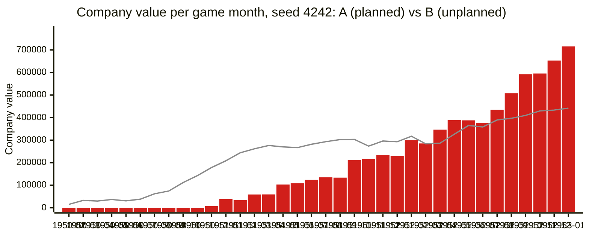
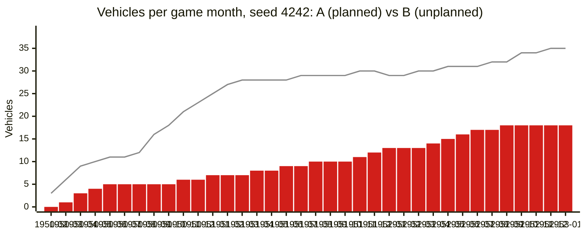

# Duel in one game: planned bot vs unplanned (seed 4242, 36 months)

Generated by `tools/research/mcp-duel` (frozen duel set at 55328bdb56: default settings both sides (B autopilot=1), seed 4242, 36 months). One game, one map: company 1 is PrismaticAI started from
the planner's portfolio (by the panel), company 2 the same AI started without a plan right after it.
Both compete for the same towns and industries. Values come from the store's daily samples (the first sampled day of each game month), fleets from the console's `companies` command.

Read from the store `/Users/korczis/.local/state/prismatic-mcp/store/panel-64604.duckdb` (instance `panel-64604`, run started at 1795072458436 ms): 4 plan.* event(s), 7360 AI log line(s), 74 sample row(s) of the months. The verdict is plan.duel seq 8719, on the bus and in the store.

- planner: game unpaused at tick 1435 with 2 AI company(ies) after 294 s
- planner: the passenger rail pair (score 205268) is built after 0 freight line(s) that score more
- planner: after these lines the bot may plan up to 8 more itself (own_lines)
- planner: Grain by rail Farm -> Factory, 208.0 tiles, profit 7665.0/month, score 114184.0 (line 10, built when the money allows)
- planner: Iron Ore by rail Iron Ore Mine -> Steel Mill, 173.0 tiles, profit 7797.0/month, score 118923.0 (line 9, built when the money allows)
- planner: Grain by rail Farm -> Factory, 237.0 tiles, profit 9438.0/month, score 127837.0 (line 8, built when the money allows)
- planner: Wood by rail Forest -> Sawmill, 243.0 tiles, profit 8456.0/month, score 129902.0 (line 7, built when the money allows)
- planner: Iron Ore by rail Iron Ore Mine -> Steel Mill, 221.0 tiles, profit 8424.0/month, score 131390.0 (line 6, built when the money allows)
- planner: Wood by rail Forest -> Sawmill, 160.0 tiles, profit 8321.0/month, score 132207.0 (line 5, built when the money allows)
- planner: Iron Ore by rail Iron Ore Mine -> Steel Mill, 198.0 tiles, profit 8409.0/month, score 132646.0 (line 4, built when the money allows)
- planner: Grain by rail Farm -> Factory, 244.0 tiles, profit 9707.0/month, score 133624.0 (line 3, built when the money allows)
- planner: Wood by rail Forest -> Sawmill, 232.0 tiles, profit 10188.0/month, score 146478.0 (line 2, built when the money allows)
- planner: Coal by rail Coal Mine -> Power Station, 242.0 tiles, profit 9671.0/month, score 159966.0
- planner: passengers by rail Wranville - Drundstone, score 205268.0
- planner: 21 rail line(s) priced on the map by track-planning, 21 with a route: 239 pieces 18240, 229 pieces 17415, 226 pieces 17190, 245 pieces 18645, 158 pieces 13376, 152 pieces 12956, 197 pieces 15135, 209 pieces 15975, 216 pieces 16753, 238 pieces 18926, 232 pieces 17968, 186 pieces 14190, 191 pieces 15416, 197 pieces 15292, 211 pieces 16200, 205 pieces 15615, 205 pieces 15555, 221 pieces 16890, 226 pieces 17205, 246 pieces 18675, 266 pieces 20443
- planner portfolio by algoglyph knapsack-dp: 4 investment(s), total score 715657.0, 296k of 300k
- planner: game paused for a repeatable start; it runs once 2 AI company(ies) exist

**Winner: A (planned).** Final company value: A 715486 vs B 441921. Rival spread 1915.5% over 3 duels of this seed, length, opponent and start.

<!-- duel-charts:begin -->
<!-- generated by tools/research/mcp-duel from this record's JSON; `mcp-duel --render` rewrites it, `mcp-duel --render --check` fails while it is stale -->

<!-- duel-charts:end -->

| Month | Date | A (planned) value | B (unplanned) value |
|---|---|---|---|
| 1 | 1950-02-01 | 1 | 15169 |
| 2 | 1950-03-01 | 1 | 32660 |
| 3 | 1950-04-01 | 1 | 29816 |
| 4 | 1950-05-01 | 1 | 36671 |
| 5 | 1950-06-01 | 1 | 30637 |
| 6 | 1950-07-01 | 1 | 38111 |
| 7 | 1950-08-01 | 1 | 62162 |
| 8 | 1950-09-01 | 1 | 74433 |
| 9 | 1950-10-01 | 1 | 111769 |
| 10 | 1950-11-01 | 1 | 142443 |
| 11 | 1950-12-01 | 7457 | 178652 |
| 12 | 1951-01-01 | 38582 | 208499 |
| 13 | 1951-02-01 | 33540 | 243893 |
| 14 | 1951-03-01 | 59001 | 261522 |
| 15 | 1951-04-01 | 59275 | 276222 |
| 16 | 1951-05-01 | 103020 | 270141 |
| 17 | 1951-06-01 | 109045 | 266676 |
| 18 | 1951-07-01 | 123715 | 281804 |
| 19 | 1951-08-01 | 135152 | 293179 |
| 20 | 1951-09-01 | 133673 | 302352 |
| 21 | 1951-10-01 | 212034 | 303425 |
| 22 | 1951-11-01 | 216411 | 273499 |
| 23 | 1951-12-01 | 234597 | 296067 |
| 24 | 1952-01-01 | 229449 | 292739 |
| 25 | 1952-02-01 | 299905 | 317348 |
| 26 | 1952-03-01 | 285337 | 283892 |
| 27 | 1952-04-01 | 346335 | 286539 |
| 28 | 1952-05-01 | 388875 | 326055 |
| 29 | 1952-06-01 | 387758 | 364971 |
| 30 | 1952-07-01 | 376656 | 358444 |
| 31 | 1952-08-01 | 434416 | 389471 |
| 32 | 1952-09-01 | 507921 | 396947 |
| 33 | 1952-10-01 | 592386 | 409748 |
| 34 | 1952-11-01 | 595414 | 429671 |
| 35 | 1952-12-01 | 653064 | 433331 |
| 36 | 1953-01-01 | 715486 | 441921 |
