# Duel in one game: planned bot vs unplanned (seed 4242, 120 months)

Generated by `tools/research/mcp-duel` (defaults-on). One game, one map: company 1 is PrismaticAI started from
the planner's portfolio (by the panel) with extra settings air_add_waiting=10,catchment_stops=8, company 2 the same AI started without a plan right after it.
Both compete for the same towns and industries. Values come from the store's daily samples (the first sampled day of each game month), fleets from the console's `companies` command.

Read from the store `/Users/korczis/.local/state/prismatic-mcp/store/panel-49491.duckdb` (instance `panel-49491`, run started at 1795073710218 ms): 2 plan.* event(s), 14297 AI log line(s), 242 sample row(s) of the months. The verdict is plan.duel seq 18708, on the bus and in the store.

- planner: game unpaused at tick 1413 with 2 AI company(ies) after 2 s
- planner: the passenger rail pair (score 204098) is built after 0 freight line(s) that score more
- planner: after these lines the bot may plan up to 8 more itself (own_lines)
- planner: Iron Ore by rail Iron Ore Mine -> Steel Mill, 194.0 tiles, profit 6121.0/month, score 78337.0 (line 15, built when the money allows)
- planner: Wood by rail Forest -> Sawmill, 172.0 tiles, profit 7181.0/month, score 105335.0 (line 14, built when the money allows)
- planner: Oil by rail Oil Wells -> Oil Refinery, 205.0 tiles, profit 7579.0/month, score 111523.0 (line 13, built when the money allows)
- planner: Grain by rail Farm -> Factory, 200.0 tiles, profit 7569.0/month, score 112480.0 (line 12, built when the money allows)
- planner: Grain by rail Farm -> Factory, 222.0 tiles, profit 7675.0/month, score 113390.0 (line 11, built when the money allows)
- planner: Grain by rail Farm -> Factory, 196.0 tiles, profit 7651.0/month, score 114757.0 (line 10, built when the money allows)
- planner: Iron Ore by rail Iron Ore Mine -> Steel Mill, 173.0 tiles, profit 7797.0/month, score 120138.0 (line 9, built when the money allows)
- planner: Grain by rail Farm -> Factory, 237.0 tiles, profit 9438.0/month, score 128030.0 (line 8, built when the money allows)
- planner: Wood by rail Forest -> Sawmill, 243.0 tiles, profit 8456.0/month, score 130603.0 (line 7, built when the money allows)
- planner: Iron Ore by rail Iron Ore Mine -> Steel Mill, 221.0 tiles, profit 8424.0/month, score 131568.0 (line 6, built when the money allows)
- planner: Iron Ore by rail Iron Ore Mine -> Steel Mill, 198.0 tiles, profit 8409.0/month, score 132931.0 (line 5, built when the money allows)
- planner: Wood by rail Forest -> Sawmill, 160.0 tiles, profit 8321.0/month, score 133583.0 (line 4, built when the money allows)
- planner: Grain by rail Farm -> Factory, 244.0 tiles, profit 9707.0/month, score 133969.0 (line 3, built when the money allows)
- planner: Wood by rail Forest -> Sawmill, 232.0 tiles, profit 10188.0/month, score 146493.0 (line 2, built when the money allows)
- planner: Coal by rail Coal Mine -> Power Station, 242.0 tiles, profit 9671.0/month, score 160056.0
- planner: passengers by rail Wranville - Drundstone, score 204098.0
- planner portfolio by builtin knapsack (MCP_ALGOGLYPH_DIR not set or the runner refused): 4 investment(s), total score 714697.0, 297k of 300k
- planner: game paused for a repeatable start; it runs once 2 AI company(ies) exist

**Winner: B (unplanned).** Final company value: A 5072798 vs B 5283080. Rival spread 7375.2% over 5 duels of this seed, length, opponent and start.

```mermaid
---
config:
  xyChart:
    width: 900
    height: 360
  themeVariables:
    xyChart:
      plotColorPalette: "#d11f1a, #8a8a8a, #0b0b0b, #ece4d6"
---
xychart-beta
    title "Company value per game month, seed 4242: A (planned) vs B (unplanned)"
    x-axis ["1950-02", "1950-03", "1950-04", "1950-05", "1950-06", "1950-07", "1950-08", "1950-09", "1950-10", "1950-11", "1950-12", "1951-01", "1951-02", "1951-03", "1951-04", "1951-05", "1951-06", "1951-07", "1951-08", "1951-09", "1951-10", "1951-11", "1951-12", "1952-01", "1952-02", "1952-03", "1952-04", "1952-05", "1952-06", "1952-07", "1952-08", "1952-09", "1952-10", "1952-11", "1952-12", "1953-01", "1953-02", "1953-03", "1953-04", "1953-05", "1953-06", "1953-07", "1953-08", "1953-09", "1953-10", "1953-11", "1953-12", "1954-01", "1954-02", "1954-03", "1954-04", "1954-05", "1954-06", "1954-07", "1954-08", "1954-09", "1954-10", "1954-11", "1954-12", "1955-01", "1955-02", "1955-03", "1955-04", "1955-05", "1955-06", "1955-07", "1955-08", "1955-09", "1955-10", "1955-11", "1955-12", "1956-01", "1956-02", "1956-03", "1956-04", "1956-05", "1956-06", "1956-07", "1956-08", "1956-09", "1956-10", "1956-11", "1956-12", "1957-01", "1957-02", "1957-03", "1957-04", "1957-05", "1957-06", "1957-07", "1957-08", "1957-09", "1957-10", "1957-11", "1957-12", "1958-01", "1958-02", "1958-03", "1958-04", "1958-05", "1958-06", "1958-07", "1958-08", "1958-09", "1958-10", "1958-11", "1958-12", "1959-01", "1959-02", "1959-03", "1959-04", "1959-05", "1959-06", "1959-07", "1959-08", "1959-09", "1959-10", "1959-11", "1959-12", "1960-01"]
    %% series: A (planned) | B (unplanned)
    %% links: duel-20261119T103653-seed4242.md?col=Month&filter=1 | duel-20261119T103653-seed4242.md?col=Month&filter=2 | duel-20261119T103653-seed4242.md?col=Month&filter=3 | duel-20261119T103653-seed4242.md?col=Month&filter=4 | duel-20261119T103653-seed4242.md?col=Month&filter=5 | duel-20261119T103653-seed4242.md?col=Month&filter=6 | duel-20261119T103653-seed4242.md?col=Month&filter=7 | duel-20261119T103653-seed4242.md?col=Month&filter=8 | duel-20261119T103653-seed4242.md?col=Month&filter=9 | duel-20261119T103653-seed4242.md?col=Month&filter=10 | duel-20261119T103653-seed4242.md?col=Month&filter=11 | duel-20261119T103653-seed4242.md?col=Month&filter=12 | duel-20261119T103653-seed4242.md?col=Month&filter=13 | duel-20261119T103653-seed4242.md?col=Month&filter=14 | duel-20261119T103653-seed4242.md?col=Month&filter=15 | duel-20261119T103653-seed4242.md?col=Month&filter=16 | duel-20261119T103653-seed4242.md?col=Month&filter=17 | duel-20261119T103653-seed4242.md?col=Month&filter=18 | duel-20261119T103653-seed4242.md?col=Month&filter=19 | duel-20261119T103653-seed4242.md?col=Month&filter=20 | duel-20261119T103653-seed4242.md?col=Month&filter=21 | duel-20261119T103653-seed4242.md?col=Month&filter=22 | duel-20261119T103653-seed4242.md?col=Month&filter=23 | duel-20261119T103653-seed4242.md?col=Month&filter=24 | duel-20261119T103653-seed4242.md?col=Month&filter=25 | duel-20261119T103653-seed4242.md?col=Month&filter=26 | duel-20261119T103653-seed4242.md?col=Month&filter=27 | duel-20261119T103653-seed4242.md?col=Month&filter=28 | duel-20261119T103653-seed4242.md?col=Month&filter=29 | duel-20261119T103653-seed4242.md?col=Month&filter=30 | duel-20261119T103653-seed4242.md?col=Month&filter=31 | duel-20261119T103653-seed4242.md?col=Month&filter=32 | duel-20261119T103653-seed4242.md?col=Month&filter=33 | duel-20261119T103653-seed4242.md?col=Month&filter=34 | duel-20261119T103653-seed4242.md?col=Month&filter=35 | duel-20261119T103653-seed4242.md?col=Month&filter=36 | duel-20261119T103653-seed4242.md?col=Month&filter=37 | duel-20261119T103653-seed4242.md?col=Month&filter=38 | duel-20261119T103653-seed4242.md?col=Month&filter=39 | duel-20261119T103653-seed4242.md?col=Month&filter=40 | duel-20261119T103653-seed4242.md?col=Month&filter=41 | duel-20261119T103653-seed4242.md?col=Month&filter=42 | duel-20261119T103653-seed4242.md?col=Month&filter=43 | duel-20261119T103653-seed4242.md?col=Month&filter=44 | duel-20261119T103653-seed4242.md?col=Month&filter=45 | duel-20261119T103653-seed4242.md?col=Month&filter=46 | duel-20261119T103653-seed4242.md?col=Month&filter=47 | duel-20261119T103653-seed4242.md?col=Month&filter=48 | duel-20261119T103653-seed4242.md?col=Month&filter=49 | duel-20261119T103653-seed4242.md?col=Month&filter=50 | duel-20261119T103653-seed4242.md?col=Month&filter=51 | duel-20261119T103653-seed4242.md?col=Month&filter=52 | duel-20261119T103653-seed4242.md?col=Month&filter=53 | duel-20261119T103653-seed4242.md?col=Month&filter=54 | duel-20261119T103653-seed4242.md?col=Month&filter=55 | duel-20261119T103653-seed4242.md?col=Month&filter=56 | duel-20261119T103653-seed4242.md?col=Month&filter=57 | duel-20261119T103653-seed4242.md?col=Month&filter=58 | duel-20261119T103653-seed4242.md?col=Month&filter=59 | duel-20261119T103653-seed4242.md?col=Month&filter=60 | duel-20261119T103653-seed4242.md?col=Month&filter=61 | duel-20261119T103653-seed4242.md?col=Month&filter=62 | duel-20261119T103653-seed4242.md?col=Month&filter=63 | duel-20261119T103653-seed4242.md?col=Month&filter=64 | duel-20261119T103653-seed4242.md?col=Month&filter=65 | duel-20261119T103653-seed4242.md?col=Month&filter=66 | duel-20261119T103653-seed4242.md?col=Month&filter=67 | duel-20261119T103653-seed4242.md?col=Month&filter=68 | duel-20261119T103653-seed4242.md?col=Month&filter=69 | duel-20261119T103653-seed4242.md?col=Month&filter=70 | duel-20261119T103653-seed4242.md?col=Month&filter=71 | duel-20261119T103653-seed4242.md?col=Month&filter=72 | duel-20261119T103653-seed4242.md?col=Month&filter=73 | duel-20261119T103653-seed4242.md?col=Month&filter=74 | duel-20261119T103653-seed4242.md?col=Month&filter=75 | duel-20261119T103653-seed4242.md?col=Month&filter=76 | duel-20261119T103653-seed4242.md?col=Month&filter=77 | duel-20261119T103653-seed4242.md?col=Month&filter=78 | duel-20261119T103653-seed4242.md?col=Month&filter=79 | duel-20261119T103653-seed4242.md?col=Month&filter=80 | duel-20261119T103653-seed4242.md?col=Month&filter=81 | duel-20261119T103653-seed4242.md?col=Month&filter=82 | duel-20261119T103653-seed4242.md?col=Month&filter=83 | duel-20261119T103653-seed4242.md?col=Month&filter=84 | duel-20261119T103653-seed4242.md?col=Month&filter=85 | duel-20261119T103653-seed4242.md?col=Month&filter=86 | duel-20261119T103653-seed4242.md?col=Month&filter=87 | duel-20261119T103653-seed4242.md?col=Month&filter=88 | duel-20261119T103653-seed4242.md?col=Month&filter=89 | duel-20261119T103653-seed4242.md?col=Month&filter=90 | duel-20261119T103653-seed4242.md?col=Month&filter=91 | duel-20261119T103653-seed4242.md?col=Month&filter=92 | duel-20261119T103653-seed4242.md?col=Month&filter=93 | duel-20261119T103653-seed4242.md?col=Month&filter=94 | duel-20261119T103653-seed4242.md?col=Month&filter=95 | duel-20261119T103653-seed4242.md?col=Month&filter=96 | duel-20261119T103653-seed4242.md?col=Month&filter=97 | duel-20261119T103653-seed4242.md?col=Month&filter=98 | duel-20261119T103653-seed4242.md?col=Month&filter=99 | duel-20261119T103653-seed4242.md?col=Month&filter=100 | duel-20261119T103653-seed4242.md?col=Month&filter=101 | duel-20261119T103653-seed4242.md?col=Month&filter=102 | duel-20261119T103653-seed4242.md?col=Month&filter=103 | duel-20261119T103653-seed4242.md?col=Month&filter=104 | duel-20261119T103653-seed4242.md?col=Month&filter=105 | duel-20261119T103653-seed4242.md?col=Month&filter=106 | duel-20261119T103653-seed4242.md?col=Month&filter=107 | duel-20261119T103653-seed4242.md?col=Month&filter=108 | duel-20261119T103653-seed4242.md?col=Month&filter=109 | duel-20261119T103653-seed4242.md?col=Month&filter=110 | duel-20261119T103653-seed4242.md?col=Month&filter=111 | duel-20261119T103653-seed4242.md?col=Month&filter=112 | duel-20261119T103653-seed4242.md?col=Month&filter=113 | duel-20261119T103653-seed4242.md?col=Month&filter=114 | duel-20261119T103653-seed4242.md?col=Month&filter=115 | duel-20261119T103653-seed4242.md?col=Month&filter=116 | duel-20261119T103653-seed4242.md?col=Month&filter=117 | duel-20261119T103653-seed4242.md?col=Month&filter=118 | duel-20261119T103653-seed4242.md?col=Month&filter=119 | duel-20261119T103653-seed4242.md?col=Month&filter=120
    y-axis "Company value" 0 --> 5810000
    bar [1, 1, 1, 1, 1, 1, 1, 1, 1, 1, 4144, 7164, 54217, 55316, 62608, 85059, 128528, 123366, 133224, 154501, 213130, 197496, 220598, 212419, 273251, 256306, 323077, 361048, 364627, 388379, 437105, 465697, 521342, 496455, 560834, 640392, 726321, 779112, 865631, 891157, 990420, 1027302, 1111818, 1174360, 1221299, 1299856, 1326962, 1404407, 1448286, 1500011, 1572493, 1579970, 1658294, 1717884, 1763429, 1801807, 1869674, 1908219, 1951058, 2031834, 2060557, 2089322, 2213538, 2207875, 2280407, 2299912, 2378717, 2417394, 2442997, 2474311, 2545831, 2633493, 2671491, 2720788, 2776854, 2813537, 2872949, 2937714, 2966262, 2995784, 3043631, 3126648, 3172907, 3197957, 3272680, 3316658, 3378728, 3406995, 3469223, 3536634, 3571117, 3626532, 3655266, 3751225, 3762641, 3820082, 3856715, 3904229, 3936731, 4071210, 4112944, 4120840, 4189037, 4274774, 4315330, 4330645, 4359927, 4413560, 4484892, 4578485, 4625892, 4636108, 4663741, 4763403, 4805222, 4843533, 4895679, 4919823, 5009952, 5072798]
    line [15163, 33974, 31708, 38608, 33529, 36886, 67114, 77119, 101275, 148672, 186232, 196440, 235183, 257299, 271758, 302346, 320706, 325146, 343434, 378996, 376085, 372423, 395116, 431115, 440864, 476263, 513325, 500707, 523142, 550266, 577785, 632218, 638597, 638348, 644506, 654955, 692927, 706367, 743437, 748379, 812970, 824552, 926684, 935674, 970150, 981542, 1038801, 1066265, 1123974, 1181270, 1214678, 1289879, 1364118, 1409111, 1442190, 1559454, 1591452, 1632677, 1652813, 1730328, 1772778, 1815798, 1848558, 1866615, 1889065, 1971450, 2027857, 2101247, 2133667, 2167519, 2261571, 2296450, 2376625, 2457286, 2569804, 2617932, 2734393, 2796052, 2890221, 2979623, 3030149, 3085142, 3200489, 3267981, 3336759, 3382289, 3430938, 3540451, 3595936, 3617847, 3672343, 3672951, 3712208, 3716125, 3733329, 3735920, 3790808, 3806744, 3845919, 3921987, 3942999, 3959118, 4017394, 4040572, 4096680, 4199934, 4264399, 4331760, 4397716, 4492925, 4592424, 4707492, 4769098, 4845104, 4883235, 4966990, 5033387, 5142729, 5196983, 5283080]
```

```mermaid
---
config:
  xyChart:
    width: 900
    height: 360
  themeVariables:
    xyChart:
      plotColorPalette: "#d11f1a, #8a8a8a, #0b0b0b, #ece4d6"
---
xychart-beta
    title "Vehicles per game month, seed 4242: A (planned) vs B (unplanned)"
    x-axis ["1950-02", "1950-03", "1950-04", "1950-05", "1950-06", "1950-07", "1950-08", "1950-09", "1950-10", "1950-11", "1950-12", "1951-01", "1951-02", "1951-03", "1951-04", "1951-05", "1951-06", "1951-07", "1951-08", "1951-09", "1951-10", "1951-11", "1951-12", "1952-01", "1952-02", "1952-03", "1952-04", "1952-05", "1952-06", "1952-07", "1952-08", "1952-09", "1952-10", "1952-11", "1952-12", "1953-01", "1953-02", "1953-03", "1953-04", "1953-05", "1953-06", "1953-07", "1953-08", "1953-09", "1953-10", "1953-11", "1953-12", "1954-01", "1954-02", "1954-03", "1954-04", "1954-05", "1954-06", "1954-07", "1954-08", "1954-09", "1954-10", "1954-11", "1954-12", "1955-01", "1955-02", "1955-03", "1955-04", "1955-05", "1955-06", "1955-07", "1955-08", "1955-09", "1955-10", "1955-11", "1955-12", "1956-01", "1956-02", "1956-03", "1956-04", "1956-05", "1956-06", "1956-07", "1956-08", "1956-09", "1956-10", "1956-11", "1956-12", "1957-01", "1957-02", "1957-03", "1957-04", "1957-05", "1957-06", "1957-07", "1957-08", "1957-09", "1957-10", "1957-11", "1957-12", "1958-01", "1958-02", "1958-03", "1958-04", "1958-05", "1958-06", "1958-07", "1958-08", "1958-09", "1958-10", "1958-11", "1958-12", "1959-01", "1959-02", "1959-03", "1959-04", "1959-05", "1959-06", "1959-07", "1959-08", "1959-09", "1959-10", "1959-11", "1959-12", "1960-01"]
    %% series: A (planned) | B (unplanned)
    %% links: duel-20261119T103653-seed4242.md?col=Month&filter=1 | duel-20261119T103653-seed4242.md?col=Month&filter=2 | duel-20261119T103653-seed4242.md?col=Month&filter=3 | duel-20261119T103653-seed4242.md?col=Month&filter=4 | duel-20261119T103653-seed4242.md?col=Month&filter=5 | duel-20261119T103653-seed4242.md?col=Month&filter=6 | duel-20261119T103653-seed4242.md?col=Month&filter=7 | duel-20261119T103653-seed4242.md?col=Month&filter=8 | duel-20261119T103653-seed4242.md?col=Month&filter=9 | duel-20261119T103653-seed4242.md?col=Month&filter=10 | duel-20261119T103653-seed4242.md?col=Month&filter=11 | duel-20261119T103653-seed4242.md?col=Month&filter=12 | duel-20261119T103653-seed4242.md?col=Month&filter=13 | duel-20261119T103653-seed4242.md?col=Month&filter=14 | duel-20261119T103653-seed4242.md?col=Month&filter=15 | duel-20261119T103653-seed4242.md?col=Month&filter=16 | duel-20261119T103653-seed4242.md?col=Month&filter=17 | duel-20261119T103653-seed4242.md?col=Month&filter=18 | duel-20261119T103653-seed4242.md?col=Month&filter=19 | duel-20261119T103653-seed4242.md?col=Month&filter=20 | duel-20261119T103653-seed4242.md?col=Month&filter=21 | duel-20261119T103653-seed4242.md?col=Month&filter=22 | duel-20261119T103653-seed4242.md?col=Month&filter=23 | duel-20261119T103653-seed4242.md?col=Month&filter=24 | duel-20261119T103653-seed4242.md?col=Month&filter=25 | duel-20261119T103653-seed4242.md?col=Month&filter=26 | duel-20261119T103653-seed4242.md?col=Month&filter=27 | duel-20261119T103653-seed4242.md?col=Month&filter=28 | duel-20261119T103653-seed4242.md?col=Month&filter=29 | duel-20261119T103653-seed4242.md?col=Month&filter=30 | duel-20261119T103653-seed4242.md?col=Month&filter=31 | duel-20261119T103653-seed4242.md?col=Month&filter=32 | duel-20261119T103653-seed4242.md?col=Month&filter=33 | duel-20261119T103653-seed4242.md?col=Month&filter=34 | duel-20261119T103653-seed4242.md?col=Month&filter=35 | duel-20261119T103653-seed4242.md?col=Month&filter=36 | duel-20261119T103653-seed4242.md?col=Month&filter=37 | duel-20261119T103653-seed4242.md?col=Month&filter=38 | duel-20261119T103653-seed4242.md?col=Month&filter=39 | duel-20261119T103653-seed4242.md?col=Month&filter=40 | duel-20261119T103653-seed4242.md?col=Month&filter=41 | duel-20261119T103653-seed4242.md?col=Month&filter=42 | duel-20261119T103653-seed4242.md?col=Month&filter=43 | duel-20261119T103653-seed4242.md?col=Month&filter=44 | duel-20261119T103653-seed4242.md?col=Month&filter=45 | duel-20261119T103653-seed4242.md?col=Month&filter=46 | duel-20261119T103653-seed4242.md?col=Month&filter=47 | duel-20261119T103653-seed4242.md?col=Month&filter=48 | duel-20261119T103653-seed4242.md?col=Month&filter=49 | duel-20261119T103653-seed4242.md?col=Month&filter=50 | duel-20261119T103653-seed4242.md?col=Month&filter=51 | duel-20261119T103653-seed4242.md?col=Month&filter=52 | duel-20261119T103653-seed4242.md?col=Month&filter=53 | duel-20261119T103653-seed4242.md?col=Month&filter=54 | duel-20261119T103653-seed4242.md?col=Month&filter=55 | duel-20261119T103653-seed4242.md?col=Month&filter=56 | duel-20261119T103653-seed4242.md?col=Month&filter=57 | duel-20261119T103653-seed4242.md?col=Month&filter=58 | duel-20261119T103653-seed4242.md?col=Month&filter=59 | duel-20261119T103653-seed4242.md?col=Month&filter=60 | duel-20261119T103653-seed4242.md?col=Month&filter=61 | duel-20261119T103653-seed4242.md?col=Month&filter=62 | duel-20261119T103653-seed4242.md?col=Month&filter=63 | duel-20261119T103653-seed4242.md?col=Month&filter=64 | duel-20261119T103653-seed4242.md?col=Month&filter=65 | duel-20261119T103653-seed4242.md?col=Month&filter=66 | duel-20261119T103653-seed4242.md?col=Month&filter=67 | duel-20261119T103653-seed4242.md?col=Month&filter=68 | duel-20261119T103653-seed4242.md?col=Month&filter=69 | duel-20261119T103653-seed4242.md?col=Month&filter=70 | duel-20261119T103653-seed4242.md?col=Month&filter=71 | duel-20261119T103653-seed4242.md?col=Month&filter=72 | duel-20261119T103653-seed4242.md?col=Month&filter=73 | duel-20261119T103653-seed4242.md?col=Month&filter=74 | duel-20261119T103653-seed4242.md?col=Month&filter=75 | duel-20261119T103653-seed4242.md?col=Month&filter=76 | duel-20261119T103653-seed4242.md?col=Month&filter=77 | duel-20261119T103653-seed4242.md?col=Month&filter=78 | duel-20261119T103653-seed4242.md?col=Month&filter=79 | duel-20261119T103653-seed4242.md?col=Month&filter=80 | duel-20261119T103653-seed4242.md?col=Month&filter=81 | duel-20261119T103653-seed4242.md?col=Month&filter=82 | duel-20261119T103653-seed4242.md?col=Month&filter=83 | duel-20261119T103653-seed4242.md?col=Month&filter=84 | duel-20261119T103653-seed4242.md?col=Month&filter=85 | duel-20261119T103653-seed4242.md?col=Month&filter=86 | duel-20261119T103653-seed4242.md?col=Month&filter=87 | duel-20261119T103653-seed4242.md?col=Month&filter=88 | duel-20261119T103653-seed4242.md?col=Month&filter=89 | duel-20261119T103653-seed4242.md?col=Month&filter=90 | duel-20261119T103653-seed4242.md?col=Month&filter=91 | duel-20261119T103653-seed4242.md?col=Month&filter=92 | duel-20261119T103653-seed4242.md?col=Month&filter=93 | duel-20261119T103653-seed4242.md?col=Month&filter=94 | duel-20261119T103653-seed4242.md?col=Month&filter=95 | duel-20261119T103653-seed4242.md?col=Month&filter=96 | duel-20261119T103653-seed4242.md?col=Month&filter=97 | duel-20261119T103653-seed4242.md?col=Month&filter=98 | duel-20261119T103653-seed4242.md?col=Month&filter=99 | duel-20261119T103653-seed4242.md?col=Month&filter=100 | duel-20261119T103653-seed4242.md?col=Month&filter=101 | duel-20261119T103653-seed4242.md?col=Month&filter=102 | duel-20261119T103653-seed4242.md?col=Month&filter=103 | duel-20261119T103653-seed4242.md?col=Month&filter=104 | duel-20261119T103653-seed4242.md?col=Month&filter=105 | duel-20261119T103653-seed4242.md?col=Month&filter=106 | duel-20261119T103653-seed4242.md?col=Month&filter=107 | duel-20261119T103653-seed4242.md?col=Month&filter=108 | duel-20261119T103653-seed4242.md?col=Month&filter=109 | duel-20261119T103653-seed4242.md?col=Month&filter=110 | duel-20261119T103653-seed4242.md?col=Month&filter=111 | duel-20261119T103653-seed4242.md?col=Month&filter=112 | duel-20261119T103653-seed4242.md?col=Month&filter=113 | duel-20261119T103653-seed4242.md?col=Month&filter=114 | duel-20261119T103653-seed4242.md?col=Month&filter=115 | duel-20261119T103653-seed4242.md?col=Month&filter=116 | duel-20261119T103653-seed4242.md?col=Month&filter=117 | duel-20261119T103653-seed4242.md?col=Month&filter=118 | duel-20261119T103653-seed4242.md?col=Month&filter=119 | duel-20261119T103653-seed4242.md?col=Month&filter=120
    y-axis "Vehicles" 0 --> 205
    bar [0, 1, 3, 4, 5, 5, 5, 5, 5, 6, 6, 7, 7, 7, 8, 8, 9, 9, 10, 10, 10, 12, 12, 12, 12, 13, 14, 15, 16, 16, 17, 17, 18, 19, 20, 20, 20, 20, 20, 20, 20, 20, 20, 20, 20, 20, 20, 20, 20, 20, 20, 20, 20, 20, 20, 20, 20, 20, 20, 20, 20, 20, 20, 20, 20, 20, 20, 20, 20, 20, 20, 20, 20, 20, 20, 20, 20, 20, 20, 20, 20, 20, 20, 20, 20, 20, 20, 20, 20, 20, 20, 20, 20, 20, 20, 20, 20, 20, 20, 20, 20, 20, 20, 20, 20, 20, 20, 20, 20, 20, 20, 20, 20, 20, 20, 20, 20, 20, 20, 20]
    line [3, 6, 9, 10, 11, 11, 12, 15, 18, 20, 22, 24, 26, 27, 28, 29, 30, 30, 30, 31, 31, 32, 33, 34, 34, 34, 35, 35, 37, 37, 37, 39, 39, 38, 38, 38, 41, 41, 40, 39, 41, 41, 45, 45, 46, 46, 48, 48, 50, 52, 52, 54, 56, 57, 58, 61, 62, 64, 64, 67, 68, 69, 71, 71, 74, 76, 77, 78, 78, 77, 79, 80, 82, 85, 88, 90, 93, 95, 98, 101, 103, 104, 108, 110, 112, 114, 115, 118, 119, 120, 121, 123, 125, 126, 129, 131, 133, 135, 136, 138, 139, 139, 141, 142, 145, 145, 149, 152, 156, 164, 172, 180, 184, 186, 186, 186, 186, 186, 186, 186]
```

<!-- duel-charts:begin -->
<!-- generated by tools/research/mcp-duel from this record's JSON; `mcp-duel --render` rewrites it, `mcp-duel --render --check` fails while it is stale -->

<!-- duel-charts:end -->

| Month | Date | A (planned) value | B (unplanned) value |
|---|---|---|---|
| 1 | 1950-02-01 | 1 | 15163 |
| 2 | 1950-03-01 | 1 | 33974 |
| 3 | 1950-04-01 | 1 | 31708 |
| 4 | 1950-05-01 | 1 | 38608 |
| 5 | 1950-06-01 | 1 | 33529 |
| 6 | 1950-07-01 | 1 | 36886 |
| 7 | 1950-08-01 | 1 | 67114 |
| 8 | 1950-09-01 | 1 | 77119 |
| 9 | 1950-10-01 | 1 | 101275 |
| 10 | 1950-11-01 | 1 | 148672 |
| 11 | 1950-12-01 | 4144 | 186232 |
| 12 | 1951-01-01 | 7164 | 196440 |
| 13 | 1951-02-01 | 54217 | 235183 |
| 14 | 1951-03-01 | 55316 | 257299 |
| 15 | 1951-04-01 | 62608 | 271758 |
| 16 | 1951-05-01 | 85059 | 302346 |
| 17 | 1951-06-01 | 128528 | 320706 |
| 18 | 1951-07-01 | 123366 | 325146 |
| 19 | 1951-08-01 | 133224 | 343434 |
| 20 | 1951-09-01 | 154501 | 378996 |
| 21 | 1951-10-01 | 213130 | 376085 |
| 22 | 1951-11-01 | 197496 | 372423 |
| 23 | 1951-12-01 | 220598 | 395116 |
| 24 | 1952-01-01 | 212419 | 431115 |
| 25 | 1952-02-01 | 273251 | 440864 |
| 26 | 1952-03-01 | 256306 | 476263 |
| 27 | 1952-04-01 | 323077 | 513325 |
| 28 | 1952-05-01 | 361048 | 500707 |
| 29 | 1952-06-01 | 364627 | 523142 |
| 30 | 1952-07-01 | 388379 | 550266 |
| 31 | 1952-08-01 | 437105 | 577785 |
| 32 | 1952-09-01 | 465697 | 632218 |
| 33 | 1952-10-01 | 521342 | 638597 |
| 34 | 1952-11-01 | 496455 | 638348 |
| 35 | 1952-12-01 | 560834 | 644506 |
| 36 | 1953-01-01 | 640392 | 654955 |
| 37 | 1953-02-01 | 726321 | 692927 |
| 38 | 1953-03-01 | 779112 | 706367 |
| 39 | 1953-04-01 | 865631 | 743437 |
| 40 | 1953-05-01 | 891157 | 748379 |
| 41 | 1953-06-01 | 990420 | 812970 |
| 42 | 1953-07-01 | 1027302 | 824552 |
| 43 | 1953-08-01 | 1111818 | 926684 |
| 44 | 1953-09-01 | 1174360 | 935674 |
| 45 | 1953-10-01 | 1221299 | 970150 |
| 46 | 1953-11-01 | 1299856 | 981542 |
| 47 | 1953-12-01 | 1326962 | 1038801 |
| 48 | 1954-01-01 | 1404407 | 1066265 |
| 49 | 1954-02-01 | 1448286 | 1123974 |
| 50 | 1954-03-01 | 1500011 | 1181270 |
| 51 | 1954-04-01 | 1572493 | 1214678 |
| 52 | 1954-05-01 | 1579970 | 1289879 |
| 53 | 1954-06-01 | 1658294 | 1364118 |
| 54 | 1954-07-01 | 1717884 | 1409111 |
| 55 | 1954-08-01 | 1763429 | 1442190 |
| 56 | 1954-09-01 | 1801807 | 1559454 |
| 57 | 1954-10-01 | 1869674 | 1591452 |
| 58 | 1954-11-01 | 1908219 | 1632677 |
| 59 | 1954-12-01 | 1951058 | 1652813 |
| 60 | 1955-01-01 | 2031834 | 1730328 |
| 61 | 1955-02-01 | 2060557 | 1772778 |
| 62 | 1955-03-01 | 2089322 | 1815798 |
| 63 | 1955-04-01 | 2213538 | 1848558 |
| 64 | 1955-05-01 | 2207875 | 1866615 |
| 65 | 1955-06-01 | 2280407 | 1889065 |
| 66 | 1955-07-01 | 2299912 | 1971450 |
| 67 | 1955-08-01 | 2378717 | 2027857 |
| 68 | 1955-09-01 | 2417394 | 2101247 |
| 69 | 1955-10-01 | 2442997 | 2133667 |
| 70 | 1955-11-01 | 2474311 | 2167519 |
| 71 | 1955-12-01 | 2545831 | 2261571 |
| 72 | 1956-01-01 | 2633493 | 2296450 |
| 73 | 1956-02-01 | 2671491 | 2376625 |
| 74 | 1956-03-01 | 2720788 | 2457286 |
| 75 | 1956-04-01 | 2776854 | 2569804 |
| 76 | 1956-05-01 | 2813537 | 2617932 |
| 77 | 1956-06-01 | 2872949 | 2734393 |
| 78 | 1956-07-01 | 2937714 | 2796052 |
| 79 | 1956-08-01 | 2966262 | 2890221 |
| 80 | 1956-09-01 | 2995784 | 2979623 |
| 81 | 1956-10-01 | 3043631 | 3030149 |
| 82 | 1956-11-01 | 3126648 | 3085142 |
| 83 | 1956-12-01 | 3172907 | 3200489 |
| 84 | 1957-01-01 | 3197957 | 3267981 |
| 85 | 1957-02-01 | 3272680 | 3336759 |
| 86 | 1957-03-01 | 3316658 | 3382289 |
| 87 | 1957-04-01 | 3378728 | 3430938 |
| 88 | 1957-05-01 | 3406995 | 3540451 |
| 89 | 1957-06-01 | 3469223 | 3595936 |
| 90 | 1957-07-01 | 3536634 | 3617847 |
| 91 | 1957-08-01 | 3571117 | 3672343 |
| 92 | 1957-09-01 | 3626532 | 3672951 |
| 93 | 1957-10-01 | 3655266 | 3712208 |
| 94 | 1957-11-01 | 3751225 | 3716125 |
| 95 | 1957-12-01 | 3762641 | 3733329 |
| 96 | 1958-01-01 | 3820082 | 3735920 |
| 97 | 1958-02-01 | 3856715 | 3790808 |
| 98 | 1958-03-01 | 3904229 | 3806744 |
| 99 | 1958-04-01 | 3936731 | 3845919 |
| 100 | 1958-05-01 | 4071210 | 3921987 |
| 101 | 1958-06-01 | 4112944 | 3942999 |
| 102 | 1958-07-01 | 4120840 | 3959118 |
| 103 | 1958-08-01 | 4189037 | 4017394 |
| 104 | 1958-09-01 | 4274774 | 4040572 |
| 105 | 1958-10-01 | 4315330 | 4096680 |
| 106 | 1958-11-01 | 4330645 | 4199934 |
| 107 | 1958-12-01 | 4359927 | 4264399 |
| 108 | 1959-01-01 | 4413560 | 4331760 |
| 109 | 1959-02-01 | 4484892 | 4397716 |
| 110 | 1959-03-01 | 4578485 | 4492925 |
| 111 | 1959-04-01 | 4625892 | 4592424 |
| 112 | 1959-05-01 | 4636108 | 4707492 |
| 113 | 1959-06-01 | 4663741 | 4769098 |
| 114 | 1959-07-01 | 4763403 | 4845104 |
| 115 | 1959-08-01 | 4805222 | 4883235 |
| 116 | 1959-09-01 | 4843533 | 4966990 |
| 117 | 1959-10-01 | 4895679 | 5033387 |
| 118 | 1959-11-01 | 4919823 | 5142729 |
| 119 | 1959-12-01 | 5009952 | 5196983 |
| 120 | 1960-01-01 | 5072798 | 5283080 |
