# Duel in one game: planned bot vs unplanned (seed 4242, 120 months)

Generated by `tools/research/mcp-duel` (defaults-off). One game, one map: company 1 is PrismaticAI started from
the planner's portfolio (by the panel) with extra settings air_add_waiting=0,catchment_stops=0, company 2 the same AI started without a plan right after it.
Both compete for the same towns and industries. Values come from the store's daily samples (the first sampled day of each game month), fleets from the console's `companies` command.

Read from the store `/Users/korczis/.local/state/prismatic-mcp/store/panel-49681.duckdb` (instance `panel-49681`, run started at 1795073710216 ms): 2 plan.* event(s), 13945 AI log line(s), 242 sample row(s) of the months. The verdict is plan.duel seq 18343, on the bus and in the store.

- planner: game unpaused at tick 1427 with 2 AI company(ies) after 2 s
- planner: the passenger rail pair (score 204098) is built after 0 freight line(s) that score more
- planner: after these lines the bot may plan up to 8 more itself (own_lines)
- planner: Iron Ore by rail Iron Ore Mine -> Steel Mill, 194.0 tiles, profit 6121.0/month, score 78337.0 (line 15, built when the money allows)
- planner: Wood by rail Forest -> Sawmill, 172.0 tiles, profit 7181.0/month, score 105335.0 (line 14, built when the money allows)
- planner: Oil by rail Oil Wells -> Oil Refinery, 205.0 tiles, profit 7579.0/month, score 111523.0 (line 13, built when the money allows)
- planner: Grain by rail Farm -> Factory, 200.0 tiles, profit 7569.0/month, score 112480.0 (line 12, built when the money allows)
- planner: Grain by rail Farm -> Factory, 222.0 tiles, profit 7675.0/month, score 113390.0 (line 11, built when the money allows)
- planner: Grain by rail Farm -> Factory, 196.0 tiles, profit 7651.0/month, score 114757.0 (line 10, built when the money allows)
- planner: Iron Ore by rail Iron Ore Mine -> Steel Mill, 173.0 tiles, profit 7797.0/month, score 120138.0 (line 9, built when the money allows)
- planner: Grain by rail Farm -> Factory, 237.0 tiles, profit 9438.0/month, score 128030.0 (line 8, built when the money allows)
- planner: Wood by rail Forest -> Sawmill, 243.0 tiles, profit 8456.0/month, score 130603.0 (line 7, built when the money allows)
- planner: Iron Ore by rail Iron Ore Mine -> Steel Mill, 221.0 tiles, profit 8424.0/month, score 131568.0 (line 6, built when the money allows)
- planner: Iron Ore by rail Iron Ore Mine -> Steel Mill, 198.0 tiles, profit 8409.0/month, score 132931.0 (line 5, built when the money allows)
- planner: Wood by rail Forest -> Sawmill, 160.0 tiles, profit 8321.0/month, score 133583.0 (line 4, built when the money allows)
- planner: Grain by rail Farm -> Factory, 244.0 tiles, profit 9707.0/month, score 133969.0 (line 3, built when the money allows)
- planner: Wood by rail Forest -> Sawmill, 232.0 tiles, profit 10188.0/month, score 146493.0 (line 2, built when the money allows)
- planner: Coal by rail Coal Mine -> Power Station, 242.0 tiles, profit 9671.0/month, score 160056.0
- planner: passengers by rail Wranville - Drundstone, score 204098.0
- planner portfolio by builtin knapsack (MCP_ALGOGLYPH_DIR not set or the runner refused): 4 investment(s), total score 714697.0, 297k of 300k
- planner: game paused for a repeatable start; it runs once 2 AI company(ies) exist

**Winner: B (unplanned).** Final company value: A 4682338 vs B 6133252. Rival spread 8578.1% over 5 duels of this seed, length, opponent and start.

```mermaid
---
config:
  xyChart:
    width: 900
    height: 360
  themeVariables:
    xyChart:
      plotColorPalette: "#d11f1a, #8a8a8a, #0b0b0b, #ece4d6"
---
xychart-beta
    title "Company value per game month, seed 4242: A (planned) vs B (unplanned)"
    x-axis ["1950-02", "1950-03", "1950-04", "1950-05", "1950-06", "1950-07", "1950-08", "1950-09", "1950-10", "1950-11", "1950-12", "1951-01", "1951-02", "1951-03", "1951-04", "1951-05", "1951-06", "1951-07", "1951-08", "1951-09", "1951-10", "1951-11", "1951-12", "1952-01", "1952-02", "1952-03", "1952-04", "1952-05", "1952-06", "1952-07", "1952-08", "1952-09", "1952-10", "1952-11", "1952-12", "1953-01", "1953-02", "1953-03", "1953-04", "1953-05", "1953-06", "1953-07", "1953-08", "1953-09", "1953-10", "1953-11", "1953-12", "1954-01", "1954-02", "1954-03", "1954-04", "1954-05", "1954-06", "1954-07", "1954-08", "1954-09", "1954-10", "1954-11", "1954-12", "1955-01", "1955-02", "1955-03", "1955-04", "1955-05", "1955-06", "1955-07", "1955-08", "1955-09", "1955-10", "1955-11", "1955-12", "1956-01", "1956-02", "1956-03", "1956-04", "1956-05", "1956-06", "1956-07", "1956-08", "1956-09", "1956-10", "1956-11", "1956-12", "1957-01", "1957-02", "1957-03", "1957-04", "1957-05", "1957-06", "1957-07", "1957-08", "1957-09", "1957-10", "1957-11", "1957-12", "1958-01", "1958-02", "1958-03", "1958-04", "1958-05", "1958-06", "1958-07", "1958-08", "1958-09", "1958-10", "1958-11", "1958-12", "1959-01", "1959-02", "1959-03", "1959-04", "1959-05", "1959-06", "1959-07", "1959-08", "1959-09", "1959-10", "1959-11", "1959-12", "1960-01"]
    %% series: A (planned) | B (unplanned)
    %% links: duel-20261119T103654-seed4242.md?col=Month&filter=1 | duel-20261119T103654-seed4242.md?col=Month&filter=2 | duel-20261119T103654-seed4242.md?col=Month&filter=3 | duel-20261119T103654-seed4242.md?col=Month&filter=4 | duel-20261119T103654-seed4242.md?col=Month&filter=5 | duel-20261119T103654-seed4242.md?col=Month&filter=6 | duel-20261119T103654-seed4242.md?col=Month&filter=7 | duel-20261119T103654-seed4242.md?col=Month&filter=8 | duel-20261119T103654-seed4242.md?col=Month&filter=9 | duel-20261119T103654-seed4242.md?col=Month&filter=10 | duel-20261119T103654-seed4242.md?col=Month&filter=11 | duel-20261119T103654-seed4242.md?col=Month&filter=12 | duel-20261119T103654-seed4242.md?col=Month&filter=13 | duel-20261119T103654-seed4242.md?col=Month&filter=14 | duel-20261119T103654-seed4242.md?col=Month&filter=15 | duel-20261119T103654-seed4242.md?col=Month&filter=16 | duel-20261119T103654-seed4242.md?col=Month&filter=17 | duel-20261119T103654-seed4242.md?col=Month&filter=18 | duel-20261119T103654-seed4242.md?col=Month&filter=19 | duel-20261119T103654-seed4242.md?col=Month&filter=20 | duel-20261119T103654-seed4242.md?col=Month&filter=21 | duel-20261119T103654-seed4242.md?col=Month&filter=22 | duel-20261119T103654-seed4242.md?col=Month&filter=23 | duel-20261119T103654-seed4242.md?col=Month&filter=24 | duel-20261119T103654-seed4242.md?col=Month&filter=25 | duel-20261119T103654-seed4242.md?col=Month&filter=26 | duel-20261119T103654-seed4242.md?col=Month&filter=27 | duel-20261119T103654-seed4242.md?col=Month&filter=28 | duel-20261119T103654-seed4242.md?col=Month&filter=29 | duel-20261119T103654-seed4242.md?col=Month&filter=30 | duel-20261119T103654-seed4242.md?col=Month&filter=31 | duel-20261119T103654-seed4242.md?col=Month&filter=32 | duel-20261119T103654-seed4242.md?col=Month&filter=33 | duel-20261119T103654-seed4242.md?col=Month&filter=34 | duel-20261119T103654-seed4242.md?col=Month&filter=35 | duel-20261119T103654-seed4242.md?col=Month&filter=36 | duel-20261119T103654-seed4242.md?col=Month&filter=37 | duel-20261119T103654-seed4242.md?col=Month&filter=38 | duel-20261119T103654-seed4242.md?col=Month&filter=39 | duel-20261119T103654-seed4242.md?col=Month&filter=40 | duel-20261119T103654-seed4242.md?col=Month&filter=41 | duel-20261119T103654-seed4242.md?col=Month&filter=42 | duel-20261119T103654-seed4242.md?col=Month&filter=43 | duel-20261119T103654-seed4242.md?col=Month&filter=44 | duel-20261119T103654-seed4242.md?col=Month&filter=45 | duel-20261119T103654-seed4242.md?col=Month&filter=46 | duel-20261119T103654-seed4242.md?col=Month&filter=47 | duel-20261119T103654-seed4242.md?col=Month&filter=48 | duel-20261119T103654-seed4242.md?col=Month&filter=49 | duel-20261119T103654-seed4242.md?col=Month&filter=50 | duel-20261119T103654-seed4242.md?col=Month&filter=51 | duel-20261119T103654-seed4242.md?col=Month&filter=52 | duel-20261119T103654-seed4242.md?col=Month&filter=53 | duel-20261119T103654-seed4242.md?col=Month&filter=54 | duel-20261119T103654-seed4242.md?col=Month&filter=55 | duel-20261119T103654-seed4242.md?col=Month&filter=56 | duel-20261119T103654-seed4242.md?col=Month&filter=57 | duel-20261119T103654-seed4242.md?col=Month&filter=58 | duel-20261119T103654-seed4242.md?col=Month&filter=59 | duel-20261119T103654-seed4242.md?col=Month&filter=60 | duel-20261119T103654-seed4242.md?col=Month&filter=61 | duel-20261119T103654-seed4242.md?col=Month&filter=62 | duel-20261119T103654-seed4242.md?col=Month&filter=63 | duel-20261119T103654-seed4242.md?col=Month&filter=64 | duel-20261119T103654-seed4242.md?col=Month&filter=65 | duel-20261119T103654-seed4242.md?col=Month&filter=66 | duel-20261119T103654-seed4242.md?col=Month&filter=67 | duel-20261119T103654-seed4242.md?col=Month&filter=68 | duel-20261119T103654-seed4242.md?col=Month&filter=69 | duel-20261119T103654-seed4242.md?col=Month&filter=70 | duel-20261119T103654-seed4242.md?col=Month&filter=71 | duel-20261119T103654-seed4242.md?col=Month&filter=72 | duel-20261119T103654-seed4242.md?col=Month&filter=73 | duel-20261119T103654-seed4242.md?col=Month&filter=74 | duel-20261119T103654-seed4242.md?col=Month&filter=75 | duel-20261119T103654-seed4242.md?col=Month&filter=76 | duel-20261119T103654-seed4242.md?col=Month&filter=77 | duel-20261119T103654-seed4242.md?col=Month&filter=78 | duel-20261119T103654-seed4242.md?col=Month&filter=79 | duel-20261119T103654-seed4242.md?col=Month&filter=80 | duel-20261119T103654-seed4242.md?col=Month&filter=81 | duel-20261119T103654-seed4242.md?col=Month&filter=82 | duel-20261119T103654-seed4242.md?col=Month&filter=83 | duel-20261119T103654-seed4242.md?col=Month&filter=84 | duel-20261119T103654-seed4242.md?col=Month&filter=85 | duel-20261119T103654-seed4242.md?col=Month&filter=86 | duel-20261119T103654-seed4242.md?col=Month&filter=87 | duel-20261119T103654-seed4242.md?col=Month&filter=88 | duel-20261119T103654-seed4242.md?col=Month&filter=89 | duel-20261119T103654-seed4242.md?col=Month&filter=90 | duel-20261119T103654-seed4242.md?col=Month&filter=91 | duel-20261119T103654-seed4242.md?col=Month&filter=92 | duel-20261119T103654-seed4242.md?col=Month&filter=93 | duel-20261119T103654-seed4242.md?col=Month&filter=94 | duel-20261119T103654-seed4242.md?col=Month&filter=95 | duel-20261119T103654-seed4242.md?col=Month&filter=96 | duel-20261119T103654-seed4242.md?col=Month&filter=97 | duel-20261119T103654-seed4242.md?col=Month&filter=98 | duel-20261119T103654-seed4242.md?col=Month&filter=99 | duel-20261119T103654-seed4242.md?col=Month&filter=100 | duel-20261119T103654-seed4242.md?col=Month&filter=101 | duel-20261119T103654-seed4242.md?col=Month&filter=102 | duel-20261119T103654-seed4242.md?col=Month&filter=103 | duel-20261119T103654-seed4242.md?col=Month&filter=104 | duel-20261119T103654-seed4242.md?col=Month&filter=105 | duel-20261119T103654-seed4242.md?col=Month&filter=106 | duel-20261119T103654-seed4242.md?col=Month&filter=107 | duel-20261119T103654-seed4242.md?col=Month&filter=108 | duel-20261119T103654-seed4242.md?col=Month&filter=109 | duel-20261119T103654-seed4242.md?col=Month&filter=110 | duel-20261119T103654-seed4242.md?col=Month&filter=111 | duel-20261119T103654-seed4242.md?col=Month&filter=112 | duel-20261119T103654-seed4242.md?col=Month&filter=113 | duel-20261119T103654-seed4242.md?col=Month&filter=114 | duel-20261119T103654-seed4242.md?col=Month&filter=115 | duel-20261119T103654-seed4242.md?col=Month&filter=116 | duel-20261119T103654-seed4242.md?col=Month&filter=117 | duel-20261119T103654-seed4242.md?col=Month&filter=118 | duel-20261119T103654-seed4242.md?col=Month&filter=119 | duel-20261119T103654-seed4242.md?col=Month&filter=120
    y-axis "Company value" 0 --> 6750000
    bar [1, 1, 1, 1, 1, 1, 1, 1, 1, 1, 1, 6304, 52998, 62818, 68958, 90008, 99945, 142069, 136861, 158956, 174152, 188999, 206652, 216350, 269026, 272820, 286185, 334532, 376216, 390030, 403734, 430290, 507315, 518601, 547692, 657110, 695378, 708858, 821860, 885045, 966568, 1019488, 1067086, 1082946, 1180804, 1226957, 1284366, 1332766, 1364164, 1413316, 1451079, 1479557, 1572558, 1589981, 1664761, 1685730, 1769217, 1791060, 1868285, 1907678, 1901117, 1967009, 2031496, 2055899, 2128222, 2160936, 2199846, 2231198, 2296142, 2331835, 2386487, 2429830, 2485561, 2507821, 2591183, 2645680, 2683328, 2677138, 2745949, 2798779, 2876319, 2919789, 2951948, 2960844, 3055996, 3070898, 3151446, 3185315, 3197237, 3296193, 3335755, 3414156, 3425264, 3457734, 3528310, 3558019, 3613688, 3653109, 3699110, 3737888, 3808422, 3851934, 3908209, 3942030, 3959334, 4019823, 4074785, 4170136, 4181439, 4239575, 4300443, 4313769, 4362549, 4393754, 4462643, 4533817, 4557741, 4613426, 4664367, 4682338]
    line [15173, 34582, 31865, 38888, 33454, 35077, 60521, 73478, 96981, 131721, 156475, 193565, 222857, 239367, 282784, 292550, 298110, 302694, 321229, 334473, 353614, 393534, 405915, 439233, 477188, 508747, 536979, 502709, 543291, 549490, 572380, 629333, 634734, 696383, 729019, 757217, 821153, 836905, 870559, 875483, 912378, 967943, 993014, 1078219, 1133869, 1170659, 1181693, 1245994, 1270604, 1338132, 1363612, 1443734, 1520732, 1621275, 1692738, 1744918, 1829712, 1859613, 1935152, 2031095, 2080426, 2127294, 2188732, 2264688, 2323363, 2429450, 2482325, 2574148, 2640124, 2690592, 2740988, 2787683, 2871359, 2953243, 3035999, 3161465, 3256314, 3340035, 3449689, 3518056, 3563406, 3615366, 3676696, 3674490, 3744226, 3761480, 3832560, 3870004, 3995928, 4017728, 4045622, 4104613, 4128968, 4181997, 4258453, 4310732, 4337016, 4413101, 4501255, 4621659, 4693545, 4784223, 4877357, 4939310, 5020127, 5096595, 5155125, 5208057, 5327807, 5394367, 5509142, 5560428, 5613623, 5698375, 5757970, 5812510, 5919006, 5959391, 6068691, 6133252]
```

```mermaid
---
config:
  xyChart:
    width: 900
    height: 360
  themeVariables:
    xyChart:
      plotColorPalette: "#d11f1a, #8a8a8a, #0b0b0b, #ece4d6"
---
xychart-beta
    title "Vehicles per game month, seed 4242: A (planned) vs B (unplanned)"
    x-axis ["1950-02", "1950-03", "1950-04", "1950-05", "1950-06", "1950-07", "1950-08", "1950-09", "1950-10", "1950-11", "1950-12", "1951-01", "1951-02", "1951-03", "1951-04", "1951-05", "1951-06", "1951-07", "1951-08", "1951-09", "1951-10", "1951-11", "1951-12", "1952-01", "1952-02", "1952-03", "1952-04", "1952-05", "1952-06", "1952-07", "1952-08", "1952-09", "1952-10", "1952-11", "1952-12", "1953-01", "1953-02", "1953-03", "1953-04", "1953-05", "1953-06", "1953-07", "1953-08", "1953-09", "1953-10", "1953-11", "1953-12", "1954-01", "1954-02", "1954-03", "1954-04", "1954-05", "1954-06", "1954-07", "1954-08", "1954-09", "1954-10", "1954-11", "1954-12", "1955-01", "1955-02", "1955-03", "1955-04", "1955-05", "1955-06", "1955-07", "1955-08", "1955-09", "1955-10", "1955-11", "1955-12", "1956-01", "1956-02", "1956-03", "1956-04", "1956-05", "1956-06", "1956-07", "1956-08", "1956-09", "1956-10", "1956-11", "1956-12", "1957-01", "1957-02", "1957-03", "1957-04", "1957-05", "1957-06", "1957-07", "1957-08", "1957-09", "1957-10", "1957-11", "1957-12", "1958-01", "1958-02", "1958-03", "1958-04", "1958-05", "1958-06", "1958-07", "1958-08", "1958-09", "1958-10", "1958-11", "1958-12", "1959-01", "1959-02", "1959-03", "1959-04", "1959-05", "1959-06", "1959-07", "1959-08", "1959-09", "1959-10", "1959-11", "1959-12", "1960-01"]
    %% series: A (planned) | B (unplanned)
    %% links: duel-20261119T103654-seed4242.md?col=Month&filter=1 | duel-20261119T103654-seed4242.md?col=Month&filter=2 | duel-20261119T103654-seed4242.md?col=Month&filter=3 | duel-20261119T103654-seed4242.md?col=Month&filter=4 | duel-20261119T103654-seed4242.md?col=Month&filter=5 | duel-20261119T103654-seed4242.md?col=Month&filter=6 | duel-20261119T103654-seed4242.md?col=Month&filter=7 | duel-20261119T103654-seed4242.md?col=Month&filter=8 | duel-20261119T103654-seed4242.md?col=Month&filter=9 | duel-20261119T103654-seed4242.md?col=Month&filter=10 | duel-20261119T103654-seed4242.md?col=Month&filter=11 | duel-20261119T103654-seed4242.md?col=Month&filter=12 | duel-20261119T103654-seed4242.md?col=Month&filter=13 | duel-20261119T103654-seed4242.md?col=Month&filter=14 | duel-20261119T103654-seed4242.md?col=Month&filter=15 | duel-20261119T103654-seed4242.md?col=Month&filter=16 | duel-20261119T103654-seed4242.md?col=Month&filter=17 | duel-20261119T103654-seed4242.md?col=Month&filter=18 | duel-20261119T103654-seed4242.md?col=Month&filter=19 | duel-20261119T103654-seed4242.md?col=Month&filter=20 | duel-20261119T103654-seed4242.md?col=Month&filter=21 | duel-20261119T103654-seed4242.md?col=Month&filter=22 | duel-20261119T103654-seed4242.md?col=Month&filter=23 | duel-20261119T103654-seed4242.md?col=Month&filter=24 | duel-20261119T103654-seed4242.md?col=Month&filter=25 | duel-20261119T103654-seed4242.md?col=Month&filter=26 | duel-20261119T103654-seed4242.md?col=Month&filter=27 | duel-20261119T103654-seed4242.md?col=Month&filter=28 | duel-20261119T103654-seed4242.md?col=Month&filter=29 | duel-20261119T103654-seed4242.md?col=Month&filter=30 | duel-20261119T103654-seed4242.md?col=Month&filter=31 | duel-20261119T103654-seed4242.md?col=Month&filter=32 | duel-20261119T103654-seed4242.md?col=Month&filter=33 | duel-20261119T103654-seed4242.md?col=Month&filter=34 | duel-20261119T103654-seed4242.md?col=Month&filter=35 | duel-20261119T103654-seed4242.md?col=Month&filter=36 | duel-20261119T103654-seed4242.md?col=Month&filter=37 | duel-20261119T103654-seed4242.md?col=Month&filter=38 | duel-20261119T103654-seed4242.md?col=Month&filter=39 | duel-20261119T103654-seed4242.md?col=Month&filter=40 | duel-20261119T103654-seed4242.md?col=Month&filter=41 | duel-20261119T103654-seed4242.md?col=Month&filter=42 | duel-20261119T103654-seed4242.md?col=Month&filter=43 | duel-20261119T103654-seed4242.md?col=Month&filter=44 | duel-20261119T103654-seed4242.md?col=Month&filter=45 | duel-20261119T103654-seed4242.md?col=Month&filter=46 | duel-20261119T103654-seed4242.md?col=Month&filter=47 | duel-20261119T103654-seed4242.md?col=Month&filter=48 | duel-20261119T103654-seed4242.md?col=Month&filter=49 | duel-20261119T103654-seed4242.md?col=Month&filter=50 | duel-20261119T103654-seed4242.md?col=Month&filter=51 | duel-20261119T103654-seed4242.md?col=Month&filter=52 | duel-20261119T103654-seed4242.md?col=Month&filter=53 | duel-20261119T103654-seed4242.md?col=Month&filter=54 | duel-20261119T103654-seed4242.md?col=Month&filter=55 | duel-20261119T103654-seed4242.md?col=Month&filter=56 | duel-20261119T103654-seed4242.md?col=Month&filter=57 | duel-20261119T103654-seed4242.md?col=Month&filter=58 | duel-20261119T103654-seed4242.md?col=Month&filter=59 | duel-20261119T103654-seed4242.md?col=Month&filter=60 | duel-20261119T103654-seed4242.md?col=Month&filter=61 | duel-20261119T103654-seed4242.md?col=Month&filter=62 | duel-20261119T103654-seed4242.md?col=Month&filter=63 | duel-20261119T103654-seed4242.md?col=Month&filter=64 | duel-20261119T103654-seed4242.md?col=Month&filter=65 | duel-20261119T103654-seed4242.md?col=Month&filter=66 | duel-20261119T103654-seed4242.md?col=Month&filter=67 | duel-20261119T103654-seed4242.md?col=Month&filter=68 | duel-20261119T103654-seed4242.md?col=Month&filter=69 | duel-20261119T103654-seed4242.md?col=Month&filter=70 | duel-20261119T103654-seed4242.md?col=Month&filter=71 | duel-20261119T103654-seed4242.md?col=Month&filter=72 | duel-20261119T103654-seed4242.md?col=Month&filter=73 | duel-20261119T103654-seed4242.md?col=Month&filter=74 | duel-20261119T103654-seed4242.md?col=Month&filter=75 | duel-20261119T103654-seed4242.md?col=Month&filter=76 | duel-20261119T103654-seed4242.md?col=Month&filter=77 | duel-20261119T103654-seed4242.md?col=Month&filter=78 | duel-20261119T103654-seed4242.md?col=Month&filter=79 | duel-20261119T103654-seed4242.md?col=Month&filter=80 | duel-20261119T103654-seed4242.md?col=Month&filter=81 | duel-20261119T103654-seed4242.md?col=Month&filter=82 | duel-20261119T103654-seed4242.md?col=Month&filter=83 | duel-20261119T103654-seed4242.md?col=Month&filter=84 | duel-20261119T103654-seed4242.md?col=Month&filter=85 | duel-20261119T103654-seed4242.md?col=Month&filter=86 | duel-20261119T103654-seed4242.md?col=Month&filter=87 | duel-20261119T103654-seed4242.md?col=Month&filter=88 | duel-20261119T103654-seed4242.md?col=Month&filter=89 | duel-20261119T103654-seed4242.md?col=Month&filter=90 | duel-20261119T103654-seed4242.md?col=Month&filter=91 | duel-20261119T103654-seed4242.md?col=Month&filter=92 | duel-20261119T103654-seed4242.md?col=Month&filter=93 | duel-20261119T103654-seed4242.md?col=Month&filter=94 | duel-20261119T103654-seed4242.md?col=Month&filter=95 | duel-20261119T103654-seed4242.md?col=Month&filter=96 | duel-20261119T103654-seed4242.md?col=Month&filter=97 | duel-20261119T103654-seed4242.md?col=Month&filter=98 | duel-20261119T103654-seed4242.md?col=Month&filter=99 | duel-20261119T103654-seed4242.md?col=Month&filter=100 | duel-20261119T103654-seed4242.md?col=Month&filter=101 | duel-20261119T103654-seed4242.md?col=Month&filter=102 | duel-20261119T103654-seed4242.md?col=Month&filter=103 | duel-20261119T103654-seed4242.md?col=Month&filter=104 | duel-20261119T103654-seed4242.md?col=Month&filter=105 | duel-20261119T103654-seed4242.md?col=Month&filter=106 | duel-20261119T103654-seed4242.md?col=Month&filter=107 | duel-20261119T103654-seed4242.md?col=Month&filter=108 | duel-20261119T103654-seed4242.md?col=Month&filter=109 | duel-20261119T103654-seed4242.md?col=Month&filter=110 | duel-20261119T103654-seed4242.md?col=Month&filter=111 | duel-20261119T103654-seed4242.md?col=Month&filter=112 | duel-20261119T103654-seed4242.md?col=Month&filter=113 | duel-20261119T103654-seed4242.md?col=Month&filter=114 | duel-20261119T103654-seed4242.md?col=Month&filter=115 | duel-20261119T103654-seed4242.md?col=Month&filter=116 | duel-20261119T103654-seed4242.md?col=Month&filter=117 | duel-20261119T103654-seed4242.md?col=Month&filter=118 | duel-20261119T103654-seed4242.md?col=Month&filter=119 | duel-20261119T103654-seed4242.md?col=Month&filter=120
    y-axis "Vehicles" 0 --> 213
    bar [0, 1, 3, 4, 5, 5, 5, 5, 5, 6, 6, 7, 7, 7, 8, 8, 9, 9, 10, 10, 10, 11, 12, 12, 12, 13, 14, 14, 15, 16, 17, 17, 18, 19, 19, 20, 20, 20, 20, 20, 20, 20, 20, 20, 20, 20, 20, 20, 20, 20, 20, 20, 20, 20, 20, 20, 20, 20, 20, 20, 20, 20, 20, 20, 20, 20, 20, 20, 20, 20, 20, 20, 20, 20, 20, 20, 20, 20, 20, 20, 20, 20, 20, 20, 20, 20, 20, 20, 20, 20, 20, 20, 20, 20, 20, 20, 20, 20, 20, 20, 20, 20, 20, 20, 20, 20, 20, 20, 20, 20, 20, 20, 20, 20, 20, 20, 20, 20, 20, 20]
    line [3, 6, 9, 10, 11, 11, 13, 16, 16, 19, 21, 23, 25, 27, 28, 28, 28, 28, 32, 33, 33, 34, 34, 35, 36, 36, 37, 37, 39, 39, 39, 41, 41, 42, 42, 43, 45, 45, 45, 45, 47, 47, 48, 52, 53, 54, 54, 56, 54, 57, 57, 59, 60, 64, 66, 67, 71, 71, 74, 77, 78, 78, 82, 83, 84, 89, 90, 92, 93, 93, 94, 95, 97, 100, 103, 106, 109, 112, 115, 117, 118, 119, 120, 120, 125, 127, 128, 130, 132, 134, 135, 141, 143, 146, 152, 154, 156, 164, 170, 172, 173, 173, 173, 174, 174, 174, 174, 174, 181, 188, 194, 194, 194, 194, 194, 194, 194, 194, 194, 194]
```

<!-- duel-charts:begin -->
<!-- generated by tools/research/mcp-duel from this record's JSON; `mcp-duel --render` rewrites it, `mcp-duel --render --check` fails while it is stale -->

<!-- duel-charts:end -->

| Month | Date | A (planned) value | B (unplanned) value |
|---|---|---|---|
| 1 | 1950-02-01 | 1 | 15173 |
| 2 | 1950-03-01 | 1 | 34582 |
| 3 | 1950-04-01 | 1 | 31865 |
| 4 | 1950-05-01 | 1 | 38888 |
| 5 | 1950-06-01 | 1 | 33454 |
| 6 | 1950-07-01 | 1 | 35077 |
| 7 | 1950-08-01 | 1 | 60521 |
| 8 | 1950-09-01 | 1 | 73478 |
| 9 | 1950-10-01 | 1 | 96981 |
| 10 | 1950-11-01 | 1 | 131721 |
| 11 | 1950-12-01 | 1 | 156475 |
| 12 | 1951-01-01 | 6304 | 193565 |
| 13 | 1951-02-01 | 52998 | 222857 |
| 14 | 1951-03-01 | 62818 | 239367 |
| 15 | 1951-04-01 | 68958 | 282784 |
| 16 | 1951-05-01 | 90008 | 292550 |
| 17 | 1951-06-01 | 99945 | 298110 |
| 18 | 1951-07-01 | 142069 | 302694 |
| 19 | 1951-08-01 | 136861 | 321229 |
| 20 | 1951-09-01 | 158956 | 334473 |
| 21 | 1951-10-01 | 174152 | 353614 |
| 22 | 1951-11-01 | 188999 | 393534 |
| 23 | 1951-12-01 | 206652 | 405915 |
| 24 | 1952-01-01 | 216350 | 439233 |
| 25 | 1952-02-01 | 269026 | 477188 |
| 26 | 1952-03-01 | 272820 | 508747 |
| 27 | 1952-04-01 | 286185 | 536979 |
| 28 | 1952-05-01 | 334532 | 502709 |
| 29 | 1952-06-01 | 376216 | 543291 |
| 30 | 1952-07-01 | 390030 | 549490 |
| 31 | 1952-08-01 | 403734 | 572380 |
| 32 | 1952-09-01 | 430290 | 629333 |
| 33 | 1952-10-01 | 507315 | 634734 |
| 34 | 1952-11-01 | 518601 | 696383 |
| 35 | 1952-12-01 | 547692 | 729019 |
| 36 | 1953-01-01 | 657110 | 757217 |
| 37 | 1953-02-01 | 695378 | 821153 |
| 38 | 1953-03-01 | 708858 | 836905 |
| 39 | 1953-04-01 | 821860 | 870559 |
| 40 | 1953-05-01 | 885045 | 875483 |
| 41 | 1953-06-01 | 966568 | 912378 |
| 42 | 1953-07-01 | 1019488 | 967943 |
| 43 | 1953-08-01 | 1067086 | 993014 |
| 44 | 1953-09-01 | 1082946 | 1078219 |
| 45 | 1953-10-01 | 1180804 | 1133869 |
| 46 | 1953-11-01 | 1226957 | 1170659 |
| 47 | 1953-12-01 | 1284366 | 1181693 |
| 48 | 1954-01-01 | 1332766 | 1245994 |
| 49 | 1954-02-01 | 1364164 | 1270604 |
| 50 | 1954-03-01 | 1413316 | 1338132 |
| 51 | 1954-04-01 | 1451079 | 1363612 |
| 52 | 1954-05-01 | 1479557 | 1443734 |
| 53 | 1954-06-01 | 1572558 | 1520732 |
| 54 | 1954-07-01 | 1589981 | 1621275 |
| 55 | 1954-08-01 | 1664761 | 1692738 |
| 56 | 1954-09-01 | 1685730 | 1744918 |
| 57 | 1954-10-01 | 1769217 | 1829712 |
| 58 | 1954-11-01 | 1791060 | 1859613 |
| 59 | 1954-12-01 | 1868285 | 1935152 |
| 60 | 1955-01-01 | 1907678 | 2031095 |
| 61 | 1955-02-01 | 1901117 | 2080426 |
| 62 | 1955-03-01 | 1967009 | 2127294 |
| 63 | 1955-04-01 | 2031496 | 2188732 |
| 64 | 1955-05-01 | 2055899 | 2264688 |
| 65 | 1955-06-01 | 2128222 | 2323363 |
| 66 | 1955-07-01 | 2160936 | 2429450 |
| 67 | 1955-08-01 | 2199846 | 2482325 |
| 68 | 1955-09-01 | 2231198 | 2574148 |
| 69 | 1955-10-01 | 2296142 | 2640124 |
| 70 | 1955-11-01 | 2331835 | 2690592 |
| 71 | 1955-12-01 | 2386487 | 2740988 |
| 72 | 1956-01-01 | 2429830 | 2787683 |
| 73 | 1956-02-01 | 2485561 | 2871359 |
| 74 | 1956-03-01 | 2507821 | 2953243 |
| 75 | 1956-04-01 | 2591183 | 3035999 |
| 76 | 1956-05-01 | 2645680 | 3161465 |
| 77 | 1956-06-01 | 2683328 | 3256314 |
| 78 | 1956-07-01 | 2677138 | 3340035 |
| 79 | 1956-08-01 | 2745949 | 3449689 |
| 80 | 1956-09-01 | 2798779 | 3518056 |
| 81 | 1956-10-01 | 2876319 | 3563406 |
| 82 | 1956-11-01 | 2919789 | 3615366 |
| 83 | 1956-12-01 | 2951948 | 3676696 |
| 84 | 1957-01-01 | 2960844 | 3674490 |
| 85 | 1957-02-01 | 3055996 | 3744226 |
| 86 | 1957-03-01 | 3070898 | 3761480 |
| 87 | 1957-04-01 | 3151446 | 3832560 |
| 88 | 1957-05-01 | 3185315 | 3870004 |
| 89 | 1957-06-01 | 3197237 | 3995928 |
| 90 | 1957-07-01 | 3296193 | 4017728 |
| 91 | 1957-08-01 | 3335755 | 4045622 |
| 92 | 1957-09-01 | 3414156 | 4104613 |
| 93 | 1957-10-01 | 3425264 | 4128968 |
| 94 | 1957-11-01 | 3457734 | 4181997 |
| 95 | 1957-12-01 | 3528310 | 4258453 |
| 96 | 1958-01-01 | 3558019 | 4310732 |
| 97 | 1958-02-01 | 3613688 | 4337016 |
| 98 | 1958-03-01 | 3653109 | 4413101 |
| 99 | 1958-04-01 | 3699110 | 4501255 |
| 100 | 1958-05-01 | 3737888 | 4621659 |
| 101 | 1958-06-01 | 3808422 | 4693545 |
| 102 | 1958-07-01 | 3851934 | 4784223 |
| 103 | 1958-08-01 | 3908209 | 4877357 |
| 104 | 1958-09-01 | 3942030 | 4939310 |
| 105 | 1958-10-01 | 3959334 | 5020127 |
| 106 | 1958-11-01 | 4019823 | 5096595 |
| 107 | 1958-12-01 | 4074785 | 5155125 |
| 108 | 1959-01-01 | 4170136 | 5208057 |
| 109 | 1959-02-01 | 4181439 | 5327807 |
| 110 | 1959-03-01 | 4239575 | 5394367 |
| 111 | 1959-04-01 | 4300443 | 5509142 |
| 112 | 1959-05-01 | 4313769 | 5560428 |
| 113 | 1959-06-01 | 4362549 | 5613623 |
| 114 | 1959-07-01 | 4393754 | 5698375 |
| 115 | 1959-08-01 | 4462643 | 5757970 |
| 116 | 1959-09-01 | 4533817 | 5812510 |
| 117 | 1959-10-01 | 4557741 | 5919006 |
| 118 | 1959-11-01 | 4613426 | 5959391 |
| 119 | 1959-12-01 | 4664367 | 6068691 |
| 120 | 1960-01-01 | 4682338 | 6133252 |
