# Duel in one game: planned bot vs unplanned (seed 4242, 120 months)

Generated by `tools/research/mcp-duel` (defaults-off). One game, one map: company 1 is PrismaticAI started from
the planner's portfolio (by the panel) with extra settings air_add_waiting=0,catchment_stops=0, company 2 the same AI started without a plan right after it.
Both compete for the same towns and industries. Values come from the store's daily samples (the first sampled day of each game month), fleets from the console's `companies` command.

Read from the store `/Users/korczis/.local/state/prismatic-mcp/store/panel-55959.duckdb` (instance `panel-55959`, run started at 1795081536323 ms): 2 plan.* event(s), 15509 AI log line(s), 242 sample row(s) of the months. The verdict is plan.duel seq 19990, on the bus and in the store.

- planner: game unpaused at tick 1424 with 2 AI company(ies) after 1 s
- planner: the passenger rail pair (score 204098) is built after 0 freight line(s) that score more
- planner: after these lines the bot may plan up to 8 more itself (own_lines)
- planner: Iron Ore by rail Iron Ore Mine -> Steel Mill, 194.0 tiles, profit 6121.0/month, score 78337.0 (line 15, built when the money allows)
- planner: Wood by rail Forest -> Sawmill, 172.0 tiles, profit 7181.0/month, score 105335.0 (line 14, built when the money allows)
- planner: Oil by rail Oil Wells -> Oil Refinery, 205.0 tiles, profit 7579.0/month, score 111523.0 (line 13, built when the money allows)
- planner: Grain by rail Farm -> Factory, 200.0 tiles, profit 7569.0/month, score 112480.0 (line 12, built when the money allows)
- planner: Grain by rail Farm -> Factory, 222.0 tiles, profit 7675.0/month, score 113390.0 (line 11, built when the money allows)
- planner: Grain by rail Farm -> Factory, 196.0 tiles, profit 7651.0/month, score 114757.0 (line 10, built when the money allows)
- planner: Iron Ore by rail Iron Ore Mine -> Steel Mill, 173.0 tiles, profit 7797.0/month, score 120138.0 (line 9, built when the money allows)
- planner: Grain by rail Farm -> Factory, 237.0 tiles, profit 9438.0/month, score 128030.0 (line 8, built when the money allows)
- planner: Wood by rail Forest -> Sawmill, 243.0 tiles, profit 8456.0/month, score 130603.0 (line 7, built when the money allows)
- planner: Iron Ore by rail Iron Ore Mine -> Steel Mill, 221.0 tiles, profit 8424.0/month, score 131568.0 (line 6, built when the money allows)
- planner: Iron Ore by rail Iron Ore Mine -> Steel Mill, 198.0 tiles, profit 8409.0/month, score 132931.0 (line 5, built when the money allows)
- planner: Wood by rail Forest -> Sawmill, 160.0 tiles, profit 8321.0/month, score 133583.0 (line 4, built when the money allows)
- planner: Grain by rail Farm -> Factory, 244.0 tiles, profit 9707.0/month, score 133969.0 (line 3, built when the money allows)
- planner: Wood by rail Forest -> Sawmill, 232.0 tiles, profit 10188.0/month, score 146493.0 (line 2, built when the money allows)
- planner: Coal by rail Coal Mine -> Power Station, 242.0 tiles, profit 9671.0/month, score 160056.0
- planner: passengers by rail Wranville - Drundstone, score 204098.0
- planner portfolio by builtin knapsack (MCP_ALGOGLYPH_DIR not set or the runner refused): 4 investment(s), total score 714697.0, 297k of 300k
- planner: game paused for a repeatable start; it runs once 2 AI company(ies) exist

**Winner: A (planned).** Final company value: A 4958663 vs B 4087092. Rival spread 8578.1% over 7 duels of this seed, length, opponent and start.

```mermaid
---
config:
  xyChart:
    width: 900
    height: 360
  themeVariables:
    xyChart:
      plotColorPalette: "#d11f1a, #8a8a8a, #0b0b0b, #ece4d6"
---
xychart-beta
    title "Company value per game month, seed 4242: A (planned) vs B (unplanned)"
    x-axis ["1950-02", "1950-03", "1950-04", "1950-05", "1950-06", "1950-07", "1950-08", "1950-09", "1950-10", "1950-11", "1950-12", "1951-01", "1951-02", "1951-03", "1951-04", "1951-05", "1951-06", "1951-07", "1951-08", "1951-09", "1951-10", "1951-11", "1951-12", "1952-01", "1952-02", "1952-03", "1952-04", "1952-05", "1952-06", "1952-07", "1952-08", "1952-09", "1952-10", "1952-11", "1952-12", "1953-01", "1953-02", "1953-03", "1953-04", "1953-05", "1953-06", "1953-07", "1953-08", "1953-09", "1953-10", "1953-11", "1953-12", "1954-01", "1954-02", "1954-03", "1954-04", "1954-05", "1954-06", "1954-07", "1954-08", "1954-09", "1954-10", "1954-11", "1954-12", "1955-01", "1955-02", "1955-03", "1955-04", "1955-05", "1955-06", "1955-07", "1955-08", "1955-09", "1955-10", "1955-11", "1955-12", "1956-01", "1956-02", "1956-03", "1956-04", "1956-05", "1956-06", "1956-07", "1956-08", "1956-09", "1956-10", "1956-11", "1956-12", "1957-01", "1957-02", "1957-03", "1957-04", "1957-05", "1957-06", "1957-07", "1957-08", "1957-09", "1957-10", "1957-11", "1957-12", "1958-01", "1958-02", "1958-03", "1958-04", "1958-05", "1958-06", "1958-07", "1958-08", "1958-09", "1958-10", "1958-11", "1958-12", "1959-01", "1959-02", "1959-03", "1959-04", "1959-05", "1959-06", "1959-07", "1959-08", "1959-09", "1959-10", "1959-11", "1959-12", "1960-01"]
    %% series: A (planned) | B (unplanned)
    %% links: duel-20261119T124718-seed4242.md?col=Month&filter=1 | duel-20261119T124718-seed4242.md?col=Month&filter=2 | duel-20261119T124718-seed4242.md?col=Month&filter=3 | duel-20261119T124718-seed4242.md?col=Month&filter=4 | duel-20261119T124718-seed4242.md?col=Month&filter=5 | duel-20261119T124718-seed4242.md?col=Month&filter=6 | duel-20261119T124718-seed4242.md?col=Month&filter=7 | duel-20261119T124718-seed4242.md?col=Month&filter=8 | duel-20261119T124718-seed4242.md?col=Month&filter=9 | duel-20261119T124718-seed4242.md?col=Month&filter=10 | duel-20261119T124718-seed4242.md?col=Month&filter=11 | duel-20261119T124718-seed4242.md?col=Month&filter=12 | duel-20261119T124718-seed4242.md?col=Month&filter=13 | duel-20261119T124718-seed4242.md?col=Month&filter=14 | duel-20261119T124718-seed4242.md?col=Month&filter=15 | duel-20261119T124718-seed4242.md?col=Month&filter=16 | duel-20261119T124718-seed4242.md?col=Month&filter=17 | duel-20261119T124718-seed4242.md?col=Month&filter=18 | duel-20261119T124718-seed4242.md?col=Month&filter=19 | duel-20261119T124718-seed4242.md?col=Month&filter=20 | duel-20261119T124718-seed4242.md?col=Month&filter=21 | duel-20261119T124718-seed4242.md?col=Month&filter=22 | duel-20261119T124718-seed4242.md?col=Month&filter=23 | duel-20261119T124718-seed4242.md?col=Month&filter=24 | duel-20261119T124718-seed4242.md?col=Month&filter=25 | duel-20261119T124718-seed4242.md?col=Month&filter=26 | duel-20261119T124718-seed4242.md?col=Month&filter=27 | duel-20261119T124718-seed4242.md?col=Month&filter=28 | duel-20261119T124718-seed4242.md?col=Month&filter=29 | duel-20261119T124718-seed4242.md?col=Month&filter=30 | duel-20261119T124718-seed4242.md?col=Month&filter=31 | duel-20261119T124718-seed4242.md?col=Month&filter=32 | duel-20261119T124718-seed4242.md?col=Month&filter=33 | duel-20261119T124718-seed4242.md?col=Month&filter=34 | duel-20261119T124718-seed4242.md?col=Month&filter=35 | duel-20261119T124718-seed4242.md?col=Month&filter=36 | duel-20261119T124718-seed4242.md?col=Month&filter=37 | duel-20261119T124718-seed4242.md?col=Month&filter=38 | duel-20261119T124718-seed4242.md?col=Month&filter=39 | duel-20261119T124718-seed4242.md?col=Month&filter=40 | duel-20261119T124718-seed4242.md?col=Month&filter=41 | duel-20261119T124718-seed4242.md?col=Month&filter=42 | duel-20261119T124718-seed4242.md?col=Month&filter=43 | duel-20261119T124718-seed4242.md?col=Month&filter=44 | duel-20261119T124718-seed4242.md?col=Month&filter=45 | duel-20261119T124718-seed4242.md?col=Month&filter=46 | duel-20261119T124718-seed4242.md?col=Month&filter=47 | duel-20261119T124718-seed4242.md?col=Month&filter=48 | duel-20261119T124718-seed4242.md?col=Month&filter=49 | duel-20261119T124718-seed4242.md?col=Month&filter=50 | duel-20261119T124718-seed4242.md?col=Month&filter=51 | duel-20261119T124718-seed4242.md?col=Month&filter=52 | duel-20261119T124718-seed4242.md?col=Month&filter=53 | duel-20261119T124718-seed4242.md?col=Month&filter=54 | duel-20261119T124718-seed4242.md?col=Month&filter=55 | duel-20261119T124718-seed4242.md?col=Month&filter=56 | duel-20261119T124718-seed4242.md?col=Month&filter=57 | duel-20261119T124718-seed4242.md?col=Month&filter=58 | duel-20261119T124718-seed4242.md?col=Month&filter=59 | duel-20261119T124718-seed4242.md?col=Month&filter=60 | duel-20261119T124718-seed4242.md?col=Month&filter=61 | duel-20261119T124718-seed4242.md?col=Month&filter=62 | duel-20261119T124718-seed4242.md?col=Month&filter=63 | duel-20261119T124718-seed4242.md?col=Month&filter=64 | duel-20261119T124718-seed4242.md?col=Month&filter=65 | duel-20261119T124718-seed4242.md?col=Month&filter=66 | duel-20261119T124718-seed4242.md?col=Month&filter=67 | duel-20261119T124718-seed4242.md?col=Month&filter=68 | duel-20261119T124718-seed4242.md?col=Month&filter=69 | duel-20261119T124718-seed4242.md?col=Month&filter=70 | duel-20261119T124718-seed4242.md?col=Month&filter=71 | duel-20261119T124718-seed4242.md?col=Month&filter=72 | duel-20261119T124718-seed4242.md?col=Month&filter=73 | duel-20261119T124718-seed4242.md?col=Month&filter=74 | duel-20261119T124718-seed4242.md?col=Month&filter=75 | duel-20261119T124718-seed4242.md?col=Month&filter=76 | duel-20261119T124718-seed4242.md?col=Month&filter=77 | duel-20261119T124718-seed4242.md?col=Month&filter=78 | duel-20261119T124718-seed4242.md?col=Month&filter=79 | duel-20261119T124718-seed4242.md?col=Month&filter=80 | duel-20261119T124718-seed4242.md?col=Month&filter=81 | duel-20261119T124718-seed4242.md?col=Month&filter=82 | duel-20261119T124718-seed4242.md?col=Month&filter=83 | duel-20261119T124718-seed4242.md?col=Month&filter=84 | duel-20261119T124718-seed4242.md?col=Month&filter=85 | duel-20261119T124718-seed4242.md?col=Month&filter=86 | duel-20261119T124718-seed4242.md?col=Month&filter=87 | duel-20261119T124718-seed4242.md?col=Month&filter=88 | duel-20261119T124718-seed4242.md?col=Month&filter=89 | duel-20261119T124718-seed4242.md?col=Month&filter=90 | duel-20261119T124718-seed4242.md?col=Month&filter=91 | duel-20261119T124718-seed4242.md?col=Month&filter=92 | duel-20261119T124718-seed4242.md?col=Month&filter=93 | duel-20261119T124718-seed4242.md?col=Month&filter=94 | duel-20261119T124718-seed4242.md?col=Month&filter=95 | duel-20261119T124718-seed4242.md?col=Month&filter=96 | duel-20261119T124718-seed4242.md?col=Month&filter=97 | duel-20261119T124718-seed4242.md?col=Month&filter=98 | duel-20261119T124718-seed4242.md?col=Month&filter=99 | duel-20261119T124718-seed4242.md?col=Month&filter=100 | duel-20261119T124718-seed4242.md?col=Month&filter=101 | duel-20261119T124718-seed4242.md?col=Month&filter=102 | duel-20261119T124718-seed4242.md?col=Month&filter=103 | duel-20261119T124718-seed4242.md?col=Month&filter=104 | duel-20261119T124718-seed4242.md?col=Month&filter=105 | duel-20261119T124718-seed4242.md?col=Month&filter=106 | duel-20261119T124718-seed4242.md?col=Month&filter=107 | duel-20261119T124718-seed4242.md?col=Month&filter=108 | duel-20261119T124718-seed4242.md?col=Month&filter=109 | duel-20261119T124718-seed4242.md?col=Month&filter=110 | duel-20261119T124718-seed4242.md?col=Month&filter=111 | duel-20261119T124718-seed4242.md?col=Month&filter=112 | duel-20261119T124718-seed4242.md?col=Month&filter=113 | duel-20261119T124718-seed4242.md?col=Month&filter=114 | duel-20261119T124718-seed4242.md?col=Month&filter=115 | duel-20261119T124718-seed4242.md?col=Month&filter=116 | duel-20261119T124718-seed4242.md?col=Month&filter=117 | duel-20261119T124718-seed4242.md?col=Month&filter=118 | duel-20261119T124718-seed4242.md?col=Month&filter=119 | duel-20261119T124718-seed4242.md?col=Month&filter=120
    y-axis "Company value" 0 --> 5450000
    bar [1, 1, 1, 1, 1, 1, 1, 1, 32979, 27673, 62561, 79315, 84516, 111795, 117406, 164694, 178162, 193116, 173853, 223882, 213133, 205499, 246722, 252364, 355360, 339625, 331285, 322370, 338336, 356680, 385701, 399114, 421099, 445967, 485340, 543617, 533139, 551738, 596372, 621326, 632122, 630471, 647527, 679901, 737211, 823857, 808006, 811554, 901406, 918045, 957563, 1040063, 1073775, 1098051, 1164508, 1196015, 1335463, 1380553, 1399401, 1435560, 1464031, 1516118, 1586206, 1578435, 1635918, 1641549, 1683965, 1754226, 1793992, 1804639, 1853484, 1933540, 1986962, 2000286, 2061903, 2115986, 2150143, 2192801, 2254831, 2354529, 2399672, 2453032, 2553718, 2653486, 2745567, 2877945, 2900197, 3017829, 3097369, 3245932, 3259914, 3352569, 3421010, 3430988, 3474481, 3534975, 3621692, 3704151, 3731457, 3805992, 3830683, 3908653, 3924243, 4003760, 4080729, 4135716, 4186427, 4227953, 4353925, 4439621, 4461886, 4494482, 4542098, 4581561, 4665587, 4746548, 4800286, 4863337, 4880087, 4958663]
    line [5378, 43691, 29561, 31864, 45038, 42699, 79612, 70245, 88996, 129862, 165924, 178121, 223975, 254747, 274379, 302491, 303877, 331184, 333855, 332238, 359602, 356928, 375777, 345873, 362017, 364182, 378855, 403967, 378716, 377619, 423805, 421005, 467973, 448948, 496100, 528073, 603395, 602931, 645550, 654347, 700520, 729154, 791331, 799416, 891648, 919359, 951468, 972940, 1004595, 1052644, 1108282, 1161298, 1176225, 1255461, 1288997, 1394375, 1408258, 1462041, 1454786, 1490418, 1514180, 1572097, 1621008, 1669275, 1725248, 1763884, 1807578, 1843321, 1879761, 1938715, 1993630, 2018732, 2055592, 2089339, 2139907, 2148633, 2219088, 2202396, 2265264, 2318754, 2374146, 2409972, 2430746, 2482380, 2518809, 2573966, 2660952, 2730045, 2756703, 2802837, 2847423, 2870370, 2909820, 2968090, 3030448, 3065361, 3083293, 3149985, 3183602, 3267425, 3287156, 3315787, 3338826, 3360893, 3428956, 3478544, 3511394, 3533509, 3593778, 3654307, 3712515, 3773865, 3780261, 3833543, 3877415, 3901803, 3951475, 4002706, 4052681, 4087092]
```

```mermaid
---
config:
  xyChart:
    width: 900
    height: 360
  themeVariables:
    xyChart:
      plotColorPalette: "#d11f1a, #8a8a8a, #0b0b0b, #ece4d6"
---
xychart-beta
    title "Vehicles per game month, seed 4242: A (planned) vs B (unplanned)"
    x-axis ["1950-02", "1950-03", "1950-04", "1950-05", "1950-06", "1950-07", "1950-08", "1950-09", "1950-10", "1950-11", "1950-12", "1951-01", "1951-02", "1951-03", "1951-04", "1951-05", "1951-06", "1951-07", "1951-08", "1951-09", "1951-10", "1951-11", "1951-12", "1952-01", "1952-02", "1952-03", "1952-04", "1952-05", "1952-06", "1952-07", "1952-08", "1952-09", "1952-10", "1952-11", "1952-12", "1953-01", "1953-02", "1953-03", "1953-04", "1953-05", "1953-06", "1953-07", "1953-08", "1953-09", "1953-10", "1953-11", "1953-12", "1954-01", "1954-02", "1954-03", "1954-04", "1954-05", "1954-06", "1954-07", "1954-08", "1954-09", "1954-10", "1954-11", "1954-12", "1955-01", "1955-02", "1955-03", "1955-04", "1955-05", "1955-06", "1955-07", "1955-08", "1955-09", "1955-10", "1955-11", "1955-12", "1956-01", "1956-02", "1956-03", "1956-04", "1956-05", "1956-06", "1956-07", "1956-08", "1956-09", "1956-10", "1956-11", "1956-12", "1957-01", "1957-02", "1957-03", "1957-04", "1957-05", "1957-06", "1957-07", "1957-08", "1957-09", "1957-10", "1957-11", "1957-12", "1958-01", "1958-02", "1958-03", "1958-04", "1958-05", "1958-06", "1958-07", "1958-08", "1958-09", "1958-10", "1958-11", "1958-12", "1959-01", "1959-02", "1959-03", "1959-04", "1959-05", "1959-06", "1959-07", "1959-08", "1959-09", "1959-10", "1959-11", "1959-12", "1960-01"]
    %% series: A (planned) | B (unplanned)
    %% links: duel-20261119T124718-seed4242.md?col=Month&filter=1 | duel-20261119T124718-seed4242.md?col=Month&filter=2 | duel-20261119T124718-seed4242.md?col=Month&filter=3 | duel-20261119T124718-seed4242.md?col=Month&filter=4 | duel-20261119T124718-seed4242.md?col=Month&filter=5 | duel-20261119T124718-seed4242.md?col=Month&filter=6 | duel-20261119T124718-seed4242.md?col=Month&filter=7 | duel-20261119T124718-seed4242.md?col=Month&filter=8 | duel-20261119T124718-seed4242.md?col=Month&filter=9 | duel-20261119T124718-seed4242.md?col=Month&filter=10 | duel-20261119T124718-seed4242.md?col=Month&filter=11 | duel-20261119T124718-seed4242.md?col=Month&filter=12 | duel-20261119T124718-seed4242.md?col=Month&filter=13 | duel-20261119T124718-seed4242.md?col=Month&filter=14 | duel-20261119T124718-seed4242.md?col=Month&filter=15 | duel-20261119T124718-seed4242.md?col=Month&filter=16 | duel-20261119T124718-seed4242.md?col=Month&filter=17 | duel-20261119T124718-seed4242.md?col=Month&filter=18 | duel-20261119T124718-seed4242.md?col=Month&filter=19 | duel-20261119T124718-seed4242.md?col=Month&filter=20 | duel-20261119T124718-seed4242.md?col=Month&filter=21 | duel-20261119T124718-seed4242.md?col=Month&filter=22 | duel-20261119T124718-seed4242.md?col=Month&filter=23 | duel-20261119T124718-seed4242.md?col=Month&filter=24 | duel-20261119T124718-seed4242.md?col=Month&filter=25 | duel-20261119T124718-seed4242.md?col=Month&filter=26 | duel-20261119T124718-seed4242.md?col=Month&filter=27 | duel-20261119T124718-seed4242.md?col=Month&filter=28 | duel-20261119T124718-seed4242.md?col=Month&filter=29 | duel-20261119T124718-seed4242.md?col=Month&filter=30 | duel-20261119T124718-seed4242.md?col=Month&filter=31 | duel-20261119T124718-seed4242.md?col=Month&filter=32 | duel-20261119T124718-seed4242.md?col=Month&filter=33 | duel-20261119T124718-seed4242.md?col=Month&filter=34 | duel-20261119T124718-seed4242.md?col=Month&filter=35 | duel-20261119T124718-seed4242.md?col=Month&filter=36 | duel-20261119T124718-seed4242.md?col=Month&filter=37 | duel-20261119T124718-seed4242.md?col=Month&filter=38 | duel-20261119T124718-seed4242.md?col=Month&filter=39 | duel-20261119T124718-seed4242.md?col=Month&filter=40 | duel-20261119T124718-seed4242.md?col=Month&filter=41 | duel-20261119T124718-seed4242.md?col=Month&filter=42 | duel-20261119T124718-seed4242.md?col=Month&filter=43 | duel-20261119T124718-seed4242.md?col=Month&filter=44 | duel-20261119T124718-seed4242.md?col=Month&filter=45 | duel-20261119T124718-seed4242.md?col=Month&filter=46 | duel-20261119T124718-seed4242.md?col=Month&filter=47 | duel-20261119T124718-seed4242.md?col=Month&filter=48 | duel-20261119T124718-seed4242.md?col=Month&filter=49 | duel-20261119T124718-seed4242.md?col=Month&filter=50 | duel-20261119T124718-seed4242.md?col=Month&filter=51 | duel-20261119T124718-seed4242.md?col=Month&filter=52 | duel-20261119T124718-seed4242.md?col=Month&filter=53 | duel-20261119T124718-seed4242.md?col=Month&filter=54 | duel-20261119T124718-seed4242.md?col=Month&filter=55 | duel-20261119T124718-seed4242.md?col=Month&filter=56 | duel-20261119T124718-seed4242.md?col=Month&filter=57 | duel-20261119T124718-seed4242.md?col=Month&filter=58 | duel-20261119T124718-seed4242.md?col=Month&filter=59 | duel-20261119T124718-seed4242.md?col=Month&filter=60 | duel-20261119T124718-seed4242.md?col=Month&filter=61 | duel-20261119T124718-seed4242.md?col=Month&filter=62 | duel-20261119T124718-seed4242.md?col=Month&filter=63 | duel-20261119T124718-seed4242.md?col=Month&filter=64 | duel-20261119T124718-seed4242.md?col=Month&filter=65 | duel-20261119T124718-seed4242.md?col=Month&filter=66 | duel-20261119T124718-seed4242.md?col=Month&filter=67 | duel-20261119T124718-seed4242.md?col=Month&filter=68 | duel-20261119T124718-seed4242.md?col=Month&filter=69 | duel-20261119T124718-seed4242.md?col=Month&filter=70 | duel-20261119T124718-seed4242.md?col=Month&filter=71 | duel-20261119T124718-seed4242.md?col=Month&filter=72 | duel-20261119T124718-seed4242.md?col=Month&filter=73 | duel-20261119T124718-seed4242.md?col=Month&filter=74 | duel-20261119T124718-seed4242.md?col=Month&filter=75 | duel-20261119T124718-seed4242.md?col=Month&filter=76 | duel-20261119T124718-seed4242.md?col=Month&filter=77 | duel-20261119T124718-seed4242.md?col=Month&filter=78 | duel-20261119T124718-seed4242.md?col=Month&filter=79 | duel-20261119T124718-seed4242.md?col=Month&filter=80 | duel-20261119T124718-seed4242.md?col=Month&filter=81 | duel-20261119T124718-seed4242.md?col=Month&filter=82 | duel-20261119T124718-seed4242.md?col=Month&filter=83 | duel-20261119T124718-seed4242.md?col=Month&filter=84 | duel-20261119T124718-seed4242.md?col=Month&filter=85 | duel-20261119T124718-seed4242.md?col=Month&filter=86 | duel-20261119T124718-seed4242.md?col=Month&filter=87 | duel-20261119T124718-seed4242.md?col=Month&filter=88 | duel-20261119T124718-seed4242.md?col=Month&filter=89 | duel-20261119T124718-seed4242.md?col=Month&filter=90 | duel-20261119T124718-seed4242.md?col=Month&filter=91 | duel-20261119T124718-seed4242.md?col=Month&filter=92 | duel-20261119T124718-seed4242.md?col=Month&filter=93 | duel-20261119T124718-seed4242.md?col=Month&filter=94 | duel-20261119T124718-seed4242.md?col=Month&filter=95 | duel-20261119T124718-seed4242.md?col=Month&filter=96 | duel-20261119T124718-seed4242.md?col=Month&filter=97 | duel-20261119T124718-seed4242.md?col=Month&filter=98 | duel-20261119T124718-seed4242.md?col=Month&filter=99 | duel-20261119T124718-seed4242.md?col=Month&filter=100 | duel-20261119T124718-seed4242.md?col=Month&filter=101 | duel-20261119T124718-seed4242.md?col=Month&filter=102 | duel-20261119T124718-seed4242.md?col=Month&filter=103 | duel-20261119T124718-seed4242.md?col=Month&filter=104 | duel-20261119T124718-seed4242.md?col=Month&filter=105 | duel-20261119T124718-seed4242.md?col=Month&filter=106 | duel-20261119T124718-seed4242.md?col=Month&filter=107 | duel-20261119T124718-seed4242.md?col=Month&filter=108 | duel-20261119T124718-seed4242.md?col=Month&filter=109 | duel-20261119T124718-seed4242.md?col=Month&filter=110 | duel-20261119T124718-seed4242.md?col=Month&filter=111 | duel-20261119T124718-seed4242.md?col=Month&filter=112 | duel-20261119T124718-seed4242.md?col=Month&filter=113 | duel-20261119T124718-seed4242.md?col=Month&filter=114 | duel-20261119T124718-seed4242.md?col=Month&filter=115 | duel-20261119T124718-seed4242.md?col=Month&filter=116 | duel-20261119T124718-seed4242.md?col=Month&filter=117 | duel-20261119T124718-seed4242.md?col=Month&filter=118 | duel-20261119T124718-seed4242.md?col=Month&filter=119 | duel-20261119T124718-seed4242.md?col=Month&filter=120
    y-axis "Vehicles" 0 --> 167
    bar [2, 3, 5, 5, 5, 5, 7, 7, 7, 7, 7, 9, 9, 9, 9, 9, 11, 11, 11, 12, 13, 13, 14, 14, 15, 15, 16, 17, 17, 17, 17, 18, 20, 20, 20, 22, 22, 22, 23, 25, 25, 26, 26, 28, 28, 30, 30, 31, 33, 34, 34, 38, 38, 40, 40, 42, 44, 44, 44, 44, 44, 44, 44, 44, 45, 45, 47, 49, 50, 53, 53, 53, 56, 56, 57, 61, 64, 64, 66, 66, 67, 68, 71, 73, 76, 79, 80, 83, 86, 90, 91, 94, 94, 94, 94, 94, 95, 95, 94, 93, 93, 93, 93, 92, 92, 92, 91, 91, 95, 95, 94, 94, 93, 93, 93, 93, 92, 92, 92, 91]
    line [2, 6, 7, 10, 11, 11, 13, 15, 17, 19, 23, 25, 27, 28, 30, 31, 31, 32, 32, 32, 33, 33, 33, 32, 33, 33, 33, 33, 34, 34, 35, 35, 35, 34, 36, 35, 37, 37, 37, 36, 37, 38, 40, 40, 44, 45, 45, 46, 47, 48, 49, 51, 51, 53, 54, 58, 58, 59, 57, 58, 58, 59, 60, 61, 62, 64, 64, 65, 66, 67, 69, 73, 74, 73, 76, 76, 78, 78, 81, 83, 84, 88, 92, 98, 100, 106, 116, 117, 120, 122, 125, 125, 125, 125, 124, 124, 131, 138, 145, 145, 145, 145, 145, 145, 145, 145, 145, 145, 149, 152, 148, 147, 147, 146, 145, 144, 144, 144, 144, 144]
```

<!-- duel-charts:begin -->
<!-- generated by tools/research/mcp-duel from this record's JSON; `mcp-duel --render` rewrites it, `mcp-duel --render --check` fails while it is stale -->

<!-- duel-charts:end -->

| Month | Date | A (planned) value | B (unplanned) value |
|---|---|---|---|
| 1 | 1950-02-01 | 1 | 5378 |
| 2 | 1950-03-01 | 1 | 43691 |
| 3 | 1950-04-01 | 1 | 29561 |
| 4 | 1950-05-01 | 1 | 31864 |
| 5 | 1950-06-01 | 1 | 45038 |
| 6 | 1950-07-01 | 1 | 42699 |
| 7 | 1950-08-01 | 1 | 79612 |
| 8 | 1950-09-01 | 1 | 70245 |
| 9 | 1950-10-01 | 32979 | 88996 |
| 10 | 1950-11-01 | 27673 | 129862 |
| 11 | 1950-12-01 | 62561 | 165924 |
| 12 | 1951-01-01 | 79315 | 178121 |
| 13 | 1951-02-01 | 84516 | 223975 |
| 14 | 1951-03-01 | 111795 | 254747 |
| 15 | 1951-04-01 | 117406 | 274379 |
| 16 | 1951-05-01 | 164694 | 302491 |
| 17 | 1951-06-01 | 178162 | 303877 |
| 18 | 1951-07-01 | 193116 | 331184 |
| 19 | 1951-08-01 | 173853 | 333855 |
| 20 | 1951-09-01 | 223882 | 332238 |
| 21 | 1951-10-01 | 213133 | 359602 |
| 22 | 1951-11-01 | 205499 | 356928 |
| 23 | 1951-12-01 | 246722 | 375777 |
| 24 | 1952-01-01 | 252364 | 345873 |
| 25 | 1952-02-01 | 355360 | 362017 |
| 26 | 1952-03-01 | 339625 | 364182 |
| 27 | 1952-04-01 | 331285 | 378855 |
| 28 | 1952-05-01 | 322370 | 403967 |
| 29 | 1952-06-01 | 338336 | 378716 |
| 30 | 1952-07-01 | 356680 | 377619 |
| 31 | 1952-08-01 | 385701 | 423805 |
| 32 | 1952-09-01 | 399114 | 421005 |
| 33 | 1952-10-01 | 421099 | 467973 |
| 34 | 1952-11-01 | 445967 | 448948 |
| 35 | 1952-12-01 | 485340 | 496100 |
| 36 | 1953-01-01 | 543617 | 528073 |
| 37 | 1953-02-01 | 533139 | 603395 |
| 38 | 1953-03-01 | 551738 | 602931 |
| 39 | 1953-04-01 | 596372 | 645550 |
| 40 | 1953-05-01 | 621326 | 654347 |
| 41 | 1953-06-01 | 632122 | 700520 |
| 42 | 1953-07-01 | 630471 | 729154 |
| 43 | 1953-08-01 | 647527 | 791331 |
| 44 | 1953-09-01 | 679901 | 799416 |
| 45 | 1953-10-01 | 737211 | 891648 |
| 46 | 1953-11-01 | 823857 | 919359 |
| 47 | 1953-12-01 | 808006 | 951468 |
| 48 | 1954-01-01 | 811554 | 972940 |
| 49 | 1954-02-01 | 901406 | 1004595 |
| 50 | 1954-03-01 | 918045 | 1052644 |
| 51 | 1954-04-01 | 957563 | 1108282 |
| 52 | 1954-05-01 | 1040063 | 1161298 |
| 53 | 1954-06-01 | 1073775 | 1176225 |
| 54 | 1954-07-01 | 1098051 | 1255461 |
| 55 | 1954-08-01 | 1164508 | 1288997 |
| 56 | 1954-09-01 | 1196015 | 1394375 |
| 57 | 1954-10-01 | 1335463 | 1408258 |
| 58 | 1954-11-01 | 1380553 | 1462041 |
| 59 | 1954-12-01 | 1399401 | 1454786 |
| 60 | 1955-01-01 | 1435560 | 1490418 |
| 61 | 1955-02-01 | 1464031 | 1514180 |
| 62 | 1955-03-01 | 1516118 | 1572097 |
| 63 | 1955-04-01 | 1586206 | 1621008 |
| 64 | 1955-05-01 | 1578435 | 1669275 |
| 65 | 1955-06-01 | 1635918 | 1725248 |
| 66 | 1955-07-01 | 1641549 | 1763884 |
| 67 | 1955-08-01 | 1683965 | 1807578 |
| 68 | 1955-09-01 | 1754226 | 1843321 |
| 69 | 1955-10-01 | 1793992 | 1879761 |
| 70 | 1955-11-01 | 1804639 | 1938715 |
| 71 | 1955-12-01 | 1853484 | 1993630 |
| 72 | 1956-01-01 | 1933540 | 2018732 |
| 73 | 1956-02-01 | 1986962 | 2055592 |
| 74 | 1956-03-01 | 2000286 | 2089339 |
| 75 | 1956-04-01 | 2061903 | 2139907 |
| 76 | 1956-05-01 | 2115986 | 2148633 |
| 77 | 1956-06-01 | 2150143 | 2219088 |
| 78 | 1956-07-01 | 2192801 | 2202396 |
| 79 | 1956-08-01 | 2254831 | 2265264 |
| 80 | 1956-09-01 | 2354529 | 2318754 |
| 81 | 1956-10-01 | 2399672 | 2374146 |
| 82 | 1956-11-01 | 2453032 | 2409972 |
| 83 | 1956-12-01 | 2553718 | 2430746 |
| 84 | 1957-01-01 | 2653486 | 2482380 |
| 85 | 1957-02-01 | 2745567 | 2518809 |
| 86 | 1957-03-01 | 2877945 | 2573966 |
| 87 | 1957-04-01 | 2900197 | 2660952 |
| 88 | 1957-05-01 | 3017829 | 2730045 |
| 89 | 1957-06-01 | 3097369 | 2756703 |
| 90 | 1957-07-01 | 3245932 | 2802837 |
| 91 | 1957-08-01 | 3259914 | 2847423 |
| 92 | 1957-09-01 | 3352569 | 2870370 |
| 93 | 1957-10-01 | 3421010 | 2909820 |
| 94 | 1957-11-01 | 3430988 | 2968090 |
| 95 | 1957-12-01 | 3474481 | 3030448 |
| 96 | 1958-01-01 | 3534975 | 3065361 |
| 97 | 1958-02-01 | 3621692 | 3083293 |
| 98 | 1958-03-01 | 3704151 | 3149985 |
| 99 | 1958-04-01 | 3731457 | 3183602 |
| 100 | 1958-05-01 | 3805992 | 3267425 |
| 101 | 1958-06-01 | 3830683 | 3287156 |
| 102 | 1958-07-01 | 3908653 | 3315787 |
| 103 | 1958-08-01 | 3924243 | 3338826 |
| 104 | 1958-09-01 | 4003760 | 3360893 |
| 105 | 1958-10-01 | 4080729 | 3428956 |
| 106 | 1958-11-01 | 4135716 | 3478544 |
| 107 | 1958-12-01 | 4186427 | 3511394 |
| 108 | 1959-01-01 | 4227953 | 3533509 |
| 109 | 1959-02-01 | 4353925 | 3593778 |
| 110 | 1959-03-01 | 4439621 | 3654307 |
| 111 | 1959-04-01 | 4461886 | 3712515 |
| 112 | 1959-05-01 | 4494482 | 3773865 |
| 113 | 1959-06-01 | 4542098 | 3780261 |
| 114 | 1959-07-01 | 4581561 | 3833543 |
| 115 | 1959-08-01 | 4665587 | 3877415 |
| 116 | 1959-09-01 | 4746548 | 3901803 |
| 117 | 1959-10-01 | 4800286 | 3951475 |
| 118 | 1959-11-01 | 4863337 | 4002706 |
| 119 | 1959-12-01 | 4880087 | 4052681 |
| 120 | 1960-01-01 | 4958663 | 4087092 |
