# Duel in one game: planned bot vs unplanned (seed 4242, 120 months)

Generated by `tools/research/mcp-duel` (defaults-on). One game, one map: company 1 is PrismaticAI started from
the planner's portfolio (by the panel) with extra settings air_add_waiting=10,catchment_stops=8, company 2 the same AI started without a plan right after it.
Both compete for the same towns and industries. Values come from the store's daily samples (the first sampled day of each game month), fleets from the console's `companies` command.

Read from the store `/Users/korczis/.local/state/prismatic-mcp/store/panel-55793.duckdb` (instance `panel-55793`, run started at 1795081536327 ms): 2 plan.* event(s), 16065 AI log line(s), 242 sample row(s) of the months. The verdict is plan.duel seq 20514, on the bus and in the store.

- planner: game unpaused at tick 1411 with 2 AI company(ies) after 2 s
- planner: the passenger rail pair (score 204098) is built after 0 freight line(s) that score more
- planner: after these lines the bot may plan up to 8 more itself (own_lines)
- planner: Iron Ore by rail Iron Ore Mine -> Steel Mill, 194.0 tiles, profit 6121.0/month, score 78337.0 (line 15, built when the money allows)
- planner: Wood by rail Forest -> Sawmill, 172.0 tiles, profit 7181.0/month, score 105335.0 (line 14, built when the money allows)
- planner: Oil by rail Oil Wells -> Oil Refinery, 205.0 tiles, profit 7579.0/month, score 111523.0 (line 13, built when the money allows)
- planner: Grain by rail Farm -> Factory, 200.0 tiles, profit 7569.0/month, score 112480.0 (line 12, built when the money allows)
- planner: Grain by rail Farm -> Factory, 222.0 tiles, profit 7675.0/month, score 113390.0 (line 11, built when the money allows)
- planner: Grain by rail Farm -> Factory, 196.0 tiles, profit 7651.0/month, score 114757.0 (line 10, built when the money allows)
- planner: Iron Ore by rail Iron Ore Mine -> Steel Mill, 173.0 tiles, profit 7797.0/month, score 120138.0 (line 9, built when the money allows)
- planner: Grain by rail Farm -> Factory, 237.0 tiles, profit 9438.0/month, score 128030.0 (line 8, built when the money allows)
- planner: Wood by rail Forest -> Sawmill, 243.0 tiles, profit 8456.0/month, score 130603.0 (line 7, built when the money allows)
- planner: Iron Ore by rail Iron Ore Mine -> Steel Mill, 221.0 tiles, profit 8424.0/month, score 131568.0 (line 6, built when the money allows)
- planner: Iron Ore by rail Iron Ore Mine -> Steel Mill, 198.0 tiles, profit 8409.0/month, score 132931.0 (line 5, built when the money allows)
- planner: Wood by rail Forest -> Sawmill, 160.0 tiles, profit 8321.0/month, score 133583.0 (line 4, built when the money allows)
- planner: Grain by rail Farm -> Factory, 244.0 tiles, profit 9707.0/month, score 133969.0 (line 3, built when the money allows)
- planner: Wood by rail Forest -> Sawmill, 232.0 tiles, profit 10188.0/month, score 146493.0 (line 2, built when the money allows)
- planner: Coal by rail Coal Mine -> Power Station, 242.0 tiles, profit 9671.0/month, score 160056.0
- planner: passengers by rail Wranville - Drundstone, score 204098.0
- planner portfolio by builtin knapsack (MCP_ALGOGLYPH_DIR not set or the runner refused): 4 investment(s), total score 714697.0, 297k of 300k
- planner: game paused for a repeatable start; it runs once 2 AI company(ies) exist

**Winner: A (planned).** Final company value: A 6026776 vs B 4971339. Rival spread 8578.1% over 8 duels of this seed, length, opponent and start.

```mermaid
---
config:
  xyChart:
    width: 900
    height: 360
  themeVariables:
    xyChart:
      plotColorPalette: "#d11f1a, #8a8a8a, #0b0b0b, #ece4d6"
---
xychart-beta
    title "Company value per game month, seed 4242: A (planned) vs B (unplanned)"
    x-axis ["1950-02", "1950-03", "1950-04", "1950-05", "1950-06", "1950-07", "1950-08", "1950-09", "1950-10", "1950-11", "1950-12", "1951-01", "1951-02", "1951-03", "1951-04", "1951-05", "1951-06", "1951-07", "1951-08", "1951-09", "1951-10", "1951-11", "1951-12", "1952-01", "1952-02", "1952-03", "1952-04", "1952-05", "1952-06", "1952-07", "1952-08", "1952-09", "1952-10", "1952-11", "1952-12", "1953-01", "1953-02", "1953-03", "1953-04", "1953-05", "1953-06", "1953-07", "1953-08", "1953-09", "1953-10", "1953-11", "1953-12", "1954-01", "1954-02", "1954-03", "1954-04", "1954-05", "1954-06", "1954-07", "1954-08", "1954-09", "1954-10", "1954-11", "1954-12", "1955-01", "1955-02", "1955-03", "1955-04", "1955-05", "1955-06", "1955-07", "1955-08", "1955-09", "1955-10", "1955-11", "1955-12", "1956-01", "1956-02", "1956-03", "1956-04", "1956-05", "1956-06", "1956-07", "1956-08", "1956-09", "1956-10", "1956-11", "1956-12", "1957-01", "1957-02", "1957-03", "1957-04", "1957-05", "1957-06", "1957-07", "1957-08", "1957-09", "1957-10", "1957-11", "1957-12", "1958-01", "1958-02", "1958-03", "1958-04", "1958-05", "1958-06", "1958-07", "1958-08", "1958-09", "1958-10", "1958-11", "1958-12", "1959-01", "1959-02", "1959-03", "1959-04", "1959-05", "1959-06", "1959-07", "1959-08", "1959-09", "1959-10", "1959-11", "1959-12", "1960-01"]
    %% series: A (planned) | B (unplanned)
    %% links: duel-20261119T124719-seed4242.md?col=Month&filter=1 | duel-20261119T124719-seed4242.md?col=Month&filter=2 | duel-20261119T124719-seed4242.md?col=Month&filter=3 | duel-20261119T124719-seed4242.md?col=Month&filter=4 | duel-20261119T124719-seed4242.md?col=Month&filter=5 | duel-20261119T124719-seed4242.md?col=Month&filter=6 | duel-20261119T124719-seed4242.md?col=Month&filter=7 | duel-20261119T124719-seed4242.md?col=Month&filter=8 | duel-20261119T124719-seed4242.md?col=Month&filter=9 | duel-20261119T124719-seed4242.md?col=Month&filter=10 | duel-20261119T124719-seed4242.md?col=Month&filter=11 | duel-20261119T124719-seed4242.md?col=Month&filter=12 | duel-20261119T124719-seed4242.md?col=Month&filter=13 | duel-20261119T124719-seed4242.md?col=Month&filter=14 | duel-20261119T124719-seed4242.md?col=Month&filter=15 | duel-20261119T124719-seed4242.md?col=Month&filter=16 | duel-20261119T124719-seed4242.md?col=Month&filter=17 | duel-20261119T124719-seed4242.md?col=Month&filter=18 | duel-20261119T124719-seed4242.md?col=Month&filter=19 | duel-20261119T124719-seed4242.md?col=Month&filter=20 | duel-20261119T124719-seed4242.md?col=Month&filter=21 | duel-20261119T124719-seed4242.md?col=Month&filter=22 | duel-20261119T124719-seed4242.md?col=Month&filter=23 | duel-20261119T124719-seed4242.md?col=Month&filter=24 | duel-20261119T124719-seed4242.md?col=Month&filter=25 | duel-20261119T124719-seed4242.md?col=Month&filter=26 | duel-20261119T124719-seed4242.md?col=Month&filter=27 | duel-20261119T124719-seed4242.md?col=Month&filter=28 | duel-20261119T124719-seed4242.md?col=Month&filter=29 | duel-20261119T124719-seed4242.md?col=Month&filter=30 | duel-20261119T124719-seed4242.md?col=Month&filter=31 | duel-20261119T124719-seed4242.md?col=Month&filter=32 | duel-20261119T124719-seed4242.md?col=Month&filter=33 | duel-20261119T124719-seed4242.md?col=Month&filter=34 | duel-20261119T124719-seed4242.md?col=Month&filter=35 | duel-20261119T124719-seed4242.md?col=Month&filter=36 | duel-20261119T124719-seed4242.md?col=Month&filter=37 | duel-20261119T124719-seed4242.md?col=Month&filter=38 | duel-20261119T124719-seed4242.md?col=Month&filter=39 | duel-20261119T124719-seed4242.md?col=Month&filter=40 | duel-20261119T124719-seed4242.md?col=Month&filter=41 | duel-20261119T124719-seed4242.md?col=Month&filter=42 | duel-20261119T124719-seed4242.md?col=Month&filter=43 | duel-20261119T124719-seed4242.md?col=Month&filter=44 | duel-20261119T124719-seed4242.md?col=Month&filter=45 | duel-20261119T124719-seed4242.md?col=Month&filter=46 | duel-20261119T124719-seed4242.md?col=Month&filter=47 | duel-20261119T124719-seed4242.md?col=Month&filter=48 | duel-20261119T124719-seed4242.md?col=Month&filter=49 | duel-20261119T124719-seed4242.md?col=Month&filter=50 | duel-20261119T124719-seed4242.md?col=Month&filter=51 | duel-20261119T124719-seed4242.md?col=Month&filter=52 | duel-20261119T124719-seed4242.md?col=Month&filter=53 | duel-20261119T124719-seed4242.md?col=Month&filter=54 | duel-20261119T124719-seed4242.md?col=Month&filter=55 | duel-20261119T124719-seed4242.md?col=Month&filter=56 | duel-20261119T124719-seed4242.md?col=Month&filter=57 | duel-20261119T124719-seed4242.md?col=Month&filter=58 | duel-20261119T124719-seed4242.md?col=Month&filter=59 | duel-20261119T124719-seed4242.md?col=Month&filter=60 | duel-20261119T124719-seed4242.md?col=Month&filter=61 | duel-20261119T124719-seed4242.md?col=Month&filter=62 | duel-20261119T124719-seed4242.md?col=Month&filter=63 | duel-20261119T124719-seed4242.md?col=Month&filter=64 | duel-20261119T124719-seed4242.md?col=Month&filter=65 | duel-20261119T124719-seed4242.md?col=Month&filter=66 | duel-20261119T124719-seed4242.md?col=Month&filter=67 | duel-20261119T124719-seed4242.md?col=Month&filter=68 | duel-20261119T124719-seed4242.md?col=Month&filter=69 | duel-20261119T124719-seed4242.md?col=Month&filter=70 | duel-20261119T124719-seed4242.md?col=Month&filter=71 | duel-20261119T124719-seed4242.md?col=Month&filter=72 | duel-20261119T124719-seed4242.md?col=Month&filter=73 | duel-20261119T124719-seed4242.md?col=Month&filter=74 | duel-20261119T124719-seed4242.md?col=Month&filter=75 | duel-20261119T124719-seed4242.md?col=Month&filter=76 | duel-20261119T124719-seed4242.md?col=Month&filter=77 | duel-20261119T124719-seed4242.md?col=Month&filter=78 | duel-20261119T124719-seed4242.md?col=Month&filter=79 | duel-20261119T124719-seed4242.md?col=Month&filter=80 | duel-20261119T124719-seed4242.md?col=Month&filter=81 | duel-20261119T124719-seed4242.md?col=Month&filter=82 | duel-20261119T124719-seed4242.md?col=Month&filter=83 | duel-20261119T124719-seed4242.md?col=Month&filter=84 | duel-20261119T124719-seed4242.md?col=Month&filter=85 | duel-20261119T124719-seed4242.md?col=Month&filter=86 | duel-20261119T124719-seed4242.md?col=Month&filter=87 | duel-20261119T124719-seed4242.md?col=Month&filter=88 | duel-20261119T124719-seed4242.md?col=Month&filter=89 | duel-20261119T124719-seed4242.md?col=Month&filter=90 | duel-20261119T124719-seed4242.md?col=Month&filter=91 | duel-20261119T124719-seed4242.md?col=Month&filter=92 | duel-20261119T124719-seed4242.md?col=Month&filter=93 | duel-20261119T124719-seed4242.md?col=Month&filter=94 | duel-20261119T124719-seed4242.md?col=Month&filter=95 | duel-20261119T124719-seed4242.md?col=Month&filter=96 | duel-20261119T124719-seed4242.md?col=Month&filter=97 | duel-20261119T124719-seed4242.md?col=Month&filter=98 | duel-20261119T124719-seed4242.md?col=Month&filter=99 | duel-20261119T124719-seed4242.md?col=Month&filter=100 | duel-20261119T124719-seed4242.md?col=Month&filter=101 | duel-20261119T124719-seed4242.md?col=Month&filter=102 | duel-20261119T124719-seed4242.md?col=Month&filter=103 | duel-20261119T124719-seed4242.md?col=Month&filter=104 | duel-20261119T124719-seed4242.md?col=Month&filter=105 | duel-20261119T124719-seed4242.md?col=Month&filter=106 | duel-20261119T124719-seed4242.md?col=Month&filter=107 | duel-20261119T124719-seed4242.md?col=Month&filter=108 | duel-20261119T124719-seed4242.md?col=Month&filter=109 | duel-20261119T124719-seed4242.md?col=Month&filter=110 | duel-20261119T124719-seed4242.md?col=Month&filter=111 | duel-20261119T124719-seed4242.md?col=Month&filter=112 | duel-20261119T124719-seed4242.md?col=Month&filter=113 | duel-20261119T124719-seed4242.md?col=Month&filter=114 | duel-20261119T124719-seed4242.md?col=Month&filter=115 | duel-20261119T124719-seed4242.md?col=Month&filter=116 | duel-20261119T124719-seed4242.md?col=Month&filter=117 | duel-20261119T124719-seed4242.md?col=Month&filter=118 | duel-20261119T124719-seed4242.md?col=Month&filter=119 | duel-20261119T124719-seed4242.md?col=Month&filter=120
    y-axis "Company value" 0 --> 6630000
    bar [1, 1, 1, 1, 1, 13278, 24535, 49822, 95323, 106261, 172650, 181074, 199015, 220502, 233792, 240207, 250549, 266298, 293568, 313408, 293274, 300352, 301872, 303871, 332834, 303059, 335770, 337772, 370386, 389690, 417466, 446707, 453059, 454859, 456213, 521248, 612267, 619334, 617828, 667737, 767031, 790000, 894955, 908622, 938108, 960544, 987642, 989551, 996291, 1014278, 1068009, 1139628, 1149120, 1228723, 1213705, 1255089, 1371076, 1522628, 1602228, 1683339, 1731610, 1788694, 1814553, 1854065, 1926112, 1975122, 2044878, 2149308, 2226430, 2306214, 2289936, 2385683, 2452394, 2506284, 2643998, 2680414, 2742104, 2797714, 2831359, 2870288, 2932969, 3061509, 3158641, 3243175, 3314204, 3422827, 3512164, 3582538, 3646868, 3687044, 3783039, 3823098, 3933844, 3987055, 4028250, 4153268, 4201953, 4229770, 4325946, 4416548, 4489328, 4572087, 4670336, 4704584, 4816980, 4916079, 4977300, 5034969, 5095457, 5147749, 5286462, 5348536, 5441972, 5505402, 5596746, 5736615, 5805307, 5875897, 5973159, 6026776]
    line [5465, 33803, 24390, 22871, 25076, 26759, 41962, 72984, 108711, 143483, 173711, 204637, 227951, 260927, 283676, 308050, 318798, 325100, 339062, 323144, 332078, 346207, 347188, 361193, 314828, 365303, 368159, 410926, 430065, 467691, 543494, 547431, 593148, 593780, 602180, 691119, 696986, 683195, 694127, 716751, 729523, 805426, 826796, 869125, 894389, 947606, 992841, 1053769, 1126085, 1186159, 1212719, 1238825, 1277456, 1360573, 1394290, 1474317, 1516269, 1553466, 1646891, 1664479, 1646088, 1686994, 1795915, 1856512, 1901360, 1948824, 2018436, 2073799, 2129149, 2207424, 2280514, 2331995, 2410780, 2481049, 2502071, 2564244, 2628210, 2723862, 2792962, 2875941, 2984410, 3059224, 3096642, 3122493, 3231196, 3254990, 3253893, 3290597, 3286285, 3358685, 3414188, 3445997, 3475008, 3499384, 3551038, 3577517, 3624862, 3671421, 3753004, 3808101, 3872071, 3906735, 3972598, 3999282, 4074758, 4098669, 4202160, 4228362, 4277109, 4362473, 4401849, 4459784, 4537358, 4599658, 4642732, 4683701, 4761608, 4822279, 4896449, 4971339]
```

```mermaid
---
config:
  xyChart:
    width: 900
    height: 360
  themeVariables:
    xyChart:
      plotColorPalette: "#d11f1a, #8a8a8a, #0b0b0b, #ece4d6"
---
xychart-beta
    title "Vehicles per game month, seed 4242: A (planned) vs B (unplanned)"
    x-axis ["1950-02", "1950-03", "1950-04", "1950-05", "1950-06", "1950-07", "1950-08", "1950-09", "1950-10", "1950-11", "1950-12", "1951-01", "1951-02", "1951-03", "1951-04", "1951-05", "1951-06", "1951-07", "1951-08", "1951-09", "1951-10", "1951-11", "1951-12", "1952-01", "1952-02", "1952-03", "1952-04", "1952-05", "1952-06", "1952-07", "1952-08", "1952-09", "1952-10", "1952-11", "1952-12", "1953-01", "1953-02", "1953-03", "1953-04", "1953-05", "1953-06", "1953-07", "1953-08", "1953-09", "1953-10", "1953-11", "1953-12", "1954-01", "1954-02", "1954-03", "1954-04", "1954-05", "1954-06", "1954-07", "1954-08", "1954-09", "1954-10", "1954-11", "1954-12", "1955-01", "1955-02", "1955-03", "1955-04", "1955-05", "1955-06", "1955-07", "1955-08", "1955-09", "1955-10", "1955-11", "1955-12", "1956-01", "1956-02", "1956-03", "1956-04", "1956-05", "1956-06", "1956-07", "1956-08", "1956-09", "1956-10", "1956-11", "1956-12", "1957-01", "1957-02", "1957-03", "1957-04", "1957-05", "1957-06", "1957-07", "1957-08", "1957-09", "1957-10", "1957-11", "1957-12", "1958-01", "1958-02", "1958-03", "1958-04", "1958-05", "1958-06", "1958-07", "1958-08", "1958-09", "1958-10", "1958-11", "1958-12", "1959-01", "1959-02", "1959-03", "1959-04", "1959-05", "1959-06", "1959-07", "1959-08", "1959-09", "1959-10", "1959-11", "1959-12", "1960-01"]
    %% series: A (planned) | B (unplanned)
    %% links: duel-20261119T124719-seed4242.md?col=Month&filter=1 | duel-20261119T124719-seed4242.md?col=Month&filter=2 | duel-20261119T124719-seed4242.md?col=Month&filter=3 | duel-20261119T124719-seed4242.md?col=Month&filter=4 | duel-20261119T124719-seed4242.md?col=Month&filter=5 | duel-20261119T124719-seed4242.md?col=Month&filter=6 | duel-20261119T124719-seed4242.md?col=Month&filter=7 | duel-20261119T124719-seed4242.md?col=Month&filter=8 | duel-20261119T124719-seed4242.md?col=Month&filter=9 | duel-20261119T124719-seed4242.md?col=Month&filter=10 | duel-20261119T124719-seed4242.md?col=Month&filter=11 | duel-20261119T124719-seed4242.md?col=Month&filter=12 | duel-20261119T124719-seed4242.md?col=Month&filter=13 | duel-20261119T124719-seed4242.md?col=Month&filter=14 | duel-20261119T124719-seed4242.md?col=Month&filter=15 | duel-20261119T124719-seed4242.md?col=Month&filter=16 | duel-20261119T124719-seed4242.md?col=Month&filter=17 | duel-20261119T124719-seed4242.md?col=Month&filter=18 | duel-20261119T124719-seed4242.md?col=Month&filter=19 | duel-20261119T124719-seed4242.md?col=Month&filter=20 | duel-20261119T124719-seed4242.md?col=Month&filter=21 | duel-20261119T124719-seed4242.md?col=Month&filter=22 | duel-20261119T124719-seed4242.md?col=Month&filter=23 | duel-20261119T124719-seed4242.md?col=Month&filter=24 | duel-20261119T124719-seed4242.md?col=Month&filter=25 | duel-20261119T124719-seed4242.md?col=Month&filter=26 | duel-20261119T124719-seed4242.md?col=Month&filter=27 | duel-20261119T124719-seed4242.md?col=Month&filter=28 | duel-20261119T124719-seed4242.md?col=Month&filter=29 | duel-20261119T124719-seed4242.md?col=Month&filter=30 | duel-20261119T124719-seed4242.md?col=Month&filter=31 | duel-20261119T124719-seed4242.md?col=Month&filter=32 | duel-20261119T124719-seed4242.md?col=Month&filter=33 | duel-20261119T124719-seed4242.md?col=Month&filter=34 | duel-20261119T124719-seed4242.md?col=Month&filter=35 | duel-20261119T124719-seed4242.md?col=Month&filter=36 | duel-20261119T124719-seed4242.md?col=Month&filter=37 | duel-20261119T124719-seed4242.md?col=Month&filter=38 | duel-20261119T124719-seed4242.md?col=Month&filter=39 | duel-20261119T124719-seed4242.md?col=Month&filter=40 | duel-20261119T124719-seed4242.md?col=Month&filter=41 | duel-20261119T124719-seed4242.md?col=Month&filter=42 | duel-20261119T124719-seed4242.md?col=Month&filter=43 | duel-20261119T124719-seed4242.md?col=Month&filter=44 | duel-20261119T124719-seed4242.md?col=Month&filter=45 | duel-20261119T124719-seed4242.md?col=Month&filter=46 | duel-20261119T124719-seed4242.md?col=Month&filter=47 | duel-20261119T124719-seed4242.md?col=Month&filter=48 | duel-20261119T124719-seed4242.md?col=Month&filter=49 | duel-20261119T124719-seed4242.md?col=Month&filter=50 | duel-20261119T124719-seed4242.md?col=Month&filter=51 | duel-20261119T124719-seed4242.md?col=Month&filter=52 | duel-20261119T124719-seed4242.md?col=Month&filter=53 | duel-20261119T124719-seed4242.md?col=Month&filter=54 | duel-20261119T124719-seed4242.md?col=Month&filter=55 | duel-20261119T124719-seed4242.md?col=Month&filter=56 | duel-20261119T124719-seed4242.md?col=Month&filter=57 | duel-20261119T124719-seed4242.md?col=Month&filter=58 | duel-20261119T124719-seed4242.md?col=Month&filter=59 | duel-20261119T124719-seed4242.md?col=Month&filter=60 | duel-20261119T124719-seed4242.md?col=Month&filter=61 | duel-20261119T124719-seed4242.md?col=Month&filter=62 | duel-20261119T124719-seed4242.md?col=Month&filter=63 | duel-20261119T124719-seed4242.md?col=Month&filter=64 | duel-20261119T124719-seed4242.md?col=Month&filter=65 | duel-20261119T124719-seed4242.md?col=Month&filter=66 | duel-20261119T124719-seed4242.md?col=Month&filter=67 | duel-20261119T124719-seed4242.md?col=Month&filter=68 | duel-20261119T124719-seed4242.md?col=Month&filter=69 | duel-20261119T124719-seed4242.md?col=Month&filter=70 | duel-20261119T124719-seed4242.md?col=Month&filter=71 | duel-20261119T124719-seed4242.md?col=Month&filter=72 | duel-20261119T124719-seed4242.md?col=Month&filter=73 | duel-20261119T124719-seed4242.md?col=Month&filter=74 | duel-20261119T124719-seed4242.md?col=Month&filter=75 | duel-20261119T124719-seed4242.md?col=Month&filter=76 | duel-20261119T124719-seed4242.md?col=Month&filter=77 | duel-20261119T124719-seed4242.md?col=Month&filter=78 | duel-20261119T124719-seed4242.md?col=Month&filter=79 | duel-20261119T124719-seed4242.md?col=Month&filter=80 | duel-20261119T124719-seed4242.md?col=Month&filter=81 | duel-20261119T124719-seed4242.md?col=Month&filter=82 | duel-20261119T124719-seed4242.md?col=Month&filter=83 | duel-20261119T124719-seed4242.md?col=Month&filter=84 | duel-20261119T124719-seed4242.md?col=Month&filter=85 | duel-20261119T124719-seed4242.md?col=Month&filter=86 | duel-20261119T124719-seed4242.md?col=Month&filter=87 | duel-20261119T124719-seed4242.md?col=Month&filter=88 | duel-20261119T124719-seed4242.md?col=Month&filter=89 | duel-20261119T124719-seed4242.md?col=Month&filter=90 | duel-20261119T124719-seed4242.md?col=Month&filter=91 | duel-20261119T124719-seed4242.md?col=Month&filter=92 | duel-20261119T124719-seed4242.md?col=Month&filter=93 | duel-20261119T124719-seed4242.md?col=Month&filter=94 | duel-20261119T124719-seed4242.md?col=Month&filter=95 | duel-20261119T124719-seed4242.md?col=Month&filter=96 | duel-20261119T124719-seed4242.md?col=Month&filter=97 | duel-20261119T124719-seed4242.md?col=Month&filter=98 | duel-20261119T124719-seed4242.md?col=Month&filter=99 | duel-20261119T124719-seed4242.md?col=Month&filter=100 | duel-20261119T124719-seed4242.md?col=Month&filter=101 | duel-20261119T124719-seed4242.md?col=Month&filter=102 | duel-20261119T124719-seed4242.md?col=Month&filter=103 | duel-20261119T124719-seed4242.md?col=Month&filter=104 | duel-20261119T124719-seed4242.md?col=Month&filter=105 | duel-20261119T124719-seed4242.md?col=Month&filter=106 | duel-20261119T124719-seed4242.md?col=Month&filter=107 | duel-20261119T124719-seed4242.md?col=Month&filter=108 | duel-20261119T124719-seed4242.md?col=Month&filter=109 | duel-20261119T124719-seed4242.md?col=Month&filter=110 | duel-20261119T124719-seed4242.md?col=Month&filter=111 | duel-20261119T124719-seed4242.md?col=Month&filter=112 | duel-20261119T124719-seed4242.md?col=Month&filter=113 | duel-20261119T124719-seed4242.md?col=Month&filter=114 | duel-20261119T124719-seed4242.md?col=Month&filter=115 | duel-20261119T124719-seed4242.md?col=Month&filter=116 | duel-20261119T124719-seed4242.md?col=Month&filter=117 | duel-20261119T124719-seed4242.md?col=Month&filter=118 | duel-20261119T124719-seed4242.md?col=Month&filter=119 | duel-20261119T124719-seed4242.md?col=Month&filter=120
    y-axis "Vehicles" 0 --> 153
    bar [2, 3, 6, 6, 6, 7, 7, 8, 9, 9, 11, 11, 12, 12, 13, 13, 13, 14, 14, 14, 15, 15, 15, 15, 15, 15, 17, 17, 17, 18, 19, 19, 21, 21, 21, 21, 24, 24, 25, 27, 29, 30, 33, 34, 34, 34, 35, 36, 36, 36, 38, 39, 41, 42, 43, 46, 49, 52, 54, 57, 58, 59, 60, 60, 62, 62, 64, 64, 66, 68, 68, 70, 72, 73, 74, 76, 77, 79, 81, 80, 81, 83, 84, 87, 89, 89, 89, 89, 89, 89, 89, 89, 88, 88, 88, 88, 88, 87, 87, 88, 88, 88, 88, 88, 88, 88, 88, 88, 90, 90, 90, 90, 90, 89, 89, 89, 88, 88, 88, 87]
    line [2, 6, 8, 10, 11, 11, 12, 16, 17, 20, 22, 24, 26, 27, 28, 29, 29, 29, 29, 29, 30, 30, 30, 29, 29, 31, 31, 32, 32, 33, 35, 35, 36, 36, 34, 37, 37, 36, 36, 37, 39, 40, 40, 41, 42, 44, 44, 47, 49, 51, 51, 52, 54, 57, 57, 59, 61, 61, 64, 64, 65, 67, 69, 70, 73, 74, 75, 76, 77, 78, 78, 80, 83, 85, 85, 87, 88, 93, 95, 96, 101, 103, 104, 104, 107, 110, 111, 113, 115, 118, 121, 124, 126, 128, 131, 134, 139, 139, 139, 139, 139, 139, 139, 139, 138, 138, 138, 138, 137, 135, 133, 129, 128, 126, 126, 126, 126, 126, 126, 126]
```

<!-- duel-charts:begin -->
<!-- generated by tools/research/mcp-duel from this record's JSON; `mcp-duel --render` rewrites it, `mcp-duel --render --check` fails while it is stale -->

<!-- duel-charts:end -->

| Month | Date | A (planned) value | B (unplanned) value |
|---|---|---|---|
| 1 | 1950-02-01 | 1 | 5465 |
| 2 | 1950-03-01 | 1 | 33803 |
| 3 | 1950-04-01 | 1 | 24390 |
| 4 | 1950-05-01 | 1 | 22871 |
| 5 | 1950-06-01 | 1 | 25076 |
| 6 | 1950-07-01 | 13278 | 26759 |
| 7 | 1950-08-01 | 24535 | 41962 |
| 8 | 1950-09-01 | 49822 | 72984 |
| 9 | 1950-10-01 | 95323 | 108711 |
| 10 | 1950-11-01 | 106261 | 143483 |
| 11 | 1950-12-01 | 172650 | 173711 |
| 12 | 1951-01-01 | 181074 | 204637 |
| 13 | 1951-02-01 | 199015 | 227951 |
| 14 | 1951-03-01 | 220502 | 260927 |
| 15 | 1951-04-01 | 233792 | 283676 |
| 16 | 1951-05-01 | 240207 | 308050 |
| 17 | 1951-06-01 | 250549 | 318798 |
| 18 | 1951-07-01 | 266298 | 325100 |
| 19 | 1951-08-01 | 293568 | 339062 |
| 20 | 1951-09-01 | 313408 | 323144 |
| 21 | 1951-10-01 | 293274 | 332078 |
| 22 | 1951-11-01 | 300352 | 346207 |
| 23 | 1951-12-01 | 301872 | 347188 |
| 24 | 1952-01-01 | 303871 | 361193 |
| 25 | 1952-02-01 | 332834 | 314828 |
| 26 | 1952-03-01 | 303059 | 365303 |
| 27 | 1952-04-01 | 335770 | 368159 |
| 28 | 1952-05-01 | 337772 | 410926 |
| 29 | 1952-06-01 | 370386 | 430065 |
| 30 | 1952-07-01 | 389690 | 467691 |
| 31 | 1952-08-01 | 417466 | 543494 |
| 32 | 1952-09-01 | 446707 | 547431 |
| 33 | 1952-10-01 | 453059 | 593148 |
| 34 | 1952-11-01 | 454859 | 593780 |
| 35 | 1952-12-01 | 456213 | 602180 |
| 36 | 1953-01-01 | 521248 | 691119 |
| 37 | 1953-02-01 | 612267 | 696986 |
| 38 | 1953-03-01 | 619334 | 683195 |
| 39 | 1953-04-01 | 617828 | 694127 |
| 40 | 1953-05-01 | 667737 | 716751 |
| 41 | 1953-06-01 | 767031 | 729523 |
| 42 | 1953-07-01 | 790000 | 805426 |
| 43 | 1953-08-01 | 894955 | 826796 |
| 44 | 1953-09-01 | 908622 | 869125 |
| 45 | 1953-10-01 | 938108 | 894389 |
| 46 | 1953-11-01 | 960544 | 947606 |
| 47 | 1953-12-01 | 987642 | 992841 |
| 48 | 1954-01-01 | 989551 | 1053769 |
| 49 | 1954-02-01 | 996291 | 1126085 |
| 50 | 1954-03-01 | 1014278 | 1186159 |
| 51 | 1954-04-01 | 1068009 | 1212719 |
| 52 | 1954-05-01 | 1139628 | 1238825 |
| 53 | 1954-06-01 | 1149120 | 1277456 |
| 54 | 1954-07-01 | 1228723 | 1360573 |
| 55 | 1954-08-01 | 1213705 | 1394290 |
| 56 | 1954-09-01 | 1255089 | 1474317 |
| 57 | 1954-10-01 | 1371076 | 1516269 |
| 58 | 1954-11-01 | 1522628 | 1553466 |
| 59 | 1954-12-01 | 1602228 | 1646891 |
| 60 | 1955-01-01 | 1683339 | 1664479 |
| 61 | 1955-02-01 | 1731610 | 1646088 |
| 62 | 1955-03-01 | 1788694 | 1686994 |
| 63 | 1955-04-01 | 1814553 | 1795915 |
| 64 | 1955-05-01 | 1854065 | 1856512 |
| 65 | 1955-06-01 | 1926112 | 1901360 |
| 66 | 1955-07-01 | 1975122 | 1948824 |
| 67 | 1955-08-01 | 2044878 | 2018436 |
| 68 | 1955-09-01 | 2149308 | 2073799 |
| 69 | 1955-10-01 | 2226430 | 2129149 |
| 70 | 1955-11-01 | 2306214 | 2207424 |
| 71 | 1955-12-01 | 2289936 | 2280514 |
| 72 | 1956-01-01 | 2385683 | 2331995 |
| 73 | 1956-02-01 | 2452394 | 2410780 |
| 74 | 1956-03-01 | 2506284 | 2481049 |
| 75 | 1956-04-01 | 2643998 | 2502071 |
| 76 | 1956-05-01 | 2680414 | 2564244 |
| 77 | 1956-06-01 | 2742104 | 2628210 |
| 78 | 1956-07-01 | 2797714 | 2723862 |
| 79 | 1956-08-01 | 2831359 | 2792962 |
| 80 | 1956-09-01 | 2870288 | 2875941 |
| 81 | 1956-10-01 | 2932969 | 2984410 |
| 82 | 1956-11-01 | 3061509 | 3059224 |
| 83 | 1956-12-01 | 3158641 | 3096642 |
| 84 | 1957-01-01 | 3243175 | 3122493 |
| 85 | 1957-02-01 | 3314204 | 3231196 |
| 86 | 1957-03-01 | 3422827 | 3254990 |
| 87 | 1957-04-01 | 3512164 | 3253893 |
| 88 | 1957-05-01 | 3582538 | 3290597 |
| 89 | 1957-06-01 | 3646868 | 3286285 |
| 90 | 1957-07-01 | 3687044 | 3358685 |
| 91 | 1957-08-01 | 3783039 | 3414188 |
| 92 | 1957-09-01 | 3823098 | 3445997 |
| 93 | 1957-10-01 | 3933844 | 3475008 |
| 94 | 1957-11-01 | 3987055 | 3499384 |
| 95 | 1957-12-01 | 4028250 | 3551038 |
| 96 | 1958-01-01 | 4153268 | 3577517 |
| 97 | 1958-02-01 | 4201953 | 3624862 |
| 98 | 1958-03-01 | 4229770 | 3671421 |
| 99 | 1958-04-01 | 4325946 | 3753004 |
| 100 | 1958-05-01 | 4416548 | 3808101 |
| 101 | 1958-06-01 | 4489328 | 3872071 |
| 102 | 1958-07-01 | 4572087 | 3906735 |
| 103 | 1958-08-01 | 4670336 | 3972598 |
| 104 | 1958-09-01 | 4704584 | 3999282 |
| 105 | 1958-10-01 | 4816980 | 4074758 |
| 106 | 1958-11-01 | 4916079 | 4098669 |
| 107 | 1958-12-01 | 4977300 | 4202160 |
| 108 | 1959-01-01 | 5034969 | 4228362 |
| 109 | 1959-02-01 | 5095457 | 4277109 |
| 110 | 1959-03-01 | 5147749 | 4362473 |
| 111 | 1959-04-01 | 5286462 | 4401849 |
| 112 | 1959-05-01 | 5348536 | 4459784 |
| 113 | 1959-06-01 | 5441972 | 4537358 |
| 114 | 1959-07-01 | 5505402 | 4599658 |
| 115 | 1959-08-01 | 5596746 | 4642732 |
| 116 | 1959-09-01 | 5736615 | 4683701 |
| 117 | 1959-10-01 | 5805307 | 4761608 |
| 118 | 1959-11-01 | 5875897 | 4822279 |
| 119 | 1959-12-01 | 5973159 | 4896449 |
| 120 | 1960-01-01 | 6026776 | 4971339 |
