# Duel in one game: planned bot vs unplanned (seed 31337, 120 months)

Generated by `tools/research/mcp-duel` (defaults-off). One game, one map: company 1 is PrismaticAI started from
the planner's portfolio (by the panel) with extra settings air_add_waiting=0,catchment_stops=0, company 2 the same AI started without a plan right after it.
Both compete for the same towns and industries. Values come from the store's daily samples (the first sampled day of each game month), fleets from the console's `companies` command.

Read from the store `/Users/korczis/.local/state/prismatic-mcp/store/panel-54815.duckdb` (instance `panel-54815`, run started at 1795088941736 ms): 2 plan.* event(s), 18531 AI log line(s), 242 sample row(s) of the months. The verdict is plan.duel seq 22950, on the bus and in the store.

- planner: game unpaused at tick 1426 with 2 AI company(ies) after 2 s
- planner: the passenger rail pair (score 113106) is built after 14 freight line(s) that score more
- planner: after these lines the bot may plan up to 8 more itself (own_lines)
- planner: Grain by rail Farm -> Factory, 237.0 tiles, profit 6768.0/month, score 90500.0 (line 16, built when the money allows)
- planner: Oil by rail Oil Wells -> Oil Refinery, 242.0 tiles, profit 7660.0/month, score 110680.0 (line 15, built when the money allows)
- planner: Grain by rail Farm -> Factory, 211.0 tiles, profit 7668.0/month, score 114039.0 (line 14, built when the money allows)
- planner: Wood by rail Forest -> Sawmill, 236.0 tiles, profit 8455.0/month, score 131101.0 (line 13, built when the money allows)
- planner: Grain by rail Farm -> Factory, 241.0 tiles, profit 9592.0/month, score 131428.0 (line 12, built when the money allows)
- planner: Wood by rail Forest -> Sawmill, 177.0 tiles, profit 8377.0/month, score 133648.0 (line 11, built when the money allows)
- planner: Wood by rail Forest -> Sawmill, 233.0 tiles, profit 10231.0/month, score 147441.0 (line 10, built when the money allows)
- planner: Coal by rail Coal Mine -> Power Station, 193.0 tiles, profit 9261.0/month, score 153896.0 (line 9, built when the money allows)
- planner: Coal by rail Coal Mine -> Power Station, 242.0 tiles, profit 9727.0/month, score 161400.0 (line 8, built when the money allows)
- planner: Coal by rail Coal Mine -> Power Station, 221.0 tiles, profit 9709.0/month, score 162551.0 (line 7, built when the money allows)
- planner: Coal by rail Coal Mine -> Power Station, 190.0 tiles, profit 9677.0/month, score 164105.0 (line 6, built when the money allows)
- planner: Wood by rail Forest -> Sawmill, 177.0 tiles, profit 10783.0/month, score 164897.0 (line 5, built when the money allows)
- planner: Coal by rail Coal Mine -> Power Station, 153.0 tiles, profit 10758.0/month, score 166443.0 (line 4, built when the money allows)
- planner: Wood by rail Forest -> Sawmill, 238.0 tiles, profit 14187.0/month, score 215507.0 (line 3, built when the money allows)
- planner: Coal by rail Coal Mine -> Power Station, 227.0 tiles, profit 14079.0/month, score 240592.0 (line 2, built when the money allows)
- planner: Coal by rail Coal Mine -> Power Station, 212.0 tiles, profit 14568.0/month, score 253447.0
- planner: passengers by rail New Prunpool - Little Bonnley Market, score 113106.0
- planner portfolio by builtin knapsack (MCP_ALGOGLYPH_DIR not set or the runner refused): 5 investment(s), total score 756048.0, 294k of 300k
- planner: game paused for a repeatable start; it runs once 2 AI company(ies) exist

**Winner: B (unplanned).** Final company value: A 5701100 vs B 6708326. Rival spread 10868.7% over 5 duels of this seed, length, opponent and start.

```mermaid
---
config:
  xyChart:
    width: 900
    height: 360
  themeVariables:
    xyChart:
      plotColorPalette: "#d11f1a, #8a8a8a, #0b0b0b, #ece4d6"
---
xychart-beta
    title "Company value per game month, seed 31337: A (planned) vs B (unplanned)"
    x-axis ["1950-02", "1950-03", "1950-04", "1950-05", "1950-06", "1950-07", "1950-08", "1950-09", "1950-10", "1950-11", "1950-12", "1951-01", "1951-02", "1951-03", "1951-04", "1951-05", "1951-06", "1951-07", "1951-08", "1951-09", "1951-10", "1951-11", "1951-12", "1952-01", "1952-02", "1952-03", "1952-04", "1952-05", "1952-06", "1952-07", "1952-08", "1952-09", "1952-10", "1952-11", "1952-12", "1953-01", "1953-02", "1953-03", "1953-04", "1953-05", "1953-06", "1953-07", "1953-08", "1953-09", "1953-10", "1953-11", "1953-12", "1954-01", "1954-02", "1954-03", "1954-04", "1954-05", "1954-06", "1954-07", "1954-08", "1954-09", "1954-10", "1954-11", "1954-12", "1955-01", "1955-02", "1955-03", "1955-04", "1955-05", "1955-06", "1955-07", "1955-08", "1955-09", "1955-10", "1955-11", "1955-12", "1956-01", "1956-02", "1956-03", "1956-04", "1956-05", "1956-06", "1956-07", "1956-08", "1956-09", "1956-10", "1956-11", "1956-12", "1957-01", "1957-02", "1957-03", "1957-04", "1957-05", "1957-06", "1957-07", "1957-08", "1957-09", "1957-10", "1957-11", "1957-12", "1958-01", "1958-02", "1958-03", "1958-04", "1958-05", "1958-06", "1958-07", "1958-08", "1958-09", "1958-10", "1958-11", "1958-12", "1959-01", "1959-02", "1959-03", "1959-04", "1959-05", "1959-06", "1959-07", "1959-08", "1959-09", "1959-10", "1959-11", "1959-12", "1960-01"]
    %% series: A (planned) | B (unplanned)
    %% links: duel-20261119T145044-seed31337.md?col=Month&filter=1 | duel-20261119T145044-seed31337.md?col=Month&filter=2 | duel-20261119T145044-seed31337.md?col=Month&filter=3 | duel-20261119T145044-seed31337.md?col=Month&filter=4 | duel-20261119T145044-seed31337.md?col=Month&filter=5 | duel-20261119T145044-seed31337.md?col=Month&filter=6 | duel-20261119T145044-seed31337.md?col=Month&filter=7 | duel-20261119T145044-seed31337.md?col=Month&filter=8 | duel-20261119T145044-seed31337.md?col=Month&filter=9 | duel-20261119T145044-seed31337.md?col=Month&filter=10 | duel-20261119T145044-seed31337.md?col=Month&filter=11 | duel-20261119T145044-seed31337.md?col=Month&filter=12 | duel-20261119T145044-seed31337.md?col=Month&filter=13 | duel-20261119T145044-seed31337.md?col=Month&filter=14 | duel-20261119T145044-seed31337.md?col=Month&filter=15 | duel-20261119T145044-seed31337.md?col=Month&filter=16 | duel-20261119T145044-seed31337.md?col=Month&filter=17 | duel-20261119T145044-seed31337.md?col=Month&filter=18 | duel-20261119T145044-seed31337.md?col=Month&filter=19 | duel-20261119T145044-seed31337.md?col=Month&filter=20 | duel-20261119T145044-seed31337.md?col=Month&filter=21 | duel-20261119T145044-seed31337.md?col=Month&filter=22 | duel-20261119T145044-seed31337.md?col=Month&filter=23 | duel-20261119T145044-seed31337.md?col=Month&filter=24 | duel-20261119T145044-seed31337.md?col=Month&filter=25 | duel-20261119T145044-seed31337.md?col=Month&filter=26 | duel-20261119T145044-seed31337.md?col=Month&filter=27 | duel-20261119T145044-seed31337.md?col=Month&filter=28 | duel-20261119T145044-seed31337.md?col=Month&filter=29 | duel-20261119T145044-seed31337.md?col=Month&filter=30 | duel-20261119T145044-seed31337.md?col=Month&filter=31 | duel-20261119T145044-seed31337.md?col=Month&filter=32 | duel-20261119T145044-seed31337.md?col=Month&filter=33 | duel-20261119T145044-seed31337.md?col=Month&filter=34 | duel-20261119T145044-seed31337.md?col=Month&filter=35 | duel-20261119T145044-seed31337.md?col=Month&filter=36 | duel-20261119T145044-seed31337.md?col=Month&filter=37 | duel-20261119T145044-seed31337.md?col=Month&filter=38 | duel-20261119T145044-seed31337.md?col=Month&filter=39 | duel-20261119T145044-seed31337.md?col=Month&filter=40 | duel-20261119T145044-seed31337.md?col=Month&filter=41 | duel-20261119T145044-seed31337.md?col=Month&filter=42 | duel-20261119T145044-seed31337.md?col=Month&filter=43 | duel-20261119T145044-seed31337.md?col=Month&filter=44 | duel-20261119T145044-seed31337.md?col=Month&filter=45 | duel-20261119T145044-seed31337.md?col=Month&filter=46 | duel-20261119T145044-seed31337.md?col=Month&filter=47 | duel-20261119T145044-seed31337.md?col=Month&filter=48 | duel-20261119T145044-seed31337.md?col=Month&filter=49 | duel-20261119T145044-seed31337.md?col=Month&filter=50 | duel-20261119T145044-seed31337.md?col=Month&filter=51 | duel-20261119T145044-seed31337.md?col=Month&filter=52 | duel-20261119T145044-seed31337.md?col=Month&filter=53 | duel-20261119T145044-seed31337.md?col=Month&filter=54 | duel-20261119T145044-seed31337.md?col=Month&filter=55 | duel-20261119T145044-seed31337.md?col=Month&filter=56 | duel-20261119T145044-seed31337.md?col=Month&filter=57 | duel-20261119T145044-seed31337.md?col=Month&filter=58 | duel-20261119T145044-seed31337.md?col=Month&filter=59 | duel-20261119T145044-seed31337.md?col=Month&filter=60 | duel-20261119T145044-seed31337.md?col=Month&filter=61 | duel-20261119T145044-seed31337.md?col=Month&filter=62 | duel-20261119T145044-seed31337.md?col=Month&filter=63 | duel-20261119T145044-seed31337.md?col=Month&filter=64 | duel-20261119T145044-seed31337.md?col=Month&filter=65 | duel-20261119T145044-seed31337.md?col=Month&filter=66 | duel-20261119T145044-seed31337.md?col=Month&filter=67 | duel-20261119T145044-seed31337.md?col=Month&filter=68 | duel-20261119T145044-seed31337.md?col=Month&filter=69 | duel-20261119T145044-seed31337.md?col=Month&filter=70 | duel-20261119T145044-seed31337.md?col=Month&filter=71 | duel-20261119T145044-seed31337.md?col=Month&filter=72 | duel-20261119T145044-seed31337.md?col=Month&filter=73 | duel-20261119T145044-seed31337.md?col=Month&filter=74 | duel-20261119T145044-seed31337.md?col=Month&filter=75 | duel-20261119T145044-seed31337.md?col=Month&filter=76 | duel-20261119T145044-seed31337.md?col=Month&filter=77 | duel-20261119T145044-seed31337.md?col=Month&filter=78 | duel-20261119T145044-seed31337.md?col=Month&filter=79 | duel-20261119T145044-seed31337.md?col=Month&filter=80 | duel-20261119T145044-seed31337.md?col=Month&filter=81 | duel-20261119T145044-seed31337.md?col=Month&filter=82 | duel-20261119T145044-seed31337.md?col=Month&filter=83 | duel-20261119T145044-seed31337.md?col=Month&filter=84 | duel-20261119T145044-seed31337.md?col=Month&filter=85 | duel-20261119T145044-seed31337.md?col=Month&filter=86 | duel-20261119T145044-seed31337.md?col=Month&filter=87 | duel-20261119T145044-seed31337.md?col=Month&filter=88 | duel-20261119T145044-seed31337.md?col=Month&filter=89 | duel-20261119T145044-seed31337.md?col=Month&filter=90 | duel-20261119T145044-seed31337.md?col=Month&filter=91 | duel-20261119T145044-seed31337.md?col=Month&filter=92 | duel-20261119T145044-seed31337.md?col=Month&filter=93 | duel-20261119T145044-seed31337.md?col=Month&filter=94 | duel-20261119T145044-seed31337.md?col=Month&filter=95 | duel-20261119T145044-seed31337.md?col=Month&filter=96 | duel-20261119T145044-seed31337.md?col=Month&filter=97 | duel-20261119T145044-seed31337.md?col=Month&filter=98 | duel-20261119T145044-seed31337.md?col=Month&filter=99 | duel-20261119T145044-seed31337.md?col=Month&filter=100 | duel-20261119T145044-seed31337.md?col=Month&filter=101 | duel-20261119T145044-seed31337.md?col=Month&filter=102 | duel-20261119T145044-seed31337.md?col=Month&filter=103 | duel-20261119T145044-seed31337.md?col=Month&filter=104 | duel-20261119T145044-seed31337.md?col=Month&filter=105 | duel-20261119T145044-seed31337.md?col=Month&filter=106 | duel-20261119T145044-seed31337.md?col=Month&filter=107 | duel-20261119T145044-seed31337.md?col=Month&filter=108 | duel-20261119T145044-seed31337.md?col=Month&filter=109 | duel-20261119T145044-seed31337.md?col=Month&filter=110 | duel-20261119T145044-seed31337.md?col=Month&filter=111 | duel-20261119T145044-seed31337.md?col=Month&filter=112 | duel-20261119T145044-seed31337.md?col=Month&filter=113 | duel-20261119T145044-seed31337.md?col=Month&filter=114 | duel-20261119T145044-seed31337.md?col=Month&filter=115 | duel-20261119T145044-seed31337.md?col=Month&filter=116 | duel-20261119T145044-seed31337.md?col=Month&filter=117 | duel-20261119T145044-seed31337.md?col=Month&filter=118 | duel-20261119T145044-seed31337.md?col=Month&filter=119 | duel-20261119T145044-seed31337.md?col=Month&filter=120
    y-axis "Company value" 0 --> 7380000
    bar [1, 1, 1, 1, 1, 1, 3443, 38743, 46441, 84896, 111639, 131996, 142750, 155485, 159882, 194953, 224368, 211963, 256165, 309561, 310808, 378981, 381159, 419312, 426683, 531044, 551736, 516332, 510979, 630457, 649535, 691267, 704521, 692088, 730348, 725805, 753611, 834083, 901784, 965376, 1031524, 1094884, 1127261, 1251990, 1297249, 1393162, 1446431, 1473870, 1498709, 1523512, 1547229, 1572383, 1603307, 1602429, 1654588, 1726640, 1801524, 1783570, 1852089, 1900024, 1971279, 1974740, 2049235, 2064656, 2110636, 2190901, 2252992, 2333284, 2380816, 2444840, 2481080, 2620173, 2714421, 2746586, 2795751, 2863800, 2898767, 2996798, 3005132, 3091254, 3191140, 3255302, 3339703, 3392341, 3460299, 3484479, 3534068, 3620516, 3615013, 3639491, 3759511, 3861193, 3919004, 3947227, 4051449, 4094313, 4193504, 4214746, 4285087, 4346058, 4386282, 4478079, 4567548, 4647334, 4659835, 4739902, 4828810, 4872060, 4992249, 5030790, 5061106, 5128612, 5247124, 5309311, 5357092, 5412591, 5439448, 5609996, 5634506, 5701100]
    line [1, 1, 1, 1, 1, 1, 1, 1, 30081, 80771, 100349, 172986, 192651, 220290, 225012, 224447, 253165, 236391, 254944, 266425, 332287, 302310, 253691, 263715, 280028, 347896, 418791, 438815, 493923, 555975, 619307, 617143, 654595, 758748, 768875, 852840, 856671, 921090, 1004689, 1049426, 1146125, 1274498, 1382603, 1429662, 1543451, 1596479, 1699381, 1745109, 1817116, 1849147, 1888303, 1983885, 1994161, 2005837, 2036551, 2097505, 2192430, 2216630, 2264608, 2345224, 2417311, 2470223, 2613622, 2645134, 2723666, 2740738, 2872515, 2947669, 2981044, 3068947, 3128285, 3194274, 3236795, 3326115, 3379390, 3430683, 3480404, 3590769, 3652457, 3712023, 3754183, 3870914, 3925194, 4006303, 4044165, 4098865, 4176310, 4228371, 4334612, 4391969, 4487272, 4527299, 4656302, 4695577, 4769146, 4830735, 4905605, 4932761, 5074901, 5098135, 5154445, 5199355, 5317253, 5430365, 5457125, 5529513, 5614402, 5723846, 5809148, 5894775, 5930236, 6088869, 6140485, 6262719, 6277391, 6346209, 6435785, 6520336, 6595462, 6708326]
```

```mermaid
---
config:
  xyChart:
    width: 900
    height: 360
  themeVariables:
    xyChart:
      plotColorPalette: "#d11f1a, #8a8a8a, #0b0b0b, #ece4d6"
---
xychart-beta
    title "Vehicles per game month, seed 31337: A (planned) vs B (unplanned)"
    x-axis ["1950-02", "1950-03", "1950-04", "1950-05", "1950-06", "1950-07", "1950-08", "1950-09", "1950-10", "1950-11", "1950-12", "1951-01", "1951-02", "1951-03", "1951-04", "1951-05", "1951-06", "1951-07", "1951-08", "1951-09", "1951-10", "1951-11", "1951-12", "1952-01", "1952-02", "1952-03", "1952-04", "1952-05", "1952-06", "1952-07", "1952-08", "1952-09", "1952-10", "1952-11", "1952-12", "1953-01", "1953-02", "1953-03", "1953-04", "1953-05", "1953-06", "1953-07", "1953-08", "1953-09", "1953-10", "1953-11", "1953-12", "1954-01", "1954-02", "1954-03", "1954-04", "1954-05", "1954-06", "1954-07", "1954-08", "1954-09", "1954-10", "1954-11", "1954-12", "1955-01", "1955-02", "1955-03", "1955-04", "1955-05", "1955-06", "1955-07", "1955-08", "1955-09", "1955-10", "1955-11", "1955-12", "1956-01", "1956-02", "1956-03", "1956-04", "1956-05", "1956-06", "1956-07", "1956-08", "1956-09", "1956-10", "1956-11", "1956-12", "1957-01", "1957-02", "1957-03", "1957-04", "1957-05", "1957-06", "1957-07", "1957-08", "1957-09", "1957-10", "1957-11", "1957-12", "1958-01", "1958-02", "1958-03", "1958-04", "1958-05", "1958-06", "1958-07", "1958-08", "1958-09", "1958-10", "1958-11", "1958-12", "1959-01", "1959-02", "1959-03", "1959-04", "1959-05", "1959-06", "1959-07", "1959-08", "1959-09", "1959-10", "1959-11", "1959-12", "1960-01"]
    %% series: A (planned) | B (unplanned)
    %% links: duel-20261119T145044-seed31337.md?col=Month&filter=1 | duel-20261119T145044-seed31337.md?col=Month&filter=2 | duel-20261119T145044-seed31337.md?col=Month&filter=3 | duel-20261119T145044-seed31337.md?col=Month&filter=4 | duel-20261119T145044-seed31337.md?col=Month&filter=5 | duel-20261119T145044-seed31337.md?col=Month&filter=6 | duel-20261119T145044-seed31337.md?col=Month&filter=7 | duel-20261119T145044-seed31337.md?col=Month&filter=8 | duel-20261119T145044-seed31337.md?col=Month&filter=9 | duel-20261119T145044-seed31337.md?col=Month&filter=10 | duel-20261119T145044-seed31337.md?col=Month&filter=11 | duel-20261119T145044-seed31337.md?col=Month&filter=12 | duel-20261119T145044-seed31337.md?col=Month&filter=13 | duel-20261119T145044-seed31337.md?col=Month&filter=14 | duel-20261119T145044-seed31337.md?col=Month&filter=15 | duel-20261119T145044-seed31337.md?col=Month&filter=16 | duel-20261119T145044-seed31337.md?col=Month&filter=17 | duel-20261119T145044-seed31337.md?col=Month&filter=18 | duel-20261119T145044-seed31337.md?col=Month&filter=19 | duel-20261119T145044-seed31337.md?col=Month&filter=20 | duel-20261119T145044-seed31337.md?col=Month&filter=21 | duel-20261119T145044-seed31337.md?col=Month&filter=22 | duel-20261119T145044-seed31337.md?col=Month&filter=23 | duel-20261119T145044-seed31337.md?col=Month&filter=24 | duel-20261119T145044-seed31337.md?col=Month&filter=25 | duel-20261119T145044-seed31337.md?col=Month&filter=26 | duel-20261119T145044-seed31337.md?col=Month&filter=27 | duel-20261119T145044-seed31337.md?col=Month&filter=28 | duel-20261119T145044-seed31337.md?col=Month&filter=29 | duel-20261119T145044-seed31337.md?col=Month&filter=30 | duel-20261119T145044-seed31337.md?col=Month&filter=31 | duel-20261119T145044-seed31337.md?col=Month&filter=32 | duel-20261119T145044-seed31337.md?col=Month&filter=33 | duel-20261119T145044-seed31337.md?col=Month&filter=34 | duel-20261119T145044-seed31337.md?col=Month&filter=35 | duel-20261119T145044-seed31337.md?col=Month&filter=36 | duel-20261119T145044-seed31337.md?col=Month&filter=37 | duel-20261119T145044-seed31337.md?col=Month&filter=38 | duel-20261119T145044-seed31337.md?col=Month&filter=39 | duel-20261119T145044-seed31337.md?col=Month&filter=40 | duel-20261119T145044-seed31337.md?col=Month&filter=41 | duel-20261119T145044-seed31337.md?col=Month&filter=42 | duel-20261119T145044-seed31337.md?col=Month&filter=43 | duel-20261119T145044-seed31337.md?col=Month&filter=44 | duel-20261119T145044-seed31337.md?col=Month&filter=45 | duel-20261119T145044-seed31337.md?col=Month&filter=46 | duel-20261119T145044-seed31337.md?col=Month&filter=47 | duel-20261119T145044-seed31337.md?col=Month&filter=48 | duel-20261119T145044-seed31337.md?col=Month&filter=49 | duel-20261119T145044-seed31337.md?col=Month&filter=50 | duel-20261119T145044-seed31337.md?col=Month&filter=51 | duel-20261119T145044-seed31337.md?col=Month&filter=52 | duel-20261119T145044-seed31337.md?col=Month&filter=53 | duel-20261119T145044-seed31337.md?col=Month&filter=54 | duel-20261119T145044-seed31337.md?col=Month&filter=55 | duel-20261119T145044-seed31337.md?col=Month&filter=56 | duel-20261119T145044-seed31337.md?col=Month&filter=57 | duel-20261119T145044-seed31337.md?col=Month&filter=58 | duel-20261119T145044-seed31337.md?col=Month&filter=59 | duel-20261119T145044-seed31337.md?col=Month&filter=60 | duel-20261119T145044-seed31337.md?col=Month&filter=61 | duel-20261119T145044-seed31337.md?col=Month&filter=62 | duel-20261119T145044-seed31337.md?col=Month&filter=63 | duel-20261119T145044-seed31337.md?col=Month&filter=64 | duel-20261119T145044-seed31337.md?col=Month&filter=65 | duel-20261119T145044-seed31337.md?col=Month&filter=66 | duel-20261119T145044-seed31337.md?col=Month&filter=67 | duel-20261119T145044-seed31337.md?col=Month&filter=68 | duel-20261119T145044-seed31337.md?col=Month&filter=69 | duel-20261119T145044-seed31337.md?col=Month&filter=70 | duel-20261119T145044-seed31337.md?col=Month&filter=71 | duel-20261119T145044-seed31337.md?col=Month&filter=72 | duel-20261119T145044-seed31337.md?col=Month&filter=73 | duel-20261119T145044-seed31337.md?col=Month&filter=74 | duel-20261119T145044-seed31337.md?col=Month&filter=75 | duel-20261119T145044-seed31337.md?col=Month&filter=76 | duel-20261119T145044-seed31337.md?col=Month&filter=77 | duel-20261119T145044-seed31337.md?col=Month&filter=78 | duel-20261119T145044-seed31337.md?col=Month&filter=79 | duel-20261119T145044-seed31337.md?col=Month&filter=80 | duel-20261119T145044-seed31337.md?col=Month&filter=81 | duel-20261119T145044-seed31337.md?col=Month&filter=82 | duel-20261119T145044-seed31337.md?col=Month&filter=83 | duel-20261119T145044-seed31337.md?col=Month&filter=84 | duel-20261119T145044-seed31337.md?col=Month&filter=85 | duel-20261119T145044-seed31337.md?col=Month&filter=86 | duel-20261119T145044-seed31337.md?col=Month&filter=87 | duel-20261119T145044-seed31337.md?col=Month&filter=88 | duel-20261119T145044-seed31337.md?col=Month&filter=89 | duel-20261119T145044-seed31337.md?col=Month&filter=90 | duel-20261119T145044-seed31337.md?col=Month&filter=91 | duel-20261119T145044-seed31337.md?col=Month&filter=92 | duel-20261119T145044-seed31337.md?col=Month&filter=93 | duel-20261119T145044-seed31337.md?col=Month&filter=94 | duel-20261119T145044-seed31337.md?col=Month&filter=95 | duel-20261119T145044-seed31337.md?col=Month&filter=96 | duel-20261119T145044-seed31337.md?col=Month&filter=97 | duel-20261119T145044-seed31337.md?col=Month&filter=98 | duel-20261119T145044-seed31337.md?col=Month&filter=99 | duel-20261119T145044-seed31337.md?col=Month&filter=100 | duel-20261119T145044-seed31337.md?col=Month&filter=101 | duel-20261119T145044-seed31337.md?col=Month&filter=102 | duel-20261119T145044-seed31337.md?col=Month&filter=103 | duel-20261119T145044-seed31337.md?col=Month&filter=104 | duel-20261119T145044-seed31337.md?col=Month&filter=105 | duel-20261119T145044-seed31337.md?col=Month&filter=106 | duel-20261119T145044-seed31337.md?col=Month&filter=107 | duel-20261119T145044-seed31337.md?col=Month&filter=108 | duel-20261119T145044-seed31337.md?col=Month&filter=109 | duel-20261119T145044-seed31337.md?col=Month&filter=110 | duel-20261119T145044-seed31337.md?col=Month&filter=111 | duel-20261119T145044-seed31337.md?col=Month&filter=112 | duel-20261119T145044-seed31337.md?col=Month&filter=113 | duel-20261119T145044-seed31337.md?col=Month&filter=114 | duel-20261119T145044-seed31337.md?col=Month&filter=115 | duel-20261119T145044-seed31337.md?col=Month&filter=116 | duel-20261119T145044-seed31337.md?col=Month&filter=117 | duel-20261119T145044-seed31337.md?col=Month&filter=118 | duel-20261119T145044-seed31337.md?col=Month&filter=119 | duel-20261119T145044-seed31337.md?col=Month&filter=120
    y-axis "Vehicles" 0 --> 133
    bar [1, 3, 4, 5, 5, 5, 6, 6, 8, 8, 8, 8, 9, 9, 10, 11, 11, 12, 12, 14, 14, 15, 16, 17, 17, 18, 20, 20, 21, 21, 22, 22, 23, 24, 25, 26, 27, 28, 31, 31, 31, 31, 31, 34, 36, 38, 40, 41, 41, 40, 41, 42, 43, 45, 45, 47, 49, 49, 50, 51, 52, 52, 53, 53, 55, 56, 57, 58, 58, 59, 59, 60, 62, 61, 61, 61, 61, 61, 61, 62, 61, 62, 62, 62, 63, 63, 61, 61, 61, 60, 60, 60, 59, 59, 59, 58, 64, 69, 76, 76, 76, 76, 76, 76, 76, 76, 76, 76, 79, 79, 79, 79, 79, 79, 79, 78, 79, 79, 79, 79]
    line [1, 1, 3, 4, 6, 6, 6, 9, 11, 14, 14, 17, 19, 21, 21, 21, 21, 21, 22, 22, 23, 23, 23, 24, 24, 25, 26, 27, 28, 30, 30, 30, 33, 35, 35, 38, 39, 41, 42, 43, 46, 49, 52, 53, 56, 58, 60, 63, 66, 69, 72, 75, 76, 76, 78, 80, 81, 84, 86, 89, 92, 95, 99, 101, 102, 105, 108, 111, 111, 111, 111, 111, 110, 110, 110, 110, 110, 109, 109, 109, 109, 110, 110, 110, 105, 105, 104, 104, 105, 105, 105, 105, 105, 106, 106, 106, 104, 102, 102, 102, 102, 101, 101, 101, 101, 101, 101, 102, 106, 106, 109, 112, 115, 118, 120, 120, 120, 120, 120, 121]
```

<!-- duel-charts:begin -->
<!-- generated by tools/research/mcp-duel from this record's JSON; `mcp-duel --render` rewrites it, `mcp-duel --render --check` fails while it is stale -->

<!-- duel-charts:end -->

| Month | Date | A (planned) value | B (unplanned) value |
|---|---|---|---|
| 1 | 1950-02-01 | 1 | 1 |
| 2 | 1950-03-01 | 1 | 1 |
| 3 | 1950-04-01 | 1 | 1 |
| 4 | 1950-05-01 | 1 | 1 |
| 5 | 1950-06-01 | 1 | 1 |
| 6 | 1950-07-01 | 1 | 1 |
| 7 | 1950-08-01 | 3443 | 1 |
| 8 | 1950-09-01 | 38743 | 1 |
| 9 | 1950-10-01 | 46441 | 30081 |
| 10 | 1950-11-01 | 84896 | 80771 |
| 11 | 1950-12-01 | 111639 | 100349 |
| 12 | 1951-01-01 | 131996 | 172986 |
| 13 | 1951-02-01 | 142750 | 192651 |
| 14 | 1951-03-01 | 155485 | 220290 |
| 15 | 1951-04-01 | 159882 | 225012 |
| 16 | 1951-05-01 | 194953 | 224447 |
| 17 | 1951-06-01 | 224368 | 253165 |
| 18 | 1951-07-01 | 211963 | 236391 |
| 19 | 1951-08-01 | 256165 | 254944 |
| 20 | 1951-09-01 | 309561 | 266425 |
| 21 | 1951-10-01 | 310808 | 332287 |
| 22 | 1951-11-01 | 378981 | 302310 |
| 23 | 1951-12-01 | 381159 | 253691 |
| 24 | 1952-01-01 | 419312 | 263715 |
| 25 | 1952-02-01 | 426683 | 280028 |
| 26 | 1952-03-01 | 531044 | 347896 |
| 27 | 1952-04-01 | 551736 | 418791 |
| 28 | 1952-05-01 | 516332 | 438815 |
| 29 | 1952-06-01 | 510979 | 493923 |
| 30 | 1952-07-01 | 630457 | 555975 |
| 31 | 1952-08-01 | 649535 | 619307 |
| 32 | 1952-09-01 | 691267 | 617143 |
| 33 | 1952-10-01 | 704521 | 654595 |
| 34 | 1952-11-01 | 692088 | 758748 |
| 35 | 1952-12-01 | 730348 | 768875 |
| 36 | 1953-01-01 | 725805 | 852840 |
| 37 | 1953-02-01 | 753611 | 856671 |
| 38 | 1953-03-01 | 834083 | 921090 |
| 39 | 1953-04-01 | 901784 | 1004689 |
| 40 | 1953-05-01 | 965376 | 1049426 |
| 41 | 1953-06-01 | 1031524 | 1146125 |
| 42 | 1953-07-01 | 1094884 | 1274498 |
| 43 | 1953-08-01 | 1127261 | 1382603 |
| 44 | 1953-09-01 | 1251990 | 1429662 |
| 45 | 1953-10-01 | 1297249 | 1543451 |
| 46 | 1953-11-01 | 1393162 | 1596479 |
| 47 | 1953-12-01 | 1446431 | 1699381 |
| 48 | 1954-01-01 | 1473870 | 1745109 |
| 49 | 1954-02-01 | 1498709 | 1817116 |
| 50 | 1954-03-01 | 1523512 | 1849147 |
| 51 | 1954-04-01 | 1547229 | 1888303 |
| 52 | 1954-05-01 | 1572383 | 1983885 |
| 53 | 1954-06-01 | 1603307 | 1994161 |
| 54 | 1954-07-01 | 1602429 | 2005837 |
| 55 | 1954-08-01 | 1654588 | 2036551 |
| 56 | 1954-09-01 | 1726640 | 2097505 |
| 57 | 1954-10-01 | 1801524 | 2192430 |
| 58 | 1954-11-01 | 1783570 | 2216630 |
| 59 | 1954-12-01 | 1852089 | 2264608 |
| 60 | 1955-01-01 | 1900024 | 2345224 |
| 61 | 1955-02-01 | 1971279 | 2417311 |
| 62 | 1955-03-01 | 1974740 | 2470223 |
| 63 | 1955-04-01 | 2049235 | 2613622 |
| 64 | 1955-05-01 | 2064656 | 2645134 |
| 65 | 1955-06-01 | 2110636 | 2723666 |
| 66 | 1955-07-01 | 2190901 | 2740738 |
| 67 | 1955-08-01 | 2252992 | 2872515 |
| 68 | 1955-09-01 | 2333284 | 2947669 |
| 69 | 1955-10-01 | 2380816 | 2981044 |
| 70 | 1955-11-01 | 2444840 | 3068947 |
| 71 | 1955-12-01 | 2481080 | 3128285 |
| 72 | 1956-01-01 | 2620173 | 3194274 |
| 73 | 1956-02-01 | 2714421 | 3236795 |
| 74 | 1956-03-01 | 2746586 | 3326115 |
| 75 | 1956-04-01 | 2795751 | 3379390 |
| 76 | 1956-05-01 | 2863800 | 3430683 |
| 77 | 1956-06-01 | 2898767 | 3480404 |
| 78 | 1956-07-01 | 2996798 | 3590769 |
| 79 | 1956-08-01 | 3005132 | 3652457 |
| 80 | 1956-09-01 | 3091254 | 3712023 |
| 81 | 1956-10-01 | 3191140 | 3754183 |
| 82 | 1956-11-01 | 3255302 | 3870914 |
| 83 | 1956-12-01 | 3339703 | 3925194 |
| 84 | 1957-01-01 | 3392341 | 4006303 |
| 85 | 1957-02-01 | 3460299 | 4044165 |
| 86 | 1957-03-01 | 3484479 | 4098865 |
| 87 | 1957-04-01 | 3534068 | 4176310 |
| 88 | 1957-05-01 | 3620516 | 4228371 |
| 89 | 1957-06-01 | 3615013 | 4334612 |
| 90 | 1957-07-01 | 3639491 | 4391969 |
| 91 | 1957-08-01 | 3759511 | 4487272 |
| 92 | 1957-09-01 | 3861193 | 4527299 |
| 93 | 1957-10-01 | 3919004 | 4656302 |
| 94 | 1957-11-01 | 3947227 | 4695577 |
| 95 | 1957-12-01 | 4051449 | 4769146 |
| 96 | 1958-01-01 | 4094313 | 4830735 |
| 97 | 1958-02-01 | 4193504 | 4905605 |
| 98 | 1958-03-01 | 4214746 | 4932761 |
| 99 | 1958-04-01 | 4285087 | 5074901 |
| 100 | 1958-05-01 | 4346058 | 5098135 |
| 101 | 1958-06-01 | 4386282 | 5154445 |
| 102 | 1958-07-01 | 4478079 | 5199355 |
| 103 | 1958-08-01 | 4567548 | 5317253 |
| 104 | 1958-09-01 | 4647334 | 5430365 |
| 105 | 1958-10-01 | 4659835 | 5457125 |
| 106 | 1958-11-01 | 4739902 | 5529513 |
| 107 | 1958-12-01 | 4828810 | 5614402 |
| 108 | 1959-01-01 | 4872060 | 5723846 |
| 109 | 1959-02-01 | 4992249 | 5809148 |
| 110 | 1959-03-01 | 5030790 | 5894775 |
| 111 | 1959-04-01 | 5061106 | 5930236 |
| 112 | 1959-05-01 | 5128612 | 6088869 |
| 113 | 1959-06-01 | 5247124 | 6140485 |
| 114 | 1959-07-01 | 5309311 | 6262719 |
| 115 | 1959-08-01 | 5357092 | 6277391 |
| 116 | 1959-09-01 | 5412591 | 6346209 |
| 117 | 1959-10-01 | 5439448 | 6435785 |
| 118 | 1959-11-01 | 5609996 | 6520336 |
| 119 | 1959-12-01 | 5634506 | 6595462 |
| 120 | 1960-01-01 | 5701100 | 6708326 |
