# Duel in one game: planned bot vs unplanned (seed 31337, 120 months)

Generated by `tools/research/mcp-duel` (defaults-on). One game, one map: company 1 is PrismaticAI started from
the planner's portfolio (by the panel) with extra settings air_add_waiting=10,catchment_stops=8, company 2 the same AI started without a plan right after it.
Both compete for the same towns and industries. Values come from the store's daily samples (the first sampled day of each game month), fleets from the console's `companies` command.

Read from the store `/Users/korczis/.local/state/prismatic-mcp/store/panel-54626.duckdb` (instance `panel-54626`, run started at 1795088941741 ms): 2 plan.* event(s), 17080 AI log line(s), 242 sample row(s) of the months. The verdict is plan.duel seq 21550, on the bus and in the store.

- planner: game unpaused at tick 1411 with 2 AI company(ies) after 2 s
- planner: the passenger rail pair (score 113106) is built after 14 freight line(s) that score more
- planner: after these lines the bot may plan up to 8 more itself (own_lines)
- planner: Grain by rail Farm -> Factory, 237.0 tiles, profit 6768.0/month, score 90500.0 (line 16, built when the money allows)
- planner: Oil by rail Oil Wells -> Oil Refinery, 242.0 tiles, profit 7660.0/month, score 110680.0 (line 15, built when the money allows)
- planner: Grain by rail Farm -> Factory, 211.0 tiles, profit 7668.0/month, score 114039.0 (line 14, built when the money allows)
- planner: Wood by rail Forest -> Sawmill, 236.0 tiles, profit 8455.0/month, score 131101.0 (line 13, built when the money allows)
- planner: Grain by rail Farm -> Factory, 241.0 tiles, profit 9592.0/month, score 131428.0 (line 12, built when the money allows)
- planner: Wood by rail Forest -> Sawmill, 177.0 tiles, profit 8377.0/month, score 133648.0 (line 11, built when the money allows)
- planner: Wood by rail Forest -> Sawmill, 233.0 tiles, profit 10231.0/month, score 147441.0 (line 10, built when the money allows)
- planner: Coal by rail Coal Mine -> Power Station, 193.0 tiles, profit 9261.0/month, score 153896.0 (line 9, built when the money allows)
- planner: Coal by rail Coal Mine -> Power Station, 242.0 tiles, profit 9727.0/month, score 161400.0 (line 8, built when the money allows)
- planner: Coal by rail Coal Mine -> Power Station, 221.0 tiles, profit 9709.0/month, score 162551.0 (line 7, built when the money allows)
- planner: Coal by rail Coal Mine -> Power Station, 190.0 tiles, profit 9677.0/month, score 164105.0 (line 6, built when the money allows)
- planner: Wood by rail Forest -> Sawmill, 177.0 tiles, profit 10783.0/month, score 164897.0 (line 5, built when the money allows)
- planner: Coal by rail Coal Mine -> Power Station, 153.0 tiles, profit 10758.0/month, score 166443.0 (line 4, built when the money allows)
- planner: Wood by rail Forest -> Sawmill, 238.0 tiles, profit 14187.0/month, score 215507.0 (line 3, built when the money allows)
- planner: Coal by rail Coal Mine -> Power Station, 227.0 tiles, profit 14079.0/month, score 240592.0 (line 2, built when the money allows)
- planner: Coal by rail Coal Mine -> Power Station, 212.0 tiles, profit 14568.0/month, score 253447.0
- planner: passengers by rail New Prunpool - Little Bonnley Market, score 113106.0
- planner portfolio by builtin knapsack (MCP_ALGOGLYPH_DIR not set or the runner refused): 5 investment(s), total score 756048.0, 294k of 300k
- planner: game paused for a repeatable start; it runs once 2 AI company(ies) exist

**Winner: B (unplanned).** Final company value: A 5768960 vs B 7131024. Rival spread 11559.8% over 6 duels of this seed, length, opponent and start.

```mermaid
---
config:
  xyChart:
    width: 900
    height: 360
  themeVariables:
    xyChart:
      plotColorPalette: "#d11f1a, #8a8a8a, #0b0b0b, #ece4d6"
---
xychart-beta
    title "Company value per game month, seed 31337: A (planned) vs B (unplanned)"
    x-axis ["1950-02", "1950-03", "1950-04", "1950-05", "1950-06", "1950-07", "1950-08", "1950-09", "1950-10", "1950-11", "1950-12", "1951-01", "1951-02", "1951-03", "1951-04", "1951-05", "1951-06", "1951-07", "1951-08", "1951-09", "1951-10", "1951-11", "1951-12", "1952-01", "1952-02", "1952-03", "1952-04", "1952-05", "1952-06", "1952-07", "1952-08", "1952-09", "1952-10", "1952-11", "1952-12", "1953-01", "1953-02", "1953-03", "1953-04", "1953-05", "1953-06", "1953-07", "1953-08", "1953-09", "1953-10", "1953-11", "1953-12", "1954-01", "1954-02", "1954-03", "1954-04", "1954-05", "1954-06", "1954-07", "1954-08", "1954-09", "1954-10", "1954-11", "1954-12", "1955-01", "1955-02", "1955-03", "1955-04", "1955-05", "1955-06", "1955-07", "1955-08", "1955-09", "1955-10", "1955-11", "1955-12", "1956-01", "1956-02", "1956-03", "1956-04", "1956-05", "1956-06", "1956-07", "1956-08", "1956-09", "1956-10", "1956-11", "1956-12", "1957-01", "1957-02", "1957-03", "1957-04", "1957-05", "1957-06", "1957-07", "1957-08", "1957-09", "1957-10", "1957-11", "1957-12", "1958-01", "1958-02", "1958-03", "1958-04", "1958-05", "1958-06", "1958-07", "1958-08", "1958-09", "1958-10", "1958-11", "1958-12", "1959-01", "1959-02", "1959-03", "1959-04", "1959-05", "1959-06", "1959-07", "1959-08", "1959-09", "1959-10", "1959-11", "1959-12", "1960-01"]
    %% series: A (planned) | B (unplanned)
    %% links: duel-20261119T145045-seed31337.md?col=Month&filter=1 | duel-20261119T145045-seed31337.md?col=Month&filter=2 | duel-20261119T145045-seed31337.md?col=Month&filter=3 | duel-20261119T145045-seed31337.md?col=Month&filter=4 | duel-20261119T145045-seed31337.md?col=Month&filter=5 | duel-20261119T145045-seed31337.md?col=Month&filter=6 | duel-20261119T145045-seed31337.md?col=Month&filter=7 | duel-20261119T145045-seed31337.md?col=Month&filter=8 | duel-20261119T145045-seed31337.md?col=Month&filter=9 | duel-20261119T145045-seed31337.md?col=Month&filter=10 | duel-20261119T145045-seed31337.md?col=Month&filter=11 | duel-20261119T145045-seed31337.md?col=Month&filter=12 | duel-20261119T145045-seed31337.md?col=Month&filter=13 | duel-20261119T145045-seed31337.md?col=Month&filter=14 | duel-20261119T145045-seed31337.md?col=Month&filter=15 | duel-20261119T145045-seed31337.md?col=Month&filter=16 | duel-20261119T145045-seed31337.md?col=Month&filter=17 | duel-20261119T145045-seed31337.md?col=Month&filter=18 | duel-20261119T145045-seed31337.md?col=Month&filter=19 | duel-20261119T145045-seed31337.md?col=Month&filter=20 | duel-20261119T145045-seed31337.md?col=Month&filter=21 | duel-20261119T145045-seed31337.md?col=Month&filter=22 | duel-20261119T145045-seed31337.md?col=Month&filter=23 | duel-20261119T145045-seed31337.md?col=Month&filter=24 | duel-20261119T145045-seed31337.md?col=Month&filter=25 | duel-20261119T145045-seed31337.md?col=Month&filter=26 | duel-20261119T145045-seed31337.md?col=Month&filter=27 | duel-20261119T145045-seed31337.md?col=Month&filter=28 | duel-20261119T145045-seed31337.md?col=Month&filter=29 | duel-20261119T145045-seed31337.md?col=Month&filter=30 | duel-20261119T145045-seed31337.md?col=Month&filter=31 | duel-20261119T145045-seed31337.md?col=Month&filter=32 | duel-20261119T145045-seed31337.md?col=Month&filter=33 | duel-20261119T145045-seed31337.md?col=Month&filter=34 | duel-20261119T145045-seed31337.md?col=Month&filter=35 | duel-20261119T145045-seed31337.md?col=Month&filter=36 | duel-20261119T145045-seed31337.md?col=Month&filter=37 | duel-20261119T145045-seed31337.md?col=Month&filter=38 | duel-20261119T145045-seed31337.md?col=Month&filter=39 | duel-20261119T145045-seed31337.md?col=Month&filter=40 | duel-20261119T145045-seed31337.md?col=Month&filter=41 | duel-20261119T145045-seed31337.md?col=Month&filter=42 | duel-20261119T145045-seed31337.md?col=Month&filter=43 | duel-20261119T145045-seed31337.md?col=Month&filter=44 | duel-20261119T145045-seed31337.md?col=Month&filter=45 | duel-20261119T145045-seed31337.md?col=Month&filter=46 | duel-20261119T145045-seed31337.md?col=Month&filter=47 | duel-20261119T145045-seed31337.md?col=Month&filter=48 | duel-20261119T145045-seed31337.md?col=Month&filter=49 | duel-20261119T145045-seed31337.md?col=Month&filter=50 | duel-20261119T145045-seed31337.md?col=Month&filter=51 | duel-20261119T145045-seed31337.md?col=Month&filter=52 | duel-20261119T145045-seed31337.md?col=Month&filter=53 | duel-20261119T145045-seed31337.md?col=Month&filter=54 | duel-20261119T145045-seed31337.md?col=Month&filter=55 | duel-20261119T145045-seed31337.md?col=Month&filter=56 | duel-20261119T145045-seed31337.md?col=Month&filter=57 | duel-20261119T145045-seed31337.md?col=Month&filter=58 | duel-20261119T145045-seed31337.md?col=Month&filter=59 | duel-20261119T145045-seed31337.md?col=Month&filter=60 | duel-20261119T145045-seed31337.md?col=Month&filter=61 | duel-20261119T145045-seed31337.md?col=Month&filter=62 | duel-20261119T145045-seed31337.md?col=Month&filter=63 | duel-20261119T145045-seed31337.md?col=Month&filter=64 | duel-20261119T145045-seed31337.md?col=Month&filter=65 | duel-20261119T145045-seed31337.md?col=Month&filter=66 | duel-20261119T145045-seed31337.md?col=Month&filter=67 | duel-20261119T145045-seed31337.md?col=Month&filter=68 | duel-20261119T145045-seed31337.md?col=Month&filter=69 | duel-20261119T145045-seed31337.md?col=Month&filter=70 | duel-20261119T145045-seed31337.md?col=Month&filter=71 | duel-20261119T145045-seed31337.md?col=Month&filter=72 | duel-20261119T145045-seed31337.md?col=Month&filter=73 | duel-20261119T145045-seed31337.md?col=Month&filter=74 | duel-20261119T145045-seed31337.md?col=Month&filter=75 | duel-20261119T145045-seed31337.md?col=Month&filter=76 | duel-20261119T145045-seed31337.md?col=Month&filter=77 | duel-20261119T145045-seed31337.md?col=Month&filter=78 | duel-20261119T145045-seed31337.md?col=Month&filter=79 | duel-20261119T145045-seed31337.md?col=Month&filter=80 | duel-20261119T145045-seed31337.md?col=Month&filter=81 | duel-20261119T145045-seed31337.md?col=Month&filter=82 | duel-20261119T145045-seed31337.md?col=Month&filter=83 | duel-20261119T145045-seed31337.md?col=Month&filter=84 | duel-20261119T145045-seed31337.md?col=Month&filter=85 | duel-20261119T145045-seed31337.md?col=Month&filter=86 | duel-20261119T145045-seed31337.md?col=Month&filter=87 | duel-20261119T145045-seed31337.md?col=Month&filter=88 | duel-20261119T145045-seed31337.md?col=Month&filter=89 | duel-20261119T145045-seed31337.md?col=Month&filter=90 | duel-20261119T145045-seed31337.md?col=Month&filter=91 | duel-20261119T145045-seed31337.md?col=Month&filter=92 | duel-20261119T145045-seed31337.md?col=Month&filter=93 | duel-20261119T145045-seed31337.md?col=Month&filter=94 | duel-20261119T145045-seed31337.md?col=Month&filter=95 | duel-20261119T145045-seed31337.md?col=Month&filter=96 | duel-20261119T145045-seed31337.md?col=Month&filter=97 | duel-20261119T145045-seed31337.md?col=Month&filter=98 | duel-20261119T145045-seed31337.md?col=Month&filter=99 | duel-20261119T145045-seed31337.md?col=Month&filter=100 | duel-20261119T145045-seed31337.md?col=Month&filter=101 | duel-20261119T145045-seed31337.md?col=Month&filter=102 | duel-20261119T145045-seed31337.md?col=Month&filter=103 | duel-20261119T145045-seed31337.md?col=Month&filter=104 | duel-20261119T145045-seed31337.md?col=Month&filter=105 | duel-20261119T145045-seed31337.md?col=Month&filter=106 | duel-20261119T145045-seed31337.md?col=Month&filter=107 | duel-20261119T145045-seed31337.md?col=Month&filter=108 | duel-20261119T145045-seed31337.md?col=Month&filter=109 | duel-20261119T145045-seed31337.md?col=Month&filter=110 | duel-20261119T145045-seed31337.md?col=Month&filter=111 | duel-20261119T145045-seed31337.md?col=Month&filter=112 | duel-20261119T145045-seed31337.md?col=Month&filter=113 | duel-20261119T145045-seed31337.md?col=Month&filter=114 | duel-20261119T145045-seed31337.md?col=Month&filter=115 | duel-20261119T145045-seed31337.md?col=Month&filter=116 | duel-20261119T145045-seed31337.md?col=Month&filter=117 | duel-20261119T145045-seed31337.md?col=Month&filter=118 | duel-20261119T145045-seed31337.md?col=Month&filter=119 | duel-20261119T145045-seed31337.md?col=Month&filter=120
    y-axis "Company value" 0 --> 7840000
    bar [1, 1, 1, 12365, 6548, 8948, 54652, 131917, 124317, 213627, 263349, 290462, 367255, 372125, 448770, 453766, 479988, 485262, 512913, 628362, 631724, 686653, 692491, 719709, 772061, 794335, 803909, 809337, 835845, 851223, 893054, 934750, 970877, 1004190, 1051045, 1062549, 1079343, 1181181, 1212466, 1174357, 1242942, 1252905, 1241837, 1280552, 1356102, 1401669, 1403400, 1422720, 1521736, 1635249, 1654987, 1638709, 1711462, 1730990, 1836760, 1896820, 1813326, 1922179, 1928468, 1950524, 2128541, 2163191, 2237780, 2237672, 2257215, 2366467, 2353877, 2373484, 2476071, 2488646, 2512083, 2549792, 2542304, 2601474, 2600922, 2688017, 2775205, 2806031, 2861255, 2877195, 2945842, 3047088, 3121101, 3163005, 3251786, 3281357, 3369557, 3416160, 3464166, 3578643, 3647543, 3724335, 3802615, 3883235, 3893181, 3958222, 4081789, 4140722, 4173500, 4276029, 4352792, 4467131, 4519690, 4600051, 4681871, 4729665, 4771565, 4841135, 4954091, 5018844, 5080675, 5164439, 5279482, 5332824, 5407070, 5467114, 5525849, 5616765, 5704174, 5768960]
    line [1, 1, 1, 1, 1, 1, 1, 1, 14330, 58062, 74989, 140992, 170779, 211151, 252155, 291978, 302349, 318857, 281777, 304844, 354307, 351563, 351634, 376132, 406069, 452930, 535469, 567181, 567514, 565228, 620724, 721980, 759568, 747961, 795026, 838269, 851525, 991699, 1032571, 1124628, 1134490, 1340883, 1423612, 1467890, 1635646, 1700381, 1788559, 1872081, 2007071, 2046962, 2117253, 2177741, 2309183, 2318871, 2348710, 2427280, 2542305, 2592093, 2641377, 2698965, 2720490, 2784175, 2811583, 2767295, 2810056, 2822720, 2897814, 2980436, 3029252, 3094259, 3144972, 3241952, 3297606, 3411753, 3475498, 3484426, 3647089, 3724412, 3745072, 3818894, 3891156, 4031530, 4048142, 4167836, 4209473, 4224152, 4347731, 4387120, 4460570, 4558026, 4615517, 4711646, 4807013, 4872627, 4973840, 5018566, 5193428, 5278884, 5372684, 5449636, 5521544, 5537186, 5722199, 5783022, 5867262, 5933305, 6009278, 6176997, 6208009, 6227081, 6372581, 6476208, 6495636, 6613098, 6675185, 6733387, 6845827, 6919660, 7039636, 7131024]
```

```mermaid
---
config:
  xyChart:
    width: 900
    height: 360
  themeVariables:
    xyChart:
      plotColorPalette: "#d11f1a, #8a8a8a, #0b0b0b, #ece4d6"
---
xychart-beta
    title "Vehicles per game month, seed 31337: A (planned) vs B (unplanned)"
    x-axis ["1950-02", "1950-03", "1950-04", "1950-05", "1950-06", "1950-07", "1950-08", "1950-09", "1950-10", "1950-11", "1950-12", "1951-01", "1951-02", "1951-03", "1951-04", "1951-05", "1951-06", "1951-07", "1951-08", "1951-09", "1951-10", "1951-11", "1951-12", "1952-01", "1952-02", "1952-03", "1952-04", "1952-05", "1952-06", "1952-07", "1952-08", "1952-09", "1952-10", "1952-11", "1952-12", "1953-01", "1953-02", "1953-03", "1953-04", "1953-05", "1953-06", "1953-07", "1953-08", "1953-09", "1953-10", "1953-11", "1953-12", "1954-01", "1954-02", "1954-03", "1954-04", "1954-05", "1954-06", "1954-07", "1954-08", "1954-09", "1954-10", "1954-11", "1954-12", "1955-01", "1955-02", "1955-03", "1955-04", "1955-05", "1955-06", "1955-07", "1955-08", "1955-09", "1955-10", "1955-11", "1955-12", "1956-01", "1956-02", "1956-03", "1956-04", "1956-05", "1956-06", "1956-07", "1956-08", "1956-09", "1956-10", "1956-11", "1956-12", "1957-01", "1957-02", "1957-03", "1957-04", "1957-05", "1957-06", "1957-07", "1957-08", "1957-09", "1957-10", "1957-11", "1957-12", "1958-01", "1958-02", "1958-03", "1958-04", "1958-05", "1958-06", "1958-07", "1958-08", "1958-09", "1958-10", "1958-11", "1958-12", "1959-01", "1959-02", "1959-03", "1959-04", "1959-05", "1959-06", "1959-07", "1959-08", "1959-09", "1959-10", "1959-11", "1959-12", "1960-01"]
    %% series: A (planned) | B (unplanned)
    %% links: duel-20261119T145045-seed31337.md?col=Month&filter=1 | duel-20261119T145045-seed31337.md?col=Month&filter=2 | duel-20261119T145045-seed31337.md?col=Month&filter=3 | duel-20261119T145045-seed31337.md?col=Month&filter=4 | duel-20261119T145045-seed31337.md?col=Month&filter=5 | duel-20261119T145045-seed31337.md?col=Month&filter=6 | duel-20261119T145045-seed31337.md?col=Month&filter=7 | duel-20261119T145045-seed31337.md?col=Month&filter=8 | duel-20261119T145045-seed31337.md?col=Month&filter=9 | duel-20261119T145045-seed31337.md?col=Month&filter=10 | duel-20261119T145045-seed31337.md?col=Month&filter=11 | duel-20261119T145045-seed31337.md?col=Month&filter=12 | duel-20261119T145045-seed31337.md?col=Month&filter=13 | duel-20261119T145045-seed31337.md?col=Month&filter=14 | duel-20261119T145045-seed31337.md?col=Month&filter=15 | duel-20261119T145045-seed31337.md?col=Month&filter=16 | duel-20261119T145045-seed31337.md?col=Month&filter=17 | duel-20261119T145045-seed31337.md?col=Month&filter=18 | duel-20261119T145045-seed31337.md?col=Month&filter=19 | duel-20261119T145045-seed31337.md?col=Month&filter=20 | duel-20261119T145045-seed31337.md?col=Month&filter=21 | duel-20261119T145045-seed31337.md?col=Month&filter=22 | duel-20261119T145045-seed31337.md?col=Month&filter=23 | duel-20261119T145045-seed31337.md?col=Month&filter=24 | duel-20261119T145045-seed31337.md?col=Month&filter=25 | duel-20261119T145045-seed31337.md?col=Month&filter=26 | duel-20261119T145045-seed31337.md?col=Month&filter=27 | duel-20261119T145045-seed31337.md?col=Month&filter=28 | duel-20261119T145045-seed31337.md?col=Month&filter=29 | duel-20261119T145045-seed31337.md?col=Month&filter=30 | duel-20261119T145045-seed31337.md?col=Month&filter=31 | duel-20261119T145045-seed31337.md?col=Month&filter=32 | duel-20261119T145045-seed31337.md?col=Month&filter=33 | duel-20261119T145045-seed31337.md?col=Month&filter=34 | duel-20261119T145045-seed31337.md?col=Month&filter=35 | duel-20261119T145045-seed31337.md?col=Month&filter=36 | duel-20261119T145045-seed31337.md?col=Month&filter=37 | duel-20261119T145045-seed31337.md?col=Month&filter=38 | duel-20261119T145045-seed31337.md?col=Month&filter=39 | duel-20261119T145045-seed31337.md?col=Month&filter=40 | duel-20261119T145045-seed31337.md?col=Month&filter=41 | duel-20261119T145045-seed31337.md?col=Month&filter=42 | duel-20261119T145045-seed31337.md?col=Month&filter=43 | duel-20261119T145045-seed31337.md?col=Month&filter=44 | duel-20261119T145045-seed31337.md?col=Month&filter=45 | duel-20261119T145045-seed31337.md?col=Month&filter=46 | duel-20261119T145045-seed31337.md?col=Month&filter=47 | duel-20261119T145045-seed31337.md?col=Month&filter=48 | duel-20261119T145045-seed31337.md?col=Month&filter=49 | duel-20261119T145045-seed31337.md?col=Month&filter=50 | duel-20261119T145045-seed31337.md?col=Month&filter=51 | duel-20261119T145045-seed31337.md?col=Month&filter=52 | duel-20261119T145045-seed31337.md?col=Month&filter=53 | duel-20261119T145045-seed31337.md?col=Month&filter=54 | duel-20261119T145045-seed31337.md?col=Month&filter=55 | duel-20261119T145045-seed31337.md?col=Month&filter=56 | duel-20261119T145045-seed31337.md?col=Month&filter=57 | duel-20261119T145045-seed31337.md?col=Month&filter=58 | duel-20261119T145045-seed31337.md?col=Month&filter=59 | duel-20261119T145045-seed31337.md?col=Month&filter=60 | duel-20261119T145045-seed31337.md?col=Month&filter=61 | duel-20261119T145045-seed31337.md?col=Month&filter=62 | duel-20261119T145045-seed31337.md?col=Month&filter=63 | duel-20261119T145045-seed31337.md?col=Month&filter=64 | duel-20261119T145045-seed31337.md?col=Month&filter=65 | duel-20261119T145045-seed31337.md?col=Month&filter=66 | duel-20261119T145045-seed31337.md?col=Month&filter=67 | duel-20261119T145045-seed31337.md?col=Month&filter=68 | duel-20261119T145045-seed31337.md?col=Month&filter=69 | duel-20261119T145045-seed31337.md?col=Month&filter=70 | duel-20261119T145045-seed31337.md?col=Month&filter=71 | duel-20261119T145045-seed31337.md?col=Month&filter=72 | duel-20261119T145045-seed31337.md?col=Month&filter=73 | duel-20261119T145045-seed31337.md?col=Month&filter=74 | duel-20261119T145045-seed31337.md?col=Month&filter=75 | duel-20261119T145045-seed31337.md?col=Month&filter=76 | duel-20261119T145045-seed31337.md?col=Month&filter=77 | duel-20261119T145045-seed31337.md?col=Month&filter=78 | duel-20261119T145045-seed31337.md?col=Month&filter=79 | duel-20261119T145045-seed31337.md?col=Month&filter=80 | duel-20261119T145045-seed31337.md?col=Month&filter=81 | duel-20261119T145045-seed31337.md?col=Month&filter=82 | duel-20261119T145045-seed31337.md?col=Month&filter=83 | duel-20261119T145045-seed31337.md?col=Month&filter=84 | duel-20261119T145045-seed31337.md?col=Month&filter=85 | duel-20261119T145045-seed31337.md?col=Month&filter=86 | duel-20261119T145045-seed31337.md?col=Month&filter=87 | duel-20261119T145045-seed31337.md?col=Month&filter=88 | duel-20261119T145045-seed31337.md?col=Month&filter=89 | duel-20261119T145045-seed31337.md?col=Month&filter=90 | duel-20261119T145045-seed31337.md?col=Month&filter=91 | duel-20261119T145045-seed31337.md?col=Month&filter=92 | duel-20261119T145045-seed31337.md?col=Month&filter=93 | duel-20261119T145045-seed31337.md?col=Month&filter=94 | duel-20261119T145045-seed31337.md?col=Month&filter=95 | duel-20261119T145045-seed31337.md?col=Month&filter=96 | duel-20261119T145045-seed31337.md?col=Month&filter=97 | duel-20261119T145045-seed31337.md?col=Month&filter=98 | duel-20261119T145045-seed31337.md?col=Month&filter=99 | duel-20261119T145045-seed31337.md?col=Month&filter=100 | duel-20261119T145045-seed31337.md?col=Month&filter=101 | duel-20261119T145045-seed31337.md?col=Month&filter=102 | duel-20261119T145045-seed31337.md?col=Month&filter=103 | duel-20261119T145045-seed31337.md?col=Month&filter=104 | duel-20261119T145045-seed31337.md?col=Month&filter=105 | duel-20261119T145045-seed31337.md?col=Month&filter=106 | duel-20261119T145045-seed31337.md?col=Month&filter=107 | duel-20261119T145045-seed31337.md?col=Month&filter=108 | duel-20261119T145045-seed31337.md?col=Month&filter=109 | duel-20261119T145045-seed31337.md?col=Month&filter=110 | duel-20261119T145045-seed31337.md?col=Month&filter=111 | duel-20261119T145045-seed31337.md?col=Month&filter=112 | duel-20261119T145045-seed31337.md?col=Month&filter=113 | duel-20261119T145045-seed31337.md?col=Month&filter=114 | duel-20261119T145045-seed31337.md?col=Month&filter=115 | duel-20261119T145045-seed31337.md?col=Month&filter=116 | duel-20261119T145045-seed31337.md?col=Month&filter=117 | duel-20261119T145045-seed31337.md?col=Month&filter=118 | duel-20261119T145045-seed31337.md?col=Month&filter=119 | duel-20261119T145045-seed31337.md?col=Month&filter=120
    y-axis "Vehicles" 0 --> 141
    bar [1, 3, 4, 7, 7, 7, 8, 10, 10, 12, 13, 14, 16, 16, 18, 18, 19, 19, 20, 23, 23, 25, 25, 26, 27, 28, 28, 28, 29, 29, 29, 32, 33, 33, 36, 36, 37, 39, 40, 40, 41, 42, 42, 44, 46, 47, 48, 50, 53, 54, 54, 55, 56, 56, 58, 59, 59, 60, 60, 64, 68, 68, 73, 73, 76, 78, 80, 80, 86, 86, 87, 87, 87, 90, 89, 92, 92, 93, 93, 93, 93, 93, 93, 93, 92, 92, 91, 91, 90, 90, 90, 90, 90, 90, 90, 90, 90, 89, 89, 88, 88, 88, 88, 88, 88, 88, 88, 88, 86, 84, 84, 84, 84, 84, 84, 83, 83, 84, 84, 84]
    line [1, 1, 4, 4, 6, 7, 7, 9, 11, 13, 15, 18, 20, 21, 22, 22, 23, 23, 23, 24, 24, 24, 24, 26, 27, 28, 30, 30, 31, 31, 32, 36, 37, 37, 38, 38, 38, 42, 43, 45, 46, 49, 52, 54, 58, 61, 63, 64, 69, 70, 74, 77, 81, 85, 88, 92, 96, 97, 100, 102, 101, 104, 107, 109, 110, 113, 116, 116, 122, 127, 126, 127, 127, 128, 127, 127, 123, 124, 124, 124, 121, 121, 121, 121, 122, 109, 109, 109, 108, 107, 107, 107, 105, 104, 104, 104, 104, 111, 117, 119, 119, 119, 119, 119, 119, 119, 119, 119, 116, 112, 112, 112, 112, 112, 112, 112, 112, 112, 112, 112]
```

<!-- duel-charts:begin -->
<!-- generated by tools/research/mcp-duel from this record's JSON; `mcp-duel --render` rewrites it, `mcp-duel --render --check` fails while it is stale -->

<!-- duel-charts:end -->

| Month | Date | A (planned) value | B (unplanned) value |
|---|---|---|---|
| 1 | 1950-02-01 | 1 | 1 |
| 2 | 1950-03-01 | 1 | 1 |
| 3 | 1950-04-01 | 1 | 1 |
| 4 | 1950-05-01 | 12365 | 1 |
| 5 | 1950-06-01 | 6548 | 1 |
| 6 | 1950-07-01 | 8948 | 1 |
| 7 | 1950-08-01 | 54652 | 1 |
| 8 | 1950-09-01 | 131917 | 1 |
| 9 | 1950-10-01 | 124317 | 14330 |
| 10 | 1950-11-01 | 213627 | 58062 |
| 11 | 1950-12-01 | 263349 | 74989 |
| 12 | 1951-01-01 | 290462 | 140992 |
| 13 | 1951-02-01 | 367255 | 170779 |
| 14 | 1951-03-01 | 372125 | 211151 |
| 15 | 1951-04-01 | 448770 | 252155 |
| 16 | 1951-05-01 | 453766 | 291978 |
| 17 | 1951-06-01 | 479988 | 302349 |
| 18 | 1951-07-01 | 485262 | 318857 |
| 19 | 1951-08-01 | 512913 | 281777 |
| 20 | 1951-09-01 | 628362 | 304844 |
| 21 | 1951-10-01 | 631724 | 354307 |
| 22 | 1951-11-01 | 686653 | 351563 |
| 23 | 1951-12-01 | 692491 | 351634 |
| 24 | 1952-01-01 | 719709 | 376132 |
| 25 | 1952-02-01 | 772061 | 406069 |
| 26 | 1952-03-01 | 794335 | 452930 |
| 27 | 1952-04-01 | 803909 | 535469 |
| 28 | 1952-05-01 | 809337 | 567181 |
| 29 | 1952-06-01 | 835845 | 567514 |
| 30 | 1952-07-01 | 851223 | 565228 |
| 31 | 1952-08-01 | 893054 | 620724 |
| 32 | 1952-09-01 | 934750 | 721980 |
| 33 | 1952-10-01 | 970877 | 759568 |
| 34 | 1952-11-01 | 1004190 | 747961 |
| 35 | 1952-12-01 | 1051045 | 795026 |
| 36 | 1953-01-01 | 1062549 | 838269 |
| 37 | 1953-02-01 | 1079343 | 851525 |
| 38 | 1953-03-01 | 1181181 | 991699 |
| 39 | 1953-04-01 | 1212466 | 1032571 |
| 40 | 1953-05-01 | 1174357 | 1124628 |
| 41 | 1953-06-01 | 1242942 | 1134490 |
| 42 | 1953-07-01 | 1252905 | 1340883 |
| 43 | 1953-08-01 | 1241837 | 1423612 |
| 44 | 1953-09-01 | 1280552 | 1467890 |
| 45 | 1953-10-01 | 1356102 | 1635646 |
| 46 | 1953-11-01 | 1401669 | 1700381 |
| 47 | 1953-12-01 | 1403400 | 1788559 |
| 48 | 1954-01-01 | 1422720 | 1872081 |
| 49 | 1954-02-01 | 1521736 | 2007071 |
| 50 | 1954-03-01 | 1635249 | 2046962 |
| 51 | 1954-04-01 | 1654987 | 2117253 |
| 52 | 1954-05-01 | 1638709 | 2177741 |
| 53 | 1954-06-01 | 1711462 | 2309183 |
| 54 | 1954-07-01 | 1730990 | 2318871 |
| 55 | 1954-08-01 | 1836760 | 2348710 |
| 56 | 1954-09-01 | 1896820 | 2427280 |
| 57 | 1954-10-01 | 1813326 | 2542305 |
| 58 | 1954-11-01 | 1922179 | 2592093 |
| 59 | 1954-12-01 | 1928468 | 2641377 |
| 60 | 1955-01-01 | 1950524 | 2698965 |
| 61 | 1955-02-01 | 2128541 | 2720490 |
| 62 | 1955-03-01 | 2163191 | 2784175 |
| 63 | 1955-04-01 | 2237780 | 2811583 |
| 64 | 1955-05-01 | 2237672 | 2767295 |
| 65 | 1955-06-01 | 2257215 | 2810056 |
| 66 | 1955-07-01 | 2366467 | 2822720 |
| 67 | 1955-08-01 | 2353877 | 2897814 |
| 68 | 1955-09-01 | 2373484 | 2980436 |
| 69 | 1955-10-01 | 2476071 | 3029252 |
| 70 | 1955-11-01 | 2488646 | 3094259 |
| 71 | 1955-12-01 | 2512083 | 3144972 |
| 72 | 1956-01-01 | 2549792 | 3241952 |
| 73 | 1956-02-01 | 2542304 | 3297606 |
| 74 | 1956-03-01 | 2601474 | 3411753 |
| 75 | 1956-04-01 | 2600922 | 3475498 |
| 76 | 1956-05-01 | 2688017 | 3484426 |
| 77 | 1956-06-01 | 2775205 | 3647089 |
| 78 | 1956-07-01 | 2806031 | 3724412 |
| 79 | 1956-08-01 | 2861255 | 3745072 |
| 80 | 1956-09-01 | 2877195 | 3818894 |
| 81 | 1956-10-01 | 2945842 | 3891156 |
| 82 | 1956-11-01 | 3047088 | 4031530 |
| 83 | 1956-12-01 | 3121101 | 4048142 |
| 84 | 1957-01-01 | 3163005 | 4167836 |
| 85 | 1957-02-01 | 3251786 | 4209473 |
| 86 | 1957-03-01 | 3281357 | 4224152 |
| 87 | 1957-04-01 | 3369557 | 4347731 |
| 88 | 1957-05-01 | 3416160 | 4387120 |
| 89 | 1957-06-01 | 3464166 | 4460570 |
| 90 | 1957-07-01 | 3578643 | 4558026 |
| 91 | 1957-08-01 | 3647543 | 4615517 |
| 92 | 1957-09-01 | 3724335 | 4711646 |
| 93 | 1957-10-01 | 3802615 | 4807013 |
| 94 | 1957-11-01 | 3883235 | 4872627 |
| 95 | 1957-12-01 | 3893181 | 4973840 |
| 96 | 1958-01-01 | 3958222 | 5018566 |
| 97 | 1958-02-01 | 4081789 | 5193428 |
| 98 | 1958-03-01 | 4140722 | 5278884 |
| 99 | 1958-04-01 | 4173500 | 5372684 |
| 100 | 1958-05-01 | 4276029 | 5449636 |
| 101 | 1958-06-01 | 4352792 | 5521544 |
| 102 | 1958-07-01 | 4467131 | 5537186 |
| 103 | 1958-08-01 | 4519690 | 5722199 |
| 104 | 1958-09-01 | 4600051 | 5783022 |
| 105 | 1958-10-01 | 4681871 | 5867262 |
| 106 | 1958-11-01 | 4729665 | 5933305 |
| 107 | 1958-12-01 | 4771565 | 6009278 |
| 108 | 1959-01-01 | 4841135 | 6176997 |
| 109 | 1959-02-01 | 4954091 | 6208009 |
| 110 | 1959-03-01 | 5018844 | 6227081 |
| 111 | 1959-04-01 | 5080675 | 6372581 |
| 112 | 1959-05-01 | 5164439 | 6476208 |
| 113 | 1959-06-01 | 5279482 | 6495636 |
| 114 | 1959-07-01 | 5332824 | 6613098 |
| 115 | 1959-08-01 | 5407070 | 6675185 |
| 116 | 1959-09-01 | 5467114 | 6733387 |
| 117 | 1959-10-01 | 5525849 | 6845827 |
| 118 | 1959-11-01 | 5616765 | 6919660 |
| 119 | 1959-12-01 | 5704174 | 7039636 |
| 120 | 1960-01-01 | 5768960 | 7131024 |
