# Duel in one game: planned bot vs unplanned (seed 20208, 120 months)

Generated by `tools/research/mcp-duel` (defaults-off). One game, one map: company 1 is PrismaticAI started from
the planner's portfolio (by the panel) with extra settings air_add_waiting=0,catchment_stops=0, company 2 the same AI started without a plan right after it.
Both compete for the same towns and industries. Values come from the store's daily samples (the first sampled day of each game month), fleets from the console's `companies` command.

Read from the store `/Users/korczis/.local/state/prismatic-mcp/store/panel-54781.duckdb` (instance `panel-54781`, run started at 1795096388142 ms): 2 plan.* event(s), 16478 AI log line(s), 242 sample row(s) of the months. The verdict is plan.duel seq 20812, on the bus and in the store.

- planner: game unpaused at tick 1424 with 2 AI company(ies) after 2 s
- planner: the passenger rail pair (score 159099) is built after 3 freight line(s) that score more
- planner: after these lines the bot may plan up to 8 more itself (own_lines)
- planner: Coal by rail Coal Mine -> Power Station, 191.0 tiles, profit 4839.0/month, score 74323.0 (line 11, built when the money allows)
- planner: Oil by rail Oil Wells -> Oil Refinery, 165.0 tiles, profit 6098.0/month, score 78967.0 (line 10, built when the money allows)
- planner: Livestock by rail Farm -> Factory, 235.0 tiles, profit 8400.0/month, score 102562.0 (line 9, built when the money allows)
- planner: Grain by rail Farm -> Factory, 225.0 tiles, profit 8972.0/month, score 117766.0 (line 8, built when the money allows)
- planner: Coal by rail Coal Mine -> Power Station, 217.0 tiles, profit 7887.0/month, score 119117.0 (line 7, built when the money allows)
- planner: Grain by rail Farm -> Factory, 234.0 tiles, profit 9322.0/month, score 125474.0 (line 6, built when the money allows)
- planner: Wood by rail Forest -> Sawmill, 164.0 tiles, profit 8336.0/month, score 133642.0 (line 5, built when the money allows)
- planner: Iron Ore by rail Iron Ore Mine -> Steel Mill, 239.0 tiles, profit 10466.0/month, score 152767.0 (line 4, built when the money allows)
- planner: Coal by rail Coal Mine -> Power Station, 246.0 tiles, profit 11486.0/month, score 176937.0 (line 3, built when the money allows)
- planner: Coal by rail Coal Mine -> Power Station, 172.0 tiles, profit 12747.0/month, score 212740.0 (line 2, built when the money allows)
- planner: Coal by rail Coal Mine -> Power Station, 180.0 tiles, profit 13327.0/month, score 226065.0
- planner: passengers by rail Mefingpool - Sontburg, score 159099.0
- planner portfolio by builtin knapsack (MCP_ALGOGLYPH_DIR not set or the runner refused): 4 investment(s), total score 646770.0, 297k of 300k
- planner: game paused for a repeatable start; it runs once 2 AI company(ies) exist

**Winner: B (unplanned).** Final company value: A 3953357 vs B 4705943. Rival spread 32751.3% over 5 duels of this seed, length, opponent and start.

```mermaid
---
config:
  xyChart:
    width: 900
    height: 360
  themeVariables:
    xyChart:
      plotColorPalette: "#d11f1a, #8a8a8a, #0b0b0b, #ece4d6"
---
xychart-beta
    title "Company value per game month, seed 20208: A (planned) vs B (unplanned)"
    x-axis ["1950-02", "1950-03", "1950-04", "1950-05", "1950-06", "1950-07", "1950-08", "1950-09", "1950-10", "1950-11", "1950-12", "1951-01", "1951-02", "1951-03", "1951-04", "1951-05", "1951-06", "1951-07", "1951-08", "1951-09", "1951-10", "1951-11", "1951-12", "1952-01", "1952-02", "1952-03", "1952-04", "1952-05", "1952-06", "1952-07", "1952-08", "1952-09", "1952-10", "1952-11", "1952-12", "1953-01", "1953-02", "1953-03", "1953-04", "1953-05", "1953-06", "1953-07", "1953-08", "1953-09", "1953-10", "1953-11", "1953-12", "1954-01", "1954-02", "1954-03", "1954-04", "1954-05", "1954-06", "1954-07", "1954-08", "1954-09", "1954-10", "1954-11", "1954-12", "1955-01", "1955-02", "1955-03", "1955-04", "1955-05", "1955-06", "1955-07", "1955-08", "1955-09", "1955-10", "1955-11", "1955-12", "1956-01", "1956-02", "1956-03", "1956-04", "1956-05", "1956-06", "1956-07", "1956-08", "1956-09", "1956-10", "1956-11", "1956-12", "1957-01", "1957-02", "1957-03", "1957-04", "1957-05", "1957-06", "1957-07", "1957-08", "1957-09", "1957-10", "1957-11", "1957-12", "1958-01", "1958-02", "1958-03", "1958-04", "1958-05", "1958-06", "1958-07", "1958-08", "1958-09", "1958-10", "1958-11", "1958-12", "1959-01", "1959-02", "1959-03", "1959-04", "1959-05", "1959-06", "1959-07", "1959-08", "1959-09", "1959-10", "1959-11", "1959-12", "1960-01"]
    %% series: A (planned) | B (unplanned)
    %% links: duel-20261119T165450-seed20208.md?col=Month&filter=1 | duel-20261119T165450-seed20208.md?col=Month&filter=2 | duel-20261119T165450-seed20208.md?col=Month&filter=3 | duel-20261119T165450-seed20208.md?col=Month&filter=4 | duel-20261119T165450-seed20208.md?col=Month&filter=5 | duel-20261119T165450-seed20208.md?col=Month&filter=6 | duel-20261119T165450-seed20208.md?col=Month&filter=7 | duel-20261119T165450-seed20208.md?col=Month&filter=8 | duel-20261119T165450-seed20208.md?col=Month&filter=9 | duel-20261119T165450-seed20208.md?col=Month&filter=10 | duel-20261119T165450-seed20208.md?col=Month&filter=11 | duel-20261119T165450-seed20208.md?col=Month&filter=12 | duel-20261119T165450-seed20208.md?col=Month&filter=13 | duel-20261119T165450-seed20208.md?col=Month&filter=14 | duel-20261119T165450-seed20208.md?col=Month&filter=15 | duel-20261119T165450-seed20208.md?col=Month&filter=16 | duel-20261119T165450-seed20208.md?col=Month&filter=17 | duel-20261119T165450-seed20208.md?col=Month&filter=18 | duel-20261119T165450-seed20208.md?col=Month&filter=19 | duel-20261119T165450-seed20208.md?col=Month&filter=20 | duel-20261119T165450-seed20208.md?col=Month&filter=21 | duel-20261119T165450-seed20208.md?col=Month&filter=22 | duel-20261119T165450-seed20208.md?col=Month&filter=23 | duel-20261119T165450-seed20208.md?col=Month&filter=24 | duel-20261119T165450-seed20208.md?col=Month&filter=25 | duel-20261119T165450-seed20208.md?col=Month&filter=26 | duel-20261119T165450-seed20208.md?col=Month&filter=27 | duel-20261119T165450-seed20208.md?col=Month&filter=28 | duel-20261119T165450-seed20208.md?col=Month&filter=29 | duel-20261119T165450-seed20208.md?col=Month&filter=30 | duel-20261119T165450-seed20208.md?col=Month&filter=31 | duel-20261119T165450-seed20208.md?col=Month&filter=32 | duel-20261119T165450-seed20208.md?col=Month&filter=33 | duel-20261119T165450-seed20208.md?col=Month&filter=34 | duel-20261119T165450-seed20208.md?col=Month&filter=35 | duel-20261119T165450-seed20208.md?col=Month&filter=36 | duel-20261119T165450-seed20208.md?col=Month&filter=37 | duel-20261119T165450-seed20208.md?col=Month&filter=38 | duel-20261119T165450-seed20208.md?col=Month&filter=39 | duel-20261119T165450-seed20208.md?col=Month&filter=40 | duel-20261119T165450-seed20208.md?col=Month&filter=41 | duel-20261119T165450-seed20208.md?col=Month&filter=42 | duel-20261119T165450-seed20208.md?col=Month&filter=43 | duel-20261119T165450-seed20208.md?col=Month&filter=44 | duel-20261119T165450-seed20208.md?col=Month&filter=45 | duel-20261119T165450-seed20208.md?col=Month&filter=46 | duel-20261119T165450-seed20208.md?col=Month&filter=47 | duel-20261119T165450-seed20208.md?col=Month&filter=48 | duel-20261119T165450-seed20208.md?col=Month&filter=49 | duel-20261119T165450-seed20208.md?col=Month&filter=50 | duel-20261119T165450-seed20208.md?col=Month&filter=51 | duel-20261119T165450-seed20208.md?col=Month&filter=52 | duel-20261119T165450-seed20208.md?col=Month&filter=53 | duel-20261119T165450-seed20208.md?col=Month&filter=54 | duel-20261119T165450-seed20208.md?col=Month&filter=55 | duel-20261119T165450-seed20208.md?col=Month&filter=56 | duel-20261119T165450-seed20208.md?col=Month&filter=57 | duel-20261119T165450-seed20208.md?col=Month&filter=58 | duel-20261119T165450-seed20208.md?col=Month&filter=59 | duel-20261119T165450-seed20208.md?col=Month&filter=60 | duel-20261119T165450-seed20208.md?col=Month&filter=61 | duel-20261119T165450-seed20208.md?col=Month&filter=62 | duel-20261119T165450-seed20208.md?col=Month&filter=63 | duel-20261119T165450-seed20208.md?col=Month&filter=64 | duel-20261119T165450-seed20208.md?col=Month&filter=65 | duel-20261119T165450-seed20208.md?col=Month&filter=66 | duel-20261119T165450-seed20208.md?col=Month&filter=67 | duel-20261119T165450-seed20208.md?col=Month&filter=68 | duel-20261119T165450-seed20208.md?col=Month&filter=69 | duel-20261119T165450-seed20208.md?col=Month&filter=70 | duel-20261119T165450-seed20208.md?col=Month&filter=71 | duel-20261119T165450-seed20208.md?col=Month&filter=72 | duel-20261119T165450-seed20208.md?col=Month&filter=73 | duel-20261119T165450-seed20208.md?col=Month&filter=74 | duel-20261119T165450-seed20208.md?col=Month&filter=75 | duel-20261119T165450-seed20208.md?col=Month&filter=76 | duel-20261119T165450-seed20208.md?col=Month&filter=77 | duel-20261119T165450-seed20208.md?col=Month&filter=78 | duel-20261119T165450-seed20208.md?col=Month&filter=79 | duel-20261119T165450-seed20208.md?col=Month&filter=80 | duel-20261119T165450-seed20208.md?col=Month&filter=81 | duel-20261119T165450-seed20208.md?col=Month&filter=82 | duel-20261119T165450-seed20208.md?col=Month&filter=83 | duel-20261119T165450-seed20208.md?col=Month&filter=84 | duel-20261119T165450-seed20208.md?col=Month&filter=85 | duel-20261119T165450-seed20208.md?col=Month&filter=86 | duel-20261119T165450-seed20208.md?col=Month&filter=87 | duel-20261119T165450-seed20208.md?col=Month&filter=88 | duel-20261119T165450-seed20208.md?col=Month&filter=89 | duel-20261119T165450-seed20208.md?col=Month&filter=90 | duel-20261119T165450-seed20208.md?col=Month&filter=91 | duel-20261119T165450-seed20208.md?col=Month&filter=92 | duel-20261119T165450-seed20208.md?col=Month&filter=93 | duel-20261119T165450-seed20208.md?col=Month&filter=94 | duel-20261119T165450-seed20208.md?col=Month&filter=95 | duel-20261119T165450-seed20208.md?col=Month&filter=96 | duel-20261119T165450-seed20208.md?col=Month&filter=97 | duel-20261119T165450-seed20208.md?col=Month&filter=98 | duel-20261119T165450-seed20208.md?col=Month&filter=99 | duel-20261119T165450-seed20208.md?col=Month&filter=100 | duel-20261119T165450-seed20208.md?col=Month&filter=101 | duel-20261119T165450-seed20208.md?col=Month&filter=102 | duel-20261119T165450-seed20208.md?col=Month&filter=103 | duel-20261119T165450-seed20208.md?col=Month&filter=104 | duel-20261119T165450-seed20208.md?col=Month&filter=105 | duel-20261119T165450-seed20208.md?col=Month&filter=106 | duel-20261119T165450-seed20208.md?col=Month&filter=107 | duel-20261119T165450-seed20208.md?col=Month&filter=108 | duel-20261119T165450-seed20208.md?col=Month&filter=109 | duel-20261119T165450-seed20208.md?col=Month&filter=110 | duel-20261119T165450-seed20208.md?col=Month&filter=111 | duel-20261119T165450-seed20208.md?col=Month&filter=112 | duel-20261119T165450-seed20208.md?col=Month&filter=113 | duel-20261119T165450-seed20208.md?col=Month&filter=114 | duel-20261119T165450-seed20208.md?col=Month&filter=115 | duel-20261119T165450-seed20208.md?col=Month&filter=116 | duel-20261119T165450-seed20208.md?col=Month&filter=117 | duel-20261119T165450-seed20208.md?col=Month&filter=118 | duel-20261119T165450-seed20208.md?col=Month&filter=119 | duel-20261119T165450-seed20208.md?col=Month&filter=120
    y-axis "Company value" 0 --> 5180000
    bar [1426, 6409, 8651, 3730, 23211, 32832, 57335, 45228, 42209, 51730, 70770, 75306, 129325, 126152, 179324, 178099, 189902, 223064, 299948, 319734, 275359, 308386, 298562, 362605, 401512, 400004, 427213, 472560, 567598, 566274, 620444, 613840, 607403, 594117, 652503, 710161, 738753, 765897, 772074, 844740, 900504, 921228, 940685, 1006902, 1042757, 1076341, 1072392, 1170539, 1182608, 1260457, 1368897, 1362124, 1448624, 1499122, 1526545, 1535105, 1562046, 1607177, 1608790, 1580011, 1614268, 1587836, 1634057, 1656320, 1670603, 1689940, 1698872, 1779421, 1809189, 1883411, 1930021, 1948110, 1994975, 2043241, 2091407, 2153947, 2168434, 2209037, 2261418, 2283770, 2319842, 2384584, 2452845, 2470843, 2541750, 2522358, 2521636, 2547841, 2589995, 2569996, 2607903, 2710972, 2737318, 2770005, 2835608, 2854691, 2950021, 2976647, 2972996, 3019536, 3015394, 3022100, 3061250, 3111985, 3116369, 3189081, 3222389, 3340332, 3429196, 3461622, 3505095, 3527232, 3551286, 3573998, 3664776, 3772365, 3777147, 3836461, 3860399, 3953357]
    line [17856, 1, 1, 1, 1, 1314, 3667, 30128, 63230, 79237, 95920, 143524, 154426, 171788, 190281, 154372, 150214, 167374, 177782, 198573, 236512, 260291, 289844, 298348, 270287, 297683, 317989, 289031, 360220, 365208, 437469, 442877, 482337, 566865, 575792, 641414, 662868, 748407, 768267, 789370, 878570, 897834, 957801, 999315, 1071838, 1091388, 1144415, 1204864, 1243607, 1272423, 1351333, 1406884, 1446201, 1525966, 1544866, 1609675, 1650892, 1681931, 1714669, 1750313, 1788446, 1805091, 1834135, 1872461, 1907744, 1946461, 1978497, 1999591, 2005932, 2058201, 2093417, 2156967, 2187622, 2253611, 2276161, 2349443, 2386514, 2434631, 2477022, 2537667, 2570704, 2616669, 2686215, 2725679, 2782995, 2828838, 2867819, 2932228, 2964982, 3006631, 3026827, 3081646, 3154129, 3200674, 3255108, 3347062, 3368775, 3426618, 3473495, 3534023, 3594056, 3638623, 3700824, 3758070, 3786583, 3890578, 3916560, 3978891, 4037569, 4083324, 4137607, 4216781, 4280244, 4329339, 4392914, 4494682, 4532141, 4576524, 4647605, 4705943]
```

```mermaid
---
config:
  xyChart:
    width: 900
    height: 360
  themeVariables:
    xyChart:
      plotColorPalette: "#d11f1a, #8a8a8a, #0b0b0b, #ece4d6"
---
xychart-beta
    title "Vehicles per game month, seed 20208: A (planned) vs B (unplanned)"
    x-axis ["1950-02", "1950-03", "1950-04", "1950-05", "1950-06", "1950-07", "1950-08", "1950-09", "1950-10", "1950-11", "1950-12", "1951-01", "1951-02", "1951-03", "1951-04", "1951-05", "1951-06", "1951-07", "1951-08", "1951-09", "1951-10", "1951-11", "1951-12", "1952-01", "1952-02", "1952-03", "1952-04", "1952-05", "1952-06", "1952-07", "1952-08", "1952-09", "1952-10", "1952-11", "1952-12", "1953-01", "1953-02", "1953-03", "1953-04", "1953-05", "1953-06", "1953-07", "1953-08", "1953-09", "1953-10", "1953-11", "1953-12", "1954-01", "1954-02", "1954-03", "1954-04", "1954-05", "1954-06", "1954-07", "1954-08", "1954-09", "1954-10", "1954-11", "1954-12", "1955-01", "1955-02", "1955-03", "1955-04", "1955-05", "1955-06", "1955-07", "1955-08", "1955-09", "1955-10", "1955-11", "1955-12", "1956-01", "1956-02", "1956-03", "1956-04", "1956-05", "1956-06", "1956-07", "1956-08", "1956-09", "1956-10", "1956-11", "1956-12", "1957-01", "1957-02", "1957-03", "1957-04", "1957-05", "1957-06", "1957-07", "1957-08", "1957-09", "1957-10", "1957-11", "1957-12", "1958-01", "1958-02", "1958-03", "1958-04", "1958-05", "1958-06", "1958-07", "1958-08", "1958-09", "1958-10", "1958-11", "1958-12", "1959-01", "1959-02", "1959-03", "1959-04", "1959-05", "1959-06", "1959-07", "1959-08", "1959-09", "1959-10", "1959-11", "1959-12", "1960-01"]
    %% series: A (planned) | B (unplanned)
    %% links: duel-20261119T165450-seed20208.md?col=Month&filter=1 | duel-20261119T165450-seed20208.md?col=Month&filter=2 | duel-20261119T165450-seed20208.md?col=Month&filter=3 | duel-20261119T165450-seed20208.md?col=Month&filter=4 | duel-20261119T165450-seed20208.md?col=Month&filter=5 | duel-20261119T165450-seed20208.md?col=Month&filter=6 | duel-20261119T165450-seed20208.md?col=Month&filter=7 | duel-20261119T165450-seed20208.md?col=Month&filter=8 | duel-20261119T165450-seed20208.md?col=Month&filter=9 | duel-20261119T165450-seed20208.md?col=Month&filter=10 | duel-20261119T165450-seed20208.md?col=Month&filter=11 | duel-20261119T165450-seed20208.md?col=Month&filter=12 | duel-20261119T165450-seed20208.md?col=Month&filter=13 | duel-20261119T165450-seed20208.md?col=Month&filter=14 | duel-20261119T165450-seed20208.md?col=Month&filter=15 | duel-20261119T165450-seed20208.md?col=Month&filter=16 | duel-20261119T165450-seed20208.md?col=Month&filter=17 | duel-20261119T165450-seed20208.md?col=Month&filter=18 | duel-20261119T165450-seed20208.md?col=Month&filter=19 | duel-20261119T165450-seed20208.md?col=Month&filter=20 | duel-20261119T165450-seed20208.md?col=Month&filter=21 | duel-20261119T165450-seed20208.md?col=Month&filter=22 | duel-20261119T165450-seed20208.md?col=Month&filter=23 | duel-20261119T165450-seed20208.md?col=Month&filter=24 | duel-20261119T165450-seed20208.md?col=Month&filter=25 | duel-20261119T165450-seed20208.md?col=Month&filter=26 | duel-20261119T165450-seed20208.md?col=Month&filter=27 | duel-20261119T165450-seed20208.md?col=Month&filter=28 | duel-20261119T165450-seed20208.md?col=Month&filter=29 | duel-20261119T165450-seed20208.md?col=Month&filter=30 | duel-20261119T165450-seed20208.md?col=Month&filter=31 | duel-20261119T165450-seed20208.md?col=Month&filter=32 | duel-20261119T165450-seed20208.md?col=Month&filter=33 | duel-20261119T165450-seed20208.md?col=Month&filter=34 | duel-20261119T165450-seed20208.md?col=Month&filter=35 | duel-20261119T165450-seed20208.md?col=Month&filter=36 | duel-20261119T165450-seed20208.md?col=Month&filter=37 | duel-20261119T165450-seed20208.md?col=Month&filter=38 | duel-20261119T165450-seed20208.md?col=Month&filter=39 | duel-20261119T165450-seed20208.md?col=Month&filter=40 | duel-20261119T165450-seed20208.md?col=Month&filter=41 | duel-20261119T165450-seed20208.md?col=Month&filter=42 | duel-20261119T165450-seed20208.md?col=Month&filter=43 | duel-20261119T165450-seed20208.md?col=Month&filter=44 | duel-20261119T165450-seed20208.md?col=Month&filter=45 | duel-20261119T165450-seed20208.md?col=Month&filter=46 | duel-20261119T165450-seed20208.md?col=Month&filter=47 | duel-20261119T165450-seed20208.md?col=Month&filter=48 | duel-20261119T165450-seed20208.md?col=Month&filter=49 | duel-20261119T165450-seed20208.md?col=Month&filter=50 | duel-20261119T165450-seed20208.md?col=Month&filter=51 | duel-20261119T165450-seed20208.md?col=Month&filter=52 | duel-20261119T165450-seed20208.md?col=Month&filter=53 | duel-20261119T165450-seed20208.md?col=Month&filter=54 | duel-20261119T165450-seed20208.md?col=Month&filter=55 | duel-20261119T165450-seed20208.md?col=Month&filter=56 | duel-20261119T165450-seed20208.md?col=Month&filter=57 | duel-20261119T165450-seed20208.md?col=Month&filter=58 | duel-20261119T165450-seed20208.md?col=Month&filter=59 | duel-20261119T165450-seed20208.md?col=Month&filter=60 | duel-20261119T165450-seed20208.md?col=Month&filter=61 | duel-20261119T165450-seed20208.md?col=Month&filter=62 | duel-20261119T165450-seed20208.md?col=Month&filter=63 | duel-20261119T165450-seed20208.md?col=Month&filter=64 | duel-20261119T165450-seed20208.md?col=Month&filter=65 | duel-20261119T165450-seed20208.md?col=Month&filter=66 | duel-20261119T165450-seed20208.md?col=Month&filter=67 | duel-20261119T165450-seed20208.md?col=Month&filter=68 | duel-20261119T165450-seed20208.md?col=Month&filter=69 | duel-20261119T165450-seed20208.md?col=Month&filter=70 | duel-20261119T165450-seed20208.md?col=Month&filter=71 | duel-20261119T165450-seed20208.md?col=Month&filter=72 | duel-20261119T165450-seed20208.md?col=Month&filter=73 | duel-20261119T165450-seed20208.md?col=Month&filter=74 | duel-20261119T165450-seed20208.md?col=Month&filter=75 | duel-20261119T165450-seed20208.md?col=Month&filter=76 | duel-20261119T165450-seed20208.md?col=Month&filter=77 | duel-20261119T165450-seed20208.md?col=Month&filter=78 | duel-20261119T165450-seed20208.md?col=Month&filter=79 | duel-20261119T165450-seed20208.md?col=Month&filter=80 | duel-20261119T165450-seed20208.md?col=Month&filter=81 | duel-20261119T165450-seed20208.md?col=Month&filter=82 | duel-20261119T165450-seed20208.md?col=Month&filter=83 | duel-20261119T165450-seed20208.md?col=Month&filter=84 | duel-20261119T165450-seed20208.md?col=Month&filter=85 | duel-20261119T165450-seed20208.md?col=Month&filter=86 | duel-20261119T165450-seed20208.md?col=Month&filter=87 | duel-20261119T165450-seed20208.md?col=Month&filter=88 | duel-20261119T165450-seed20208.md?col=Month&filter=89 | duel-20261119T165450-seed20208.md?col=Month&filter=90 | duel-20261119T165450-seed20208.md?col=Month&filter=91 | duel-20261119T165450-seed20208.md?col=Month&filter=92 | duel-20261119T165450-seed20208.md?col=Month&filter=93 | duel-20261119T165450-seed20208.md?col=Month&filter=94 | duel-20261119T165450-seed20208.md?col=Month&filter=95 | duel-20261119T165450-seed20208.md?col=Month&filter=96 | duel-20261119T165450-seed20208.md?col=Month&filter=97 | duel-20261119T165450-seed20208.md?col=Month&filter=98 | duel-20261119T165450-seed20208.md?col=Month&filter=99 | duel-20261119T165450-seed20208.md?col=Month&filter=100 | duel-20261119T165450-seed20208.md?col=Month&filter=101 | duel-20261119T165450-seed20208.md?col=Month&filter=102 | duel-20261119T165450-seed20208.md?col=Month&filter=103 | duel-20261119T165450-seed20208.md?col=Month&filter=104 | duel-20261119T165450-seed20208.md?col=Month&filter=105 | duel-20261119T165450-seed20208.md?col=Month&filter=106 | duel-20261119T165450-seed20208.md?col=Month&filter=107 | duel-20261119T165450-seed20208.md?col=Month&filter=108 | duel-20261119T165450-seed20208.md?col=Month&filter=109 | duel-20261119T165450-seed20208.md?col=Month&filter=110 | duel-20261119T165450-seed20208.md?col=Month&filter=111 | duel-20261119T165450-seed20208.md?col=Month&filter=112 | duel-20261119T165450-seed20208.md?col=Month&filter=113 | duel-20261119T165450-seed20208.md?col=Month&filter=114 | duel-20261119T165450-seed20208.md?col=Month&filter=115 | duel-20261119T165450-seed20208.md?col=Month&filter=116 | duel-20261119T165450-seed20208.md?col=Month&filter=117 | duel-20261119T165450-seed20208.md?col=Month&filter=118 | duel-20261119T165450-seed20208.md?col=Month&filter=119 | duel-20261119T165450-seed20208.md?col=Month&filter=120
    y-axis "Vehicles" 0 --> 66
    bar [2, 4, 6, 6, 6, 7, 7, 7, 8, 8, 8, 8, 8, 10, 10, 10, 10, 11, 12, 13, 14, 14, 14, 14, 17, 17, 18, 18, 19, 19, 20, 21, 22, 22, 24, 26, 27, 27, 28, 28, 29, 30, 30, 31, 32, 32, 32, 33, 34, 36, 39, 39, 41, 43, 43, 43, 43, 44, 44, 44, 46, 47, 47, 48, 50, 50, 51, 51, 51, 51, 52, 53, 55, 55, 55, 55, 55, 55, 54, 54, 54, 54, 55, 55, 57, 55, 54, 53, 53, 53, 54, 54, 54, 54, 55, 55, 58, 58, 56, 54, 53, 53, 53, 52, 51, 51, 51, 50, 51, 51, 51, 51, 51, 51, 51, 51, 50, 50, 50, 50]
    line [3, 3, 6, 9, 9, 9, 10, 12, 14, 16, 18, 19, 19, 19, 19, 19, 20, 20, 20, 20, 21, 21, 22, 22, 22, 23, 23, 23, 25, 25, 26, 26, 27, 29, 28, 30, 30, 33, 33, 34, 36, 37, 39, 40, 42, 43, 44, 46, 47, 48, 49, 51, 52, 54, 55, 56, 56, 56, 56, 56, 56, 56, 56, 56, 56, 58, 58, 58, 57, 58, 58, 58, 57, 58, 58, 57, 57, 57, 57, 57, 57, 57, 57, 57, 58, 58, 57, 58, 58, 59, 59, 59, 59, 59, 59, 60, 59, 59, 59, 59, 59, 59, 59, 59, 59, 59, 59, 59, 59, 59, 59, 59, 59, 59, 59, 59, 59, 59, 59, 59]
```

<!-- duel-charts:begin -->
<!-- generated by tools/research/mcp-duel from this record's JSON; `mcp-duel --render` rewrites it, `mcp-duel --render --check` fails while it is stale -->

<!-- duel-charts:end -->

| Month | Date | A (planned) value | B (unplanned) value |
|---|---|---|---|
| 1 | 1950-02-01 | 1426 | 17856 |
| 2 | 1950-03-01 | 6409 | 1 |
| 3 | 1950-04-01 | 8651 | 1 |
| 4 | 1950-05-01 | 3730 | 1 |
| 5 | 1950-06-01 | 23211 | 1 |
| 6 | 1950-07-01 | 32832 | 1314 |
| 7 | 1950-08-01 | 57335 | 3667 |
| 8 | 1950-09-01 | 45228 | 30128 |
| 9 | 1950-10-01 | 42209 | 63230 |
| 10 | 1950-11-01 | 51730 | 79237 |
| 11 | 1950-12-01 | 70770 | 95920 |
| 12 | 1951-01-01 | 75306 | 143524 |
| 13 | 1951-02-01 | 129325 | 154426 |
| 14 | 1951-03-01 | 126152 | 171788 |
| 15 | 1951-04-01 | 179324 | 190281 |
| 16 | 1951-05-01 | 178099 | 154372 |
| 17 | 1951-06-01 | 189902 | 150214 |
| 18 | 1951-07-01 | 223064 | 167374 |
| 19 | 1951-08-01 | 299948 | 177782 |
| 20 | 1951-09-01 | 319734 | 198573 |
| 21 | 1951-10-01 | 275359 | 236512 |
| 22 | 1951-11-01 | 308386 | 260291 |
| 23 | 1951-12-01 | 298562 | 289844 |
| 24 | 1952-01-01 | 362605 | 298348 |
| 25 | 1952-02-01 | 401512 | 270287 |
| 26 | 1952-03-01 | 400004 | 297683 |
| 27 | 1952-04-01 | 427213 | 317989 |
| 28 | 1952-05-01 | 472560 | 289031 |
| 29 | 1952-06-01 | 567598 | 360220 |
| 30 | 1952-07-01 | 566274 | 365208 |
| 31 | 1952-08-01 | 620444 | 437469 |
| 32 | 1952-09-01 | 613840 | 442877 |
| 33 | 1952-10-01 | 607403 | 482337 |
| 34 | 1952-11-01 | 594117 | 566865 |
| 35 | 1952-12-01 | 652503 | 575792 |
| 36 | 1953-01-01 | 710161 | 641414 |
| 37 | 1953-02-01 | 738753 | 662868 |
| 38 | 1953-03-01 | 765897 | 748407 |
| 39 | 1953-04-01 | 772074 | 768267 |
| 40 | 1953-05-01 | 844740 | 789370 |
| 41 | 1953-06-01 | 900504 | 878570 |
| 42 | 1953-07-01 | 921228 | 897834 |
| 43 | 1953-08-01 | 940685 | 957801 |
| 44 | 1953-09-01 | 1006902 | 999315 |
| 45 | 1953-10-01 | 1042757 | 1071838 |
| 46 | 1953-11-01 | 1076341 | 1091388 |
| 47 | 1953-12-01 | 1072392 | 1144415 |
| 48 | 1954-01-01 | 1170539 | 1204864 |
| 49 | 1954-02-01 | 1182608 | 1243607 |
| 50 | 1954-03-01 | 1260457 | 1272423 |
| 51 | 1954-04-01 | 1368897 | 1351333 |
| 52 | 1954-05-01 | 1362124 | 1406884 |
| 53 | 1954-06-01 | 1448624 | 1446201 |
| 54 | 1954-07-01 | 1499122 | 1525966 |
| 55 | 1954-08-01 | 1526545 | 1544866 |
| 56 | 1954-09-01 | 1535105 | 1609675 |
| 57 | 1954-10-01 | 1562046 | 1650892 |
| 58 | 1954-11-01 | 1607177 | 1681931 |
| 59 | 1954-12-01 | 1608790 | 1714669 |
| 60 | 1955-01-01 | 1580011 | 1750313 |
| 61 | 1955-02-01 | 1614268 | 1788446 |
| 62 | 1955-03-01 | 1587836 | 1805091 |
| 63 | 1955-04-01 | 1634057 | 1834135 |
| 64 | 1955-05-01 | 1656320 | 1872461 |
| 65 | 1955-06-01 | 1670603 | 1907744 |
| 66 | 1955-07-01 | 1689940 | 1946461 |
| 67 | 1955-08-01 | 1698872 | 1978497 |
| 68 | 1955-09-01 | 1779421 | 1999591 |
| 69 | 1955-10-01 | 1809189 | 2005932 |
| 70 | 1955-11-01 | 1883411 | 2058201 |
| 71 | 1955-12-01 | 1930021 | 2093417 |
| 72 | 1956-01-01 | 1948110 | 2156967 |
| 73 | 1956-02-01 | 1994975 | 2187622 |
| 74 | 1956-03-01 | 2043241 | 2253611 |
| 75 | 1956-04-01 | 2091407 | 2276161 |
| 76 | 1956-05-01 | 2153947 | 2349443 |
| 77 | 1956-06-01 | 2168434 | 2386514 |
| 78 | 1956-07-01 | 2209037 | 2434631 |
| 79 | 1956-08-01 | 2261418 | 2477022 |
| 80 | 1956-09-01 | 2283770 | 2537667 |
| 81 | 1956-10-01 | 2319842 | 2570704 |
| 82 | 1956-11-01 | 2384584 | 2616669 |
| 83 | 1956-12-01 | 2452845 | 2686215 |
| 84 | 1957-01-01 | 2470843 | 2725679 |
| 85 | 1957-02-01 | 2541750 | 2782995 |
| 86 | 1957-03-01 | 2522358 | 2828838 |
| 87 | 1957-04-01 | 2521636 | 2867819 |
| 88 | 1957-05-01 | 2547841 | 2932228 |
| 89 | 1957-06-01 | 2589995 | 2964982 |
| 90 | 1957-07-01 | 2569996 | 3006631 |
| 91 | 1957-08-01 | 2607903 | 3026827 |
| 92 | 1957-09-01 | 2710972 | 3081646 |
| 93 | 1957-10-01 | 2737318 | 3154129 |
| 94 | 1957-11-01 | 2770005 | 3200674 |
| 95 | 1957-12-01 | 2835608 | 3255108 |
| 96 | 1958-01-01 | 2854691 | 3347062 |
| 97 | 1958-02-01 | 2950021 | 3368775 |
| 98 | 1958-03-01 | 2976647 | 3426618 |
| 99 | 1958-04-01 | 2972996 | 3473495 |
| 100 | 1958-05-01 | 3019536 | 3534023 |
| 101 | 1958-06-01 | 3015394 | 3594056 |
| 102 | 1958-07-01 | 3022100 | 3638623 |
| 103 | 1958-08-01 | 3061250 | 3700824 |
| 104 | 1958-09-01 | 3111985 | 3758070 |
| 105 | 1958-10-01 | 3116369 | 3786583 |
| 106 | 1958-11-01 | 3189081 | 3890578 |
| 107 | 1958-12-01 | 3222389 | 3916560 |
| 108 | 1959-01-01 | 3340332 | 3978891 |
| 109 | 1959-02-01 | 3429196 | 4037569 |
| 110 | 1959-03-01 | 3461622 | 4083324 |
| 111 | 1959-04-01 | 3505095 | 4137607 |
| 112 | 1959-05-01 | 3527232 | 4216781 |
| 113 | 1959-06-01 | 3551286 | 4280244 |
| 114 | 1959-07-01 | 3573998 | 4329339 |
| 115 | 1959-08-01 | 3664776 | 4392914 |
| 116 | 1959-09-01 | 3772365 | 4494682 |
| 117 | 1959-10-01 | 3777147 | 4532141 |
| 118 | 1959-11-01 | 3836461 | 4576524 |
| 119 | 1959-12-01 | 3860399 | 4647605 |
| 120 | 1960-01-01 | 3953357 | 4705943 |
