# Duel in one game: planned bot vs unplanned (seed 20208, 120 months)

Generated by `tools/research/mcp-duel` (defaults-on). One game, one map: company 1 is PrismaticAI started from
the planner's portfolio (by the panel) with extra settings air_add_waiting=10,catchment_stops=8, company 2 the same AI started without a plan right after it.
Both compete for the same towns and industries. Values come from the store's daily samples (the first sampled day of each game month), fleets from the console's `companies` command.

Read from the store `/Users/korczis/.local/state/prismatic-mcp/store/panel-54602.duckdb` (instance `panel-54602`, run started at 1795096388146 ms): 2 plan.* event(s), 16097 AI log line(s), 242 sample row(s) of the months. The verdict is plan.duel seq 20438, on the bus and in the store.

- planner: game unpaused at tick 1404 with 2 AI company(ies) after 2 s
- planner: the passenger rail pair (score 159099) is built after 3 freight line(s) that score more
- planner: after these lines the bot may plan up to 8 more itself (own_lines)
- planner: Coal by rail Coal Mine -> Power Station, 191.0 tiles, profit 4839.0/month, score 74323.0 (line 11, built when the money allows)
- planner: Oil by rail Oil Wells -> Oil Refinery, 165.0 tiles, profit 6098.0/month, score 78967.0 (line 10, built when the money allows)
- planner: Livestock by rail Farm -> Factory, 235.0 tiles, profit 8400.0/month, score 102562.0 (line 9, built when the money allows)
- planner: Grain by rail Farm -> Factory, 225.0 tiles, profit 8972.0/month, score 117766.0 (line 8, built when the money allows)
- planner: Coal by rail Coal Mine -> Power Station, 217.0 tiles, profit 7887.0/month, score 119117.0 (line 7, built when the money allows)
- planner: Grain by rail Farm -> Factory, 234.0 tiles, profit 9322.0/month, score 125474.0 (line 6, built when the money allows)
- planner: Wood by rail Forest -> Sawmill, 164.0 tiles, profit 8336.0/month, score 133642.0 (line 5, built when the money allows)
- planner: Iron Ore by rail Iron Ore Mine -> Steel Mill, 239.0 tiles, profit 10466.0/month, score 152767.0 (line 4, built when the money allows)
- planner: Coal by rail Coal Mine -> Power Station, 246.0 tiles, profit 11486.0/month, score 176937.0 (line 3, built when the money allows)
- planner: Coal by rail Coal Mine -> Power Station, 172.0 tiles, profit 12747.0/month, score 212740.0 (line 2, built when the money allows)
- planner: Coal by rail Coal Mine -> Power Station, 180.0 tiles, profit 13327.0/month, score 226065.0
- planner: passengers by rail Mefingpool - Sontburg, score 159099.0
- planner portfolio by builtin knapsack (MCP_ALGOGLYPH_DIR not set or the runner refused): 4 investment(s), total score 646770.0, 297k of 300k
- planner: game paused for a repeatable start; it runs once 2 AI company(ies) exist

**Winner: B (unplanned).** Final company value: A 5044516 vs B 5648639. Rival spread 39332.0% over 6 duels of this seed, length, opponent and start.

```mermaid
---
config:
  xyChart:
    width: 900
    height: 360
  themeVariables:
    xyChart:
      plotColorPalette: "#d11f1a, #8a8a8a, #0b0b0b, #ece4d6"
---
xychart-beta
    title "Company value per game month, seed 20208: A (planned) vs B (unplanned)"
    x-axis ["1950-02", "1950-03", "1950-04", "1950-05", "1950-06", "1950-07", "1950-08", "1950-09", "1950-10", "1950-11", "1950-12", "1951-01", "1951-02", "1951-03", "1951-04", "1951-05", "1951-06", "1951-07", "1951-08", "1951-09", "1951-10", "1951-11", "1951-12", "1952-01", "1952-02", "1952-03", "1952-04", "1952-05", "1952-06", "1952-07", "1952-08", "1952-09", "1952-10", "1952-11", "1952-12", "1953-01", "1953-02", "1953-03", "1953-04", "1953-05", "1953-06", "1953-07", "1953-08", "1953-09", "1953-10", "1953-11", "1953-12", "1954-01", "1954-02", "1954-03", "1954-04", "1954-05", "1954-06", "1954-07", "1954-08", "1954-09", "1954-10", "1954-11", "1954-12", "1955-01", "1955-02", "1955-03", "1955-04", "1955-05", "1955-06", "1955-07", "1955-08", "1955-09", "1955-10", "1955-11", "1955-12", "1956-01", "1956-02", "1956-03", "1956-04", "1956-05", "1956-06", "1956-07", "1956-08", "1956-09", "1956-10", "1956-11", "1956-12", "1957-01", "1957-02", "1957-03", "1957-04", "1957-05", "1957-06", "1957-07", "1957-08", "1957-09", "1957-10", "1957-11", "1957-12", "1958-01", "1958-02", "1958-03", "1958-04", "1958-05", "1958-06", "1958-07", "1958-08", "1958-09", "1958-10", "1958-11", "1958-12", "1959-01", "1959-02", "1959-03", "1959-04", "1959-05", "1959-06", "1959-07", "1959-08", "1959-09", "1959-10", "1959-11", "1959-12", "1960-01"]
    %% series: A (planned) | B (unplanned)
    %% links: duel-20261119T165451-seed20208.md?col=Month&filter=1 | duel-20261119T165451-seed20208.md?col=Month&filter=2 | duel-20261119T165451-seed20208.md?col=Month&filter=3 | duel-20261119T165451-seed20208.md?col=Month&filter=4 | duel-20261119T165451-seed20208.md?col=Month&filter=5 | duel-20261119T165451-seed20208.md?col=Month&filter=6 | duel-20261119T165451-seed20208.md?col=Month&filter=7 | duel-20261119T165451-seed20208.md?col=Month&filter=8 | duel-20261119T165451-seed20208.md?col=Month&filter=9 | duel-20261119T165451-seed20208.md?col=Month&filter=10 | duel-20261119T165451-seed20208.md?col=Month&filter=11 | duel-20261119T165451-seed20208.md?col=Month&filter=12 | duel-20261119T165451-seed20208.md?col=Month&filter=13 | duel-20261119T165451-seed20208.md?col=Month&filter=14 | duel-20261119T165451-seed20208.md?col=Month&filter=15 | duel-20261119T165451-seed20208.md?col=Month&filter=16 | duel-20261119T165451-seed20208.md?col=Month&filter=17 | duel-20261119T165451-seed20208.md?col=Month&filter=18 | duel-20261119T165451-seed20208.md?col=Month&filter=19 | duel-20261119T165451-seed20208.md?col=Month&filter=20 | duel-20261119T165451-seed20208.md?col=Month&filter=21 | duel-20261119T165451-seed20208.md?col=Month&filter=22 | duel-20261119T165451-seed20208.md?col=Month&filter=23 | duel-20261119T165451-seed20208.md?col=Month&filter=24 | duel-20261119T165451-seed20208.md?col=Month&filter=25 | duel-20261119T165451-seed20208.md?col=Month&filter=26 | duel-20261119T165451-seed20208.md?col=Month&filter=27 | duel-20261119T165451-seed20208.md?col=Month&filter=28 | duel-20261119T165451-seed20208.md?col=Month&filter=29 | duel-20261119T165451-seed20208.md?col=Month&filter=30 | duel-20261119T165451-seed20208.md?col=Month&filter=31 | duel-20261119T165451-seed20208.md?col=Month&filter=32 | duel-20261119T165451-seed20208.md?col=Month&filter=33 | duel-20261119T165451-seed20208.md?col=Month&filter=34 | duel-20261119T165451-seed20208.md?col=Month&filter=35 | duel-20261119T165451-seed20208.md?col=Month&filter=36 | duel-20261119T165451-seed20208.md?col=Month&filter=37 | duel-20261119T165451-seed20208.md?col=Month&filter=38 | duel-20261119T165451-seed20208.md?col=Month&filter=39 | duel-20261119T165451-seed20208.md?col=Month&filter=40 | duel-20261119T165451-seed20208.md?col=Month&filter=41 | duel-20261119T165451-seed20208.md?col=Month&filter=42 | duel-20261119T165451-seed20208.md?col=Month&filter=43 | duel-20261119T165451-seed20208.md?col=Month&filter=44 | duel-20261119T165451-seed20208.md?col=Month&filter=45 | duel-20261119T165451-seed20208.md?col=Month&filter=46 | duel-20261119T165451-seed20208.md?col=Month&filter=47 | duel-20261119T165451-seed20208.md?col=Month&filter=48 | duel-20261119T165451-seed20208.md?col=Month&filter=49 | duel-20261119T165451-seed20208.md?col=Month&filter=50 | duel-20261119T165451-seed20208.md?col=Month&filter=51 | duel-20261119T165451-seed20208.md?col=Month&filter=52 | duel-20261119T165451-seed20208.md?col=Month&filter=53 | duel-20261119T165451-seed20208.md?col=Month&filter=54 | duel-20261119T165451-seed20208.md?col=Month&filter=55 | duel-20261119T165451-seed20208.md?col=Month&filter=56 | duel-20261119T165451-seed20208.md?col=Month&filter=57 | duel-20261119T165451-seed20208.md?col=Month&filter=58 | duel-20261119T165451-seed20208.md?col=Month&filter=59 | duel-20261119T165451-seed20208.md?col=Month&filter=60 | duel-20261119T165451-seed20208.md?col=Month&filter=61 | duel-20261119T165451-seed20208.md?col=Month&filter=62 | duel-20261119T165451-seed20208.md?col=Month&filter=63 | duel-20261119T165451-seed20208.md?col=Month&filter=64 | duel-20261119T165451-seed20208.md?col=Month&filter=65 | duel-20261119T165451-seed20208.md?col=Month&filter=66 | duel-20261119T165451-seed20208.md?col=Month&filter=67 | duel-20261119T165451-seed20208.md?col=Month&filter=68 | duel-20261119T165451-seed20208.md?col=Month&filter=69 | duel-20261119T165451-seed20208.md?col=Month&filter=70 | duel-20261119T165451-seed20208.md?col=Month&filter=71 | duel-20261119T165451-seed20208.md?col=Month&filter=72 | duel-20261119T165451-seed20208.md?col=Month&filter=73 | duel-20261119T165451-seed20208.md?col=Month&filter=74 | duel-20261119T165451-seed20208.md?col=Month&filter=75 | duel-20261119T165451-seed20208.md?col=Month&filter=76 | duel-20261119T165451-seed20208.md?col=Month&filter=77 | duel-20261119T165451-seed20208.md?col=Month&filter=78 | duel-20261119T165451-seed20208.md?col=Month&filter=79 | duel-20261119T165451-seed20208.md?col=Month&filter=80 | duel-20261119T165451-seed20208.md?col=Month&filter=81 | duel-20261119T165451-seed20208.md?col=Month&filter=82 | duel-20261119T165451-seed20208.md?col=Month&filter=83 | duel-20261119T165451-seed20208.md?col=Month&filter=84 | duel-20261119T165451-seed20208.md?col=Month&filter=85 | duel-20261119T165451-seed20208.md?col=Month&filter=86 | duel-20261119T165451-seed20208.md?col=Month&filter=87 | duel-20261119T165451-seed20208.md?col=Month&filter=88 | duel-20261119T165451-seed20208.md?col=Month&filter=89 | duel-20261119T165451-seed20208.md?col=Month&filter=90 | duel-20261119T165451-seed20208.md?col=Month&filter=91 | duel-20261119T165451-seed20208.md?col=Month&filter=92 | duel-20261119T165451-seed20208.md?col=Month&filter=93 | duel-20261119T165451-seed20208.md?col=Month&filter=94 | duel-20261119T165451-seed20208.md?col=Month&filter=95 | duel-20261119T165451-seed20208.md?col=Month&filter=96 | duel-20261119T165451-seed20208.md?col=Month&filter=97 | duel-20261119T165451-seed20208.md?col=Month&filter=98 | duel-20261119T165451-seed20208.md?col=Month&filter=99 | duel-20261119T165451-seed20208.md?col=Month&filter=100 | duel-20261119T165451-seed20208.md?col=Month&filter=101 | duel-20261119T165451-seed20208.md?col=Month&filter=102 | duel-20261119T165451-seed20208.md?col=Month&filter=103 | duel-20261119T165451-seed20208.md?col=Month&filter=104 | duel-20261119T165451-seed20208.md?col=Month&filter=105 | duel-20261119T165451-seed20208.md?col=Month&filter=106 | duel-20261119T165451-seed20208.md?col=Month&filter=107 | duel-20261119T165451-seed20208.md?col=Month&filter=108 | duel-20261119T165451-seed20208.md?col=Month&filter=109 | duel-20261119T165451-seed20208.md?col=Month&filter=110 | duel-20261119T165451-seed20208.md?col=Month&filter=111 | duel-20261119T165451-seed20208.md?col=Month&filter=112 | duel-20261119T165451-seed20208.md?col=Month&filter=113 | duel-20261119T165451-seed20208.md?col=Month&filter=114 | duel-20261119T165451-seed20208.md?col=Month&filter=115 | duel-20261119T165451-seed20208.md?col=Month&filter=116 | duel-20261119T165451-seed20208.md?col=Month&filter=117 | duel-20261119T165451-seed20208.md?col=Month&filter=118 | duel-20261119T165451-seed20208.md?col=Month&filter=119 | duel-20261119T165451-seed20208.md?col=Month&filter=120
    y-axis "Company value" 0 --> 6210000
    bar [1407, 8079, 25149, 19418, 52425, 54182, 61028, 154088, 145824, 186748, 265363, 292660, 335068, 402858, 453262, 456047, 514558, 564026, 607161, 630258, 659009, 712192, 758266, 796016, 849803, 872046, 942991, 964225, 1010509, 1029992, 1062110, 1065672, 1109457, 1146224, 1196821, 1209093, 1218544, 1193679, 1207580, 1238473, 1236982, 1220931, 1234429, 1196404, 1249678, 1240520, 1308227, 1313839, 1360606, 1414804, 1480632, 1512693, 1502751, 1595571, 1637332, 1734644, 1782577, 1813181, 1875052, 1906719, 1937422, 1978624, 2010988, 2052231, 2101634, 2128842, 2135709, 2125849, 2193818, 2237993, 2273382, 2284155, 2327140, 2369994, 2479720, 2513243, 2562183, 2609957, 2663955, 2701529, 2799221, 2844431, 2876275, 2911325, 2960621, 3020716, 3099914, 3156721, 3249334, 3294054, 3342806, 3359316, 3407665, 3497317, 3555878, 3625889, 3682030, 3725916, 3758480, 3809036, 3900974, 3956847, 4032823, 4085518, 4110853, 4182308, 4226780, 4306728, 4407826, 4477736, 4501344, 4530426, 4592216, 4664300, 4738084, 4835882, 4893724, 4940012, 5005818, 5044516]
    line [18002, 1, 1, 1, 1, 1, 1, 10686, 56655, 75892, 100274, 131055, 155574, 164043, 184990, 193632, 209876, 218709, 199454, 213238, 211782, 224704, 275710, 273842, 289472, 264352, 314424, 327608, 344813, 347520, 422522, 462658, 484089, 480670, 489391, 539226, 540803, 632984, 704939, 725698, 758853, 820714, 892488, 1046557, 1100509, 1221202, 1282038, 1336410, 1452983, 1517566, 1589609, 1647274, 1700184, 1737958, 1772305, 1876804, 1878117, 1945865, 1950301, 1956316, 2022286, 2074148, 2134907, 2144924, 2220373, 2228196, 2285822, 2315827, 2363325, 2411521, 2463213, 2472620, 2547365, 2604520, 2641950, 2705986, 2752414, 2862414, 2893107, 2961527, 3009845, 3049276, 3060541, 3112152, 3181258, 3293822, 3426062, 3483160, 3575244, 3624119, 3656426, 3707660, 3724228, 3793845, 3884470, 3949648, 4008145, 4111897, 4164162, 4198092, 4281943, 4380715, 4420581, 4463616, 4512139, 4663906, 4712719, 4769571, 4827267, 4901431, 4957477, 5040221, 5112029, 5202826, 5246206, 5325268, 5457213, 5527076, 5608790, 5648639]
```

```mermaid
---
config:
  xyChart:
    width: 900
    height: 360
  themeVariables:
    xyChart:
      plotColorPalette: "#d11f1a, #8a8a8a, #0b0b0b, #ece4d6"
---
xychart-beta
    title "Vehicles per game month, seed 20208: A (planned) vs B (unplanned)"
    x-axis ["1950-02", "1950-03", "1950-04", "1950-05", "1950-06", "1950-07", "1950-08", "1950-09", "1950-10", "1950-11", "1950-12", "1951-01", "1951-02", "1951-03", "1951-04", "1951-05", "1951-06", "1951-07", "1951-08", "1951-09", "1951-10", "1951-11", "1951-12", "1952-01", "1952-02", "1952-03", "1952-04", "1952-05", "1952-06", "1952-07", "1952-08", "1952-09", "1952-10", "1952-11", "1952-12", "1953-01", "1953-02", "1953-03", "1953-04", "1953-05", "1953-06", "1953-07", "1953-08", "1953-09", "1953-10", "1953-11", "1953-12", "1954-01", "1954-02", "1954-03", "1954-04", "1954-05", "1954-06", "1954-07", "1954-08", "1954-09", "1954-10", "1954-11", "1954-12", "1955-01", "1955-02", "1955-03", "1955-04", "1955-05", "1955-06", "1955-07", "1955-08", "1955-09", "1955-10", "1955-11", "1955-12", "1956-01", "1956-02", "1956-03", "1956-04", "1956-05", "1956-06", "1956-07", "1956-08", "1956-09", "1956-10", "1956-11", "1956-12", "1957-01", "1957-02", "1957-03", "1957-04", "1957-05", "1957-06", "1957-07", "1957-08", "1957-09", "1957-10", "1957-11", "1957-12", "1958-01", "1958-02", "1958-03", "1958-04", "1958-05", "1958-06", "1958-07", "1958-08", "1958-09", "1958-10", "1958-11", "1958-12", "1959-01", "1959-02", "1959-03", "1959-04", "1959-05", "1959-06", "1959-07", "1959-08", "1959-09", "1959-10", "1959-11", "1959-12", "1960-01"]
    %% series: A (planned) | B (unplanned)
    %% links: duel-20261119T165451-seed20208.md?col=Month&filter=1 | duel-20261119T165451-seed20208.md?col=Month&filter=2 | duel-20261119T165451-seed20208.md?col=Month&filter=3 | duel-20261119T165451-seed20208.md?col=Month&filter=4 | duel-20261119T165451-seed20208.md?col=Month&filter=5 | duel-20261119T165451-seed20208.md?col=Month&filter=6 | duel-20261119T165451-seed20208.md?col=Month&filter=7 | duel-20261119T165451-seed20208.md?col=Month&filter=8 | duel-20261119T165451-seed20208.md?col=Month&filter=9 | duel-20261119T165451-seed20208.md?col=Month&filter=10 | duel-20261119T165451-seed20208.md?col=Month&filter=11 | duel-20261119T165451-seed20208.md?col=Month&filter=12 | duel-20261119T165451-seed20208.md?col=Month&filter=13 | duel-20261119T165451-seed20208.md?col=Month&filter=14 | duel-20261119T165451-seed20208.md?col=Month&filter=15 | duel-20261119T165451-seed20208.md?col=Month&filter=16 | duel-20261119T165451-seed20208.md?col=Month&filter=17 | duel-20261119T165451-seed20208.md?col=Month&filter=18 | duel-20261119T165451-seed20208.md?col=Month&filter=19 | duel-20261119T165451-seed20208.md?col=Month&filter=20 | duel-20261119T165451-seed20208.md?col=Month&filter=21 | duel-20261119T165451-seed20208.md?col=Month&filter=22 | duel-20261119T165451-seed20208.md?col=Month&filter=23 | duel-20261119T165451-seed20208.md?col=Month&filter=24 | duel-20261119T165451-seed20208.md?col=Month&filter=25 | duel-20261119T165451-seed20208.md?col=Month&filter=26 | duel-20261119T165451-seed20208.md?col=Month&filter=27 | duel-20261119T165451-seed20208.md?col=Month&filter=28 | duel-20261119T165451-seed20208.md?col=Month&filter=29 | duel-20261119T165451-seed20208.md?col=Month&filter=30 | duel-20261119T165451-seed20208.md?col=Month&filter=31 | duel-20261119T165451-seed20208.md?col=Month&filter=32 | duel-20261119T165451-seed20208.md?col=Month&filter=33 | duel-20261119T165451-seed20208.md?col=Month&filter=34 | duel-20261119T165451-seed20208.md?col=Month&filter=35 | duel-20261119T165451-seed20208.md?col=Month&filter=36 | duel-20261119T165451-seed20208.md?col=Month&filter=37 | duel-20261119T165451-seed20208.md?col=Month&filter=38 | duel-20261119T165451-seed20208.md?col=Month&filter=39 | duel-20261119T165451-seed20208.md?col=Month&filter=40 | duel-20261119T165451-seed20208.md?col=Month&filter=41 | duel-20261119T165451-seed20208.md?col=Month&filter=42 | duel-20261119T165451-seed20208.md?col=Month&filter=43 | duel-20261119T165451-seed20208.md?col=Month&filter=44 | duel-20261119T165451-seed20208.md?col=Month&filter=45 | duel-20261119T165451-seed20208.md?col=Month&filter=46 | duel-20261119T165451-seed20208.md?col=Month&filter=47 | duel-20261119T165451-seed20208.md?col=Month&filter=48 | duel-20261119T165451-seed20208.md?col=Month&filter=49 | duel-20261119T165451-seed20208.md?col=Month&filter=50 | duel-20261119T165451-seed20208.md?col=Month&filter=51 | duel-20261119T165451-seed20208.md?col=Month&filter=52 | duel-20261119T165451-seed20208.md?col=Month&filter=53 | duel-20261119T165451-seed20208.md?col=Month&filter=54 | duel-20261119T165451-seed20208.md?col=Month&filter=55 | duel-20261119T165451-seed20208.md?col=Month&filter=56 | duel-20261119T165451-seed20208.md?col=Month&filter=57 | duel-20261119T165451-seed20208.md?col=Month&filter=58 | duel-20261119T165451-seed20208.md?col=Month&filter=59 | duel-20261119T165451-seed20208.md?col=Month&filter=60 | duel-20261119T165451-seed20208.md?col=Month&filter=61 | duel-20261119T165451-seed20208.md?col=Month&filter=62 | duel-20261119T165451-seed20208.md?col=Month&filter=63 | duel-20261119T165451-seed20208.md?col=Month&filter=64 | duel-20261119T165451-seed20208.md?col=Month&filter=65 | duel-20261119T165451-seed20208.md?col=Month&filter=66 | duel-20261119T165451-seed20208.md?col=Month&filter=67 | duel-20261119T165451-seed20208.md?col=Month&filter=68 | duel-20261119T165451-seed20208.md?col=Month&filter=69 | duel-20261119T165451-seed20208.md?col=Month&filter=70 | duel-20261119T165451-seed20208.md?col=Month&filter=71 | duel-20261119T165451-seed20208.md?col=Month&filter=72 | duel-20261119T165451-seed20208.md?col=Month&filter=73 | duel-20261119T165451-seed20208.md?col=Month&filter=74 | duel-20261119T165451-seed20208.md?col=Month&filter=75 | duel-20261119T165451-seed20208.md?col=Month&filter=76 | duel-20261119T165451-seed20208.md?col=Month&filter=77 | duel-20261119T165451-seed20208.md?col=Month&filter=78 | duel-20261119T165451-seed20208.md?col=Month&filter=79 | duel-20261119T165451-seed20208.md?col=Month&filter=80 | duel-20261119T165451-seed20208.md?col=Month&filter=81 | duel-20261119T165451-seed20208.md?col=Month&filter=82 | duel-20261119T165451-seed20208.md?col=Month&filter=83 | duel-20261119T165451-seed20208.md?col=Month&filter=84 | duel-20261119T165451-seed20208.md?col=Month&filter=85 | duel-20261119T165451-seed20208.md?col=Month&filter=86 | duel-20261119T165451-seed20208.md?col=Month&filter=87 | duel-20261119T165451-seed20208.md?col=Month&filter=88 | duel-20261119T165451-seed20208.md?col=Month&filter=89 | duel-20261119T165451-seed20208.md?col=Month&filter=90 | duel-20261119T165451-seed20208.md?col=Month&filter=91 | duel-20261119T165451-seed20208.md?col=Month&filter=92 | duel-20261119T165451-seed20208.md?col=Month&filter=93 | duel-20261119T165451-seed20208.md?col=Month&filter=94 | duel-20261119T165451-seed20208.md?col=Month&filter=95 | duel-20261119T165451-seed20208.md?col=Month&filter=96 | duel-20261119T165451-seed20208.md?col=Month&filter=97 | duel-20261119T165451-seed20208.md?col=Month&filter=98 | duel-20261119T165451-seed20208.md?col=Month&filter=99 | duel-20261119T165451-seed20208.md?col=Month&filter=100 | duel-20261119T165451-seed20208.md?col=Month&filter=101 | duel-20261119T165451-seed20208.md?col=Month&filter=102 | duel-20261119T165451-seed20208.md?col=Month&filter=103 | duel-20261119T165451-seed20208.md?col=Month&filter=104 | duel-20261119T165451-seed20208.md?col=Month&filter=105 | duel-20261119T165451-seed20208.md?col=Month&filter=106 | duel-20261119T165451-seed20208.md?col=Month&filter=107 | duel-20261119T165451-seed20208.md?col=Month&filter=108 | duel-20261119T165451-seed20208.md?col=Month&filter=109 | duel-20261119T165451-seed20208.md?col=Month&filter=110 | duel-20261119T165451-seed20208.md?col=Month&filter=111 | duel-20261119T165451-seed20208.md?col=Month&filter=112 | duel-20261119T165451-seed20208.md?col=Month&filter=113 | duel-20261119T165451-seed20208.md?col=Month&filter=114 | duel-20261119T165451-seed20208.md?col=Month&filter=115 | duel-20261119T165451-seed20208.md?col=Month&filter=116 | duel-20261119T165451-seed20208.md?col=Month&filter=117 | duel-20261119T165451-seed20208.md?col=Month&filter=118 | duel-20261119T165451-seed20208.md?col=Month&filter=119 | duel-20261119T165451-seed20208.md?col=Month&filter=120
    y-axis "Vehicles" 0 --> 79
    bar [2, 4, 7, 7, 8, 8, 8, 10, 10, 11, 13, 14, 15, 16, 18, 18, 20, 21, 22, 23, 24, 25, 26, 28, 29, 30, 32, 33, 34, 35, 36, 36, 38, 39, 40, 40, 40, 40, 41, 41, 42, 43, 43, 43, 44, 45, 45, 47, 50, 50, 50, 52, 52, 54, 54, 54, 56, 56, 57, 57, 58, 58, 59, 58, 58, 58, 58, 60, 61, 61, 61, 60, 60, 60, 60, 61, 61, 61, 61, 61, 61, 61, 61, 61, 61, 61, 61, 61, 61, 61, 61, 61, 61, 61, 61, 61, 62, 62, 62, 61, 61, 61, 61, 61, 61, 61, 61, 61, 61, 61, 59, 59, 59, 59, 59, 59, 59, 59, 59, 59]
    line [3, 3, 4, 5, 7, 8, 9, 11, 15, 16, 18, 19, 20, 20, 20, 20, 20, 20, 20, 21, 21, 21, 22, 22, 22, 22, 24, 24, 24, 24, 27, 28, 27, 27, 28, 28, 28, 32, 32, 33, 34, 35, 37, 40, 42, 45, 47, 49, 52, 53, 55, 55, 55, 55, 55, 55, 55, 55, 55, 56, 56, 56, 57, 57, 58, 59, 59, 60, 61, 61, 61, 61, 61, 61, 61, 61, 61, 61, 61, 61, 61, 61, 60, 60, 63, 65, 68, 70, 71, 71, 71, 71, 71, 71, 71, 71, 71, 71, 71, 71, 71, 71, 71, 71, 71, 71, 71, 71, 71, 71, 71, 71, 71, 71, 71, 71, 71, 71, 71, 71]
```

<!-- duel-charts:begin -->
<!-- generated by tools/research/mcp-duel from this record's JSON; `mcp-duel --render` rewrites it, `mcp-duel --render --check` fails while it is stale -->

<!-- duel-charts:end -->

| Month | Date | A (planned) value | B (unplanned) value |
|---|---|---|---|
| 1 | 1950-02-01 | 1407 | 18002 |
| 2 | 1950-03-01 | 8079 | 1 |
| 3 | 1950-04-01 | 25149 | 1 |
| 4 | 1950-05-01 | 19418 | 1 |
| 5 | 1950-06-01 | 52425 | 1 |
| 6 | 1950-07-01 | 54182 | 1 |
| 7 | 1950-08-01 | 61028 | 1 |
| 8 | 1950-09-01 | 154088 | 10686 |
| 9 | 1950-10-01 | 145824 | 56655 |
| 10 | 1950-11-01 | 186748 | 75892 |
| 11 | 1950-12-01 | 265363 | 100274 |
| 12 | 1951-01-01 | 292660 | 131055 |
| 13 | 1951-02-01 | 335068 | 155574 |
| 14 | 1951-03-01 | 402858 | 164043 |
| 15 | 1951-04-01 | 453262 | 184990 |
| 16 | 1951-05-01 | 456047 | 193632 |
| 17 | 1951-06-01 | 514558 | 209876 |
| 18 | 1951-07-01 | 564026 | 218709 |
| 19 | 1951-08-01 | 607161 | 199454 |
| 20 | 1951-09-01 | 630258 | 213238 |
| 21 | 1951-10-01 | 659009 | 211782 |
| 22 | 1951-11-01 | 712192 | 224704 |
| 23 | 1951-12-01 | 758266 | 275710 |
| 24 | 1952-01-01 | 796016 | 273842 |
| 25 | 1952-02-01 | 849803 | 289472 |
| 26 | 1952-03-01 | 872046 | 264352 |
| 27 | 1952-04-01 | 942991 | 314424 |
| 28 | 1952-05-01 | 964225 | 327608 |
| 29 | 1952-06-01 | 1010509 | 344813 |
| 30 | 1952-07-01 | 1029992 | 347520 |
| 31 | 1952-08-01 | 1062110 | 422522 |
| 32 | 1952-09-01 | 1065672 | 462658 |
| 33 | 1952-10-01 | 1109457 | 484089 |
| 34 | 1952-11-01 | 1146224 | 480670 |
| 35 | 1952-12-01 | 1196821 | 489391 |
| 36 | 1953-01-01 | 1209093 | 539226 |
| 37 | 1953-02-01 | 1218544 | 540803 |
| 38 | 1953-03-01 | 1193679 | 632984 |
| 39 | 1953-04-01 | 1207580 | 704939 |
| 40 | 1953-05-01 | 1238473 | 725698 |
| 41 | 1953-06-01 | 1236982 | 758853 |
| 42 | 1953-07-01 | 1220931 | 820714 |
| 43 | 1953-08-01 | 1234429 | 892488 |
| 44 | 1953-09-01 | 1196404 | 1046557 |
| 45 | 1953-10-01 | 1249678 | 1100509 |
| 46 | 1953-11-01 | 1240520 | 1221202 |
| 47 | 1953-12-01 | 1308227 | 1282038 |
| 48 | 1954-01-01 | 1313839 | 1336410 |
| 49 | 1954-02-01 | 1360606 | 1452983 |
| 50 | 1954-03-01 | 1414804 | 1517566 |
| 51 | 1954-04-01 | 1480632 | 1589609 |
| 52 | 1954-05-01 | 1512693 | 1647274 |
| 53 | 1954-06-01 | 1502751 | 1700184 |
| 54 | 1954-07-01 | 1595571 | 1737958 |
| 55 | 1954-08-01 | 1637332 | 1772305 |
| 56 | 1954-09-01 | 1734644 | 1876804 |
| 57 | 1954-10-01 | 1782577 | 1878117 |
| 58 | 1954-11-01 | 1813181 | 1945865 |
| 59 | 1954-12-01 | 1875052 | 1950301 |
| 60 | 1955-01-01 | 1906719 | 1956316 |
| 61 | 1955-02-01 | 1937422 | 2022286 |
| 62 | 1955-03-01 | 1978624 | 2074148 |
| 63 | 1955-04-01 | 2010988 | 2134907 |
| 64 | 1955-05-01 | 2052231 | 2144924 |
| 65 | 1955-06-01 | 2101634 | 2220373 |
| 66 | 1955-07-01 | 2128842 | 2228196 |
| 67 | 1955-08-01 | 2135709 | 2285822 |
| 68 | 1955-09-01 | 2125849 | 2315827 |
| 69 | 1955-10-01 | 2193818 | 2363325 |
| 70 | 1955-11-01 | 2237993 | 2411521 |
| 71 | 1955-12-01 | 2273382 | 2463213 |
| 72 | 1956-01-01 | 2284155 | 2472620 |
| 73 | 1956-02-01 | 2327140 | 2547365 |
| 74 | 1956-03-01 | 2369994 | 2604520 |
| 75 | 1956-04-01 | 2479720 | 2641950 |
| 76 | 1956-05-01 | 2513243 | 2705986 |
| 77 | 1956-06-01 | 2562183 | 2752414 |
| 78 | 1956-07-01 | 2609957 | 2862414 |
| 79 | 1956-08-01 | 2663955 | 2893107 |
| 80 | 1956-09-01 | 2701529 | 2961527 |
| 81 | 1956-10-01 | 2799221 | 3009845 |
| 82 | 1956-11-01 | 2844431 | 3049276 |
| 83 | 1956-12-01 | 2876275 | 3060541 |
| 84 | 1957-01-01 | 2911325 | 3112152 |
| 85 | 1957-02-01 | 2960621 | 3181258 |
| 86 | 1957-03-01 | 3020716 | 3293822 |
| 87 | 1957-04-01 | 3099914 | 3426062 |
| 88 | 1957-05-01 | 3156721 | 3483160 |
| 89 | 1957-06-01 | 3249334 | 3575244 |
| 90 | 1957-07-01 | 3294054 | 3624119 |
| 91 | 1957-08-01 | 3342806 | 3656426 |
| 92 | 1957-09-01 | 3359316 | 3707660 |
| 93 | 1957-10-01 | 3407665 | 3724228 |
| 94 | 1957-11-01 | 3497317 | 3793845 |
| 95 | 1957-12-01 | 3555878 | 3884470 |
| 96 | 1958-01-01 | 3625889 | 3949648 |
| 97 | 1958-02-01 | 3682030 | 4008145 |
| 98 | 1958-03-01 | 3725916 | 4111897 |
| 99 | 1958-04-01 | 3758480 | 4164162 |
| 100 | 1958-05-01 | 3809036 | 4198092 |
| 101 | 1958-06-01 | 3900974 | 4281943 |
| 102 | 1958-07-01 | 3956847 | 4380715 |
| 103 | 1958-08-01 | 4032823 | 4420581 |
| 104 | 1958-09-01 | 4085518 | 4463616 |
| 105 | 1958-10-01 | 4110853 | 4512139 |
| 106 | 1958-11-01 | 4182308 | 4663906 |
| 107 | 1958-12-01 | 4226780 | 4712719 |
| 108 | 1959-01-01 | 4306728 | 4769571 |
| 109 | 1959-02-01 | 4407826 | 4827267 |
| 110 | 1959-03-01 | 4477736 | 4901431 |
| 111 | 1959-04-01 | 4501344 | 4957477 |
| 112 | 1959-05-01 | 4530426 | 5040221 |
| 113 | 1959-06-01 | 4592216 | 5112029 |
| 114 | 1959-07-01 | 4664300 | 5202826 |
| 115 | 1959-08-01 | 4738084 | 5246206 |
| 116 | 1959-09-01 | 4835882 | 5325268 |
| 117 | 1959-10-01 | 4893724 | 5457213 |
| 118 | 1959-11-01 | 4940012 | 5527076 |
| 119 | 1959-12-01 | 5005818 | 5608790 |
| 120 | 1960-01-01 | 5044516 | 5648639 |
