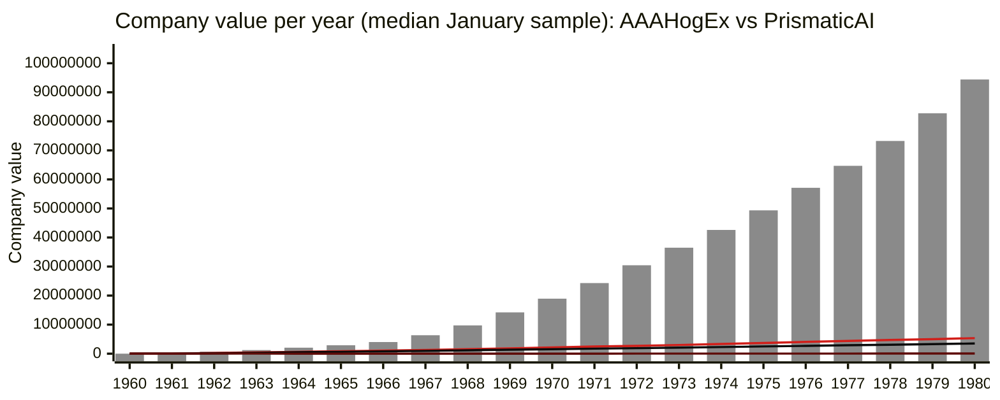
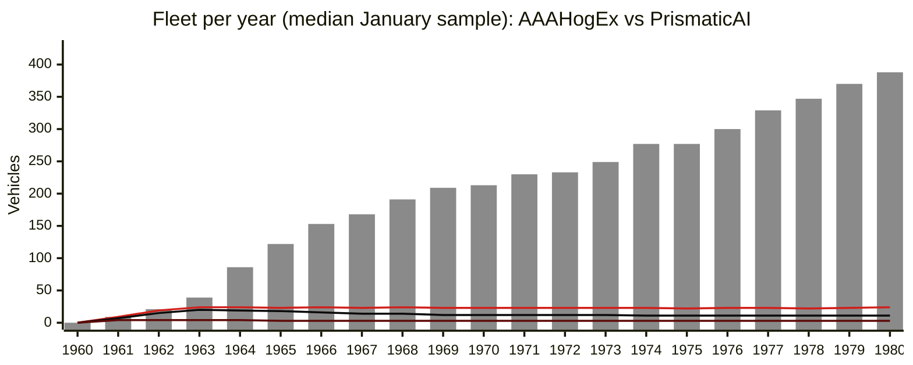
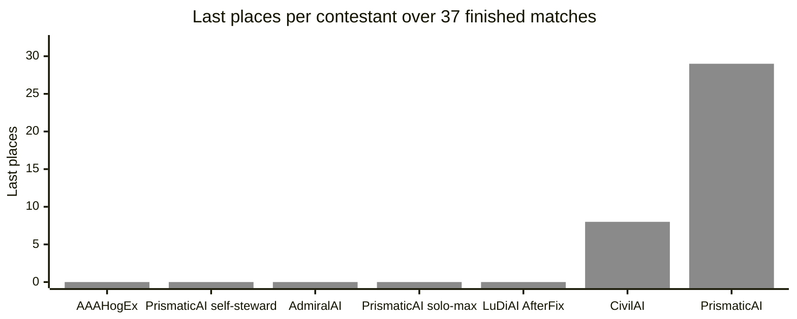
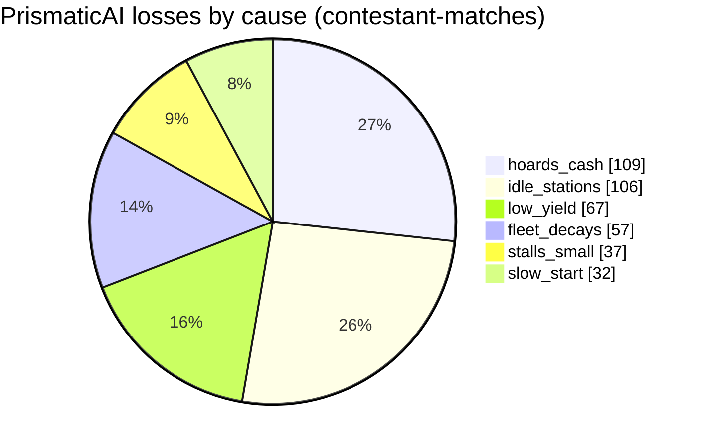

# Battle post-mortem: edition 155d18ea50071e72

**RESEARCH-ONLY.** Derived by `battle-postmortem` from the edition's match records; do not edit.
How it is computed: [research/battle-postmortem.md](../battle-postmortem.md).

Finished matches: 37. Contestants: 7.

**PrismaticAI finished last:**

- `PrismaticAI`: last in 29 of 37 matches

## Charts

<!-- postmortem-charts:begin -->
<!-- generated by battle-postmortem from this post-mortem's JSON; `battle-postmortem render` rewrites it, `battle-postmortem check` fails while it is stale -->

<!-- postmortem-charts:end -->

## Contestants

| Contestant | Matches | Avg rank | Last | Value / winner | Peak fleet | Final fleet | Idle cash | Gap opens (median) | Causes (matches) |
|---|---|---|---|---|---|---|---|---|---|
| AAAHogEx | 37 | 1.0 | 0 | 1.000 | 406.7 | 395.7 | 0.92 | - | - |
| PrismaticAI self-steward * | 37 | 2.622 | 0 | 0.056 | 29.2 | 22.8 | 0.94 | 1960-07 | fleet_decays (2), hoards_cash (37), idle_stations (36), low_yield (16), slow_start (16) |
| AdmiralAI | 37 | 2.946 | 0 | 0.059 | 236.5 | 216.2 | 0.66 | 1962-01 | fleet_decays (2), hoards_cash (6), low_yield (36) |
| PrismaticAI solo-max * | 37 | 3.649 | 0 | 0.036 | 24.4 | 11.3 | 0.94 | 1960-07 | fleet_decays (34), hoards_cash (37), idle_stations (37), low_yield (14), slow_start (16) |
| LuDiAI AfterFix | 37 | 4.973 | 0 | 0.016 | 125.2 | 115.7 | 0.35 | 1960-07 | fleet_decays (3), hoards_cash (4), low_yield (36), slow_start (2) |
| CivilAI | 37 | 6.027 | 8 | 0.006 | 41.5 | 37.9 | 0.84 | 1960-07 | fleet_decays (1), hoards_cash (32), low_yield (36), slow_start (8), stalls_small (3) |
| PrismaticAI * | 37 | 6.784 | 29 | 0.000 | 5.0 | 2.5 | 0.86 | 1960-07 | fleet_decays (21), hoards_cash (35), idle_stations (33), low_yield (37), stalls_small (37) |

`*` PrismaticAI. Causes and thresholds:

- `stalls_small`: peak fleet below 10.0
- `fleet_decays`: final fleet below 0.6 of its peak
- `hoards_cash`: cash above 0.6 of company value over the last 4 quarters, with a fleet below 0.25 of the winner's
- `low_yield`: income per vehicle below 0.5 of the winner's
- `idle_stations`: more than 2.0 stations per vehicle at the end
- `slow_start`: first vehicle more than 1 quarter(s) after the start
- `mode_gap`: a mode that earns at least 0.3 of the winner's profit, with no vehicle of it (referee v3)
- gap opens: the first quarter from which value stays below 0.5 of the winner's

## Why PrismaticAI loses

A loss is one PrismaticAI contestant in one match with that cause; a match with several causes counts once for each.

| Cause | Losses | Contestants (matches) |
|---|---|---|
| `hoards_cash` | 109 | PrismaticAI self-steward (37), PrismaticAI solo-max (37), PrismaticAI (35) |
| `idle_stations` | 106 | PrismaticAI self-steward (36), PrismaticAI solo-max (37), PrismaticAI (33) |
| `low_yield` | 67 | PrismaticAI self-steward (16), PrismaticAI solo-max (14), PrismaticAI (37) |
| `fleet_decays` | 57 | PrismaticAI self-steward (2), PrismaticAI solo-max (34), PrismaticAI (21) |
| `stalls_small` | 37 | PrismaticAI (37) |
| `slow_start` | 32 | PrismaticAI self-steward (16), PrismaticAI solo-max (16) |

## Trajectory (median of the January samples over the matches)

Value / vehicles (of which aircraft and trains) / last year's profit from air and rail, the best contestant first. Without the parenthesis, the referee of that edition had no per-mode fields.

| Year | AAAHogEx | PrismaticAI self-steward | PrismaticAI solo-max | PrismaticAI |
|---|---|---|---|---|
| 1960 | 0 / 0 veh | 0 / 0 veh | 0 / 0 veh | 0 / 0 veh |
| 1961 | 229k / 9 veh | 15k / 9 veh | 3k / 7 veh | 22k / 4 veh |
| 1962 | 692k / 21 veh | 209k / 19 veh | 114k / 15 veh | 25k / 4 veh |
| 1963 | 1.2M / 39 veh | 459k / 24 veh | 293k / 20 veh | 24k / 4 veh |
| 1964 | 2.1M / 86 veh | 636k / 24 veh | 499k / 19 veh | 23k / 4 veh |
| 1965 | 2.9M / 122 veh | 817k / 23 veh | 632k / 18 veh | 22k / 3 veh |
| 1966 | 4.0M / 153 veh | 1.0M / 24 veh | 791k / 16 veh | 21k / 3 veh |
| 1967 | 6.3M / 168 veh | 1.3M / 23 veh | 959k / 14 veh | 19k / 3 veh |
| 1968 | 9.7M / 191 veh | 1.6M / 24 veh | 1.1M / 14 veh | 18k / 3 veh |
| 1969 | 14.2M / 209 veh | 1.8M / 23 veh | 1.4M / 12 veh | 19k / 3 veh |
| 1970 | 18.9M / 213 veh | 2.2M / 23 veh | 1.5M / 12 veh | 20k / 3 veh |
| 1971 | 24.3M / 230 veh | 2.5M / 23 veh | 1.7M / 12 veh | 22k / 3 veh |
| 1972 | 30.4M / 233 veh | 2.7M / 23 veh | 1.9M / 12 veh | 27k / 3 veh |
| 1973 | 36.5M / 249 veh | 3.0M / 23 veh | 2.1M / 12 veh | 29k / 3 veh |
| 1974 | 42.6M / 277 veh | 3.3M / 23 veh | 2.3M / 11 veh | 30k / 3 veh |
| 1975 | 49.3M / 277 veh | 3.7M / 22 veh | 2.5M / 11 veh | 30k / 3 veh |
| 1976 | 57.1M / 300 veh | 4.0M / 23 veh | 2.7M / 11 veh | 32k / 3 veh |
| 1977 | 64.7M / 329 veh | 4.4M / 23 veh | 2.9M / 11 veh | 34k / 3 veh |
| 1978 | 73.2M / 347 veh | 4.7M / 22 veh | 3.1M / 11 veh | 36k / 3 veh |
| 1979 | 82.8M / 370 veh | 5.0M / 23 veh | 3.3M / 11 veh | 38k / 3 veh |
| 1980 | 94.4M / 388 veh | 5.3M / 24 veh | 3.5M / 11 veh | 39k / 3 veh |

## Proposals for the next edition

Settings the causes ask for. These are inputs for the battle's owner, who decides whether they become contestants; nothing applies them.

| For | Settings | Because (matches) |
|---|---|---|
| PrismaticAI | `aggressiveness=100,cash_reserve=5000,intercity=1,max_routes=30,own_lines=8,self_steward=1` | fleet_decays (21), hoards_cash (35), idle_stations (33), low_yield (37), stalls_small (37) |
| PrismaticAI solo-max | `aggressiveness=100,cash_reserve=5000,intercity=1,max_routes=30,own_lines=8,self_steward=1` | fleet_decays (34), hoards_cash (37), idle_stations (37) |
