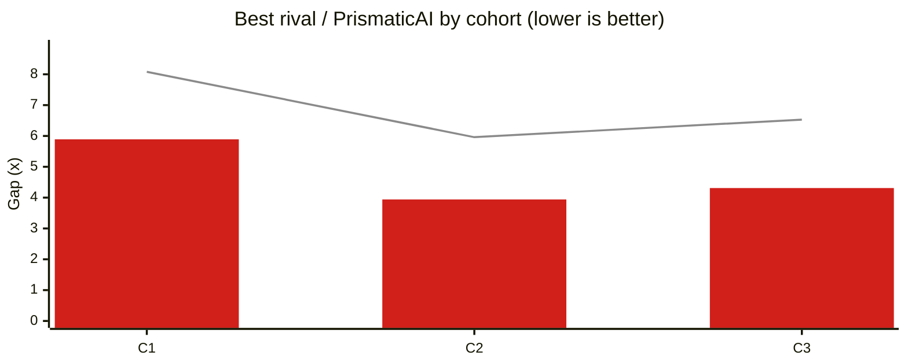

# PrismaticAI strategy state

**RESEARCH-ONLY.** Where PrismaticAI stands against the AIs it actually plays, and what the
post-mortems found. Both tables below are derived from the repository's records by
`tools/research/strategy-surfaces render`, which `tools/surfaces/surfaces sync` runs and
`tools/surfaces/surfaces check` re-runs with `--check`: a record added without a re-sync fails the
commit, the gate and CI. Nothing in them is typed by hand.

The yardstick is the gap to the strongest rival in the match, not the rank: PrismaticAI places
second in nearly every match, and the rank does not move while the gap does. The post-mortem that
explains why the strategy was judged by other yardsticks for so long is listed in the second table
once it lands.

## Evaluations against the field

Every ablation record under [`research/results/`](../results/) whose rows carry `standings` is a
row here. `standings` is the final company value of every company of the row's match, keyed as the
lineup names it (the variant by its name, each opponent by its AI); `battle.py ablate --write`
([`research/ai-battle/README.md`](../ai-battle/README.md)) records it from 2026-11-23 on, and
`battle.py check` refuses standings that name a company twice, miss one, or disagree with the row's
own value or best opponent. A run made before that whose log was kept (`ablate --log-dir`) is
recorded with `tools/research/strategy-surfaces import`: the record then carries `imported` (the
log's and the binary's sha256, the binary's version), its exit status is unknown, and its page says
so. One seed is a direction, not a verdict: compare cohorts over the same seeds.

<!-- strategy-evals:begin -->
<!-- derived by `tools/research/strategy-surfaces render`; `surfaces check` fails when stale -->

Cohorts: runs of one tree, one settings line, one field, one start slot and one length.
The gap is the best rival's final company value over PrismaticAI's: lower is better,
1.0x is parity. Its mean is geometric over the cohort's seeds.

| Cohort | Variant | Tree | Field | Years from | Seeds | Sum of values | Gap (geometric mean) | Worst gap | Ranks |
|---|---|---|---|---|---|---|---|---|---|
| C1 | master | [`13b7005480`](https://github.com/korczis/OpenTTD/commit/13b700548023148035460934f9e5516fd3fe648b) | 7 AIs | 10 from 1950 | 2927, 4242, 15805, 31337 | 13,735,036 | 5.9x | 8.1x | 2/8, 2/8, 2/8, 2/8 |
| C2 | now | [`833ebc615c`](https://github.com/korczis/OpenTTD/commit/833ebc615ce010119d369ccd58a45f1d2950b1bc) | 7 AIs | 10 from 1950 | 2927, 4242, 15805, 31337 | 19,258,915 | 3.9x | 6.0x | 2/8, 2/8, 2/8, 2/8 |
| C3 | pr245 | [`cf3b9ba6a6`](https://github.com/korczis/OpenTTD/commit/cf3b9ba6a61656963bde9fd0387ba04889263673) | 7 AIs | 10 from 1950 | 2927, 4242, 15805, 31337 | 18,319,784 | 4.3x | 6.5x | 2/8, 2/8, 2/8, 2/8 |

| Cohort | Seed | Rank | PrismaticAI value | Strongest rival | Rival value | Gap | Rail / road / air | Record |
|---|---|---|---|---|---|---|---|---|
| C1 | 2927 | 2/8 | 3,335,947 | AAAHogEx | 26,950,796 | 8.1x | 14/41/16 | [ablation-20261123T000649-seed2927-master](../results/ablation-20261123T000649-seed2927-master.md) |
| C1 | 4242 | 2/8 | 3,708,921 | AAAHogEx | 21,334,915 | 5.8x | 20/51/19 | [ablation-20261123T000931-seed4242-master](../results/ablation-20261123T000931-seed4242-master.md) |
| C1 | 15805 | 2/8 | 2,901,081 | AAAHogEx | 16,917,412 | 5.8x | 13/32/17 | [ablation-20261123T000649-seed15805-master](../results/ablation-20261123T000649-seed15805-master.md) |
| C1 | 31337 | 2/8 | 3,789,087 | AAAHogEx | 16,804,001 | 4.4x | 21/40/18 | [ablation-20261123T000931-seed31337-master](../results/ablation-20261123T000931-seed31337-master.md) |
| C2 | 2927 | 2/8 | 6,630,130 | AAAHogEx | 20,237,533 | 3.1x | 20/12/52 | [ablation-20261123T010437-seed2927-now](../results/ablation-20261123T010437-seed2927-now.md) |
| C2 | 4242 | 2/8 | 5,305,853 | AAAHogEx | 12,415,271 | 2.3x | 13/6/63 | [ablation-20261123T010626-seed4242-now](../results/ablation-20261123T010626-seed4242-now.md) |
| C2 | 15805 | 2/8 | 3,380,319 | AAAHogEx | 20,149,625 | 6.0x | 11/4/49 | [ablation-20261123T010437-seed15805-now](../results/ablation-20261123T010437-seed15805-now.md) |
| C2 | 31337 | 2/8 | 3,942,613 | AAAHogEx | 22,327,496 | 5.7x | 13/6/43 | [ablation-20261123T010626-seed31337-now](../results/ablation-20261123T010626-seed31337-now.md) |
| C3 | 2927 | 2/8 | 6,700,606 | AAAHogEx | 21,933,195 | 3.3x | 22/13/58 | [ablation-20261123T010437-seed2927-pr245](../results/ablation-20261123T010437-seed2927-pr245.md) |
| C3 | 4242 | 2/8 | 4,355,770 | AAAHogEx | 16,913,375 | 3.9x | 21/19/57 | [ablation-20261123T010626-seed4242-pr245](../results/ablation-20261123T010626-seed4242-pr245.md) |
| C3 | 15805 | 2/8 | 2,995,459 | AAAHogEx | 19,566,571 | 6.5x | 12/4/34 | [ablation-20261123T010437-seed15805-pr245](../results/ablation-20261123T010437-seed15805-pr245.md) |
| C3 | 31337 | 2/8 | 4,267,949 | AAAHogEx | 17,769,838 | 4.2x | 11/4/45 | [ablation-20261123T010626-seed31337-pr245](../results/ablation-20261123T010626-seed31337-pr245.md) |

Fields and settings of the cohorts, as the records hold them:

- C1, C2, C3: field AAAHogEx, LuDiAI AfterFix, CivilAI, AdmiralAI, NoCAB, DictatorAI, SimpleAI; PrismaticAI in slot 0; settings `aggressiveness=80,air_add_waiting=90,air_full_load=0,air_grow_money=0,air_keep_last=1,air_level_max=20,air_level_once=1,air_level_step=8,air_max_tiles=440,air_planes=5,air_reuse=1,air_routes_max=2,air_towns=35,cash_reserve=5000,catchment_stops=4,intercity=1,invest_air_cap=10,invest_borrow=1,invest_min=50,invest_ppv_div=6,invest_road_cap=12,line_budget=30000,max_routes=30,own_fail_pause=4,own_lines=4,rail_twin_max=10,self_steward=1,statue_money=0`

<!-- strategy-evals:end -->

## Post-mortems and root-cause analyses

Every research document whose lead paragraph opens with "Post-mortem" or "Root-cause analysis",
newest first. "Links to" and "Linked from" are read from the documents' own links.

<!-- strategy-incidents:begin -->
<!-- derived by `tools/research/strategy-surfaces render`; `surfaces check` fails when stale -->

| Date | Document | Kind | Seeds | Links to | Linked from |
|---|---|---|---|---|---|
| 2026-11-23 | [Finished rail lines without a train, and nothing that saw them](../incident-2026-11-23-trainless-lines.md) | Root-cause analysis | [15805](#evaluations-against-the-field) | [analysis-2026-11-23-why-prismatic-loses](../analysis-2026-11-23-why-prismatic-loses.md), [incident-2026-11-23-live-game-15805](../incident-2026-11-23-live-game-15805.md) | [analysis-2026-11-23-why-prismatic-loses](../analysis-2026-11-23-why-prismatic-loses.md) |
| 2026-11-23 | [PrismaticAI ran one train for eight years in the owner's live game](../incident-2026-11-23-live-game-15805.md) | Post-mortem | [15805](#evaluations-against-the-field) | - | [analysis-2026-11-23-why-prismatic-loses](../analysis-2026-11-23-why-prismatic-loses.md), [incident-2026-11-23-trainless-lines](../incident-2026-11-23-trainless-lines.md) |
| 2026-11-23 | [Analysis 2026-11-23: why PrismaticAI loses to AAAHogEx, and why nothing reacted](../analysis-2026-11-23-why-prismatic-loses.md) | Post-mortem | [2927](#evaluations-against-the-field) | [incident-2026-11-22-sibling-industries](../incident-2026-11-22-sibling-industries.md), [incident-2026-11-23-live-game-15805](../incident-2026-11-23-live-game-15805.md), [incident-2026-11-23-trainless-lines](../incident-2026-11-23-trainless-lines.md) | [incident-2026-11-23-trainless-lines](../incident-2026-11-23-trainless-lines.md) |
| 2026-11-22 | [Four PrismaticAI companies of one map built on the same mines](../incident-2026-11-22-sibling-industries.md) | Post-mortem | [2927](#evaluations-against-the-field) | - | [analysis-2026-11-23-why-prismatic-loses](../analysis-2026-11-23-why-prismatic-loses.md) |
| 2026-11-19 | [An unowned AI battle held three machines, and master's CI broke twice](../incident-2026-11-19-ai-battle-overload.md) | Post-mortem | - | - | - |

<!-- strategy-incidents:end -->

## Related

- [`research/ai-battle/README.md`](../ai-battle/README.md): the LAN battle and `battle.py ablate`,
  which writes the records the first table reads.
- [`research/open-findings.md`](../open-findings.md): what the records say is still missing,
  blocked or failed.
- [`tools/surfaces/README.md`](../../tools/surfaces/README.md): how derived regions are kept
  current.
