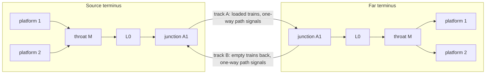

# PrismaticAI: the owner's company AI

**RESEARCH-ONLY.** A Squirrel company AI that the owner's planner and the Rhai scripts steer from
outside the game. It builds bus, intercity road, air, freight rail and passenger rail routes from
its settings. It now lives here, beside the panel, planner and scripts that drive it. Until
2026-11-18 it lived in the bridge repository (`~/dev/openttd-prismatic-bridge/ai/PrismaticAI`,
moved at that repository's `19c2cbe`, whose history keeps the earlier commits).

It is content, not engine code: OpenTTD loads it from the `ai/` folder of its personal directory,
like any AI from BaNaNaS. No CMake option builds or ships it, so no default or release build
contains it (rule `project.research-code-is-gated-and-labelled`). It also stays out of `bin/ai/`,
the folder upstream ships with every build.

## Install

```bash
tools/research/prismatic-ai/install          # ~/Documents/OpenTTD/ai/PrismaticAI -> this checkout
tools/research/prismatic-ai/install --check  # exit 0 when the game loads this checkout's bot
```

The personal folder gets a symlink, never a copy, so the next `start_ai PrismaticAI` loads an
edit made here. A real folder found there is moved aside to `ai-backup/PrismaticAI.<time>`, outside
`ai/`, because the game scans every folder of `ai/` and a backup left there is a second PrismaticAI. Run the
script from another worktree to point the game at that worktree's bot. `--personal DIR` covers
another personal directory: Linux uses `$XDG_DATA_HOME/openttd`, and a test run can use a scratch
`HOME`.

## Files

| File | What it does |
|---|---|
| `info.nut` | Name, API version and every setting. All settings are `CONFIG_INGAME`, so a running bot takes a change at once (`openttd.ai.set_setting`, gated by the owner's approval) |
| `main.nut` | The heartbeat: the planner's air, freight and passenger lines first, then the bot's own lines, buses, fleet, line reconciliation and loan |
| `rail.nut` | Rail lines: termini with a throat, the A* line search, laying, the walk check, depots, trains, platform length; the opt-in double track (`BuildDoubleRailLineAndTrain`: a junction at each terminus, two one-way tracks, one-way path signals) |
| `lines.nut` | Rail lines as desired state: line slots, the record the Rhai steward reads (with station ids), and the reconciliation of its targets; closing removes only what the line owns |
| `fleet.nut` | Road, air and ship capacity follows waiting cargo and the link graph's planned flow; vehicles that lose money are sold; no vehicle more on a route that runs part empty (`load_add_min`) and no new bus route while the road does not pay (`road_yield`); a yearly road and air report in the log |
| `ships.nut` | Ships behind `ships_max` (0, default: none; RESEARCH-ONLY): the bot's own water routes from an oil rig or a coastal producer to an acceptor by the sea, or between two coastal towns, scored by estimated yearly profit, checked on the map before anything is built (dock sites in `AITestMode`, an A* over water), then docks, a ship depot and ships; `fleet.nut` grows and sells them like road and air routes |
| `funnel.nut` | The growth funnel (RESEARCH-ONLY observability: counts and logs, never acts): one `FUNNEL` line per mode once a game year counts candidates, skips, money short or idle, builds, trains and paying lines; `battle.py fitness` prints them ([`research/growth-funnel.md`](../../../research/growth-funnel.md)) |
| `catchment.nut`, `statues.nut` | Mechanisms learned from AAAHogEx: joined drive-through stops that ring each airport to collect the whole town, and statues in the towns of our stations; each behind its setting, off by default |
| `autopilot.nut` | Autopilot's own air routes for a bot without a plan: the best big-town pairs, built first on borrowed money with a real budget check; a half-built route takes its airport down again |
| `steward.nut` | The in-bot steward behind `self_steward=1`: the Rhai steward's line policy for lines with no external target, and reinvestment of idle money in more own lines; on a double-track line, a train more while half a trainload waits and no train loads at the source; on any line that earns, a train more while its source station rates the cargo below `steward_rating` (a full-load train hides a shortage of trains from the cargo waiting), and with `steward_borrow` such a train may be paid from the loan (`lines.nut` `FundTrain`) |
| `roadstop.nut`, `intercity.nut`, `air.nut` | Bus stops and depots facing their road, intercity roads tile by tile, airports and aircraft |
| `rich.nut` | Rich growth behind `rich_growth=1`: once the bank holds `rich_budgets` line budgets (5 by default), the caps that ran out are lifted (routes, air hubs, planes per route while its airports have room, own lines from poorly served producers too) |
| `modernize.nut` | Fleet modernisation behind `modernize=1`: the game's autoreplace from every engine the bot runs to the better one its builders would buy now; vehicles on their way to be sold are protected from it |
| `events.nut` | The game's events, the bot's one reader of `AIEventController`: a lost vehicle's line is checked and repaired (a missing piece laid again, a tile without power converted, the depot joined again or rebuilt), a train on a line that cannot be repaired is sold (stopped where it stands when no depot can be reached) and the line gets no new one, nor does a line whose trains get lost on a whole track until one of them reaches a station; a losing vehicle on a broken route is sold, on a whole one left to the fleet's and the steward's rules; once a month a vehicle stopped in a depot with no orders gets the orders of the line or route served from there, or is sold. Every decision logs one line (`PrismaticAI: lost:`, `unprofitable:`, `no orders:`) |
| `restore.nut` | `Save()`/`Load()`, and a rebuild from the map when a restarted bot has no save data, so a save-and-load (the only way to deploy new code into a running game) does not make it build its lines twice |
| `pressure.nut` | Competitive pressure behind `compete=1`: once a game quarter, the gap to the strongest company's value loosens the fleet limits while money sits idle |
| `capital.nut` | The capital allocator behind `capital_alloc` (3 by default), once a heartbeat in place of the plain loan repayment: money above the reserve buys the investment with the best measured payback within `invest_ppv_div` years, one more vehicle on a route or one more train on an earning rail line with cargo waiting or a low source rating, or is held for it, before the loan is repaid; one loan interval stays above the stay-afloat floor; after a quarter of idle money with no loan, one new air route where the air fleet as a whole pays; a quarterly `capital report` in the log |
| `infra.nut` | Track upgrades behind `upgrade_track=1`: new lines in the best rail type, and one existing network a month converted once an electric locomotive beats the old ones and every train keeps power |

## Rail lines a train can always run

Full rationale: [`research/rail-steward.md`](../../../research/rail-steward.md), knowledge
`rail-lines-a-train-can-turn-on`.

- **No 90-degree turn anywhere.** `pf.forbid_90_deg` is on by default (`src/table/settings/pathfinding_settings.ini`).
  `Turns90` rejects two corners in a row that turn the same way: in the search, on the first tile
  beyond each throat, on the last tile into it, and across a re-plan. The line also runs straight
  through each throat's first tile: the second platform joins by a sideways move, so a corner
  there would be a 90-degree turn on its route only.
- **Termini with two platforms** (`rail_platforms`, default 2). A two-tile throat merges the
  platforms into the single line, with a path signal on each platform's exit. A train leaves only
  when it can reserve its way into a free platform at the other end, so up to `trains_max`
  trains share one track without a passing loop.
- **A terminus finds a site on hilly land** (`BuildRailStationAt`). It tries the axis toward the
  other end, then the other axis, then the reversed exit. In each it takes the catching site
  with the most cargo: flat first, then sloped land the game builds on with foundations
  (`construction.build_on_slopes`; `FitsOnFoundations`, then a test-mode build). It levels a
  site only when no orientation has one. Sites used to be flat and on one axis only, and in the
  owner's hilly 1950 settings about half of the failed own lines ended there.
- **Land is levelled only where it will end level** (`LevelPlan`, rail.nut). The game's
  level-land reports success when any corner moved, so a corner shared with a house, road or
  water stayed where it was and the money was spent on a site the airport or station then
  refused. `LevelPlan` predicts the levelling (a corner d tiles out ends within d steps of the
  level) and the tiles it touches, and takes the cheapest of the site's four corner heights that
  only clear land and trees take part in. Airport sites are also asked about the town's noise
  and airport limit first (`AirportAuthorityAllows`). Rail station levelling keeps a margin
  proportionate to its price (`RailLevelKeep`). With 2M or more to spend it levels sites of up to
  three height steps and up to 400000 (`RailLevelStep`, `RailLevelMax`); the site search reaches
  as far north and west as a terminus there can still catch the industry (its corner up to 3 tiles
  plus its own length out).
- **A terminus with no site is remembered** (`NO_RAIL_SITE`, saved): the next line to or from the
  same place with the same platforms does not survey it again for two game years (30 days when
  a levellable site was passed over for money), an acceptor remembered so fails before the
  source station is built, and the own-line search passes over a producer or acceptor remembered
  so (`NoRailSiteFor`) instead of spending a try on it.
- **The laid line is walked** (`VerifyRailLine`) before any train is bought. A missing piece is
  laid again, and a line that stays broken gets no train.
- **Every wagon is checked.** A wagon the game will not refit or couple (a NewGRF rule) is sold
  again (`AddWagon`), and a train that would carry nothing is not started.
- **The depot stands behind a platform's dead end.** If that fails, it goes beside a straight
  piece of the line, never on a corner.
- **Length follows demand** (`PlatformPlan`). Platform length and wagons come from the line's
  monthly supply, its distance and the locomotive's speed. They are capped by
  `vehicle.max_train_length` and `station.station_spread`, unless `rail_len` or `rail_wagons`
  override them.

## Double track (`rail_double=1`, opt-in)

After AAAHogEx, whose rail scales by double track while a single-track line here holds two
trains. With `rail_double=1` each new own freight line gets a junction at both termini and two
tracks, one each way (`rail.nut` `BuildDoubleRailLineAndTrain`):



- **One A\* search, twice.** Track A is `FindRailPath` between the junctions. Track B is the
  same search with track A's tiles left out. Both are walked (`VerifyRailLine`, `VerifyJunction`)
  before a train is bought. L0 is straight, so no route through the junction turns 90 degrees.
- **One-way path signals** every `RAIL_SIGNAL_SPACING` tiles, plus one on the last tile before
  each far junction, so an arriving train waits on its own track.
- **The throat's path signals face departing trains**, unlike a single-track throat.
  `AIRail.BuildSignal(tile, front)` signals trains that come *from* `front` (`script_rail.cpp`
  `_possible_trackdirs`). A signal facing arrivals let an arriving train wait on M, the tile every
  departure needs, and the first build deadlocked there.
- **`trains_max`** is the platforms plus the signal blocks of the shorter track: half of what
  both tracks and all four platforms hold.
- **Growth.** The in-bot steward adds a train while half a trainload waits and no train of the
  line is loading at the source (AAAHogEx's rule). It adds at most one a game month.
- **Fallback.** When track B cannot be found, laid or walked, the junction's spur is removed and
  the line runs single track with `trains_max` = platforms. On hilly maps this is common: track A
  takes the only bridge site across a valley.
- **Not ported.** AAAHogEx's third source platform, signals at the top of slopes, and cloning
  without the steward's monthly rhythm.

The measured effect is in `research/ai-battle/README.md` (section *Double track*).

## Steering from outside

| Setting | Set by | Meaning |
|---|---|---|
| `rail_a`, `rail_b`; `fr_*` … `fr16_*`; `air_a`, `air_b` | the panel, from the planner's portfolio | the lines to build |
| `own_lines`, `line_budget`, `rail_after`, `own_fail_pause` | the panel | how far the bot plans on its own, and when; `own_fail_pause` stops trying own lines for the game year after that many failed in a row (0, default: never) |
| `planned_freight_only` (RESEARCH-ONLY) | a single freight-line authority outside the bot (the battlebrain service) | 1: the bot builds only the freight lines handed over in `fr_*` … `fr16_*` and plans none of its own: the own plan in `main.nut` (`NextOwnFreightLine`, `rail.nut`) is skipped whatever `own_lines`, the in-bot steward's reinvestment beyond it (`steward.nut` `OwnLinesCap`) or the autopilot's floor of own lines say. `own_lines=0` alone is not enough: with `self_steward=1` (forced on by `autopilot=1`) `OwnLinesCap` still lets idle money fund up to 32 own lines. Twins (`rail_twin_max`, `steward.nut` `TwinLines`) and the passenger pair (`rail_a`, `rail_b`) keep their own settings. 0 (default): unchanged |
| `rail_platforms`, `rail_len`, `rail_wagons` | the owner, a duel's `--bot-settings` | the shape of new rail lines (0: derive) |
| `disclose_name` | the owner, for a real game against people | 1 appends " (AI)" to the company's name ([`research/real-game.md`](../../../research/real-game.md)) |
| `line<N>_trains`, `line<N>_wagons` (24 slots) | `tools/research/mcp-panel/rhai/rail_steward.rhai` | the target of rail line N: trains (0 closes it), wagons per train |
| `autopilot` | default 1; the owner (0 restores the duels' old unplanned rival) | the bot grows on its own, with or without a plan: in-bot steward, at least 10 own freight lines, intercity roads, up to 30 routes, at most a 5000 reserve (`main.nut:Behaviour`, rule `project.prismatic-ai-is-never-last`) |
| `air_routes_max`, `air_towns`, `air_min_tiles`, `air_max_tiles`, `air_level_max`, `air_keep_last`, `air_reuse`, `air_grow_money`, `air_level_once`, `air_level_step`, `foreign_airports` | the owner, any surface: tilde console `bot set <company> <name> <value>`, MCP `openttd.ai.set_setting`, Rhai `api_botSetting`, the panel, a battle settings string, the battle's genetic algorithm | the autopilot's air routes: how many, from how many of the biggest towns, at what distance, and when a town is skipped because other companies already fly from it (`autopilot.nut`), and how much levelling one airport site may cost, in thousands (`air.nut`; 35 by default since the levelling rectangle was fixed on 2026-11-20), and whether the fleet seller keeps the last plane of an air route (`fleet.nut`; on by default, and pinned on in the battle: a bug fix is not a gene); `air_reuse` lets new routes fly from our airports (hubs) once no fresh pair is left, and `air_grow_money` allows one more route per that much idle money, and `air_level_once` stops a search levelling after a levelled site was refused anyway (all off by default, GA genes); `air_level_step` levels only sites whose corners lie within that many height steps (default 0: any step until a levelled site is refused in the game, then 1) |
| `invest_min`, `invest_ppv_div`, `invest_road_cap`, `invest_air_cap`, `reinvest_budgets` | the same surfaces | when idle money buys vehicles and how far a route grows (`fleet.nut` InvestSurplus), and how many line budgets in the bank fund own lines beyond `own_lines` (`steward.nut`) |
| `catchment_stops`, `catchment_spacing`, `statue_money`, `air_full_load`, `invest_borrow` | the same surfaces; genes of the battle's GA | mechanisms learned from AAAHogEx's source, each off by default because one recorded ablation (`research/results/ablation-20261119T062938-seed930967890.md`) did not favour turning it on: joined road-stop rings around airports (`catchment.nut`), statues (`statues.nut`), full load at both airports, borrowing for vehicles that pay back |
| `air_add_waiting`, `rail_twin_max` | the same surfaces; GA genes | a plane more while both airports have passengers waiting; twin rail lines for saturated lines. Both off by default, see the recorded ablations `research/results/ablation-20261119T06*` |
| `ships_max`, `ships_cap`, `ships_max_tiles` (RESEARCH-ONLY) | the owner, any surface above; not GA genes yet | `ships_max` water routes the bot plans itself (`ships.nut`; 0, default: no ships), at most `ships_cap` ships per route (`fleet.nut`), routes at most `ships_max_tiles` long. Off until measured |
| `rail_double` | the owner, any surface above | 1: the bot's own new freight lines are double track, see below; 0 (default): single track, unchanged |
| `autopilot` with a plan | the panel | since 2026-11-19 a plan no longer switches growth off, and since 2026-11-23 it keeps the autopilot's floors too (a planner's higher `own_lines`/`max_routes` stand): the planner's lines are added on top of the autopilot, not used instead of it. The handed freight lines (`fr_*`) still come before the bot's own; the passenger pair (`rail_a`, `rail_b`, `main.nut` `PairDue`, `TryRailPair`) takes a heartbeat in which the bot started no own freight line (none free, its cap, a failure pause, no budget), or any heartbeat once it has waited `PAIR_WAIT_DAYS` (two game years) since it became due, and then needs money plus loan headroom of `line_budget`. Before, the pair was built first and its path search held the first own line back for months while rivals claimed the free producers; a planned start cost 25-35% on the live settings |
| `fr_*` … `fr16_*` written one setting at a time | the panel, the re-planner | a slot counts only when `from`, `to` and `cargo` are all set, both industries exist, the producer makes the cargo and the acceptor takes it, and two reads in a row (a heartbeat apart) agree (`main.nut` `FreightLines`). Until then it is not tried and not marked tried; an incoherent slot is logged once per state; a set slot that does not count yet holds back the bot's own lines and the passenger pair for up to 6 reads. A mixed tuple that is coherent by chance and stays a heartbeat or more is still built: only a writer that publishes a slot whole prevents that. `test_freight_slots=1` (RESEARCH-ONLY) drives every case headless |
| `self_steward` | the owner, e.g. the headless LAN AI battle ([`research/ai-battle/README.md`](../../../research/ai-battle/README.md)) | 1: lines without a steward's target follow the Rhai steward's policy inside the bot, and idle money funds own lines beyond `own_lines` (`steward.nut`); 0 (default): unchanged |
| `steward_rating`, `steward_borrow` | the same surfaces | with `self_steward=1`: an earning line gets a train more while its source station rates the cargo below `steward_rating` percent (default 55; 0: off), and `steward_borrow` (default 1) lets such a line borrow for it while the loan stays at most half its limit (`steward.nut`, `lines.nut` `FundTrain`; evidence in [`research/rail-steward.md`](../../../research/rail-steward.md#the-in-bot-stewards-capital)) |

Every finished line logs a record once at build time and again every game month:

```text
PrismaticAI: rail line 3: label=COAL A Mine - B Power Station|a=26106|b=53365|st_a=0|st_b=1|cargo=1|platforms=2|len=3|depot=26109|trains_max=2|wagons_fit=5|tiles=233|state=open
```

`tools/research/mcp-panel/rhai/rail_lib.rhai` (`parse_record`) reads it. The steward and the
monitor share that reading.

## Settings

Every setting `info.nut` declares; [Steering from outside](#steering-from-outside) says who sets which. Change a live one in a running game with `openttd.ai.set_setting` (approval-gated) or the tilde console `bot set <company> <name> <value>`.

<!-- prismatic-ai-settings:begin -->

176 settings in 88 declarations, 172 of them live-changeable (`CONFIG_INGAME`), 36 genes of the battle's genetic algorithm (`tuning` in [`battle.json`](../ai-battle/battle.json)). Derived from [`PrismaticAI/info.nut`](PrismaticAI/info.nut) by `derive_docs.py`.

| Setting | Default | Range / step | Live | GA | Description |
|---|---|---|---|---|---|
| [`aggressiveness`](PrismaticAI/info.nut#L24) | 30 | 0 .. 100 | yes | gene 20 .. 100 / 10 | How aggressively to expand (0 = passive, 100 = maximal). Set via start_ai/reload_ai settings string, e.g. 'aggressiveness=75'. |
| [`heartbeat_seconds`](PrismaticAI/info.nut#L32) | 30 | 1 .. 300 | yes |  | How often (in-game seconds) the AI logs a heartbeat -- useful to confirm the bridge can see it's alive via /rcon list_ai and the Admin console feed. |
| [`max_routes`](PrismaticAI/info.nut#L43) | 4 | 1 .. 30 | yes | gene 4 .. 30 / 2 | How many bus routes (one per town) the company may run. Raising it while the AI runs makes it expand. |
| [`cash_reserve`](PrismaticAI/info.nut#L54) | 25000 | 0 .. 500000 / 5000 | yes | gene 0 .. 40000 / 5000 | Money the company keeps in the bank: no new route is built while the balance is below it. |
| [`intercity`](PrismaticAI/info.nut#L66) | 1 | 0 / 1 | yes | pinned 1 | 1: connect pairs of towns with a road the bot builds tile by tile and run buses between them; 0: routes inside one town only. |
| [`air_a`](PrismaticAI/info.nut#L77) | -1 | -1 .. 65535 | yes |  | First town of the air route the owner's planner chose (town id; -1: none). Set by the panel from mcp-plan by_mode.air. |
| [`air_b`](PrismaticAI/info.nut#L88) | -1 | -1 .. 65535 | yes |  | Second town of the planner's air route (town id; -1: none). |
| [`rail_a`](PrismaticAI/info.nut#L99) | -1 | -1 .. 65535 | yes |  | First town of the rail route the owner's planner chose (town id; -1: none). Set by the panel from mcp-plan by_mode.rail. |
| [`rail_b`](PrismaticAI/info.nut#L106) | -1 | -1 .. 65535 | yes |  | Second town of the planner's rail route (town id; -1: none). |
| [`rail_after`](PrismaticAI/info.nut#L113) | 1 | 0 .. 16 | yes |  | The planner's freight lines built before its passenger rail pair: those that score more (1: after the first, as before). |
| [`rail_wagons`](PrismaticAI/info.nut#L120) | 0 | 0 .. 30 | yes |  | Wagons behind the locomotive of a new rail line's train (0: derive from the line's monthly supply, distance and speed, and fill the platform; rail.nut PlatformPlan). |
| [`rail_len`](PrismaticAI/info.nut#L127) | 4 | 0 .. 16 | yes |  | Platform length in tiles of a new rail line (0: derive from demand, capped by the game's vehicle.max_train_length and station.station_spread). |
| [`rail_platforms`](PrismaticAI/info.nut#L137) | 2 | 1 .. 2 | yes |  | Platforms at each terminus of a new rail line: 2 builds a throat with path signals so two trains share the single track (each waits in a platform, never on the line); 1 is one platform and one train. |
| [`fr_from`](PrismaticAI/info.nut#L144) | -1 | -1 .. 65535 | yes |  | Producing industry of the freight rail route the owner's planner chose (industry id; -1: none). Set by the panel from the planner's portfolio. |
| [`fr_to`](PrismaticAI/info.nut#L151) | -1 | -1 .. 65535 | yes |  | Accepting industry of the planner's freight rail route (industry id; -1: none). |
| [`fr_cargo`](PrismaticAI/info.nut#L158) | -1 | -1 .. 63 | yes |  | Cargo of the planner's freight rail route (cargo id; -1: none). |
| [`fr<N>_from`](PrismaticAI/info.nut#L171) (N = 2 .. 16) | -1 | -1 .. 65535 | yes |  | Producing industry of the planner's freight rail line N (industry id; -1: none). |
| [`fr<N>_to`](PrismaticAI/info.nut#L178) (N = 2 .. 16) | -1 | -1 .. 65535 | yes |  | Accepting industry of the planner's freight rail line N (industry id; -1: none). |
| [`fr<N>_cargo`](PrismaticAI/info.nut#L185) (N = 2 .. 16) | -1 | -1 .. 63 | yes |  | Cargo of the planner's freight rail line N (cargo id; -1: none). |
| [`line<N>_trains`](PrismaticAI/info.nut#L198) (N = 1 .. 24) | -1 | -1 .. 8 | yes |  | Trains on rail line N (the steward's target; 0 closes the line, -1: no target). |
| [`line<N>_wagons`](PrismaticAI/info.nut#L205) (N = 1 .. 24) | -1 | -1 .. 30 | yes |  | Wagons per train on rail line N (the steward's target; -1: no target). |
| [`own_lines`](PrismaticAI/info.nut#L213) | 18 | 0 .. 32 | yes | gene 0 .. 24 / 2 | Freight rail lines the bot plans itself once every line the planner handed over was tried and money waits. With autopilot=1, planned or not, at least 10 (main.nut Behaviour); 0 means none only with autopilot=0, and planned_freight_only=1 turns them off under any plan. |
| [`planned_freight_only`](PrismaticAI/info.nut#L223) | 0 | 0 / 1 | yes |  | 1: the bot builds only the freight rail lines handed over in fr_* to fr16_* and plans none itself (no own lines from own_lines, the in-bot steward's reinvestment or the autopilot); twins (rail_twin_max) and the passenger pair still follow their own settings. 0 (default): unchanged. |
| [`line_budget`](PrismaticAI/info.nut#L230) | 50000 | 10000 .. 1000000 / 10000 | yes | gene 30000 .. 200000 / 10000 | Money (bank balance plus loan headroom) the bot wants at hand before it builds the planner's next freight rail line. |
| [`disclose_name`](PrismaticAI/info.nut#L237) | 0 | 0 / 1 | yes |  | Name the company so it reads as an AI the host steers ("&lt;name&gt; (AI)"), for a real game against people (research/real-game.md). 0 keeps the game's own name. |
| [`air_routes_max`](PrismaticAI/info.nut#L244) | 15 | 0 .. 30 | yes | gene 2 .. 20 | Autopilot: most own air routes (autopilot.nut). |
| [`air_towns`](PrismaticAI/info.nut#L251) | 50 | 4 .. 60 | yes | gene 10 .. 50 / 5 | Autopilot: how many of the most populous towns air pairs are chosen from. |
| [`air_min_tiles`](PrismaticAI/info.nut#L258) | 60 | 20 .. 400 / 10 | yes |  | Autopilot: shortest air pair, in tiles. |
| [`air_max_tiles`](PrismaticAI/info.nut#L265) | 400 | 60 .. 800 / 10 | yes | gene 160 .. 500 / 20 | Autopilot: longest air pair, in tiles. |
| [`air_level_max`](PrismaticAI/info.nut#L272) | 10 | 0 .. 200 / 5 | yes | gene 5 .. 60 / 5 | Most levelling one airport site may cost, in thousands (a hilly map needs more). |
| [`air_grow_money`](PrismaticAI/info.nut#L279) | 2500 | 0 .. 10000 / 250 | yes | gene 0 .. 4000 / 500 | Autopilot: one more air route beyond air_routes_max per this much bank money above the reserve, in thousands (0: never more than air_routes_max). |
| [`air_reuse`](PrismaticAI/info.nut#L286) | 0 | 0 / 1 | yes | gene | Autopilot: once no pair of fresh towns is left, a new air route may fly from an airport of ours (a hub); 0: one route per airport. |
| [`air_level_step`](PrismaticAI/info.nut#L293) | 8 | 0 .. 8 | yes | gene | Most height steps between the corners of an airport site that is still levelled (a bigger step moves corners outside the site, where houses and roads stop it); 0: any step until a levelled site is refused in this game, then 1. |
| [`air_level_once`](PrismaticAI/info.nut#L300) | 0 | 0 / 1 | yes | gene | 1: an airport search levels no further site once a levelled site was refused anyway (a corner shared with a house or road does not move); 0: it keeps levelling. |
| [`own_fail_pause`](PrismaticAI/info.nut#L307) | 6 | 0 .. 10 | yes | gene 1 .. 6 | After this many own freight lines in a row could not be built, try no more that game year (a failed line still costs its stations); 0: at most 8 a game year (main.nut OWN_FAIL_YEAR_MAX). |
| [`air_keep_last`](PrismaticAI/info.nut#L314) | 1 | 0 / 1 | yes | pinned 1 | Never sell the last plane of an air route for losing money (a dead route never flies again). |
| [`foreign_airports`](PrismaticAI/info.nut#L321) | 1 | 0 .. 5 | yes |  | Autopilot: skip a town with this many airports of other companies within 16 tiles (0: never skip). |
| [`invest_min`](PrismaticAI/info.nut#L328) | 50 | 0 .. 2000 / 10 | yes | gene 50 .. 600 / 50 | Fleet: idle money (in thousands) above which InvestSurplus buys vehicles where they earn most. |
| [`invest_ppv_div`](PrismaticAI/info.nut#L335) | 3 | 1 .. 10 | yes | gene 1 .. 6 | Fleet: a route gets one more vehicle while its vehicles earn more than price / this per year. |
| [`invest_road_cap`](PrismaticAI/info.nut#L342) | 6 | 1 .. 40 | yes | gene 6 .. 30 / 2 | Fleet: most road vehicles per route that InvestSurplus grows to. |
| [`invest_air_cap`](PrismaticAI/info.nut#L349) | 6 | 1 .. 30 | yes | gene 4 .. 24 / 2 | Fleet: most planes per route (InvestSurplus, and fleet growth with the steward on). |
| [`reinvest_budgets`](PrismaticAI/info.nut#L356) | 2 | 1 .. 10 | yes |  | Steward: own lines beyond own_lines need this many line budgets in the bank. |
| [`catchment_stops`](PrismaticAI/info.nut#L363) | 8 | 0 .. 30 | yes | gene 0 .. 12 / 2 | Catchment ring (learned from AAAHogEx): most joined drive-through road stops around each passenger airport, so it collects the whole town (catchment.nut; default 8 since GA g150.0 became the default on 2026-11-20; 2 before, from the GA elite of 2026-11-19; 0: off). |
| [`catchment_spacing`](PrismaticAI/info.nut#L370) | 4 | 2 .. 10 | yes |  | Catchment ring: tiles between two of its road stops. |
| [`statue_money`](PrismaticAI/info.nut#L377) | 0 | 0 .. 5000 / 50 | yes | gene 0 .. 0 / 200 | Statues (learned from AAAHogEx): money in thousands above which the bot builds a statue in each town next to its stations (statues.nut; default 0: off, it cost ~30% on the fitness seed at 6 years, and the battle's GA no longer explores it: on seed 853334149 statues took g279.3 from 3.19M to 0.66M, and over 1,140 GA variants those with statues averaged 14% less value). |
| [`air_full_load`](PrismaticAI/info.nut#L384) | 0 | 0 .. 1 | yes | gene | 1: planes wait for a full load at both airports (learned from AAAHogEx); 0 (default): they leave at once; full load cost ~5% on the fitness seed at 6 years. |
| [`invest_borrow`](PrismaticAI/info.nut#L391) | 0 | 0 .. 1 | yes | gene | 1: InvestSurplus may borrow up to the loan limit for a vehicle that pays back (learned from AAAHogEx, which keeps its cash near zero); 0 (default): bank money only; borrowing changed nothing on the fitness seed at 6 years. |
| [`air_add_waiting`](PrismaticAI/info.nut#L398) | 20 | 0 .. 500 / 10 | yes | gene 0 .. 100 / 10 | Planes (learned from AAAHogEx): add a plane to an air route while the passengers waiting at BOTH of its airports exceed this, up to invest_air_cap (fleet.nut; default 20 since GA g150.0 became the default on 2026-11-20; 0: the old rule of 1.5 loads at one end, the default of the GA elite of 2026-11-19; the earlier default 10 with catchment_stops=8 had +14.8% mean value over 36 seeds against the bot before it). |
| [`air_add_full`](PrismaticAI/info.nut#L405) | 0 | 0 .. 100 / 5 | yes | gene 0 .. 90 / 10 | Air yield (after AAAHogEx, whose planes fly 89% full): one more plane calls at an airport of ours only while the planes flying from it are this percent full: a plane added to an air route (fleet growth, InvestSurplus) needs the route's flying planes that full, a new autopilot route from an airport we have (air_reuse) the planes flying from that airport (fleet.nut AirRouteHasDemand, autopilot.nut BestAirPair; 0: off). |
| [`rail_twin_max`](PrismaticAI/info.nut#L412) | 6 | 0 .. 24 | yes | gene 0 .. 16 / 2 | Rail capacity (after AAAHogEx's double track): most twin lines, each a second line with its own track and platforms between the same two industries, built when a line runs all its trains and still has a trainload waiting (steward.nut TwinLines; 0: off). |
| [`rail_grow_max`](PrismaticAI/info.nut#L419) | 0 | 0 .. 7 | yes |  | Growing stations (growth.nut): a rail line that earns, runs trains as long as its platforms and still leaves a full trainload waiting gets its platforms one tile longer at both ends, once a game month, up to this many tiles (0: off). |
| [`rail_feed`](PrismaticAI/info.nut#L426) | 0 | 0 .. 6 | yes |  | Multi-source stations (growth.nut FeedStations): a rail line that earns joins up to this many more producers of its cargo, unserved and within the station spread of its source station, into that station's catchment with one station tile each, once a game month (0: off). |
| [`rail_double`](PrismaticAI/info.nut#L433) | 1 | 0 / 1 | yes |  | 1: the bot's own new freight lines are double track (after AAAHogEx): one one-way track each way with path signals, so a line runs many trains and the in-bot steward adds one while half a trainload waits and no train loads at the source (rail.nut BuildDoubleRailLine); 0 (default): single track, two trains a line. Default 1 since 2026-11-19: in the battle, 20 years, paired on 74 common seeds, +14.8% mean value and better in 56 of 74; 0: single track. |
| [`autopilot`](PrismaticAI/info.nut#L440) | 1 | 0 / 1 | yes |  | 1 (default): the bot grows on its own, with or without a plan from the panel: in-bot steward, own freight lines (at least 10), intercity roads, up to 30 routes and at most a 5000 reserve; a plan's lines are built on top, its passenger pair in a heartbeat that starts no own freight line, or after two years of waiting. 0: the bot stays as small as its settings say (the duels' rival before 2026-11-19). |
| [`self_steward`](PrismaticAI/info.nut#L447) | 1 | 0 / 1 | yes | pinned 1 | 1: with no steward's target for a rail line, the bot applies the Rhai steward's policy itself (lengthen, add a train, shrink, close) and reinvests idle money in more own lines beyond own_lines (steward.nut); 0: lines run what the external steward sets. |
| [`steward_rating`](PrismaticAI/info.nut#L456) | 55 | 0 .. 100 / 5 | yes |  | In-bot steward: an earning rail line whose source station rates its cargo below this percent gets one more train (up to trains_max, its newest train at least 90 days old, a source platform free). The rating falls with the days between pickups, which a full-load train hides from the cargo waiting (steward.nut; 0: off, only waiting cargo grows a line). |
| [`steward_target`](PrismaticAI/info.nut#L463) | 1 | 0 / 1 | yes |  | In-bot steward: 1 (default): a freight rail line that earns gets the trains that carry its monthly production (its producer and the ones feeding its source station) over one round trip, in batches (at most doubling a month, up to trains_max), its newest train at least 90 days old (steward.nut LineTrainTarget); 0: only the waiting-cargo and rating rules grow a line, one train at a time. |
| [`steward_borrow`](PrismaticAI/info.nut#L470) | 1 | 0 / 1 | yes |  | 1 (default): a rail line whose trains earn may borrow for the next train the steward set, while the loan stays at most half its limit and the headroom left holds a line budget and two quarters of running costs (lines.nut FundTrain); 0: a new train only from the bank balance, which RepaySurplus keeps near the reserve. |
| [`rich_growth`](PrismaticAI/info.nut#L477) | 1 | 0 / 1 | yes | pinned 1 | 1 (default): once the bank holds rich_budgets line budgets (default ten), the caps that ran out are lifted: max_routes at least 30, air_reuse on, more planes per air route while its airports have room, own freight lines without a cap and from poorly served producers too (rich.nut); 0: money above the caps stays in the bank. |
| [`rich_air`](PrismaticAI/info.nut#L484) | 0 | 0 / 1 | yes | pinned 0 | 0 (default): idle money (rich_growth, compete) is not spent on aircraft: air_reuse, planes per air route, air_routes_max and air_add_waiting stay as set; six replays on 2026-11-22 lost 13-55% of company value with 53-79 planes against about 25; 1: rich growth and competitive pressure also lift the air caps (as first built). |
| [`modernize`](PrismaticAI/info.nut#L491) | 1 | 0 / 1 | yes | pinned 1 | 1 (default): once a game month the bot sets the game's autoreplace from every engine it runs to the better one its builders would buy now (same rail type with power, same plane class; modernize.nut); 0: engines are only renewed with the same model. |
| [`compete`](PrismaticAI/info.nut#L498) | 1 | 0 / 1 | yes | pinned 1 | 1 (default): once a game quarter the bot compares its company value with the strongest other company; while it is behind and money sits idle, its fleet limits loosen by how far behind it is (vehicles per route, the earnings a route needs for one more, air routes, twin lines; pressure.nut); 0: the limits stay as set. |
| [`upgrade_track`](PrismaticAI/info.nut#L505) | 1 | 0 / 1 | yes | pinned 1 | 1 (default): once a month, convert one rail network to a better rail type (electrified once an electric locomotive beats the steam and diesel ones) when every train keeps power on it and the bank holds the cost plus track_keep_budgets line budgets (default two); new lines are built in the best type (infra.nut); 0: plain rail all game. |
| [`rich_budgets`](PrismaticAI/info.nut#L512) | 5 | 1 .. 100 | yes | gene | Rich growth: the bot counts as rich once the bank holds this many line budgets (rich.nut Rich). Default 5 (250k at the default line_budget): below the fitness check's hoards floor (500k), so the bot spends before it hoards; at 10 the planned fitness contestant held 9 vehicles while its money rose from 283k to 697k (2026-11-22). |
| [`rich_air_money`](PrismaticAI/info.nut#L519) | 250 | 10 .. 5000 / 10 | yes | gene | Rich growth: one plane more per air route for every this much bank money above the rich threshold, in thousands (rich.nut RichAirCap). |
| [`rich_invest_rounds`](PrismaticAI/info.nut#L526) | 4 | 1 .. 20 | yes | gene | Rich growth: how many times a heartbeat idle money buys one more vehicle for the route that earns most per vehicle (fleet.nut InvestSurplus); 1 when not rich. |
| [`rich_air_cap_max`](PrismaticAI/info.nut#L533) | 30 | 1 .. 30 | yes |  | Rich growth: the most planes per air route it raises invest_air_cap to (rich.nut RichAirCap; never lowers invest_air_cap). |
| [`rich_served_below`](PrismaticAI/info.nut#L540) | 60 | 0 .. 100 / 5 | yes | gene | Rich growth: an own freight line may also start at a producer others serve while under this share of its production was transported last month, in percent (rich.nut, read by rail.nut NextOwnFreightLine). |
| [`rich_min_tiles`](PrismaticAI/info.nut#L547) | 80 | 20 .. 400 / 10 | yes | gene | Rich growth: the shortest own freight line, in tiles (the planner's window is 100-260; rich.nut, read by rail.nut NextOwnFreightLine). |
| [`rich_max_tiles`](PrismaticAI/info.nut#L554) | 320 | 100 .. 1000 / 10 | yes | gene | Rich growth: the longest own freight line, in tiles, at least rich_min_tiles (rich.nut, read by rail.nut NextOwnFreightLine). |
| [`airport_fill`](PrismaticAI/info.nut#L561) | 100 | 25 .. 200 / 5 | yes | gene | Planes an airport takes before it counts as full, in percent of the planes its type serves (8 small to 24 international; rich.nut AirportPlanesMax, used by AirportHasRoom for every plane added). |
| [`pressure_low`](PrismaticAI/info.nut#L568) | 125 | 100 .. 2000 / 5 | yes | gene | Competitive pressure: the strongest rival's company value against ours, in percent, from which the level is low (pressure.nut PressureLevel). |
| [`pressure_mid`](PrismaticAI/info.nut#L575) | 200 | 100 .. 2000 / 5 | yes | gene | Competitive pressure: the leader / ours percent from which the level is mid (twin rail lines from here on); below pressure_low counts as pressure_low (pressure.nut). |
| [`pressure_high`](PrismaticAI/info.nut#L582) | 400 | 100 .. 2000 / 5 | yes | gene | Competitive pressure: the leader / ours percent from which the level is high; below pressure_mid counts as pressure_mid (pressure.nut). |
| [`track_keep_budgets`](PrismaticAI/info.nut#L589) | 2 | 0 .. 20 | yes |  | Track upgrade: a rail network is converted only while the bank holds its cost plus this many line budgets (infra.nut UpgradeTrack). |
| [`ships_max`](PrismaticAI/info.nut#L597) | 0 | 0 .. 30 | yes |  | Ships (ships.nut): most water routes the bot plans itself, from an oil rig or a coastal producer to an acceptor by the sea, or between two coastal towns, one a heartbeat when money plus loan headroom reach line_budget; the fleet grows them like road and air routes (0, the default: no ships). |
| [`ships_cap`](PrismaticAI/info.nut#L604) | 6 | 1 .. 20 | yes |  | Ships: most ships per water route, for the fleet's additions where cargo waits and InvestSurplus (fleet.nut), and for how many a new route is planned with (ships.nut). |
| [`ships_max_tiles`](PrismaticAI/info.nut#L611) | 150 | 40 .. 500 / 10 | yes |  | Ships: the longest water route, in tiles between its two ends (the shortest is 20; ships.nut). |
| [`air_planes`](PrismaticAI/info.nut#L618) | 1 | 1 .. 8 | yes | gene 1 .. 6 | Aircraft on the planner's air route. |
| [`load_add_min`](PrismaticAI/info.nut#L628) | 50 | 0 .. 100 / 5 | yes |  | Yield: no vehicle is added to a road, air or water route (fleet growth, InvestSurplus) whose vehicles ran under this percent full over the last heartbeats, sampled while they run (fleet.nut RouteLoad; 0: off). |
| [`road_yield`](PrismaticAI/info.nut#L635) | 20 | 0 .. 200 / 5 | yes |  | Yield: a new bus route is built only while our road vehicles a year old earned, last year, at least this percent of their price between them; before any is a year old, only while fewer than road_probes road routes run (fleet.nut RoadPays; 0: off). |
| [`road_probes`](PrismaticAI/info.nut#L642) | 2 | 0 .. 30 | yes |  | Yield: how many bus routes run before any road vehicle is a year old and road_yield can judge them (fleet.nut RoadPays). |
| [`air_yield_routes`](PrismaticAI/info.nut#L649) | 8 | 0 .. 30 | yes |  | Yield: autopilot air routes beyond air_routes_max, one at a time, each once every air route we fly has planes a year old that earned last year at least their price / invest_ppv_div a plane (autopilot.nut AirRoutesPay; 0: off). |
| [`capital_alloc`](PrismaticAI/info.nut#L657) | 3 | 0 .. 3 | yes |  | Capital allocator, once a heartbeat in place of the plain loan repayment (capital.nut). 1: keep one loan interval above the stay-afloat floor, so a few days of costs no longer trigger a rescue and a 90-day construction freeze; 2 (and 1): before repaying, buy the investment with the best measured return whose payback is within invest_ppv_div years: one more vehicle on a road, air or water route (behind the fleet's caps and load guards) or one more train on an earning rail line with cargo waiting or a low source rating, or hold the money for it; 3 (default, and 2): after a quarter with money idle and no loan, one new air route where the air fleet as a whole pays; 0: repay everything above twice the reserve, as before. |
| [`test_trainless`](PrismaticAI/info.nut#L666) | 0 | 0 .. 2 | no |  | RESEARCH-ONLY test hook. 1: the first train of every new rail line, and every other new line's depot, is refused as if for money, so the line waits trainless for KeepLinesServed to buy it; 2: as 1, and once a game month the bot forgets its lines that still have no train, as a restart would, so AdoptTrainlessLines (monthly in this mode, yearly otherwise) takes them back from the map. 0 (default): off. |
| [`test_borrow`](PrismaticAI/info.nut#L676) | 0 | 0 / 1 | no |  | RESEARCH-ONLY test hook. 1: when the steward adds a train, FundTrain counts the bank as holding only the cash reserve, so every such train is borrowed for, within the bounds of steward_borrow (the loan at most half its limit, a line budget and two quarters of running costs left), and RepaySurplus pays it back. 0 (default): off. |
| [`test_freight_slots`](PrismaticAI/info.nut#L685) | 0 | 0 .. 1 | no |  | RESEARCH-ONLY test hook. 1: the handed freight slots (fr_*) are not read from the settings but from main.nut TestFreightSlots, which hands the bot's own best freight line half written, then incoherent (an acceptor that does not take the cargo, a cargo the producer does not make), then flipping between two acceptors, then whole; FreightLines must try it once, only when whole. Run it with planned_freight_only=1. 0 (default): off. |
| [`test_claim_race`](PrismaticAI/info.nut#L695) | 0 | 0 .. 60 | no |  | RESEARCH-ONLY test hook. Days the company waits after the claim check before its first source station, once a game, so a sibling that chose the same producer builds and checks its station first and only the second claim check (rail.nut ClaimBlocks) can settle the race. 0 (default): off. |

<!-- prismatic-ai-settings:end -->

## Rhai policy stages

The stages of the live policy outside the bot, one Rhai file each.

<!-- prismatic-ai-policy:begin -->

7 files in `tools/research/mcp-panel/rhai/policy/`; the chain runs 5 stages in this order, merged by `priority`. Each row is derived from the file's header comment and source, and the settings column also from the stage's `params` block in `chain.rhai`, by `derive_docs.py`.

| # | File | Role | Purpose | Parameters it reads | Settings it moves or reads |
|---|---|---|---|---|---|
| 1 | [`rich.rhai`](../mcp-panel/rhai/policy/rich.rhai) | stage | Money that sits idle is growth not bought. | `budgets_per_step`, `growth`, `idle_budgets`, `knobs`, `steps_max`, `switches` | `air_reuse`, `air_routes_max`, `invest_air_cap`, `invest_ppv_div`, `invest_road_cap`, `max_routes`, `own_lines`, `rich_growth` |
| 2 | [`pressure.rhai`](../mcp-panel/rhai/policy/pressure.rhai) | stage | The gap to the leader loosens the caps. | `gap_per_step`, `growth`, `idle_budgets`, `knobs`, `min_gap`, `require_idle`, `steps_max`, `switches` | `air_reuse`, `air_routes_max`, `compete`, `invest_air_cap`, `invest_ppv_div`, `invest_road_cap`, `max_routes`, `own_lines`, `rail_twin_max` |
| 3 | [`modernize.rhai`](../mcp-panel/rhai/policy/modernize.rhai) | stage | A fleet older than the market is turned over. | `engine`, `speed_gain`, `track` | `modernize`, `upgrade_track` |
| 4 | [`ga.rhai`](../mcp-panel/rhai/policy/ga.rhai) | stage | The genetic algorithm's best measured variant. | `genes_only`, `growth`, `hold`, `hold_for`, `min_matches` | none |
| 5 | [`brain.rhai`](../mcp-panel/rhai/policy/brain.rhai) | stage | The battle brain's proposal. | `any_kind`, `growth`, `hold`, `hold_for`, `kind`, `need_data` | none |
|  | [`chain.rhai`](../mcp-panel/rhai/policy/chain.rhai) | chain | The default policy of prismatic_tune.rhai. | none | `air_reuse`, `air_routes_max`, `airport_fill`, `compete`, `invest_air_cap`, `invest_ppv_div`, `invest_road_cap`, `max_routes`, `modernize`, `own_lines`, `rail_twin_max`, `rich_air_cap_max`, `rich_budgets`, `rich_growth`, `rich_served_below`, `upgrade_track` |
|  | [`lib.rhai`](../mcp-panel/rhai/policy/lib.rhai) | library | The pure pieces every stage of the chain shares. | none | `cash_reserve`, `line_budget` |

<!-- prismatic-ai-policy:end -->

## Idle money (the 2026-11-22 stall)

In the owner's co-play game (seed 20261122, company 0, a planned bot) the fleet stayed at 35-37
vehicles from 1955 to 1960 while the bank rose from 0.6M to 3.77M. No single bug: every growth
sink had reached a limit that money never moved.

| Sink | Where it stopped |
|---|---|
| more planes | every air route ran `invest_air_cap` (6) planes while 539 passengers waited |
| new air routes | no fresh town pair: `foreign_airports` marked 18 of 25 towns, `air_reuse=0` left out our own 7 |
| own freight lines | `NextOwnFreightLine` wanted a producer nobody transports from; with eight companies none was left after 1958; one farm with no station site spent five of `own_fail_pause`'s six tries in a month |
| road routes | `routes` 23 >= `max_routes` 4: air and rail routes count too, and a planned bot got no autopilot floor (it does since 2026-11-23) |
| more trains | the lines were short of supply, not of trains: correctly not grown |
| new engines | none: clones copy the old model and autorenew renews like for like; 17 steam engines of 1935 ran while a 1960 diesel was buildable |
| the replanner | 101 new plans for company 0 waited for the owner's Approve from 1953 on; nobody saw them |

The fixes: `rich_growth`, `modernize`, `compete` and `upgrade_track` above, all decided inside the bot, so none waits for an approval; the heartbeat logs the caps in force
(`own_cap=`, `air_cap=`, `rich=1`) instead of the raw settings; the narrator reports only the
owner's company and reminds of waiting approvals each game quarter
(`tools/research/mcp-panel/rhai/narrator.rhai`); and the headless fitness check fails a bot that
hoards (`hoards` anomaly, [`research/ai-battle/README.md`](../../../research/ai-battle/README.md)).
Outside the bot, `tools/research/mcp-panel/rhai/prismatic_tune.rhai` is the 10-minute live tuner
of the owner's company ([`research/battle-brain.md`](../../../research/battle-brain.md)); its changes
are approval-gated like every MCP change.

## Yield: money goes where it earns (2026-11-22)

Six-year headless matches from 1950 with the live game's settings (seeds 15805, 2927, 31337 and
4242 against AAAHogEx, LuDiAI AfterFix, CivilAI and AdmiralAI) showed two sinks that took the
early money and returned almost nothing, while the second air route waited until 1954-55:

| Sink | What the logs showed |
|---|---|
| more vehicles on a full route | `InvestSurplus` grew any route earning above price / `invest_ppv_div` a vehicle, by the average of its year-old vehicles. Seed 15805: one air route earned 106,795 a year with 5 planes; the 6th plane took it to 87,026, and it went on to 10 planes. On the road it added buses at 951 to 2,790 a year each |
| bus routes | one a heartbeat up to the autopilot's 30 routes, 14 to 23 per game. By the yearly road report, a bus inside one town (10-11 tiles between stops) earned 38-536 a year on a price of 4,921; intercity buses (26-52 tiles) earned 460-3,048 |

The changes, each an AI setting in the info.nut "Yield" block:

- `load_add_min` (default 50): fleet growth and `InvestSurplus` add no vehicle to a route whose
  vehicles ran under that percent full. `RouteLoad` samples the cargo aboard every running road
  vehicle, plane and ship each heartbeat, as a decaying sum per route.
- `road_yield` (default 20) and `road_probes` (default 2): a new bus route only while our
  year-old road vehicles earned at least 20% of their price last year between them; before any
  is a year old, at most two bus routes (`RoadPays`, checked in the heartbeat's one road-route
  condition in `main.nut`).
- `air_yield_routes` (default 8): one autopilot air route beyond `air_routes_max` at a time, each
  once every air route we fly has planes a year old that earned their price / `invest_ppv_div`
  last year; with money idle (`rich`), the proven routes vouch for a route not yet a year old
  (`AirRoutesPay`).
- `RoadReport` logs every road route once a game year (distance, town or intercity, how full,
  profit per vehicle), next to the air report.

The measurement and its limits are in
[`research/mechanisms/prismatic-ai.md`](../../../research/mechanisms/prismatic-ai.md#road-and-air-yield).

## Growth funnel (2026-11-24)

Once a game year the bot logs one `FUNNEL year=<y> mode=<rail|road|air|ship> <stage>=<n> ...` line
per mode (`funnel.nut`). Rail counts the last own-line search's census (producers, ours, claimed,
small, served, no acceptor, pairs tried) and the year's events: tries, both stations standing,
path failures, track laid, lines kept, single-track fallbacks, trainless lines, locomotives
refused for money and first trains. It also counts the heartbeats short of a line's budget
(`short_hb`) and those with money idle above the investor's threshold (`idle_hb`), because
`InvestSurplus` buys no train. At the report it adds the open lines, the paying lines and the
trains. Road and air count each try's outcome; every mode counts the vehicles that
`InvestSurplus` added and the vehicles that paid. The line uses `AILog.Error` so that a
headless match at `-d script=1` shows it. `battle.py fitness` prints every line with the stage
that lost most, and fails a contestant in `fitness.must_funnel` that misses a whole year
(`no_funnel`). Every stage and counter is described in
[`research/growth-funnel.md`](../../../research/growth-funnel.md).

## Checks

- `check_floors.py <log>` (test G6): every `PrismaticAI behaviour:` line of a company that runs
  with the autopilot on, planned or not, keeps the floors `main.nut` declares (`AUTOPILOT_OWN_LINES`,
  `AUTOPILOT_MAX_ROUTES`, intercity, `AUTOPILOT_CASH_RESERVE`). Use it on a log at script debug level 4,
  for example from `battle.py ablate --log-dir`. Exit 0 means PASS, 1 FAIL, 3 NOT RUN. It refuses
  origin/master 11411cdc4d's planned bot on the live settings (`own_lines 4 < 10`). Its tests are in
  `test_check_floors.py`.
- `tools/research/mcp-duel --months 12 --seed 4242` plays a game with this bot. Run it against a
  scratch `HOME` whose `ai/PrismaticAI` points here, so other sessions' games keep their bot.
- `cargo test` in `tools/research/mcp-rhai` runs the Rhai side offline (`rail_*` tests).
